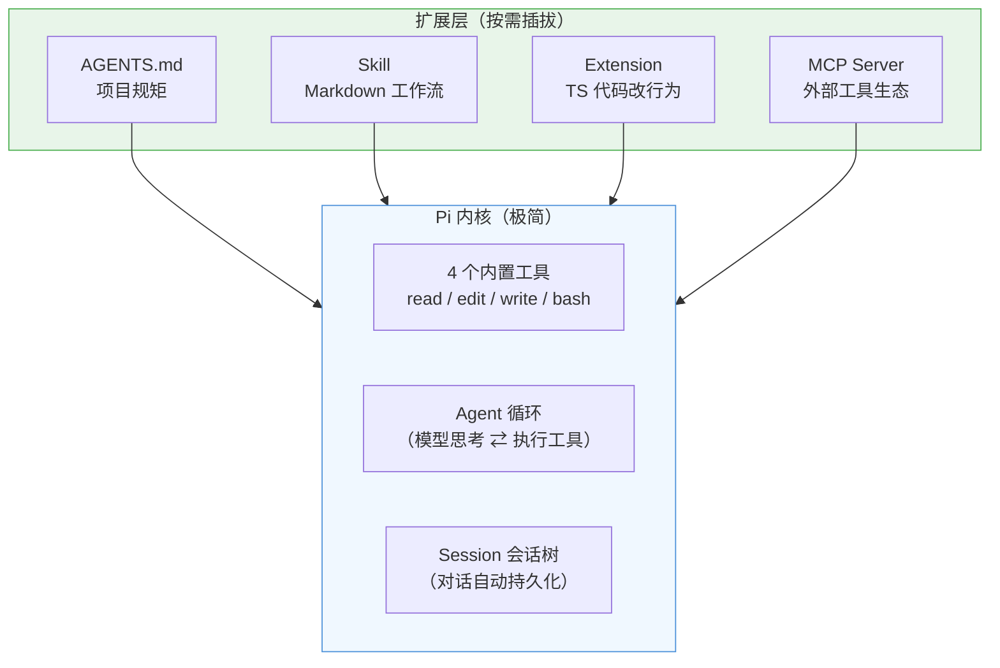
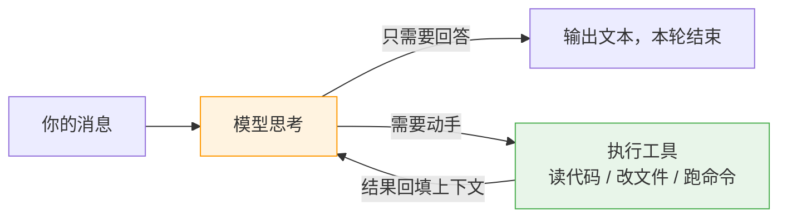
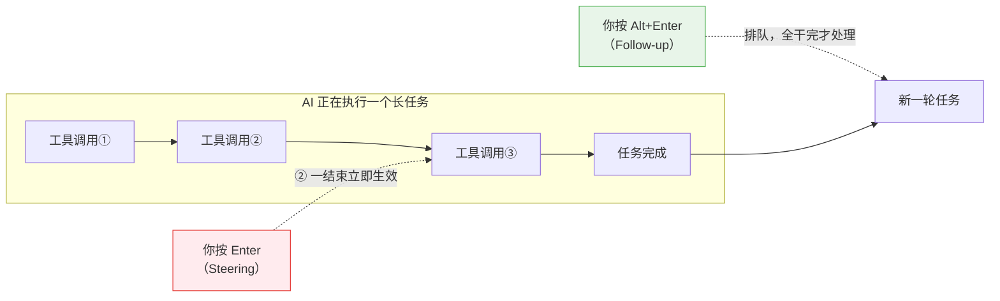
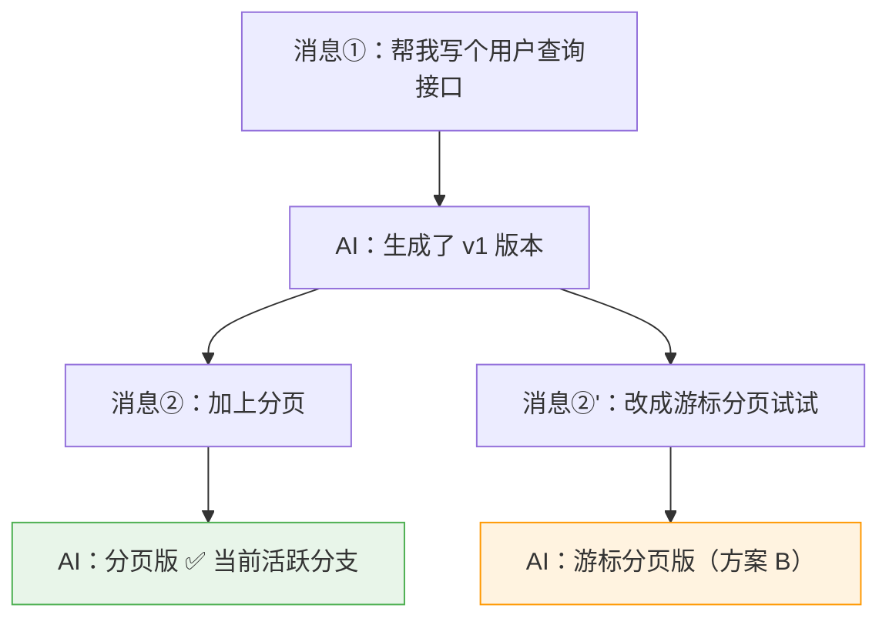
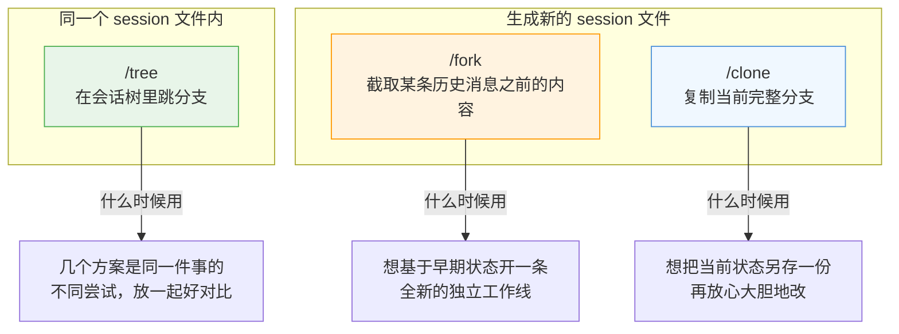
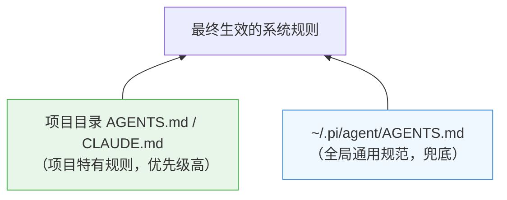
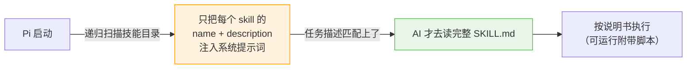
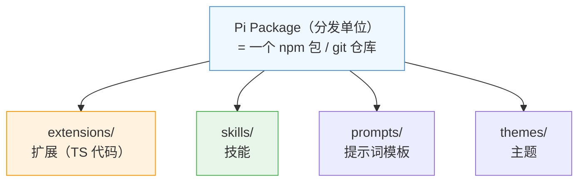
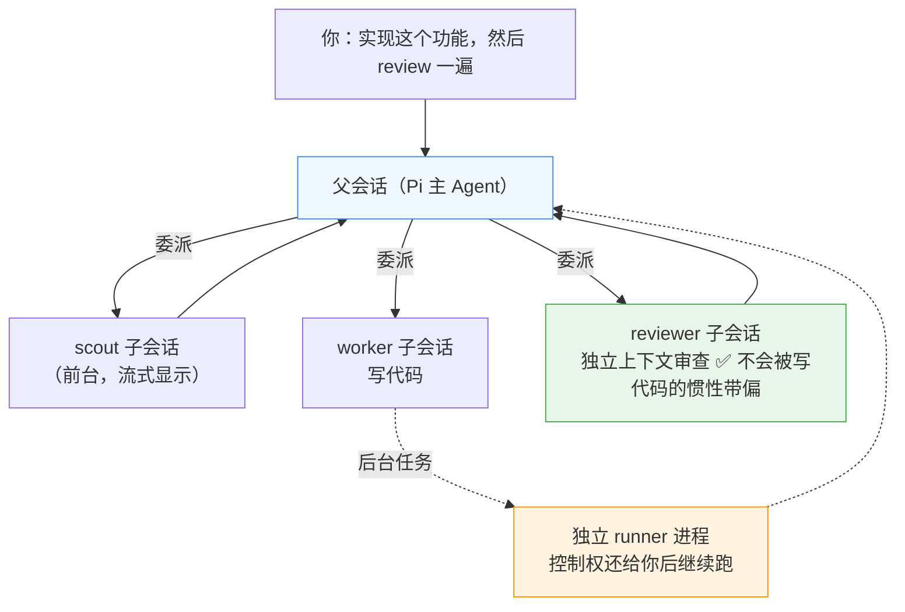

# Pi Agent 上手实战：一个"核心极简、一切皆扩展"的终端 AI 编程助手

> 💡 **核心认知**：Pi 是一个跑在终端里的开源 AI 编程 Agent。它的设计哲学和 Claude Code 这类"全家桶"完全相反——**核心只给你 4 个工具（读文件、改文件、写文件、跑命令），其余一切（规则、技能、插件、MCP）都是可插拔的扩展**。所以上手 Pi 的过程，其实就是"按需给自己组装一个趁手工具"的过程。
>
> 官方文档：https://pi.dev/docs

---

## 一、先跑起来：安装、启动、配模型

```bash
# 安装（二选一）
npm install -g --ignore-scripts @earendil-works/pi-coding-agent
curl -fsSL https://pi.dev/install.sh | sh

# 进到你的项目目录，启动
cd /your/project
pi
```

启动后是个 TUI 聊天界面，第一件事是配模型：

```bash
/login    # OAuth 登录（Claude/ChatGPT 订阅可直接复用）或填 API Key
/model    # 切换模型，快捷键 Ctrl+L
```

> 💡 如果你之前用过 Claude Code，项目里已有的 `CLAUDE.md` 会被 Pi 直接识别，**零迁移成本**。

还有一个不常用的细节但值得知道：Pi 启动时会自动加载当前目录及父目录的 `AGENTS.md` / `CLAUDE.md` 当上下文，这是下一节要讲的"定规矩"的基础。

---

## 二、理解 Pi：一个极简内核 + Agent 循环

### 2.1 内核到底有多大？

很多人第一次看 Pi 文档会觉得"这也太简陋了"——没错，**简陋是故意的**。Pi 内核只有四个内置工具和一套 Agent 循环，其他能力全靠外挂：



### 2.2 Agent 循环：它是怎么干活的

你发一条消息之后，Pi 内部就是这么转的：



模型每轮要么直接回话，要么发起工具调用；工具结果回填给模型继续想，直到它认为任务完成。**理解了这个循环，后面所有高级玩法（steering、session 树、扩展）都是在往这个循环的不同位置插东西。**

---

## 三、日常操作：喂信息、中途插手、贴图提问

### 3.1 交互模式 vs Print 模式

```bash
pi                        # 交互模式：进 TUI 边聊边改
pi -p "总结这个项目的架构"   # Print 模式：一次性问答，输出完就退出
```

Print 模式是 Pi 被低估的功能——它能吃到 Unix 管道里，直接当流水线中的一个"AI 步骤"用：

```bash
pi -p "这段代码有什么问题 @src/main.js"     # @file 是 Pi 原生的文件引用语法
cat data.csv | pi -p "这个 CSV 有几列？"    # 管道喂数据
git diff | pi -p "帮我写 commit message"   # 最实用的组合
```

### 3.2 `!` 和 `!!`：在对话框里直接跑命令

| 命令 | 行为 | 什么时候用 |
| :--- | :--- | :--- |
| `!git diff` | 执行命令，**输出发给 AI** | 让 AI 基于命令结果分析 |
| `!!ls -la` | 执行命令，**只给你自己看** | 单纯查个东西，不浪费 token |

以前你得开另一个终端跑命令 → 复制输出 → 粘回 Pi，现在一个 `!` 搞定。

### 3.3 Steering：AI 跑偏了，中途掰方向盘 ⭐️

这是 Pi 交互体验上最爽的功能。AI 正在干活时你可以随时插话，而且有两种插法：



两个真实场景：

```
场景一：AI 正在批量改 20 个文件，改到第 5 个你发现方向不对
→ 输入"不要改 XML 文件，只改 Java 文件" → 按 Enter
→ 当前这个文件改完，AI 立即调头 ✅（不用 Esc 打断重来）

场景二：AI 在写单元测试，你想让它写完顺便跑一下
→ 输入"写完测试后执行 mvn test" → 按 Alt+Enter
→ 消息进队列，AI 干完手头的活自动接着做 ✅
```

> 💡 记住一句话就行：**Enter 是"等一下，换个方向"，Alt+Enter 是"干完活记得顺便做这个"**。排队的 Follow-up 用 Alt+↑ 撤销，真跑飞了用 Esc 硬打断。

### 3.4 截图直接 Ctrl+V 粘贴提问 🖼️

前端页面报错、设计稿还原度、终端里的报错截图——都不用先存成文件再发路径，**截图后在 Pi 输入框里直接 Ctrl+V**（Windows/WSL 上是 Alt+V），剪贴板里的图片、文件、文本都能粘进去，模型直接"看图"回答。

除此之外还有两条途彆：

| 方式 | 用法 | 场景 |
| :--- | :--- | :--- |
| 剪贴板粘贴 | 截图 → **Ctrl+V** | 最快的姿势，随截随问 |
| `@路径` 引用 | `这个报错怎么回事 @imgs/error.png` | 图片已存成文件 |
| 让 AI 自己读 | "看一下 screenshot.png 里是什么" | 内置 `read` 工具支持 png/jpg/gif/webp |

Pi 甚至能在终端里**内联显示图片**（自动检测 kitty / iTerm2 图片协议），AI 生成的图、读出来的图直接在 TUI 里渲染，不用切窗口看。检测不准时可用 `PI_IMAGE_PROTOCOL=kitty|iterm2|none` 或 `terminal.images` 设置强制指定。

> ⚠️ 看图能力取决于当前模型是否支持视觉输入（Claude/GPT-4o/Gemini 等主流模型都支持），另外粘贴图片依赖终端把 Ctrl+V 交给 Pi 处理，如果被终端自己的粘贴占用了，可用 `/hotkeys` 查看、改键。

### 3.5 值得记的快捷键（其他用到再查）

| 快捷键 | 作用 |
| :--- | :--- |
| **Enter / Alt+Enter** | Steering / Follow-up（见上） |
| **Esc** | 中断当前任务 |
| **Ctrl+V** | 粘贴剪贴板里的图片/文件/文本 |
| **Ctrl+G** | 用外部编辑器（vim/nano）写长提示词 |
| **Ctrl+L** | 切换模型 |
| **Ctrl+T / Ctrl+O** | 显示思考块 / 展开工具调用输出 |

---

## 四、Session 会话管理：对话是一棵树，不是一条线 ⭐️⭐️

这是 Pi 最大的亮点，也是我认为比 Claude Code 做得好的地方。

### 4.1 为什么"树"很重要？

用 AI 写代码经常遇到这种事：让 AI 按方案 A 改了一通，效果不好，想回到 20 分钟前试试方案 B——但对话是线性的，回去就意味着**丢掉方案 A 的所有工作**。

Pi 的 session 天生是一棵树：**每条消息是树上的一个节点，从任意历史节点重新出发，会长出一条新分支，老分支原封不动地保留着**。



发给模型的上下文永远只是**当前活跃分支**这一条路径，其他分支不占 token、但也不丢。方案 A 和方案 B 可以随时来回切换对比，这在改需求、试设计时非常好用。

### 4.2 常用命令
一个工作空间里面可能我们有多个历史会话记录，我们可以切换到指定的会话进行继续聊。

```bash
pi --continue        # 直接续上本目录最近一次会话（最常用）
pi --resume          # 打开会话选择器（可搜索、重命名、删除）
```

会话内：

| 命令 | 作用 |
| :--- | :--- |
| `/new` | 开新会话，也就是创建一个新的 session，我们每次在一个目录下面开启一次会话然后退出就算一个 session |
| `/resume` | 打开会话选择器 |
| `/tree` | **可视化会话树，跳到任意历史节点** 注意文件不会一起回退|
| `/fork` | 从某条历史用户消息分叉出一个**新 session 文件** |
| `/clone` | 把当前分支完整复制成一个新 session |
| `/name` | 给会话起个名字，方便以后 resume 时找 |
| `/session` | 看当前会话的文件路径、消息数、token、花费 |
| `/compact` | 手动压缩上下文（见 4.4） |

### 4.3 /tree 实操：怎么"回到过去"

`/tree` 会画出上面那样的树，然后：

- **选中一条你自己发的消息** → 消息文本回到输入框 → 你改一改再提交 → 长出平行分支（就是上图的"消息②'"）；
- **选中 AI 的回复** → 直接跳到那个时间点继续聊。

更妙的是：当你离开一条分支时，Pi 可以**把被放弃的分支总结成一段摘要，挂到你跳过去的新位置上**——方案 A 里踩过的坑、得出的结论不会白丢，但也不用把几十条消息全带上。

### 4.4 /tree、/fork、/clone 怎么选



### 4.5 上下文快满了怎么办：Compaction

TUI 底部实时显示上下文占用。快满时 Pi 会**自动压缩**：把老消息总结成一段摘要，保留最近的消息。关键点：

- 压缩**只影响发给模型的内容，不会删 session 文件里的原始记录**——随时可以 `/tree` 回去看原文；
- 可以手动 `/compact`，还能带要求：`/compact 保留数据库表结构的讨论`；
- session 默认存在 `~/.pi/agent/sessions/`，按工作目录分组，就是普通 JSONL 文件，想备份/检索/grep 都行。

> 💡 另外 `pi --no-session` 可以跑一次性不留痕的会话，`/export` 能把会话导出成 HTML/JSONL 存档或发人。

---

## 五、AGENTS.md：给 AI 定规矩

规矩分两层，Pi 会**从当前目录向上一路收集**，全部合并生效：



**全局**放通用编码规范（注释用中文、改完代码必须跑测试）；**项目级**放硬约束，写得越具体越好：

```markdown
# 本项目规则

## 文件操作需先确认（重要）
修改任何文件之前，先列出变更计划并获得我的确认。

## 技术栈约束
- 必须使用 Java 17，不要使用更高版本的 API
- 数据库查询必须使用 JPA Criteria API，不要写原生 SQL

## 禁止事项
- 不要自行添加第三方依赖
- 不要修改 application.yml 中的数据库配置
```

> 💡 `AGENTS.md`、`CLAUDE.md` 都认，改完之后在会话里执行 `/reload` 立即生效，不用重启。规矩文件建议进 Git，团队共享。

---

## 六、SKILL：给 Pi 装"技能包"

Skill 是给 AI 的"某类专业活怎么干"的说明书——一个包含 `SKILL.md` 的目录，可以附带脚本和参考资料。Pi 内核极简，**Skill 就是官方推荐的、不需要写代码的能力扩展方式**。

### 6.1 先理解加载机制，你就知道怎么写了



启动时**只挂个"目录"，不占上下文**；匹配上了才加载全文。所以 `description` 是命门——它决定 AI 什么时候想起你。写"帮忙处理 PDF"这种模糊话 AI 永远不会触发；要写"**提取 PDF 文本和表格。当需要读取、转换或检查 PDF 时使用**"。

### 6.2 安装方式一：扔进技能目录（最简单）

把 skill 目录放到下面任意一个位置，重启（或 `/reload`）即被发现：

| 位置 | 作用范围 | 说明 |
| :--- | :--- | :--- |
| `~/.agents/skills/<名字>/` | 所有项目 | ⭐️ **Agent Skills 通用标准目录**，Claude Code 等工具也读这里，装一次多工具共用 |
| `~/.pi/agent/skills/<名字>/` | 所有项目 | Pi 自己的用户级目录 |
| `<项目>/.agents/skills/<名字>/` | 当前项目 | 从工作目录向父目录逐级发现 |
| `<项目>/.pi/skills/<名字>/` | 当前项目 | 需先授予项目信任 |

```bash
# 例：手动装一个 pdf-tools
mkdir -p ~/.agents/skills/pdf-tools
# 把 SKILL.md（以及 scripts/、references/ 等）放进去，完事
```

验证装没装上：会话里敲 `/skill:` 看能不能补全出来，或者直接 `/skill:pdf-tools 提取 report.pdf 的表格` 强制触发。

### 6.3 安装方式二：`pi install`（第三方发布的包）

先分清两个容易混的概念：**Package 是"包装盒"，Skill/Extension 是盒子里的"货"**。一个 Pi Package 就是一个普通的 npm 包或 git 仓库，里面可以同时装四种资源：



官网的包画廊 https://pi.dev/packages 里可以按 extension / skill / theme / prompt 四种类型筛选，每个包都直接给出 `pi install npm:xxx` 的安装命令。安装源有四种写法：

```bash
pi install npm:@example/pi-tools@1.0.0        # 从 npm 装（可锁版本）
pi install git:github.com/example/pi-tools@v1 # 从 git 装（可锁 tag/commit）
pi install ./my-tools                         # 本地目录/文件：原地加载不复制，适合自己开发的 skill/扩展
pi -e npm:@example/pi-tools                   # 只试用一次，不写入配置
```

本地路径源有两个特点：改完源码 `/reload` 即生效，不用反复重装（注意本地包的依赖 Pi 不管，用了第三方库得自己在包目录 `npm install`）；相对路径以记录它的那份 settings.json 为基准解析。

### 6.4 全局装还是项目装？—— `-l` 参数

这是最容易搞混的一个点，它和上面的"本地路径源"是两码事：`-l` 控制的是**安装范围**。默认是全局（用户级）安装，加 `--local`（简写 `-l`）变成项目级安装：

```bash
pi install npm:@example/pi-tools@1.0.0        # 声明写入 ~/.pi/agent/settings.json，所有项目可用
pi install npm:@example/pi-tools@1.0.0 -l     # 声明写入 <项目>/.pi/settings.json，只对这个项目生效
```

| | 默认（全局） | `-l`（项目级） |
| :--- | :--- | :--- |
| 声明写在哪 | `~/.pi/agent/settings.json` | `<项目>/.pi/settings.json` |
| 生效范围 | 你机器上所有项目 | 仅当前项目 |
| 能否随 Git 分发 | ❌ 只在你自己机器上 | ✅ 提交后队友 clone 即得 |
| 加载前提 | 无 | 需先授予项目信任（project trust） |

> ⚠️ **一个常见误解要纠正**：`-l` 并不会把包的文件拷进项目目录。npm/git 包的实体永远装在 Pi 自己的缓存目录下，`-l` 只是把"这个项目要用哪个包、哪个版本"这条**声明**写进项目的 `.pi/settings.json`。队友拉代码后首次运行 pi，Pi 按声明自动把包装到他自己的缓存里（所以信任授予前会提醒你检查声明）。

`-l` 最有价值的两个场景：

1. **团队统一工具链**：`pi install npm:pi-subagents -l` 后把 `.pi/settings.json` 提交进 Git，全组人的 Pi 能力对齐，版本也锁死；
2. **自研扩展随仓分发**：把 skill/扩展代码放在仓库里，再用本地路径源 + `-l` 安装：`pi install ./.pi/extensions/my-tools -l`——声明和代码都跟着仓库走，clone 即用。

对应地，`remove` / `config` 也分范围：项目级装的包要用 `pi remove -l <source>` 卸、`pi config --local` 管，否则 Pi 会去用户级配置里找。同一个包两边都声明了时，项目级条目覆盖全局条目。

### 6.5 卸载与更新

```bash
pi list                            # 先看装了哪些包（source 以这里显示的为准）

pi remove npm:pi-subagents         # 卸载：删掉配置条目和安装的文件
pi remove npm:@example/pi-tools@1.0.0  # 带不带版本号都行：npm 包按包名识别，git 包按仓库地址，本地包按绝对路径
pi remove ./my-tools               # 本地包同样用 source 卸
pi uninstall <source>              # remove 的别名，完全等价

pi update --extensions             # 更新所有已装的包
pi update npm:@example/pi-tools    # 只更新某一个
pi update --all                    # Pi 本体 + 所有包一起更新
```

> 💡 不想彻底卸载、只是暂时不想用某个 skill/扩展，用 `pi config` 面板单独禁用更灵活（项目级配置用 `pi config --local`）。

去哪找现成的 skill：

| 来源 | 地址 |
| :--- | :--- |
| Pi 官方包画廊 | https://pi.dev/packages |
| Anthropic 官方技能集 | https://github.com/anthropics/skills |
| Pi 社区技能集 | https://github.com/badlogic/pi-skills |

> ⚠️ **安全提示**：skill 可以指挥 AI 跑脚本，扩展包更是直接执行代码。第三方包装之前先看一眼源码，尤其是项目级 `.pi/settings.json` 里声明的东西，授予信任前务必检查。

---

## 七、Extension 与 MCP：要改 Pi 本身的行为时才用

Skill 只能"教"AI，如果你想**改变 Pi 内核的行为**——注册一个新工具、加个斜杠命令、拦截危险命令、在状态栏显示东西——就得写 Extension（TypeScript）。

### 7.1 Extension

加载方式和 skill 一个套路：

```bash
# 1. 扔进扩展目录自动加载
#    用户级：~/.pi/agent/extensions/hello.ts
#    项目级：<项目>/.pi/extensions/hello.ts

# 2. 开发调试：单次加载（内置 jiti，TS 不用编译）
pi --extension ./hello.ts

# 3. 正式发布：打成 Pi Package 走 pi install（同 6.3）
```

最小示例——注册一个 `/hello` 命令：

```typescript
import type { ExtensionAPI } from "@earendil-works/pi-coding-agent";

export default function (pi: ExtensionAPI) {
  pi.registerCommand("hello", {
    description: "Show a greeting",
    handler: async (name, ctx) => {
      ctx.ui.notify(`Hello, ${name || "world"}!`, "info");
    },
  });
}
```

能力上限很高：`pi.registerTool()` 给模型加新工具、`pi.on()` 拦截每次工具调用（比如"rm -rf 必须人工确认"）、`pi.registerProvider()` 接自定义模型源。

> ⚠️ 扩展跑在 Pi 进程里，权限和 Pi 一样，能看到你的提示词、文件和凭据。**只装可信来源的扩展**。官网（https://pi.dev/packages） 有一些有用的拓展

### 7.2 让 Pi 给自己写扩展：最好玩的玩法 ⭐️

前面说过 Pi 官方 README 的那句话："Ask Pi to build what you want"——这不是客套话，而是 Pi 生态真正的打开方式：**扩展不需要你自己会写 TypeScript，直接把需求说给 Pi，它写完放进扩展目录就能用**。Pi 自己就带着完整的扩展 API 文档和几十个官方示例，写这种东西属于降维打击。

实战一例：我想要"每次打开 Pi，终端底部状态栏显示我 IP 所在城市的天气和当前日期"。新建一个空目录启动 pi，直接说：

```
帮我写一个 Pi 扩展：session_start 时请求 wttr.in（免 API key，按 IP 自动定位），
在底部状态栏显示天气和今天的日期，网络失败时显示 weather unavailable，
写到 ~/.pi/agent/extensions/weather-status.ts
```

Pi 生成的核心代码大致长这样（已实测可跑）：

```typescript
import type { ExtensionAPI } from "@earendil-works/pi-coding-agent";

export default function (pi: ExtensionAPI) {
  pi.on("session_start", async (_event, ctx) => {
    if (ctx.mode !== "tui") return;
    const theme = ctx.ui.theme;
    ctx.ui.setStatus("weather", theme.fg("dim", "loading weather..."));
    try {
      const res = await fetch("https://wttr.in/?format=3", {
        signal: AbortSignal.timeout(5000),   // 5 秒超时，网络差也不卡启动
      });
      const weather = (await res.text()).trim();          // "Beijing: ☀️ +18°C"
      const date = new Date().toLocaleDateString("zh-CN", {
        year: "numeric", month: "2-digit", day: "2-digit", weekday: "long",
      });
      ctx.ui.setStatus("weather", `${theme.fg("accent", weather)} | ${date}`);
    } catch {
      ctx.ui.setStatus("weather", theme.fg("error", "weather unavailable"));
    }
  });
}
```

重启 pi（或 `/reload`），底部状态栏就永久挂上了天气和日期。用到的 API 就两个：`pi.on("session_start")` 监听会话启动事件，`ctx.ui.setStatus(key, text)` 往底栏挂一段常驻文本。

这个玩法的价值在于**把"我想要个小功能"到"功能上线"的距离压缩到一句话**。官方示例库里还有一堆可以抄灵感的东西：会话退出时自动 git commit、危险命令二次确认、回合完成发系统通知、状态栏显示 model/turn 信息……甚至还有 snake.ts、space-invaders.ts、doom-overlay——在终端里玩贪吃蛇、太空侵略者、DOOM。

> ⚠️ 两个提醒：① 扩展在 Pi 进程内全权限运行，Pi 生成的代码也要自己过一眼再留用（尤其别让它顺手读你的凭据文件）；② 需求里把"写到哪个路径、用哪个事件、失败怎么降级"说清楚，一次就能到位，这和让 AI 写业务代码是一个道理。

### 7.3 MCP

MCP 是 Pi 的**内置能力**，不需要装任何扩展（早期版本确实没有，后来官方内置了），命令行两下就配好；不想用时 `--no-mcp` 可单次关闭：

```bash
# 本地 stdio 服务器
pi mcp add filesystem -- npx -y @modelcontextprotocol/server-filesystem .

# 远程 HTTP 服务器
pi mcp add docs --url https://example.com/mcp --bearer-token-env-var DOCS_TOKEN

pi mcp list    # 查看已配置的服务器
```

会话内用 `/mcp` 看连接状态、登录、启停。配置文件在 `~/.pi/agent/mcp.json`（用户级）和 `.pi/mcp.json`（项目级），格式和 Claude 等其他 MCP 客户端兼容，配置可以直接抄。

### 7.4 生态案例：pi-subagents —— 把 Pi 没有的多 Agent 能力补上

Pi 官方 README 里有句话很坦诚：

> "Pi ships with powerful defaults but **skips features like sub-agents and plan mode**. Ask Pi to build what you want, or install a package that does it your way."

也就是说，和 Claude Code 内置 subagent 不同，**Pi 故意不做多 Agent**（作者认为大多数场景单 agent 就够），缺的能力交给扩展生态。社区最火的补位方案就是 `pi-subagents`（月下载 57 万+，需 Pi ≥ 1.2.0）：

```bash
pi install npm:pi-subagents
```

它的模型是**父会话委派子会话**：Pi 主会话当"包工头"，子 agent 是带独立任务的子 Pi 会话，干完把结果带回来：



**内置 7 个角色**，开箱即用：

| 角色 | 干什么 |
| :--- | :--- |
| `scout` | 代码侦察：相关文件、入口、数据流、风险点 |
| `researcher` | 联网查资料，带来源的调研简报 |
| `evidence-auditor` | 独立核查调研结论是否真有依据 |
| `worker` | 实现代码，拿不准的决策会上报而不是瞎猜 |
| `reviewer` | 对照任务/测试/边界条件审查代码 |
| `oracle` | 动手前的第二意见，专门挑战你的假设 |
| `delegate` | 轻量通用委托 |

**用法零学习成本**——不用记任何命令，自然语言说就行，Pi 自己决定要不要调 `subagent` 工具、用哪个角色：

```
"Use reviewer to review this diff"
"让 oracle 挑战一下我这个方案的假设"
"Run parallel reviewers: 一个看正确性，一个看测试，一个看过度设计"
"实现完这个功能后，用 reviewer 审一遍再总结"（也可以写进 AGENTS.md 变成固定规矩）
```

进阶玩法：推荐的开发闭环是 `clarify → scout → worker → 全新 reviewer → worker`（审查者用干净上下文，不会被写代码时的妥协带偏）；`/parallel-review`、`/review-loop`（审到干净为止，可限轮数）等快捷命令；`/council` 能拉多个不同模型开"议会"辩论重大决策。运维侧：TUI 底部的 FleetView 实时显示子任务，`/subagents-fleet` 可以看子 agent 的完整 transcript、中途 steering、叫停；`/subagents-doctor` 一键自检。

> ⚠️ 子 agent 是真金白银在烧 token：并行开几个 reviewer，费用就是几倍。好在它默认有护栏（单次运行最多 64 个子 agent，可配置），后台任务也能随时叫停。

这个案例很好地诠释了 Pi 的哲学：**内核不做的，生态补；补的方式就是前面讲的 Extension + Package 那套机制**。

### 7.5 三种扩展方式怎么选

| | Skill | Extension | MCP |
| :--- | :--- | :--- | :--- |
| 形态 | Markdown 说明书 + 脚本 | TypeScript 代码 | 独立进程/服务 |
| 门槛 | 会写文档就行 | 会写 TS | 找现成的服务器 |
| 改变什么 | AI 的"知识/流程" | Pi 内核的行为 | Pi 可用的工具集 |
| 典型场景 | "怎么处理 PDF""Dockerfile 怎么写" | 危险命令确认、企业内部 API | filesystem、GitHub、数据库等社区服务器 |

**选择顺序建议**：能用 Skill 解决就别写 Extension，有现成 MCP 服务器就别自己造轮子。

---

## 八、一页速查

| 你想干嘛 | 怎么做 |
| :--- | :--- |
| 续上昨天的会话 | `pi --continue`；找特定会话用 `pi --resume` |
| 回到历史某一步换个方案 | `/tree` 跳到那条消息，改完重发，长出新分支 |
| 基于早期状态开新工作线 | `/fork` |
| AI 跑偏了立即纠正 | 输入新指令 + **Enter**（Steering） |
| 给 AI 派"干完这个再干那个" | 输入指令 + **Alt+Enter**（Follow-up） |
| 让 AI 看命令输出 | `!git diff` |
| 截图提问 | 截图 → 输入框 **Ctrl+V** 直接粘贴；或 `@imgs/xxx.png` |
| 上下文快满了 | `/compact`（原始记录不会丢） |
| 定项目规矩 | 项目根目录写 `AGENTS.md`，改完 `/reload` |
| 装技能包 | 拷进 `~/.agents/skills/` 或 `pi install npm:...` |
| 管理已装的包 | `pi list` / `pi remove <source>` / `pi update --extensions` / `pi config` |
| 项目级装包（随 Git 分发给团队） | `pi install <source> -l`；卸载对应 `pi remove -l <source>` |
| 边开发边调自己的 skill/扩展 | `pi install ./本地目录`（原地加载不复制，改完 `/reload` 即生效） |
| 接 MCP 服务器 | `pi mcp add <名字> -- <命令>` |
| 想要个小功能但不会写 TS | 直接把需求说给 Pi，让它生成扩展到 `~/.pi/agent/extensions/`，`/reload` 生效 |
| 多 Agent（子 agent 委派/并行审查） | 原生不支持，装 `pi install npm:pi-subagents` |
| 脚本/管道里用 AI | `pi -p "提示词"`，支持 `@file` 和 stdin 管道 |
| 一次性会话不留痕 | `pi --no-session` |
