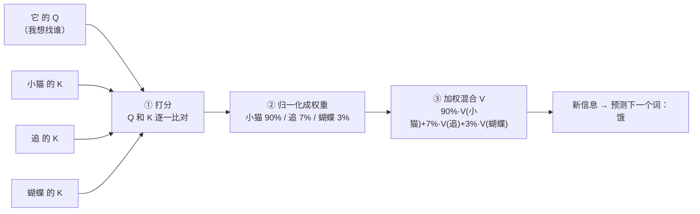
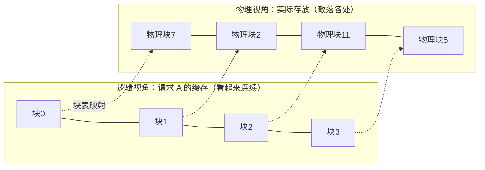

# VLLM 大模型计算加速基本原理

> 一句话：LLM 服务的瓶颈往往不是"算不动"，而是"存不下、排不好"。vLLM 靠三招——分页管显存、随到随服务、共享前缀——把吞吐量拉到 HuggingFace Transformers 的 24 倍。

## 零、先搞清定位：vLLM 是什么、不是什么

一个常见误解：以为 vLLM 是加在大模型前面的一层"加速代理"。**不是。**

```
误解（中间层）：
  客户端 → vLLM → 原来的大模型服务 → GPU        ❌ vLLM 不做代理转发

实际（引擎替换）：
  客户端 → vLLM（自己加载权重、自己算）→ GPU      ✅
```

大模型权重还是同一份（HuggingFace 下载的那堆文件），但**加载权重、执行推理、管理并发请求这一整套活全由 vLLM 干**。它替换的是 HuggingFace Transformers / TGI 这类推理引擎的角色。

> 💡 后端类比：**不是"加个 Nginx"，是"把 Tomcat 换成 Netty"**——同一份业务代码（模型权重），换了个执行引擎，并发能力完全不一样。

| 场景 | 适合用 vLLM 吗 |
| :--- | :--- |
| 自建 API 给多用户/业务方调（Agent 后端、客服系统） | ✅ 最典型 |
| RAG、多轮对话（前缀重复多） | ✅ prefix caching 白拿加速 |
| 单机自己玩、偶尔问一句 | ❌ Ollama 更省心 |
| 模型训练 | ❌ vLLM 只管推理 |
| 路由/代理多个模型（转发到 OpenAI、本地混着来） | ❌ 那是 LiteLLM/网关的活，vLLM 是被转发的那一端 |

## 一、先搞懂：大模型是怎么"说话"的

要看懂 vLLM 在优化什么，得先搞懂两件事：**大模型怎么生成文字**，以及**注意力机制里的 K 和 V 是什么**。后面所有优化都是围绕它们展开的。

### 1.1 大模型是一个词一个词往外蹦的

ChatGPT 回答问题时，并不是"想好一整句话"再发给你，而是**像接龙一样，一次只蹦一个词**：

```
输入：中国的首都是
第 1 步：中国的首都是 → "北"      ← 模型只预测下一个词
第 2 步：中国的首都是北 → "京"    ← 把预测结果拼回去，再预测下一个
第 3 步：中国的首都是北京 → "。"
...
```

每蹦一个词，都要把"目前所有的内容"完整过一遍模型，这叫**自回归生成**。

这个特性带来一个关键点：**生成第 100 个词时，模型要重新"看"前面 99 个词**。怎么看？靠注意力机制。

### 1.2 注意力机制：每个词都要"抬头看"前面的词

#### 先回忆 RNN 的痛点（从这里最容易理解注意力）

你知道 RNN 怎么处理句子——**像传话游戏**：

```
小猫 →(隐状态)→ 追 →(隐状态)→ 蝴蝶 →(隐状态)→ 它
```

每个词只把信息传给下一个词，一步步往后递。问题来了：句子一长，"它"想引用句首的"小猫"，信息却要经过一长串传递，**逐步被稀释、覆盖**——传到最后，"小猫"的信息可能只剩一点残影。这就是 RNN 搞不定长文本的根源。

Transformer 的解法简单粗暴：**别传话了，每个词直接"看"所有词**：

```
RNN（传话游戏）：
  小猫 → 追 → 蝴蝶 → 它         信息一步步稀释，越远越模糊

注意力（直接看）：
  小猫    追    蝴蝶
    \      |     /
     \     |    /              "它"一次性看到所有词
      \    |   /               想重点看谁，由"注意力分数"决定
        "它"
```

剩下的问题只有一个：**"看"具体是什么操作？** 这就轮到 Q、K、V 出场了。

#### Q、K、V：每个词的"问题、标签、内容"

先铺垫一个事实：模型里每个词都被表示成**一串数字（词向量）**——含义相近的词，向量也相近，"猫"和"狗"的向量离得近，和"石头"离得远。

每个词的向量会分别乘上三个**训练出来的矩阵**（\(W_Q\)、\(W_K\)、\(W_V\)），得到三串新数字：

| 角色 | 图书馆类比 | 大白话 |
| :--- | :--- | :--- |
| Q（Query） | 你写在小纸条上的检索需求 | 我现在想找什么 |
| K（Key） | 每本书的书名/标签 | 我是什么、能被怎么检索到 |
| V（Value） | 书的实际内容 | 如果你选中我，我能提供的内容 |

**为什么非得分三个，不能直接拿词向量互相比对？** 因为"我想找什么"和"我是什么"是两回事（Q 和 K 要分开），"标签"和"内容"也是两回事（K 和 V 要分开）——书名不等于书的内容。拆成三个角色，模型才能自由学出"什么样的需求和什么样的标签相匹配"。

#### 完整流程走一遍（真实例子）

句子："**小猫追蝴蝶，因为它___**"，现在模型要生成下一个词。核心是搞清楚：**"它"指的是谁？**（是猫饿了还是蝴蝶饿了？）

**第一步：打分**——拿"它"的 Q，和前面每个词的 K 逐一比对（算点积，可理解为"两串数字的相似度"）：

```
"它"的 Q vs 各词的 K：
   K(小猫) ──很匹配──  得 5.0 分
   K(追)   ──不太匹配── 得 0.5 分
   K(蝴蝶) ──不太匹配── 得 0.3 分
```

**第二步：归一化**——把分数换算成加起来等于 100% 的权重（softmax）：

```
   小猫: 90%     追: 7%     蝴蝶: 3%
```

**第三步：加权混合**——按权重把各词的 V 混合起来：

```
   "它"吸收的新信息 = 90% × V(小猫) + 7% × V(追) + 3% × V(蝴蝶)
```

90% 的注意力给了"小猫" → "它"的表示里灌满了猫的信息 → 模型明白了"它 = 小猫" → 下一个词大概率生成"饿"。



> 💡 一句话：**注意力 = 拿着新词的问题（Q），去前面所有词的标签（K）里挨个打分，再按分数把各词的内容（V）加权混合回来。**

#### 伏笔：为什么 K 和 V 值得缓存

注意一个关键细节：**旧词的 K 和 V 算过一次之后就永远不会变**——词定了、矩阵参数也定了（训练完就固定），"小猫"的 K/V 算一万遍还是同一个结果。

而每一步真正"新"的东西，只有**新词自己的 Q**（以及新词的 K、V，留给再下一个词用）。

这就为下一节埋下伏笔：旧 K/V 既然不变，何必每步重算？**存起来就行——这就是 KV Cache。**

### 1.3 KV Cache：省计算，但费显存

上面流程里藏着一个天大的浪费：

> **前面那些词的 K 和 V，每次都被重新算了一遍。**

而它们根本不会变——"中国的首都是"这几个词既然定了，它们的 K、V 就是固定的，算一遍就够了。

所以推理引擎都会做 **KV Cache（键值缓存）**：把历史词算出来的 K 和 V 存在显存里，生成新词时直接拿来用，只算新词自己的那一份。

```
没有 KV Cache：生成第 N 个词，要重算前面 N-1 个词的 K、V → 平方级的重复计算
有 KV Cache：  生成第 N 个词，只算新词的 K、V，前面的读缓存 → 线性级计算
```

计算省了，代价是**显存开始爆炸**：

- 官方数据：LLaMA-13B **一个序列**的 KV Cache 最大能到 **1.7GB**——注意这只是一个请求！
- 100 个并发请求同时来，光缓存就可能上百 GB，而模型权重本身才 26GB
- 更麻烦的是它**大小不可预测**：请求进来之前，你根本不知道它会生成 10 个词还是 10000 个词

**KV Cache 又大、又动态、又不可预测——这是所有推理框架头疼的根源，也是 vLLM 的主战场。**

## 二、传统做法的三大痛点

### 2.1 痛点一：显存浪费 60%~80%（碎片 + 过度预留）

传统框架（早期 HuggingFace、TGI）的做法：**每个请求一进来，就按"最大可能长度"预留一整块连续显存**。

类比：餐厅按"大胃王标准"给每桌留座——不管你实际吃多少，先按"最多吃 10 碗饭"给你留 10 个位置。

造成两种浪费：

```
内部碎片（预留太多）：
  按最大 2048 个词预留 ─────────────────────────┐
  实际生成 200 个词    ████████░░░░░░░░░░░░░░░  ← 后面 90% 空着没人用

外部碎片（缝隙塞不下）：
  ┌────请求A────┐░░┌─请求B─┐░░░░┌──请求C──┐░░
  长度不一的请求之间留下碎隙，新请求塞不进去
```

vLLM 团队实测：**60%~80% 的显存就这么白白浪费了**。

连锁反应：显存浪费 → 同一张卡能同时服务的请求变少 → GPU 每次只算几个请求的任务，吃不饱 → 吞吐量上不去。

### 2.2 痛点二：静态批处理——短请求陪长请求"坐牢"

GPU 喜欢一次算一批请求（批处理，吞吐高）。传统做法是**攒一批，一起跑，全部跑完再接下一批**。

问题是：一批请求的生成长度天差地别。有人问"1+1=?"（蹦 5 个词就完了），有人要"写一篇 2000 字的周报"。

```
静态批处理（一批 5 个请求）：
  请求1 ████████░░░░░░░░░░░░░░░░░░  ← 早就完成了，还在"占座"
  请求2 ██████░░░░░░░░░░░░░░░░░░░░  ← 早就完成了
  请求3 ███████████████████████████  ← 还在生成
  → 前面完成的请求座位空转，直到最长的跑完成，整批才结束
```

类比：拼车出游，先到目的地的人**不能下车**，必须陪最后那个人坐到终点，车才能拉下一趟。

### 2.3 痛点三：相同前缀，人人重算一遍

线上服务几乎每个请求都带同一段 system prompt（"你是一个专业客服……"，几千个词）。

传统做法：**每个请求都把这段一模一样的 prompt 从头到尾算一遍 K、V**。1000 个请求就算 1000 遍，纯重复劳动。

三个痛点合起来的结果：GPU 又闲又忙——**算力在空转，显存却在爆满**。vLLM 的三板斧就是冲着这三个问题来的。

## 三、vLLM 的三板斧

### 3.1 第一板斧：PagedAttention——像操作系统一样管显存

这是 vLLM 的成名绝技（论文发表在系统顶会 SOSP 2023）。思路一句话：

> **KV Cache 不必连续存放——学操作系统，把缓存切成小块、按需分配。**

操作系统怎么管内存？把物理内存切成一页一页，进程用"页表"把自己的逻辑地址映射到散落各处的物理页。**进程看到的是连续内存，物理上根本不连续。**

PagedAttention 原样照搬到显存上：

| 操作系统 | PagedAttention |
| :--- | :--- |
| 页（page） | 块（block） |
| 字节（byte） | token |
| 进程（process） | 请求（序列） |
| 页表 | 块表（block table） |



具体机制：

- KV Cache 按 **block** 切分，每块存固定数量 token 的 K 和 V
- 请求来了**不预留**：生成新词、现有块装不下了，再从"空闲块池"里领一块
- 注意力计算时通过**块表**按图索骥，把散落的块拼起来用

效果立竿见影：

| | 传统做法 | PagedAttention |
| :--- | :--- | :--- |
| 分配方式 | 按最大长度一次性预留 | 按需逐块领取 |
| 连续性要求 | 必须连续 | 随便放哪 |
| 浪费比例 | **60%~80%** | **< 4%**（只剩每个序列最后一个块的尾部空隙） |

浪费从 60~80% 压到 4% 以下 → 同一张卡塞进多几倍的请求 → GPU 吃饱 → 吞吐起飞。

**附赠红利：内存共享**。既然块靠映射表关联，多个请求的逻辑块就可以指向**同一个物理块**：

- 场景：同一个 prompt 生成 3 个候选回答（并行采样），prompt 部分的 KV 完全一样
- 3 个请求的块表都指向同一批物理块 → prompt 的 KV **只存一份**
- 安全保障：物理块带**引用计数**（记录几个人在用），谁要往共享块里写新词，先复制一份再写（**写时复制**）——和操作系统进程共享内存的处理一模一样

官方数据：并行采样、beam search 这类算法的显存开销降低最高 55%，吞吐提升 2.2 倍。

### 3.2 第二板斧：Continuous Batching——随到随服务

解决"短请求陪长请求坐牢"。核心改动一句话：

> **把调度粒度从"一批"细化到"每一步"——每生成一个词，都检查一次队伍。**

生成是逐词进行的（见 1.1 节），每蹦一个词算"一步"。vLLM 在**每一步结束后**都重新排队：

- 谁生成完了（蹦出结束符）→ 立刻请出队伍，KV Cache 的块立刻回收
- 队列里谁在等 → 立刻补位进来
- 队伍长度维持在上限（`--max-num-seqs` 参数）

类比：食堂打饭窗口——前面的人打完立刻走，排队的立刻顶上，窗口永远有人在打饭，不会空转。

```
Continuous Batching（同 5 个请求）：
  t1: 请求1 ████████ ✅完成，离场 → 请求6 补位
  t2: 请求2 ██████ ✅完成，离场 → 请求7 补位
  t3: 请求3 ███████████████████████  还在生成，但 GPU 一直满负荷干活
```

静态批处理会浪费 60%~90% 的 GPU 算力在"空座位"上；continuous batching 让 GPU 几乎永远满负荷。它也是 vLLM、TGI 等现代推理框架的默认调度策略。

### 3.3 第三板斧：Prefix Caching——相同开头只算一次

解决 system prompt 重复计算。有了分页机制，这个功能几乎是白送的：

> **把"算过的前缀"的物理块留在显存里，下个请求发现开头一样，直接复用，跳过计算。**

```
请求 1: [system prompt 3000词][问题A]   → prompt 部分从头算，算完块留在显存
请求 2: [system prompt 3000词][问题B]   → 开头命中缓存！直接用，只算问题B
请求 3: [system prompt 3000词][问题C]   → 同上
```

识别靠"块哈希"：每个块根据内容算出哈希，新请求的前缀块哈希能对上就复用。

受益场景：

- 所有请求带同一段 system prompt（客服、Agent 系统提示词）→ 白拿加速
- **RAG**：很多人对着同一份文档提问，文档部分的 KV 只算一次
- **多轮对话**：第二轮的上下文 = 第一轮全部内容 + 新问题，前缀全部命中

社区实战数据：RAG 类场景普遍有 **30%~50% 的吞吐提升**（vLLM V1 引擎已默认开启）。

### 3.4 还有一些常规武器

三板斧之外，vLLM 还集成了推理服务的常规优化（了解即可）：

| 优化 | 大白话 | 效果 |
| :--- | :--- | :--- |
| 权重量化（AWQ/GPTQ/FP8） | 模型参数从 FP16 压成 INT4/FP8 存储 | 权重显存省 50%~75% |
| KV Cache 量化（`--kv-cache-dtype fp8`） | 缓存本身也用低精度存 | 缓存显存省一半 |
| 张量并行（`--tensor-parallel-size`） | 多张卡各拿模型的一部分权重 | 大模型装进多卡 |
| CUDA Graph | 把每步生成的 GPU 指令"录下来"重放 | 减少每步的启动开销 |

这些和 PagedAttention 互补：分页省的是"空间"，量化省的是"体积"，并行堆的是"机器"。

## 四、效果：数字说话

官方基准（ShareGPT 真实请求分布）：

| 对比对象 | vLLM 吞吐优势 |
| :--- | :--- |
| HuggingFace Transformers | **最高 24 倍** |
| HuggingFace TGI（当时最强） | **最高 3.5 倍** |

实战案例：LMSYS 的 Chatbot Arena（大模型竞技场，日均 3 万请求、峰值 6 万）把后端换成 vLLM 后，**GPU 数量减少 50% 的同时扛住了 5 倍流量增长**。

## 五、快速上手

```bash
pip install vllm

# 起一个 OpenAI 兼容的服务
vllm serve Qwen/Qwen2.5-7B-Instruct \
  --gpu-memory-utilization 0.9 \
  --max-model-len 8192
```

```bash
# 直接用 OpenAI SDK / curl 调用
curl http://localhost:8000/v1/chat/completions \
  -H "Content-Type: application/json" \
  -d '{"model": "Qwen/Qwen2.5-7B-Instruct", "messages": [{"role": "user", "content": "你好"}]}'
```

启动时盯日志里两行：`GPU KV cache size`（缓存总共能装多少 token）和 `Maximum concurrency`（估算的最大并发），就能判断显存配置是否合理。

## 六、总结

| 问题（第二章） | vLLM 的解法 | 效果 |
| :--- | :--- | :--- |
| KV Cache 预留 + 碎片，浪费 60~80% 显存 | **PagedAttention**：分页、按需分配、块表映射 | 浪费 < 4% |
| 短请求陪长请求，GPU 空转 | **Continuous Batching**：每步重排队，完成即离场 | GPU 永远满负荷 |
| 相同 prompt 人人重算 | **Prefix Caching**：前缀块哈希复用 | RAG 场景 +30%~50% |
| （附赠）并行采样显存翻倍 | 分块共享 + 引用计数 + 写时复制 | 采样显存 -55% |

一句话记住 vLLM：

> **算得快的前提是"喂得饱"——GPU 一直有活干、显存不浪费，吞吐自然起飞。vLLM 靠分页管理 KV Cache（省显存）+ 连续批处理（不空转）+ 前缀缓存（不重算），把这三件事做到了极致。**

## 参考

- [vLLM 官方博客：PagedAttention 发布](https://blog.vllm.ai/2023/06/20/vllm.html)（中文版：<https://vllm.com.cn/blog/2023-06-20-vllm>）
- [PagedAttention 论文（SOSP 2023）](https://arxiv.org/abs/2309.06180)
- [vLLM 官方文档](https://docs.vllm.ai/)
