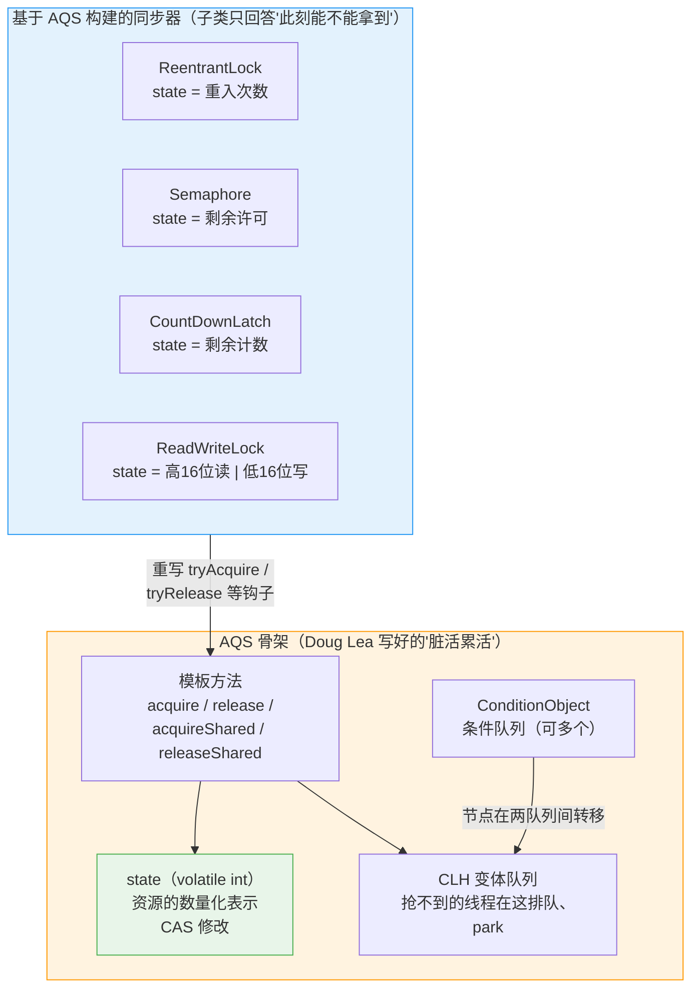
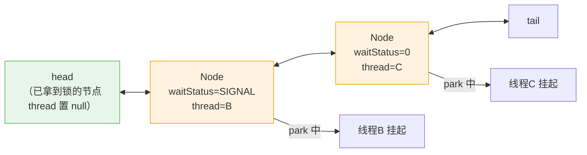
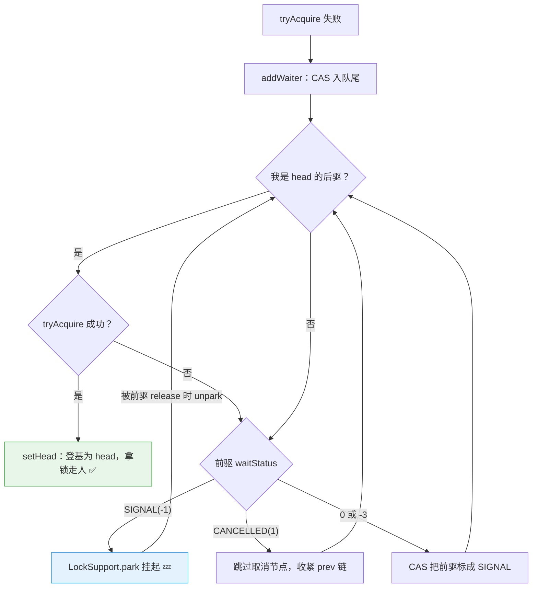
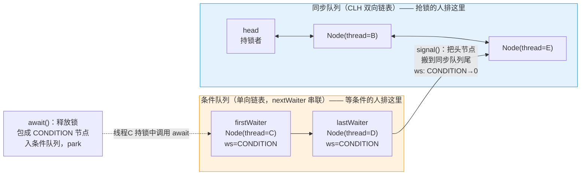
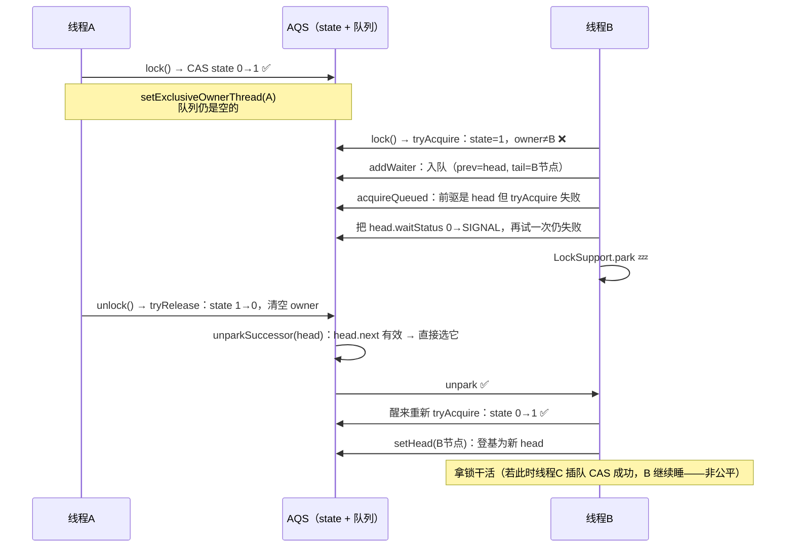

# AQS 原理：state、CLH 队列与 Condition 一次讲透

## 核心概念全览



> 💡 **阅读指引**：网上的 AQS 文章大多不清不楚，原因就三个：不讲清**职责划分**（AQS 管什么、子类管什么）、不讲清 **state 的语义是子类定义的**、把 **CLH 队列和 Condition 队列**混为一谈。这篇按"骨架 → state → 排队 → 唤醒 → 共享传播 → Condition 双队列 → 全流程串讲 → 手写一个锁"的顺序推进，关键源码逐行走读（以 JDK 8 为基准，JDK 17 重构过内部实现但机制完全一致）。看懂这篇，ReentrantLock/Semaphore/CountDownLatch 就全通了——它们只是同一副骨架上的不同"语义插件"。

---

## 一、AQS 是什么：所有同步器的骨架

### 1.1 一句话定位

AQS（AbstractQueuedSynchronizer，抽象队列同步器）是 JUC 包的**地基**：它把"抢资源失败了怎么排队、怎么睡、怎么被叫醒、怎么防丢唤醒"这些又难又容易写错的通用逻辑做成了一套骨架，子类只需要回答一个问题——**"此刻资源能不能给你"**。

看看 JUC 里有多少东西是它撑起来的：

| 同步器 | state 的含义 | 模式 |
| :--- | :--- | :--- |
| ReentrantLock | 重入次数（0=无人持有） | 独占 |
| ReentrantReadWriteLock | 高 16 位=读锁持有计数，低 16 位=写锁重入次数 | 共享+独占 |
| Semaphore | 剩余许可数 | 共享 |
| CountDownLatch | 剩余计数 | 共享 |
| CyclicBarrier | （间接）内部用 ReentrantLock + Condition 实现 | 独占 |
| ThreadPoolExecutor.Worker | 借 state 表达 worker 状态（-1/0/1） | 独占 |

> 💡 冷知识：`synchronized` 走的是 JVM 内置的 Monitor 路线，和 AQS 没有任何关系——这是"JVM 级"和"API 级"两条技术路线（详见锁机制笔记）。

### 1.2 模板方法模式：职责划分一表看清

这是理解 AQS 的**第一把钥匙**。AQS 用的是模板方法模式：

| 职责 | 谁负责 | 具体内容 |
| :--- | :--- | :--- |
| 定义资源语义 | **子类** | 重写 `tryAcquire/tryRelease`（独占）或 `tryAcquireShared/tryReleaseShared`（共享），只回答"能不能"，返回 boolean/int |
| 排队、阻塞、唤醒、公平性、中断响应 | **AQS** | `acquire/release` 等 final 模板方法 + CLH 队列，子类**不用也不能**碰 |

骨架长这样（final 方法，子类不可改）：

```java
public final void acquire(int arg) {
    if (!tryAcquire(arg) &&                        // ① 先问子类：能直接拿到吗？
        acquireQueued(addWaiter(Node.EXCLUSIVE), arg))  // ② 拿不到：入队 → 排队竞争 → park
        selfInterrupt();                           // ③ 排队期间被中断过，补个标记
}
```

而钩子方法默认全部"不支持"，逼子类按需实现：

```java
protected boolean tryAcquire(int arg) {
    throw new UnsupportedOperationException();
}
```

所以看任何一个基于 AQS 的锁，**只需要看它的 tryAcquire/tryRelease 写了什么**，剩下的排队唤醒逻辑全是 AQS 通用的——这就是为什么学会 AQS 等于学会了一族工具。

### 1.3 两种模式

| | 独占（Exclusive） | 共享（Shared） |
| :--- | :--- | :--- |
| 语义 | 同一时刻只有一个线程持有 | 多个线程可同时持有 |
| 入口 | `acquire / release` | `acquireShared / releaseShared` |
| 典型 | ReentrantLock、写锁 | Semaphore、CountDownLatch、读锁 |
| 唤醒行为 | 只叫醒队头一个 | 叫醒一个后**链式传播**（见第四章） |

---

## 二、state：一个留给子类想象的计数

### 2.1 本体简单到离谱：volatile int + CAS

```java
private volatile int state;                      // 就一个 int

protected final boolean compareAndSetState(int expect, int update) {
    return unsafe.compareAndSwapInt(this, stateOffset, expect, update);  // CAS 原子修改
}
```

**理解 state 的第二把钥匙：AQS 自己完全不管 state 是什么意思**。它只提供三件事：`getState()`、`setState()`、CAS 修改。语义 100% 由子类定义：

| 同步器 | state=0 | state=n |
| :--- | :--- | :--- |
| ReentrantLock | 没人持锁 | 被持有且重入了 n-1 次 |
| Semaphore(10) | 许可发完了 | 还剩 n 个许可 |
| CountDownLatch(5) | 计数清零，await 放行 | 还差 n 个 countDown |
| ReadWriteLock | 无任何锁 | `(n >>> 16)` 个读锁 + `(n & 0xFFFF)` 层写锁重入 |

ReadWriteLock 的位分割值得多看一眼——**一个 int 塞两个计数器**：

```java
static final int SHARED_SHIFT   = 16;
static int sharedCount(int c)    { return c >>> SHARED_SHIFT; }  // 高 16 位：读锁总数
static int exclusiveCount(int c) { return c & 0xFFFF; }         // 低 16 位：写锁重入数
```

（每个线程各自持有几个读锁，则用 `HoldCounter` + ThreadLocal 另记。）

### 2.2 走读 ReentrantLock 的 tryAcquire：state 的三种改法

非公平锁的核心就 10 行，把 state 的所有玩法都用上了：

```java
final boolean nonfairTryAcquire(int acquires) {
    final Thread current = Thread.currentThread();
    int c = getState();
    if (c == 0) {                                  // 情况① 锁空闲：CAS 抢
        if (compareAndSetState(0, acquires)) {     // 必须 CAS：可能有多个线程同时看到 c==0
            setExclusiveOwnerThread(current);      // 记录持有者（继承自 AbstractOwnableSynchronizer）
            return true;
        }
    }
    else if (current == getExclusiveOwnerThread()) { // 情况② 重入：自己持有，无需 CAS
        int nextc = c + acquires;                    // （独占状态下只有我能改，直接 setState）
        if (nextc < 0) throw new Error("Maximum lock count exceeded");
        setState(nextc);
        return true;
    }
    return false;                                  // 情况③ 别人持有：失败，回 acquire 走排队流程
}
```

释放是镜像操作：`tryRelease` 里 state 减到 0 才算真正释放（重入几次就要解几次），然后清空 owner、返回 true 触发 AQS 唤醒队头。

> ⚠️ **面试高频陷阱**：state=1 不代表"锁被拿了一次"，重入后 state 可以是 2、3……`unlock()` 调用次数少于 `lock()` 时锁根本不会释放。这也是为什么 try/finally 里必须成对使用。

---

## 三、CLH 队列：抢不到锁的线程去哪了

### 3.1 先说清楚：AQS 用的是 CLH 的"变体"

很多文章直接甩一句"AQS 内部是 CLH 队列"就完了，这是**不清不楚的重灾区**。CLH 是三位作者（**C**raig、**L**andin、**H**agersten）名字的缩写，原版是一把自旋锁：

| | 原版 CLH 锁 | AQS 变体 |
| :--- | :--- | :--- |
| 队列形态 | **隐式单向**链表（每个线程只有一个指向 prev 的引用，没有显式 head/tail 之外的 next 指针） | **显式双向**链表（prev + next，有 head/tail） |
| 等待方式 | **自旋**：盯着前驱节点的状态位转圈 | **park 挂起**：LockSupport.park()，被前驱唤醒 |
| 为什么改 | 自旋适合短临界区，但 Java 锁的持有时间不可控，长自旋白烧 CPU | park 让出 CPU；加 next 指针是为了 release 时能**主动找到后继去 unpark**（原版自旋不需要叫醒谁） |
| 加塞判断 | 前驱状态变了就轮到我 | 只有**head 的后驱**才尝试 tryAcquire |

所以准确说法是：**AQS 借了 CLH"排队看前驱"的思想，改成了双向链表 + 阻塞唤醒**。面试答出"变体在哪、为什么变"，直接和背八股的人拉开差距。

### 3.2 队列节点：Node 的结构和 waitStatus



关键认知：**head 节点就是"当前持有锁的线程"所在的节点**（拿到锁的瞬间执行 `setHead(node)`，把 node.thread 置 null——它已经不需要再排队了）。队列里真正"在等"的是 head 后面的节点。

每个节点的 `waitStatus` 是理解排队逻辑的第三把钥匙，**它描述的是"我这个节点对后继负有什么义务"**，而不是自己的状态：

| waitStatus | 值 | 含义 |
| :--- | :--- | :--- |
| **0** | 初始值 | 新节点入队的默认状态 |
| **SIGNAL** | -1 | "**我释放/取消时必须 unpark 后继**"——后继看到前驱是 SIGNAL，才敢安心 park |
| **CANCELLED** | 1 | 该节点线程放弃了（超时/中断），是唯一>0 的值，遍历时要跳过并清理 |
| **CONDITION** | -2 | 节点在**条件队列**里等待（第五章），不在同步队列中 |
| **PROPAGATE** | -3 | 共享模式下保证唤醒**向后传播**（第四章），设置在 head 上 |

### 3.3 acquire 全流程走读：入队 → 排队 → park

**第一步：addWaiter 入队**

```java
private Node addWaiter(Node mode) {
    Node node = new Node(Thread.currentThread(), mode);
    Node pred = tail;
    if (pred != null) {                    // 快速路径：直接 CAS 接到队尾
        node.prev = pred;                  // ⚠️ 先接 prev，再 CAS tail，最后才接 pred.next
        if (compareAndSetTail(pred, node)) {
            pred.next = node;
            return node;
        }
    }
    enq(node);                             // 慢速路径：自旋重试；tail 为 null 时先初始化一个空 head
    return node;
}
```

注意那个"先 prev 后 next"的顺序——**入队过程中 next 链可能短暂断裂，但 prev 链永远完整**。这个细节直接决定了后面唤醒时为什么要从尾往前扫（3.4 节），是 AQS 源码里最优雅的伏笔。

**第二步：acquireQueued 在队列里挣扎**

```java
final boolean acquireQueued(final Node node, int arg) {
    for (;;) {
        final Node p = node.predecessor();
        if (p == head && tryAcquire(arg)) {   // ① 只有队头（head 的后驱）才有资格试锁
            setHead(node);                    //    拿到了：我登基成 head
            p.next = null;                    //    老 head 出队帮助 GC
            return false;
        }
        if (shouldParkAfterFailedAcquire(p, node) &&   // ② 没拿到：把前驱标成 SIGNAL，
            parkAndCheckInterrupt())                   //    确认安全后 park 自己
            interrupted = true;                          // ③ 被 unpark/中断唤醒，回到 for 重试
    }
}
```

`shouldParkAfterFailedAcquire` 是"安心睡觉检查"：

```java
private static boolean shouldParkAfterFailedAcquire(Node pred, Node node) {
    int ws = pred.waitStatus;
    if (ws == Node.SIGNAL)
        return true;                    // 前驱承诺了会叫我 → 放心 park
    if (ws > 0) {                       // 前驱 CANCELLED：向前跳过所有已取消节点
        do { node.prev = pred = pred.prev; } while (pred.waitStatus > 0);
        pred.next = node;               // 顺手把取消链清理掉
    } else {
        compareAndSetWaitStatus(pred, ws, Node.SIGNAL);  // 前驱还是 0/-3：把它标成 SIGNAL
    }
    return false;                       // 这一轮不睡，再给一次 tryAcquire 的机会
}
```

流程图画出来就是：



> 💡 **为什么 park 前必须把前驱标成 SIGNAL？** 这是一个"承诺机制"：如果不确认前驱知道自己要睡觉，可能出现"前驱刚好在标记前释放了锁、没叫任何人，而我随后 park"——**丢失唤醒，永久睡死**。AQS 的解法是：先给前驱挂上 SIGNAL 义务，然后**再给一次 tryAcquire 机会**（shouldPark 返回 false 重新走循环），双重保险。这个模式和 Condition、PROPAGATE 里的防丢唤醒设计一脉相承。

### 3.4 release：唤醒为什么从尾往前扫

```java
public final boolean release(int arg) {
    if (tryRelease(arg)) {              // 子类把 state 减到 0、清空 owner
        Node h = head;
        if (h != null && h.waitStatus != 0)
            unparkSuccessor(h);
        return true;
    }
    return false;
}

private void unparkSuccessor(Node node) {
    if (node.waitStatus < 0) compareAndSetWaitStatus(node, 0, node.waitStatus); // 清掉 SIGNAL 义务
    Node s = node.next;
    if (s == null || s.waitStatus > 0) {         // next 断了或已取消
        s = null;
        for (Node t = tail; t != null && t != node; t = t.prev)   // ⚠️ 从尾往前扫！
            if (t.waitStatus <= 0) s = t;        // 找离 head 最近的、还有效的节点
    }
    if (s != null) LockSupport.unpark(s.thread);
}
```

**为什么倒着扫？** 就是 3.3 埋的伏笔：入队时 `prev` 先接好、`tail` CAS 成功后 `next` 才补上，所以任意时刻 **prev 链一定完整，next 链可能有瞬时空洞**；取消节点的清理也是先改 prev。正着扫会漏人，倒着扫一定能找到"最靠前且未取消"的节点。

还有一点容易被忽略：**unpark 只是把等待线程叫醒，不是把锁塞给它**。被叫醒的线程从 park 处返回后，回到 acquireQueued 循环重新 tryAcquire——这就是非公平锁"插队"的窗口，也是为什么唤醒后必须重新竞争。

### 3.5 公平 vs 非公平：差别只有一行

```java
// 非公平 tryAcquire：
if (c == 0) { if (compareAndSetState(0, acquires)) { ... } }        // 上来就抢

// 公平 tryAcquire（唯一区别）：
if (c == 0 && !hasQueuedPredecessors()                               // 先看看队列里有没有人排在我前面
        && compareAndSetState(0, acquires)) { ... }
```

非公平锁允许两波"插队"：① `lock()` 时直接 CAS 抢（还没入队就先试一把）；② 被唤醒的线程和刚到的新线程一起竞争，新来的可能先抢到。

| | 非公平（默认） | 公平 |
| :--- | :--- | :--- |
| 吞吐 | **高**：唤醒有延迟，插队者可以直接干活，CPU 不空转 | 低：必须严格按队列来，唤醒-切换的间隙锁可能空着 |
| 饥饿 | 理论上可能（实践中新线程源源不断才会） | 不会 |
| 选择建议 | 默认就用它 | 只有业务明确要求先来先服务（如排队下单）才用 |

**为什么默认非公平**：插队者拿到锁时，队列里的线程反正在睡觉，没有任何额外代价；而公平锁要求"锁空着也必须等 head 后继被唤醒"，白白损失吞吐。

---

## 四、共享模式：叫醒一个，传醒一串

### 4.1 和独占的结构性区别

共享模式的钩子返回值不再是 boolean，而是 **int**：

```java
protected int tryAcquireShared(int arg) {
    // 返回 <0：失败；=0：拿到但后续线程没戏了；>0：拿到且【可能还有剩余资源】
}
```

`>0` 是传播的触发器——拿到资源的线程发现有剩，就有义务**顺手叫醒下一个**，形成链式唤醒。

### 4.2 拿 CountDownLatch 走一遍

latch = new CountDownLatch(3)，线程 A await，线程 B/C/D 各自 countDown：

```java
// A: await() → acquireSharedInterruptibly(1)
//    tryAcquireShared: return getState() == 0 ? 1 : -1;   → state=3，返回 -1，入队 park

// B/C/D: countDown() → releaseShared(1)
//    tryReleaseShared: for(;;) { c = getState(); if (c == 0) return false;   // 已经 0 了，幂等
//                      if (compareAndSetState(c, c - 1)) return c - 1 == 0; } // 减到 0 才返回 true

// D 把 state 减到 0 → doReleaseShared() → unparkSuccessor(head) → A 被唤醒
// A 醒来重新 tryAcquireShared 返回 1（>0）→ setHeadAndPropagate → 还有剩余？继续 doReleaseShared 叫醒下一个
```

### 4.3 PROPAGATE：为"丢失唤醒"打的补丁

设想没有 PROPAGATE：共享资源一次性放行多个等待者时，`releaseShared` 和等待者的 `setHead` 并发执行，存在这样的竞态——**某次唤醒把 head 的 waitStatus 从 SIGNAL 清成 0 后，并发的另一次释放看到 0 就不再 unpark**，链条断在这里，后面的线程永远睡着（这是 JDK 6 时代真实修过的 bug：Semaphore/latch 偶发永久挂起）。

PROPAGATE（-3）就是补丁：**当 head 状态是 0、没有 SIGNAL 义务可履行时，把它 CAS 成 PROPAGATE，作为一个"欠唤醒"的记号**；后续任何等待者成为新 head 时（`setHeadAndPropagate` 检查 `h.waitStatus < 0`），看到这个记号就补一轮 `doReleaseShared`，保证传播不断链。

> 💡 一句话记忆：**SIGNAL 管独占模式的"我走时叫你"，PROPAGATE 管共享模式的"叫不醒也要留个欠账，下一个人负责补叫"**。面试能讲到这里，AQS 就算真懂了。

---

## 五、Condition：一把锁的第二条队列

### 5.1 核心认知：两条队列，节点在中间搬家

这是 Condition 最容易被讲糊的地方。先建立图像：**一个 ReentrantLock（一个 AQS）可以 newCondition() 出多个 ConditionObject，每个 ConditionObject 内部是一条独立的单向"条件队列"**。节点（Node）是两条队列间流转的载体：



两条队列的分工：

| | 同步队列（CLH） | 条件队列 |
| :--- | :--- | :--- |
| 谁在里面 | **没拿到锁**、等着抢锁的线程 | **已经拿到锁**、但业务条件不满足而主动等待的线程 |
| 结构 | 双向链表（prev+next） | 单向链表（nextWaiter），每 Condition 一条 |
| 进入 | tryAcquire 失败 | 持锁线程调用 `await()`（先**完全释放**锁） |
| 离开 | 抢到锁 setHead | `signal()` 把节点**转移**到同步队列 |
| 唤醒者 | 前驱 release 时 unpark | signal/signalAll 转移节点；await 内 park 被唤醒 |

### 5.2 await() 走读：释放锁 → 进条件队列 → 睡

```java
public final void await() throws InterruptedException {
    if (Thread.interrupted()) throw new InterruptedException();
    Node node = addConditionWaiter();      // ① 包成 CONDITION 节点挂到条件队列尾
    int savedState = fullyRelease(node);   // ② 完全释放锁：重入了几层就一次性减到 0（返回减掉的总量）
    int interruptMode = 0;
    while (!isOnSyncQueue(node)) {         // ③ 只要还没被 signal 搬进同步队列，就继续睡
        LockSupport.park(this);            //    （被中断/虚假唤醒也会醒来检查，所以用 while）
        if ((interruptMode = checkInterruptWhileWaiting(node)) != 0) break;
    }
    // ④ 被搬进同步队列后从这里继续：像普通抢锁者一样 acquireQueued 竞争
    if (acquireQueued(node, savedState) && interruptMode != THROW_IE)
        interruptMode = REINTERRUPT;
    if (node.nextWaiter != null) unlinkCancelledWaiters();  // ⑤ 清理条件队列里取消的节点
    if (interruptMode != 0) reportInterruptAfterWait(interruptMode);
}
```

三个细节值得划重点：

1. **`fullyRelease` 是一次性卸到底**：重入 3 层也全部放掉（savedState=3），因为"等待条件"意味着你把锁完整让出去，不然别人永远进不来改条件；返回的 savedState 用于醒来后**原样重入 3 层**——这就是"await 返回时锁的状态和调用前一模一样"的实现。
2. **await 返回 ≠ 被 signal 的瞬间**：signal 只是把你搬进同步队列，你还要和所有抢锁者公平竞争，**抢到锁之后 await 才返回**。所以从 signal 到 await 返回之间有一段"已在路上但未持锁"的状态。
3. 没持锁就调 await 会直接抛 `IllegalMonitorStateException`（addConditionWaiter 检查 owner）。

### 5.3 signal() 走读：只做一件事——搬家

```java
public final void signal() {
    if (!isHeldExclusively()) throw new IllegalMonitorStateException();  // 必须持锁
    Node first = firstWaiter;
    if (first != null) doSignal(first);       // 只叫醒条件队列的头节点（signalAll 则是全部）
}

private void doSignal(Node first) {
    do {
        if ((firstWaiter = first.nextWaiter) == null) lastWaiter = null;
        first.nextWaiter = null;              // 从条件队列摘下来
    } while (!transferToQueue(first) && (first = firstWaiter) != null);
}

final boolean transferToQueue(Node node) {
    enq(node);                                // 入同步队列尾（waitStatus 在 enq 中被重置为 0）
    Node p = node.predecessor();
    if (p == head || p.waitStatus == Node.CANCELLED ||
        !compareAndSetWaitStatus(p, 0, Node.SIGNAL))
        LockSupport.unpark(node.thread);      // 给前驱挂上 SIGNAL 义务；挂不上就直接叫醒去抢
    return true;
}
```

注意 signal **不释放锁**——调用者继续持有锁执行后面的代码，通常到 `unlock()` 或被唤醒者才有机会抢到。所以典型模式是：`条件满足 → signal → （稍后）unlock`。

### 5.4 标准使用范式：为什么必须 while

```java
lock.lock();
try {
    while (queue.isFull()) {      // ⚠️ 必须 while，不能 if
        notFull.await();
    }
    queue.add(x);
    notEmpty.signal();
} finally {
    lock.unlock();
}
```

两个原因：① **虚假唤醒**——park/unpark 机制允许无 signal 的唤醒（JVM 规范保留的权利），醒来必须重新验证条件；② **条件被别人抢先改变**——signalAll 唤醒一群线程，或 signal 之后、你抢到锁之前，另一个线程先把资源消费掉了。`while` 让醒来变成"重新检查"而不是"直接往下走"。

### 5.5 多 Condition 的价值：定向唤醒

synchronized 的 wait/notify 只有**一个**等待队列，notify 无法指定叫醒谁，实践中只能 notifyAll 全员广播再互相抢。Condition 允许一把锁挂**多条**队列，实现精准唤醒——`ArrayBlockingQueue` 就是教科书：

```java
final ReentrantLock lock;
private final Condition notEmpty;   // 队列空 → take 的线程等在这条队列
private final Condition notFull;    // 队列满 → put 的线程等在这条队列

// put 成功后只需要叫醒"等取"的人，绝不会误伤"等放"的人：
notEmpty.signal();
```

对比表：

| | synchronized + wait/notify | ReentrantLock + Condition |
| :--- | :--- | :--- |
| 等待队列数 | 1 个（Monitor 的 EntryList/WaitSet） | **每个 newCondition() 一条** |
| 唤醒精度 | notify 随机一个 / notifyAll 全部 | 按队列定向 signal |
| 典型收益 | — | 生产者消费者互不干扰，减少无效唤醒和锁竞争 |
| 超时等待 | `wait(millis)` | `await(time, unit)` / `awaitUntil(deadline)` |
| 中断策略 | 只能抛中断 | `await()` 抛 / `awaitUninterruptibly()` 忽略 |

### 5.6 一个容易混的点：Condition 队列的节点也是 AQS 的 Node

条件队列和同步队列**共用同一个 Node 类**（靠 `nextWaiter` 字段串条件队列，靠 `waitStatus=CONDITION` 标记身份），所以"搬家"（transferToQueue）只是换个链表挂，不用新建对象——这是理解源码里为什么 `addConditionWaiter` 返回 Node、`isOnSyncQueue` 能判断"搬没搬过去"的关键。

---

## 六、串起来：两个线程抢一把锁的全过程



---

## 七、十分钟手写一个独占锁：验证你真的懂了

用 AQS 实现一个**不可重入**的互斥锁——子类只需要回答"能不能"，排队唤醒白拿：

```java
public class SimpleLock implements Lock {
    private final Sync sync = new Sync();

    private static class Sync extends AbstractQueuedSynchronizer {
        @Override
        protected boolean tryAcquire(int ignore) {
            if (compareAndSetState(0, 1)) {          // 0→1 即拿到
                setExclusiveOwnerThread(Thread.currentThread());
                return true;
            }
            return false;                             // 不支持重入：是自己也返回 false（会死锁，故意的）
        }
        @Override
        protected boolean tryRelease(int ignore) {
            if (getState() == 0) throw new IllegalMonitorStateException();
            setExclusiveOwnerThread(null);
            setState(0);                              // 无竞争者时只有 owner 会调，setState 即可
            return true;
        }
        @Override
        protected ConditionObject newCondition() {
            return new ConditionObject();             // 白送一个条件队列
        }
    }

    public void lock()                { sync.acquire(1); }
    public boolean tryLock()          { return sync.tryAcquire(1); }
    public void unlock()              { sync.release(1); }
    public void lockInterruptibly() throws InterruptedException { sync.acquireInterruptibly(1); }
    public boolean tryLock(long t, TimeUnit u) throws InterruptedException { return sync.tryAcquireNanos(1, u.toNanos(t)); }
    public Condition newCondition()   { return sync.newCondition(); }
}
```

10 行钩子代码，换来：可中断等待、超时尝试、Condition 多条件队列、公平的排队唤醒——**这就是"骨架"二字的含金量**。对照 JDK 里的 `ReentrantLock.Sync`，你会发现它无非是把 tryAcquire 换成了"带重入计数 + 公平性判断"的版本。

---

## 八、面试高频问答速查

### Q1: 用你自己的话解释 AQS？
**答**：AQS 是 JUC 同步器的骨架，核心是"一个 volatile int state + 一个 CLH 变体的 FIFO 双向等待队列 + 一套 acquire/release 模板方法"。子类通过重写 tryAcquire/tryRelease（独占）或 tryAcquireShared/tryReleaseShared（共享）定义 state 的语义、回答"资源此刻能不能给你"；排队、park/unpark、防丢唤醒、公平性、中断响应这些通用且易错的逻辑全由 AQS 兜底。ReentrantLock、Semaphore、CountDownLatch、ReadWriteLock 都是这副骨架上的语义插件。

### Q2: 为什么说是 CLH 队列的"变体"？改了什么、为什么改？
**答**：原版 CLH 是隐式单向链表的自旋锁，线程盯着前驱状态位自旋。AQS 改了两点：① 自旋换成 LockSupport.park/unpark——Java 锁持有时间不可控，长自旋烧 CPU；② 单向隐式改成显式双向链表（加 next 指针）——因为 park 之后线程自己醒不了，释放者必须能通过 next 找到后继去 unpark。保留了"排队、看前驱脸色"的核心思想。

### Q3: state 到底存的是什么？
**答**：AQS 层面它只是一个 volatile int，提供 get/set/CAS 三种操作，**语义完全由子类定义**：ReentrantLock 是重入次数、Semaphore 是剩余许可、CountDownLatch 是剩余计数、ReadWriteLock 用高 16 位存读锁计数、低 16 位存写锁重入数。修改必须走 CAS（重入场景除外——独占下只有 owner 能改，setState 即可）。

### Q4: 一个线程 acquire 失败后，完整经历了什么？
**答**：① addWaiter：包成 Node，CAS 接到队尾（先接 prev 再 CAS tail 最后补 next）；② acquireQueued 循环：只有 head 的直接后继才尝试 tryAcquire，成功则 setHead 登基；③ 失败则检查前驱 waitStatus：前驱已取消就向前跳过收紧链，否则把前驱 CAS 成 SIGNAL（挂上"释放时叫我"的义务），然后 LockSupport.park；④ 前驱 release 时 unparkSuccessor 把它叫醒，回到②重新竞争——**唤醒不等于给锁**，非公平模式下可能被插队。

### Q5: unparkSuccessor 为什么从 tail 往前扫，而不是顺着 head.next 往后找？
**答**：因为入队时 prev 指针先建立、tail CAS 成功后 next 才补上，任意时刻 **prev 链一定完整、next 链可能有瞬时空洞**；取消节点的清理同样先维护 prev。顺着 next 扫可能漏掉正在入队的节点，从 tail 沿 prev 倒扫，找到的第一个未取消节点必然是"离 head 最近的有效等待者"。

### Q6: Condition 的实现原理？和 wait/notify 什么区别？
**答**：每个 ConditionObject 维护一条**单向条件队列**，和 AQS 的同步队列共用 Node。await()：把当前线程包成 CONDITION 节点入条件队列 → fullyRelease 一次性完全释放锁（重入几层都放掉，记住 savedState）→ park；signal()：把条件队列头节点**转移**到同步队列尾，醒来后按普通抢锁流程 acquireQueued(savedState) 重新竞争，拿到锁 await 才返回。与 wait/notify 的区别：synchronized 只有一个等待队列，notify 无法定向；Condition 一把锁可挂多条队列，能精准唤醒（如 ArrayBlockingQueue 的 notFull/notEmpty 互不打扰）；另外 Condition 支持超时、可中断/不可中断等待等多种策略。

### Q7: 公平锁和非公平锁在源码层面差在哪？为什么默认非公平？
**答**：只差 tryAcquire 里一个 `hasQueuedPredecessors()` 判断——公平锁发现队列里有人排在自己前面就不抢；非公平锁允许两波插队：lock() 时未入队先 CAS 抢一把，以及被唤醒线程和新到线程同台竞争。默认非公平因为吞吐高：唤醒线程从 park 中恢复有延迟，这段时间让插队者干活，锁不空转；代价是理论上可能饥饿，实践中需要线程持续高压涌入才会发生。

### Q8: PROPAGATE 状态是干嘛的？
**答**：共享模式的防丢唤醒补丁。共享释放和等待者 setHead 并发时，存在"唤醒把 head 的 SIGNAL 清成 0，另一次并发释放看到 0 就不再 unpark"的竞态，导致传播链断裂、后面的线程永久挂起（JDK 6 真实修复过的 bug）。PROPAGATE(-3) 的含义是"欠一次唤醒"：head 没有 SIGNAL 义务可履行时 CAS 成 PROPAGATE 留个记号，后续 setHeadAndPropagate 检查到 `waitStatus < 0` 就补一轮 doReleaseShared，保证唤醒传播不断链。

### Q9: AQS 为什么不用 synchronized 实现，它比 synchronized 强在哪？
**答**：定位不同。synchronized 是 JVM 内置关键字，走 Monitor/对象头路线，功能封闭；AQS 是 API 级骨架，把同步器需要的能力全部开放出来：可尝试获取（tryLock）、可超时（tryLock/awaitNanos）、可中断（lockInterruptibly）、可选公平性、多条件队列（多个 Condition）、共享/独占双模式。正因为有这套骨架，JUC 才能在纯 Java 层快速构建出 Semaphore、Latch 这些 synchronized 做不到的同步器。

### Q10: ReadWriteLock 怎么用一个 int 管两把锁？读写锁之间有互斥吗？
**答**：state 高 16 位记读锁总持有计数、低 16 位记写锁重入次数，一次 CAS 同时看到两个维度。互斥规则体现在 tryAcquire 的判断里：写锁独占——已有读锁（高16位≠0）或别的线程持有写锁时，写请求失败；读锁共享——仅当没有写锁持有（或有写锁但持有者是自己，支持锁降级）时可以 CAS 增加高 16 位；每个线程自己拿了几把读锁用 HoldCounter（ThreadLocal）单独记。支持**锁降级**（持写锁→加读锁→放写锁），不支持锁升级。

---

## 九、总结

| 组件 | 一句话职责 | 关键细节 |
| :--- | :--- | :--- |
| state | 资源的数量化表示 | volatile int + CAS，语义由子类定义 |
| tryAcquire 等钩子 | 子类回答"能不能" | 模板方法模式，骨架与语义分离 |
| CLH 变体队列 | 抢不到锁的人排队睡觉 | 双向链表、head=持锁者、prev 链永远完整 |
| waitStatus | 节点对后继的义务 | SIGNAL=走时叫我；CANCELLED=跳过我；PROPAGATE=欠一次唤醒 |
| park/unpark | 阻塞与唤醒 | 唤醒≠给锁，醒来重新竞争 |
| Condition | 一把锁多条等待队列 | await 完全释放锁进条件队列；signal 只搬家不给锁 |
| 公平性 | 一行 hasQueuedPredecessors | 默认非公平换吞吐 |

> 📌 **记忆口诀**：**一个 state 定乾坤，语义留给子类分；抢不到锁进 CLH，前驱 SIGNAL 才安眠；释放 unpark 从尾扫，唤醒回来再竞争；条件队列单独排，signal 搬家不换权；共享传播 PROPAGATE，欠账补叫不断链。**
