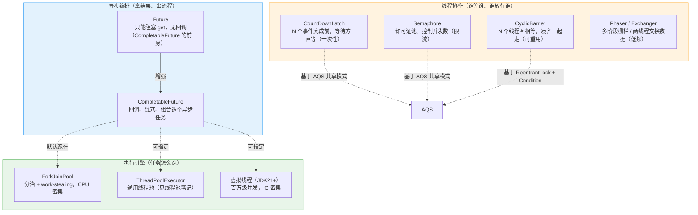
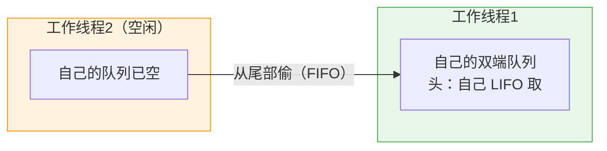
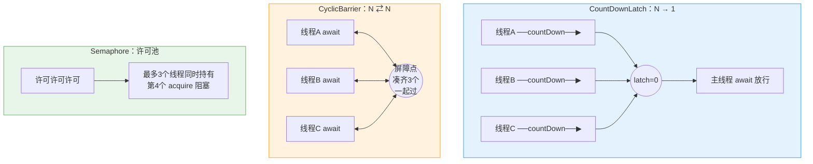
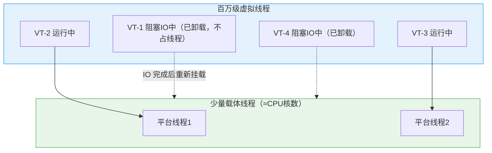
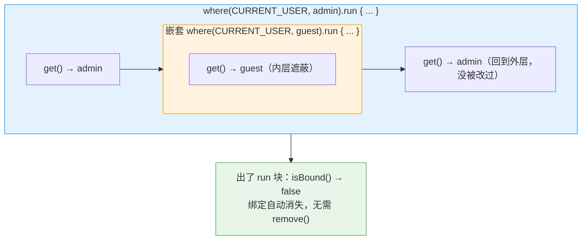
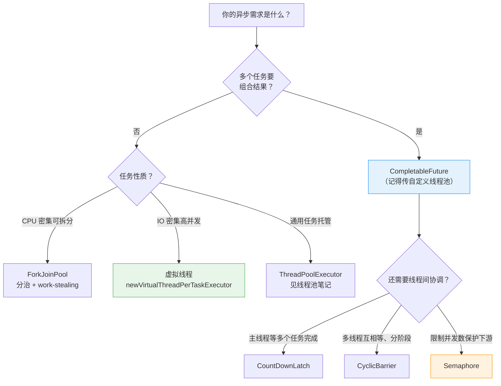

# 常用异步工具：CompletableFuture、ForkJoinPool、线程协作工具与虚拟线程

## 核心概念全览



> 💡 **阅读指引**：很多人把"异步工具"窄化成 CompletableFuture，其实它是一整个家族，按职责分三类——**编排**（CompletableFuture：把多个异步任务串起来）、**执行**（ForkJoinPool / 线程池 / 虚拟线程：任务在哪跑）、**协作**（CountDownLatch / CyclicBarrier / Semaphore：线程之间谁等谁）。三类的选型逻辑完全不同，面试时也经常被混着问。建议先记住第一节的分类速查表，再按顺序看每个工具的 API、场景和坑，最后过一遍虚拟线程——它正在改变前两者的最佳实践。

---

## 一、分类速查：先搞清楚每个工具解决什么问题

| 工具 | 类别 | 一句话定位 | 典型场景 |
| :--- | :--- | :--- | :--- |
| **CompletableFuture** | 异步编排 | 声明式地组合多个异步任务（串行、并行、汇聚、异常兜底） | 详情页并行调 3 个服务再聚合 |
| **ForkJoinPool** | 执行引擎 | 分治任务 + work-stealing，榨干多核 | 大数组求和、递归拆分计算 |
| **CountDownLatch** | 线程协作 | 主线程等 N 个事件全部完成，**一次性** | 服务启动等所有预热任务就绪 |
| **CyclicBarrier** | 线程协作 | N 个线程互相等，凑齐一起进下一阶段，**可重用** | 多线程分阶段计算，每阶段对齐 |
| **Semaphore** | 线程协作 | 许可证池，控制同时访问资源的线程数 | 接口限流、限制下游并发 |
| **虚拟线程** | 执行引擎 | JVM 调度的轻量线程，阻塞不再昂贵 | 高并发 IO（爬虫、网关聚合） |
| Phaser | 线程协作 | CyclicBarrier 增强版：动态注册、多阶段 | 参与方数量会变的分阶段任务 |
| Exchanger | 线程协作 | 两个线程在同一汇合点交换数据 | 生产-校对双线程流水线 |

**记忆锚点**：CompletableFuture 管"结果怎么合"，ForkJoinPool/虚拟线程管"任务在哪跑"，Latch/Barrier/Semaphore 管"线程之间怎么等"。

---

## 二、CompletableFuture（下文简称 CF）：异步编排的主力

### 2.1 为什么不是 Future？

`Future` 是 JDK5 就有的，但它有三个硬伤，导致实际业务里几乎没法用：

| 痛点 | Future | CompletableFuture |
| :--- | :--- | :--- |
| 拿结果 | 只能 `get()` **阻塞**或轮询 `isDone()` | 回调自动触发，不阻塞 |
| 任务依赖 | A 完成后触发 B？手动写循环等 | `thenApply/thenCompose` 声明式串联 |
| 多任务聚合 | 挨个 `get()`，串行等待 | `allOf/anyOf/thenCombine` 组合 |
| 异常处理 | `get()` 抛 ExecutionException 自己拆 | `exceptionally/handle` 链上兜底 |

### 2.2 API 按用途记，不用背

**创建**：

```java
CompletableFuture.supplyAsync(() -> query(id));          // 有返回值
CompletableFuture.runAsync(() -> send(msg));              // 无返回值
CompletableFuture.completedFuture(result);                // 直接给个已完成的结果
```

**串行（一个接一个）**：

| 方法 | 特点 |
| :--- | :--- |
| `thenApply` | 拿上一步结果，返回新结果（有返回值，类似 map） |
| `thenAccept` | 拿上一步结果，消费掉（无返回值） |
| `thenRun` | 不关心上一步结果，只是接着跑（无参无返回） |
| `thenCompose` | 上一步结果作为入参，**再发起一个异步任务**（类似 flatMap，避免嵌套 CF） |

**并行汇聚（多个合一个）**：

| 方法 | 特点 |
| :--- | :--- |
| `thenCombine` | 两个 CF **都完成**后，合并它们的结果 |
| `allOf` | 等所有 CF 完成（返回 `CF<Void>`，结果要自己 join 取） |
| `anyOf` | 任意一个完成就返回 |

**异常与超时**：

```java
.exceptionally(ex -> fallback)        // 出异常走兜底
.handle((result, ex) -> ...)          // 成功失败都进，自己判断
.whenComplete((result, ex) -> ...)    // 只观察不改结果
.orTimeout(800, MILLISECONDS)         // JDK9+：超时抛异常
.completeOnTimeout(fallback, 800, MILLISECONDS) // JDK9+：超时给默认值
```

### 2.3 实战：详情页并行聚合

```java
// 三个下游服务并行调用，全部完成后聚合，任何一个挂了走兜底
CompletableFuture<UserInfo> userF  = CompletableFuture.supplyAsync(() -> userService.get(id), bizPool);
CompletableFuture<List<Order>> orderF = CompletableFuture.supplyAsync(() -> orderService.list(id), bizPool);
CompletableFuture<Wallet> walletF  = CompletableFuture.supplyAsync(() -> walletService.get(id), bizPool);

CompletableFuture<DetailPage> pageF = CompletableFuture
        .allOf(userF, orderF, walletF)
        .thenApply(v -> new DetailPage(userF.join(), orderF.join(), walletF.join()))
        .exceptionally(ex -> {
            log.error("聚合失败", ex);
            return DetailPage.fallback();   // 降级页面
        });

DetailPage page = pageF.orTimeout(800, TimeUnit.MILLISECONDS).join();
```

> 💡 `allOf` 返回的是 `CompletableFuture<Void>`，结果需要在回调里对每个子 CF 调 `join()` 取——此时它们都已完成，`join()` 不会阻塞。

### 2.4 三个必知的坑 ⚠️

**坑一：不传线程池 = 用公共的 ForkJoinPool.commonPool()**

```java
// ❌ 默认跑在 commonPool（并行度 = CPU核数-1，全 JVM 共享）
CompletableFuture.supplyAsync(() -> remoteCall());

// ✅ IO 型任务必须指定自己的业务线程池
CompletableFuture.supplyAsync(() -> remoteCall(), bizPool);
```

commonPool 是给 **CPU 密集型分治任务**准备的，容量只有核数-1。把阻塞 IO 任务扔进去，几个慢调用就能把全 JVM 的 commonPool 打满——**所有用默认 CF 的地方、所有 parallelStream 一起卡死**。这是生产事故的经典来源。

**坑二：异常不处理会被静默吞掉**

CF 链上的异常不会打到控制台，只会存在 future 里；如果没人调 `get/join`、链上也没挂 `exceptionally/handle`，异常就无声消失。原则：**每条链必须以异常处理结尾**。

**坑三：get 和 join 的区别**

| | `get()` | `join()` |
| :--- | :--- | :--- |
| 异常 | 抛受检异常 `ExecutionException`，必须 try-catch | 抛非受检 `CompletionException` |
| 使用建议 | 需要区分超时（`get(timeout)`）时用 | 链式回调里取已完成的结果时用 |

---

## 三、ForkJoinPool（下文简称 FJ）：分治 + 工作窃取

### 3.1 解决什么问题

大任务拆小任务递归求解（分治），难点在于：**拆出来的小任务数量不均，有的线程忙死、有的闲死**。ForkJoinPool 的答案是 work-stealing——每个线程有自己的双端队列，闲下来的线程从别人队列**尾部**偷任务：



头尾分离取任务，减少了窃取者和主人的竞争。

### 3.2 用法

```java
public class SumTask extends RecursiveTask<Long> {
    private static final int THRESHOLD = 10_000;
    private final long[] arr; private final int lo, hi;

    @Override
    protected Long compute() {
        if (hi - lo <= THRESHOLD) {                 // 足够小：直接算
            long sum = 0;
            for (int i = lo; i < hi; i++) sum += arr[i];
            return sum;
        }
        int mid = (lo + hi) >>> 1;
        SumTask left  = new SumTask(arr, lo, mid);
        SumTask right = new SumTask(arr, mid, hi);
        left.fork();                                 // 异步执行左半
        long rr = right.compute();                   // 当前线程算右半
        return rr + left.join();                     // 等左半结果
    }
}

long total = new ForkJoinPool().invoke(new SumTask(arr, 0, arr.length));
```

要点：`RecursiveTask`（有返回值）/ `RecursiveAction`（无返回值）；**任务足够小就直接算，别无限拆**（拆分的调度开销会超过计算本身）。

### 3.3 什么时候用、什么时候别用

| | 说明 |
| :--- | :--- |
| ✅ 适合 | **CPU 密集型**、天然可递归拆分的任务：大集合计算、树/图遍历、归并排序 |
| ❌ 不适合 | 阻塞 IO 任务——线程阻塞住了没法去偷别人任务，池就废了（有 `ManagedBlocker` 补偿机制，但业务里基本不用，IO 场景直接上虚拟线程） |
| 💡 冷知识 | `parallelStream()` 和默认 CF 背后都是 `ForkJoinPool.commonPool()`，所以它只适合纯计算 |

---

## 四、线程协作三剑客：CountDownLatch、CyclicBarrier、Semaphore

这三个是最容易被混着考的一组，先上对比表：

| | CountDownLatch | CyclicBarrier | Semaphore |
| :--- | :--- | :--- | :--- |
| 语义 | **等事件**：N 个事件完成前我等着 | **等同伴**：N 个线程凑齐一起走 | **抢许可**：拿到许可证才能进 |
| 计数方向 | 倒数到 0 | 凑数到 N | 剩余许可数 |
| 可否重用 | ❌ 一次性，归零后无法重置 | ✅ 可反复 `reset()`，自动进入下一轮 | ✅ release 后许可回收 |
| 等待关系 | 等待方和被等待方是**不同**线程 | 参与方**互相**等待 | 没有互相等，只有抢资源 |
| 底层实现 | AQS 共享模式（state=计数） | ReentrantLock + Condition | AQS 共享模式（state=许可数） |
| 典型场景 | 主线程等所有子任务完成 | 多线程分阶段计算对齐 | 限流、连接数控制 |

三种等待模式的直观区别：



### 4.1 CountDownLatch：主线程等子任务

```java
// 场景：服务启动时并行预热本地缓存、连接池、配置，全部就绪才对外提供服务
CountDownLatch latch = new CountDownLatch(3);

for (Runnable warmup : List.of(cacheWarmup, poolInit, configLoad)) {
    executor.execute(() -> {
        try {
            warmup.run();
        } finally {
            latch.countDown();   // ⚠️ 必须放 finally，任务抛异常也要计数，否则主线程永久卡死
        }
    });
}

if (!latch.await(30, TimeUnit.SECONDS)) {   // 带超时的 await，别裸等
    throw new IllegalStateException("服务预热超时，拒绝启动");
}
```

两个细节：`countDown()` 一定要放 `finally`；`await()` 尽量带超时。一次性——计数到 0 之后这个 latch 就废了，想再来一轮只能 new 一个（或者用 CyclicBarrier / Phaser）。

### 4.2 CyclicBarrier：多线程互相等、分阶段推进

```java
// 场景：3 个线程分别计算报表的三个模块，每一阶段都要等所有人算完才能进下一阶段
CyclicBarrier barrier = new CyclicBarrier(3, () ->
        System.out.println("本阶段全部完成，执行汇总"));  // 凑齐后额外触发的 barrierAction

// 每个参与线程：
phase1Compute();
barrier.await();     // 等其他两个线程也到齐，然后一起放行
phase2Compute();
barrier.await();     // 屏障自动重置，可循环使用
phase3Compute();
```

和 latch 的本质区别：latch 是"**事件**计数，别人 countDown、我 await"，两边角色不同；barrier 是"**人**计数，大家互相等"，所有参与方既等别人也被别人等。

### 4.3 Semaphore：并发数控制 / 限流

```java
// 场景：下游服务脆弱，限制最多 10 个线程同时调用
Semaphore semaphore = new Semaphore(10);          // 10 个许可
// new Semaphore(10, true) 公平模式，防饿死但吞吐低

public Result callDownstream(Request req) throws InterruptedException {
    if (!semaphore.tryAcquire(200, TimeUnit.MILLISECONDS)) {
        return Result.degraded();                  // 拿不到许可快速降级，比排队更符合限流语义
    }
    try {
        return downstream.call(req);
    } finally {
        semaphore.release();                       // ⚠️ 必须 finally 归还，泄漏一个许可就永久少一个
    }
}
```

Semaphore 就是"没有排队入口的限流器"：许可数 = 并发上限。`tryAcquire` 带超时做快速失败，比 `acquire` 死等更适合限流场景。

> 💡 **和线程池限流的区别**：线程池靠队列 + 最大线程数限流，任务会**排队**；Semaphore 控制的是**同时在执行**的数量，更适合"保护下游"而不是"管理任务"。另外别忽略 JDK 里现成的限流实现——Guava `RateLimiter`（令牌桶，按 QPS 限）和 Sentinel/Resilience4j（生产级限流熔断），Semaphore 适合最轻量的场景。

### 4.4 顺带一提：Phaser 和 Exchanger

- **Phaser**：CyclicBarrier 的增强版——参与方可以**运行时动态注册/注销**（`register()`/`arriveAndDeregister()`），支持多阶段（每阶段一个 arrive 点），还能重写 `onAdvance()` 控制阶段推进。适合"参与线程数量会变"的分阶段任务，日常业务用得少，面试提一嘴加分。
- **Exchanger**：两个线程在汇合点**交换数据**（`exchanger.exchange(obj)`），经典例子是"填充缓冲区线程"和"消费缓冲区线程"互换 buffer。场景很窄，知道即可。

---

## 五、虚拟线程（Virtual Threads，JDK21 正式）

### 5.1 解决什么问题

传统平台线程 1:1 映射到 OS 线程：一个线程约 1MB 栈内存、创建要过内核，几千个就到头了。所以 IO 阻塞才需要线程池"省着用"——**线程阻塞在 IO 上 = 昂贵的资源被白白占着**。

虚拟线程是 M:N 模型——JVM 自己调度，百万个虚拟线程复用少量平台线程（carrier thread）。阻塞时 JVM 把虚拟线程从载体线程上**卸下来**（unmount），载体线程立刻去跑别的虚拟线程：



### 5.2 用法

```java
// 方式一：直接创建
Thread vt = Thread.ofVirtual().name("worker-", 0).start(() -> blockingIO());

// 方式二：每个任务一个虚拟线程的 executor（最常用）
try (var executor = Executors.newVirtualThreadPerTaskExecutor()) {
    IntStream.range(0, 100_000).forEach(i ->
            executor.submit(() -> {
                Thread.sleep(Duration.ofSeconds(1));   // 模拟阻塞 IO，睡 10 万个也不心疼
                return callRemote(i);
            }));
}   // close() 自动等待全部任务完成

// 方式三：和 CompletableFuture 组合——编排用 CF，执行用虚拟线程
CompletableFuture.supplyAsync(() -> remoteCall(), Executors.newVirtualThreadPerTaskExecutor());
```

三个坑：

1. **Pinning（钉住）问题**：虚拟线程在 `synchronized` 块内阻塞时，无法从载体线程卸载，会把载体线程一起钉住。JDK 21~23 时代的规避法是热点路径改用 `ReentrantLock`；**JDK 24（JEP 491）已彻底修复**，synchronized 里阻塞也能正常卸载——但如果你还在 JDK 21 LTS 上，这个坑仍然存在。
2. **ThreadLocal 的设计前提崩了**：ThreadLocal 的隐含契约是"线程贵、数量少、活得久"，所以池内线程用它缓存 SimpleDateFormat、缓冲区这类创建贵的对象很划算——一次创建、复用几万次。虚拟线程把每一条都反过来了：
   - **内存爆炸**：百万级 VT，每个都挂一份 ThreadLocalMap，缓存对象被复制百万份；
   - **缓存失效**：每任务一线程、用完即弃，缓存命中率趋近于零，纯占内存不复用；
   - **继承开销放大**：InheritableThreadLocal 每次 spawn 都要拷贝父线程的 map，百万次创建就是百万次拷贝；
   - 实际重灾区：基于 ThreadLocal 的**日志 MDC**、框架里"每线程缓存重对象"的老写法。例外：`ThreadLocalRandom` 这种每份只有几十字节的照用不误，别一刀切；
   - 需要跨调用层传递上下文时，用官方的 **ScopedValue**（JDK 25 转正，JEP 506）：不可变、离开作用域自动清理、可高效继承，专为虚拟线程设计（用法和对比见 5.4）。
3. **CPU 密集任务没有收益**：虚拟线程省的是"阻塞等待"的成本，纯计算任务该占 CPU 还是占，用平台线程池（核数大小）反而更好。

### 5.3 选型：虚拟线程 vs 传统线程池 vs 响应式

| | 平台线程池 | 虚拟线程 | 响应式（WebFlux） |
| :--- | :--- | :--- | :--- |
| 并发上限 | 数百~数千 | **百万级** | 百万级 |
| 代码风格 | 同步阻塞 ✅ | 同步阻塞 ✅ | 异步回调/流 ❌ 心智负担大 |
| 适用 | CPU 密集、存量系统 | **IO 密集高并发** | 已有响应式技术栈/背压需求 |
| 生态兼容 | 全兼容 | 大部分兼容（注意 pinning、ThreadLocal） | 需要全链路响应式驱动 |

一句话：**新项目 IO 密集场景，虚拟线程是比响应式更务实的选择**——拿到异步的吞吐，保留同步的可读性。

### 5.4 ScopedValue：ThreadLocal 的接班者

ScopedValue 从 JDK 20 开始多轮预览，**JDK 25 正式转正（JEP 506）**。它解决的问题一句话就能说清：**把"一段调用范围内的只读上下文"传给下游所有代码，而不用把它写进每一层方法签名**——traceId、登录用户、请求上下文这类东西。

心智模型：ThreadLocal 是"线程的私有可变储物柜"，ScopedValue 是"绑定在代码块上的隐式只读参数"。

#### 基本用法：绑定 → 读 → 自动解除

```java
// 1. 声明：惯例是 private static final，全局一个实例
private static final ScopedValue<User> CURRENT_USER = ScopedValue.newInstance();

// 2. 绑定 + 执行：值只在这个 run/call 的动态作用域内可见
ScopedValue.where(CURRENT_USER, user).run(() -> handleRequest());          // 无返回值
var result = ScopedValue.where(CURRENT_USER, user).call(() -> handle());   // 有返回值

// 3. 读取：handleRequest 内部及它调用的任意深度的下游代码里
User u = CURRENT_USER.get();                 // 未绑定时抛 NoSuchElementException
User u2 = CURRENT_USER.orElse(GUEST);        // 带默认值的读法
boolean bound = CURRENT_USER.isBound();      // 是否处于绑定范围
```

注意：**没有 `set()` 这种 API**。值在 `where()` 时绑定一次，范围内所有代码只能读不能改——想"换个值"只能嵌套再绑一层（rebind，内层遮蔽外层，外层不受影响）：



#### 配合 StructuredTaskScope：子虚拟线程自动继承

```java
ScopedValue.where(CURRENT_USER, user).run(() -> {
    try (var scope = new StructuredTaskScope.ShutdownOnFailure()) {
        // fork 出的子虚拟线程里 CURRENT_USER.get() 直接可用：
        // 因为值不可变，子线程共享同一个引用，零拷贝
        var sub1 = scope.fork(() -> queryOrders(CURRENT_USER.get()));
        var sub2 = scope.fork(() -> queryWallet(CURRENT_USER.get()));
        scope.join().throwIfFailed();
        return new Page(sub1.get(), sub2.get());
    } catch (Exception e) { throw new RuntimeException(e); }
});
```

对比 `InheritableThreadLocal`：后者是每次 spawn 子线程都**拷贝整个 map**（百万虚拟线程 = 百万次拷贝）；ScopedValue 因为不可变，继承只是共享指针，几乎零成本。

#### 和 ThreadLocal 逐项对比

| 维度 | ThreadLocal | ScopedValue |
| :--- | :--- | :--- |
| 本质 | 每个**线程**一份可变私有副本 | 一个不可变值绑定到一段**调用范围** |
| 写入 | `set()` 随时、任何代码都能改 | 只能 `where().run()` 绑定，范围内**无 API 可改** |
| 生命周期 | 跟线程走，线程池里线程不死值不消失 | 跟 `run/call` 代码块走，方法返回即蒸发 |
| 清理 | 手动 `remove()`，忘了就泄漏/脏数据串号 | **没有 remove，结构上不可能泄漏** |
| 下游篡改 | 防不住，任何一层都可能偷偷 set | 不可能，只读 |
| 子线程继承 | InheritableThreadLocal 拷贝整个 map，开销大 | StructuredTaskScope fork 自动共享引用，零拷贝 |
| 典型用途 | 每线程可变状态、缓存重对象（SimpleDateFormat） | 只读上下文下传：traceId、登录用户、请求上下文 |
| 版本 | JDK 1.2+ | JDK 20 起预览，JDK 25 转正（JEP 506） |

#### 怎么选：不是替代，是分工

- **只读上下文往下传**（以前用 ThreadLocal 硬堆的场景，尤其配合虚拟线程）→ **ScopedValue**；
- **每线程的可变状态**（比如非线程安全对象的每线程副本）→ 还是 ThreadLocal，但虚拟线程下先想想能不能改成普通局部变量或方法参数；
- 存量项目用 ThreadLocal 没泄漏问题就不用强行迁移，两者可以共存（MDC 等框架适配 ScopedValue 还在演进中）。

---

## 六、选型决策：一张图定工具



---

## 七、关键问答速查

### Q1: CountDownLatch 和 CyclicBarrier 的区别？
**答**：① 语义不同：latch 是"等事件"——一个（或多个）线程等另外 N 个线程把计数减到 0，等待方和触发方角色不同；barrier 是"等同伴"——N 个线程互相等，凑齐一起过屏障，人人既是等待方也是触发方。② 重用性：latch 一次性，归零作废；barrier 可循环使用，过屏障自动重置。③ 实现：latch 基于 AQS 共享模式（state 当计数器）；barrier 基于 ReentrantLock + Condition。④ barrier 还能挂一个凑齐后执行的 barrierAction，latch 没有。

### Q2: CompletableFuture 为什么不建议用默认线程池？
**答**：不传 executor 时它跑在 `ForkJoinPool.commonPool()`，并行度只有 CPU 核数-1，且**全 JVM 共享**（parallelStream 也在用）。业务里的 IO 阻塞任务会把 commonPool 占满，拖垮所有依赖它的组件。正确做法：IO 任务传自定义业务线程池（隔离 + 可监控 + 可配拒绝策略）；JDK21+ 也可以传虚拟线程 executor。

### Q3: Semaphore 和线程池都能限并发，用哪个？
**答**：语义不同。线程池限制的是"同时执行的任务数"，超出的任务**进队列排队**，目标是管理任务生命周期；Semaphore 限制的是"同时持有许可的线程数"，目标是**保护某个资源/下游**，配合 `tryAcquire` 超时可以做快速失败降级。保护下游接口用 Semaphore（或 Guava RateLimiter/Sentinel 按 QPS 限），管理任务执行用线程池，两者经常配合：线程池管任务，池内调用下游前再过一道 Semaphore。

### Q4: 虚拟线程为什么不需要池化？它和线程池怎么共存？
**答**：池化的动机是"线程创建/销毁贵 + 线程数量受限"，虚拟线程创建成本近乎为零、可开百万个，池化反而画蛇添足——官方姿势是 `newVirtualThreadPerTaskExecutor()` 每任务一个。但"每任务一个线程"意味着并发无上限，所以下游保护的责任转移给 Semaphore/限流器。CPU 密集任务仍用平台线程池（核数大小），虚拟线程只对 IO 阻塞型负载有收益。

### Q5: ForkJoinPool 的 work-stealing 是怎么工作的？
**答**：每个工作线程有自己的双端队列，自己从**头部**取任务（LIFO，刚拆出来的子任务还热着，缓存友好），空闲线程从别人队列**尾部**偷任务（FIFO，偷到的是大块任务，减少偷取次数）。头尾分离降低了竞争。配合分治：`compute()` 里够小就直接算，否则 fork 出子任务再 join 结果。注意它只适合 CPU 密集任务，阻塞 IO 会让线程没法偷任务、池失去意义。

### Q6: 主线程要等 3 个并行任务全部完成，有哪几种写法？
**答**：① `CompletableFuture.allOf(a, b, c).join()`——最常用，还能顺手组合结果和挂异常兜底；② `CountDownLatch(3)` + 每个任务 finally 里 `countDown()`，主线程 `await(超时)`——不依赖 CF，JDK5 就能用；③ 虚拟线程 executor 的 `close()`——try-with-resources 关闭时自动等全部任务完成；④ 挨个 `future.get()`——串行等待，总耗时是各任务之和而非最大值，**反面教材**。

---

## 八、总结

| 需求 | 工具 | 关键点 |
| :--- | :--- | :--- |
| 组合多个异步任务的结果 | CompletableFuture | 传自定义线程池；每条链以异常处理结尾 |
| CPU 密集分治计算 | ForkJoinPool | 够小直接算；别拿它跑 IO |
| 主线程等多个事件完成 | CountDownLatch | countDown 放 finally；await 带超时 |
| 多线程互相等、分阶段 | CyclicBarrier | 可重用；可挂 barrierAction |
| 限制并发保护下游 | Semaphore | tryAcquire 快速失败；release 放 finally |
| 海量 IO 并发 | 虚拟线程 | 不池化；Semaphore 限流；JDK21~23 注意 pinning |

> 📌 **记忆口诀**：**编排 CF 聚合忙，分治 FJ 窃取强；一把门闩等到底（Latch），循环栅栏互相望（Barrier），许可限流守下游（Semaphore），虚拟线程百万翔。**
