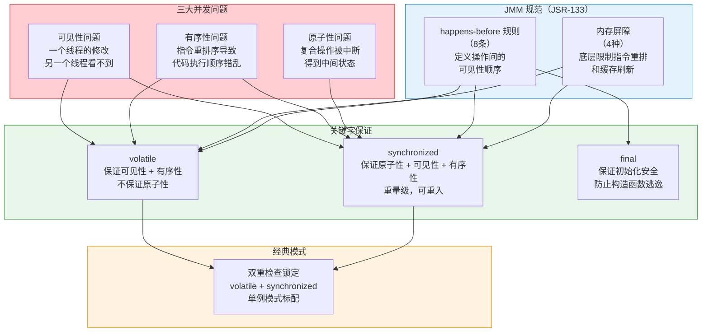
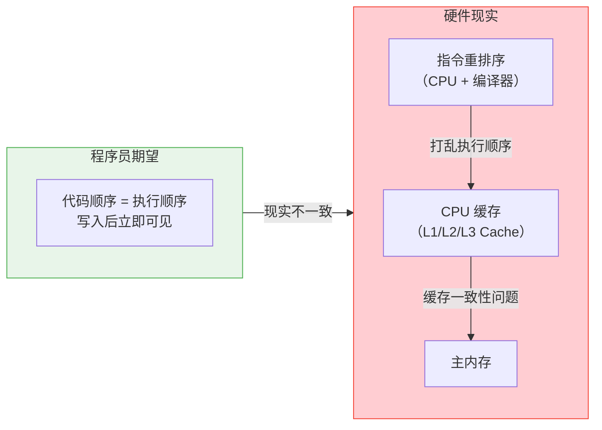
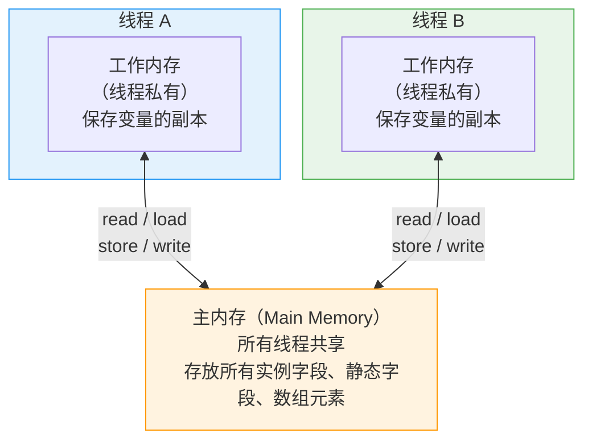
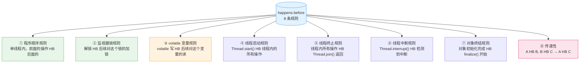

# Java 内存模型（JMM）：happens-before、可见性、有序性

## 核心概念全览



> 💡 **阅读指引**：JMM 是 Java 并发编程的底层规范，定义了什么情况下一个线程的写入对另一个线程可见。本文先讲"为什么会有这些规则"（CPU 缓存、指令重排这些硬件问题），再讲"规则是什么"（8 条 happens-before），最后落到 volatile、final、双重检查锁定这些日常开发中直接使用的场景。建议先看懂问题再学规则，理解会深刻很多。
>
> 🔗 **关联阅读**：[Java 锁机制](Java-Lock-Mechanism-Notes.md) 中 synchronized / ReentrantLock 的可见性实现依赖 JMM 规范；[线程池](ThreadPool-Notes.md) 中任务提交也涉及跨线程可见性问题。
>
> ⚠️ **概念区分**：JMM（Java Memory Model）是**并发编程规范**，定义多线程下内存可见性规则。不要和"JVM 内存模型"混淆——后者指 JVM 运行时数据区域（堆、栈、方法区、GC），是完全不同的概念。

---

## 一、为什么需要 JMM？

### 1.1 理想 vs 现实



在物理层面，程序运行的真实世界有三重"干扰"：

| 来源 | 做了什么 | 导致的问题 |
| :--- | :--- | :--- |
| **CPU 缓存** | 每个 CPU 核心有自己的 L1/L2 缓存，共享 L3 缓存和主内存 | 可见性：一个核心的写入，另一个核心不能立即看到 |
| **CPU 指令重排** | CPU 为提升流水线效率，可能打乱无依赖指令的执行顺序 | 有序性：代码执行顺序和书写顺序不一致 |
| **编译器优化** | JIT 编译器也可能重排指令、将变量缓存在寄存器中 | 有序性：和上面叠加，更加不可预测 |

> 💡 **一句话理解**：JMM 就是在这些"不可靠的硬件行为"之上，规定了一套"可靠的编程规则"。你按规则写代码，JVM 保证多线程下行为正确。

### 1.2 经典问题：一个线程写，另一个线程读不到

```java
public class VisibilityExample {
    private static boolean flag = false;  // 没有 volatile！

    public static void main(String[] args) {
        new Thread(() -> {
            while (!flag) {  // 线程 B：可能永远看不到 flag = true
            }
            System.out.println("线程 B 退出");
        }).start();

        Thread.sleep(1000);
        flag = true;  // 线程 A：修改 flag
        System.out.println("flag 已设置为 true");
    }
}
```

**可能结果**：线程 B 永远不会退出。因为线程 A 对 `flag` 的修改只写入了 CPU 缓存，没有刷新到主内存；线程 B 读取的一直是自己缓存中的旧值。

> ⚠️ **注意**：这不是必然发生的——取决于 CPU 架构（x86 的缓存一致性比 ARM 强）、JIT 编译优化、运气。但规范上就是未定义行为。

---

## 二、JMM 抽象模型：主内存 + 工作内存



JMM 定义了线程和主内存之间的抽象关系：

| 概念 | 存储内容 | 共享性 | 类比 |
| :--- | :--- | :--- | :--- |
| **主内存** | 所有实例字段、静态字段、数组元素 | 所有线程共享 | 物理内存 |
| **工作内存** | 主内存变量的**副本**，线程操作的都是副本 | 线程私有 | CPU 缓存 + 寄存器 |

**八种原子操作**（JMM 定义的抽象操作，JVM 实现可不同）：

| 操作 | 方向 | 说明 |
| :--- | :--- | :--- |
| `lock` | — | 锁定主内存变量，线程独占 |
| `unlock` | — | 解锁主内存变量 |
| `read` | 主内存 → 工作内存 | 从主内存读取变量到工作内存 |
| `load` | — | 把 read 读取的值放入工作内存的副本中 |
| `use` | — | 工作内存中的值传递给执行引擎 |
| `assign` | — | 执行引擎计算后的值赋给工作内存副本 |
| `store` | 工作内存 → 主内存 | 把工作内存副本传递到主内存 |
| `write` | — | 把 store 传递的值写入主内存变量 |

> 💡 **关键理解**：线程之间**不会直接共享工作内存**。线程 A 修改变量 → store/write 到主内存 → 线程 B read/load 到工作内存。这就是 "为什么需要可见性规则" 的根本原因。

---

## 三、happens-before 规则（8 条）

### 3.1 什么是 happens-before？

> **如果一个操作 happens-before 另一个操作，那么第一个操作的执行结果对第二个操作可见，且第一个操作的执行顺序在第二个操作之前。**

这是 JMM 的核心承诺：程序员按规则写代码，JVM 保证多线程下的可见性和有序性。**它不是"一定在时间上先发生"，而是"结果上保证可见"**。

### 3.2 8 条规则详解



#### ① 程序顺序规则（Program Order Rule）

```java
// 单线程中，代码书写顺序 = happens-before 顺序
int a = 1;       // ①
int b = 2;       // ②  ① happens-before ②
int c = a + b;   // ③  ①、② happens-before ③
```

> ⚠️ **注意**：这只保证"结果上"的正确性，JVM 可能在不影响结果的前提下重排序指令。

#### ② 监视器锁规则（Monitor Lock Rule）

```java
// 对同一个锁：unlock happens-before lock
synchronized (lock) {       // lock ④
    x = 10;                 // ⑤
}                           // unlock ⑥

// 另一个线程：
synchronized (lock) {       // lock ⑦ —— ⑥ happens-before ⑦，所以能看到 x = 10
    System.out.println(x);  // ⑧ 一定输出 10
}
```

#### ③ volatile 变量规则（Volatile Variable Rule）

```java
volatile int v = 0;

// 线程 A：
v = 42;  // volatile 写

// 线程 B：
int r = v;  // volatile 读 —— 线程 A 的写 happens-before 此读，r 一定是 42
```

而且 volatile 写 **不仅仅对 volatile 变量本身**保证可见性——写之前的全部写入都对后续 volatile 读可见：

```java
// 线程 A：
x = 1;      // 普通变量
flag = true; // volatile 写

// 线程 B：
if (flag) {             // volatile 读
    int r = x;          // r 一定是 1，因为 volatile 的"附带可见性"
}
```

#### ④ 线程启动规则（Thread Start Rule）

```java
x = 42;                              // 主线程操作
Thread t = new Thread(() -> {
    System.out.println(x);           // 一定能看到 x = 42
});
t.start();                           // start() happens-before 线程内所有操作
```

#### ⑤ 线程终止规则（Thread Termination Rule）

```java
Thread t = new Thread(() -> {
    x = 42;                          // 线程内操作
});
t.start();
t.join();                            // 线程内操作 happens-before join() 返回
System.out.println(x);               // 一定能看到 x = 42
```

#### ⑧ 传递性（最常用也最重要）

```java
// 线程 A：
x = 1;         // ①
flag = true;   // ② volatile 写

// 线程 B：
if (flag) {    // ③ volatile 读
    int r = x; // ④
}
//  ① hb ② (程序顺序) → ② hb ③ (volatile规则) → ③ hb ④ (程序顺序)
//  → ① hb ④ (传递性)，所以 r 一定是 1
```

### 3.3 as-if-serial vs happens-before

| 概念 | 作用域 | 含义 |
| :--- | :--- | :--- |
| **as-if-serial** | 单线程 | 不管怎么重排序，单线程执行结果不变 |
| **happens-before** | 多线程 | 跨线程的可见性和顺序保证 |

> 💡 **一句话区别**：as-if-serial 让你单线程放心写代码；happens-before 让你多线程放心写代码。

---

## 四、volatile 深度解析

### 4.1 volatile 的三大特性

| 特性 | 保证？ | 说明 |
| :--- | :---: | :--- |
| **可见性** | ✅ | volatile 写立即刷新到主内存，volatile 读强制从主内存读取 |
| **有序性** | ✅ | 禁止 volatile 变量与普通变量的指令重排序 |
| **原子性** | ❌ | `i++` 这样的复合操作仍然不安全 |

### 4.2 volatile 如何禁止指令重排序

```java
// volatile 写的内存屏障插入规则：
普通写操作
    ↓
StoreStore 屏障  ← 禁止上面的普通写和下面的 volatile 写重排
    ↓
volatile 写
    ↓
StoreLoad 屏障   ← 禁止 volatile 写和后面的 volatile 读/写重排（最昂贵的屏障）
    ↓
后续操作
```

```java
// volatile 读的内存屏障插入规则：
volatile 读
    ↓
LoadLoad 屏障    ← 禁止 volatile 读和后面普通读重排
    ↓
LoadStore 屏障   ← 禁止 volatile 读和后面普通写重排
    ↓
后续操作
```

### 4.3 四种内存屏障

| 屏障类型 | 指令 | 禁止的重排序 |
| :--- | :--- | :--- |
| **LoadLoad** | `Load1; LoadLoad; Load2` | Load1 不能和 Load2 重排 |
| **StoreStore** | `Store1; StoreStore; Store2` | Store1 不能和 Store2 重排 |
| **LoadStore** | `Load1; LoadStore; Store2` | Load1 不能和 Store2 重排 |
| **StoreLoad** | `Store1; StoreLoad; Load2` | Store1 不能和 Load2 重排（**最昂贵**，同时具有其他三个的效果） |

### 4.4 volatile 适用场景

| ✅ 适合 | ❌ 不适合 |
| :--- | :--- |
| 状态标志 `volatile boolean flag` | `count++` 复合操作 |
| 双重检查锁定中的单例 | 需要原子性的计数器 |
| 独立观察（一个线程写，多线程读） | 需要 `compare-and-set` 的场景（用 `AtomicInteger`） |
| 一次性安全发布（如初始化后不再变） | 多线程写竞争 |

```java
// ✅ 适合 volatile：状态标志
volatile boolean shutdown = false;
// 线程 A：shutdown = true;
// 线程 B：if (shutdown) { cleanUp(); }

// ❌ 不适合 volatile：计数器
volatile int count = 0;
count++;  // 实际上是 read-modify-write 三步，非原子！
// 正确做法：
AtomicInteger count = new AtomicInteger(0);
count.incrementAndGet();
```

---

## 五、final 域的内存语义

### 5.1 final 的初始化安全

```java
public class FinalExample {
    private final int x;
    private int y;            // 普通变量
    private static FinalExample instance;

    public FinalExample() {
        x = 1;                // final 写入
        y = 2;                // 普通写入
    }

    public static void writer() {
        instance = new FinalExample();
    }

    public static void reader() {
        FinalExample obj = instance;
        if (obj != null) {
            int a = obj.x;    // ✅ 保证是 1（final 保证了初始化安全）
            int b = obj.y;    // ❌ 可能是 0！普通变量可能被重排序
        }
    }
}
```

JMM 对 final 域有两个特殊规则：

| 规则 | 说明 |
| :--- | :--- |
| **构造函数内 final 写** | 禁止 final 域写入与"对象引用赋值给其他变量"重排序 |
| **初次读 final 域** | 禁止初次读对象引用与初次读该对象的 final 域重排序 |

> 💡 **一句话**：`final` 域保证**只要对象被正确构造出来**（没有构造函数逃逸），所有线程看到的 final 值就是构造函数中赋予的值，不需要同步。

### 5.2 构造函数逃逸问题

```java
// ❌ 危险写法：this 逃逸
public class ThisEscape {
    private final int x;

    public ThisEscape() {
        // 在构造函数完成前，this 就被另一个线程拿到了！
        SomeClass.register(this);  // this 逃逸！
        x = 42;   // 另一个线程此时读 x 可能看到 0
    }
}

// ✅ 正确写法：工厂方法
public class SafeConstruction {
    private final int x;

    private SafeConstruction() {
        x = 42;  // 先构造完成
    }

    public static SafeConstruction create() {
        SafeConstruction obj = new SafeConstruction();
        SomeClass.register(obj);  // 构造完成后再注册，this 不逃逸
        return obj;
    }
}
```

---

## 六、经典案例：双重检查锁定（DCL）

### 6.1 单例模式：从有 bug 到正确

```java
// ❌ 第一版：懒汉式，线程不安全
class Singleton1 {
    private static Singleton1 instance;
    public static Singleton1 getInstance() {
        if (instance == null) {
            instance = new Singleton1();   // 多线程可能创建多个实例
        }
        return instance;
    }
}

// ❌ 第二版：加锁，但性能差
class Singleton2 {
    private static Singleton2 instance;
    public synchronized static Singleton2 getInstance() {  // 每次调用都要竞争锁
        if (instance == null) {
            instance = new Singleton2();
        }
        return instance;
    }
}

// ❌ 第三版：DCL 但有 bug！
class Singleton3 {
    private static Singleton3 instance;   // 没有 volatile！
    public static Singleton3 getInstance() {
        if (instance == null) {           // 第一次检查（无锁）
            synchronized (Singleton3.class) {
                if (instance == null) {   // 第二次检查（有锁）
                    // ⚠️ 问题在这行！new Singleton3() 不是原子操作
                    instance = new Singleton3();
                }
            }
        }
        return instance;
    }
}
```

### 6.2 为什么 DCL 需要 volatile？

`new Singleton3()` 这句看似简单，实际上分为 3 步：

```java
// 伪代码：new Singleton3() 的底层步骤
memory = allocate();        // ① 分配内存空间
ctorInstance(memory);      // ② 初始化对象（调用构造函数）
instance = memory;          // ③ 将 instance 指向分配的内存地址
```

**问题**：步骤 ② 和 ③ 可能被**重排序**！如果先执行 ③ 再执行 ②：

```java
// 重排序后的执行顺序：
memory = allocate();        // ①
instance = memory;          // ③ instance 指向了未初始化的对象！
ctorInstance(memory);      // ② 初始化（还没执行完）

// 此时另一个线程执行到第一个 if (instance == null)：
// instance != null → 直接返回 → 拿到一个未初始化完的对象！
```

```java
// ✅ 正确版：加 volatile 禁止重排序
class Singleton {
    private static volatile Singleton instance;

    public static Singleton getInstance() {
        if (instance == null) {
            synchronized (Singleton.class) {
                if (instance == null) {
                    instance = new Singleton();
                }
            }
        }
        return instance;
    }
}
```

`volatile` 在这里的作用：插入 `StoreStore` 屏障，禁止「② 初始化对象」和「③ 赋值引用」的重排序，保证 `instance` 指向的一定是完全初始化好的对象。

---

## 七、JMM 与 synchronized / Lock 的关系

| 机制 | 可见性 | 有序性 | 原子性 | 原理 |
| :--- | :---: | :---: | :---: | :--- |
| **volatile** | ✅ | ✅ | ❌ | 内存屏障 |
| **synchronized** | ✅ | ✅ | ✅ | monitorenter/monitorexit + 内存屏障 |
| **Lock** | ✅ | ✅ | ✅ | AQS 中的 volatile state + CAS |
| **final** | ✅（仅初始值） | ✅（禁止重排） | — | final 语义规则 |

> 💡 **记忆口诀**：`volatile` 是**轻量级 synchronized**，只保可见有序，不保原子；`synchronized` / `Lock` 是**全能型**，三样都保，但有开销。

---

## 八、常见误区

| 误区 | 事实 |
| :--- | :--- |
| "volatile 变量是线程安全的" | ❌ 只保可见有序，`i++` 照样出事 |
| "synchronized 比 volatile 慢很多" | ⚠️ JDK 6 后锁升级（偏向→轻量→重量），竞争不大时接近 CAS 性能 |
| "所有共享变量都加 volatile 就行" | ❌ 原子性问题不解决，而且会引入不必要的内存屏障开销 |
| "happens-before 就是时间上的先后" | ❌ 是**可见性保证**，不是时间先后。A hb B 不意味着 A 在 B 之前执行完 |
| "JMM 可以解决所有并发问题" | ❌ JMM 只规定可见性和有序性。原子性需要锁或 CAS 来解决 |
| "无锁编程就不需要 JMM" | ❌ CAS 底层的 `Unsafe.compareAndSwap` 同样依赖 volatile 语义保证可见性 |

---

## 九、关键问答速查

**Q1: 为什么要有 JMM？直接按物理内存模型不行吗？**

> 不同 CPU 架构（x86、ARM、PowerPC）的内存模型差异巨大。x86 是强内存模型（只有 StoreLoad 重排），ARM 是弱内存模型（几乎所有重排都可能发生）。如果 Java 不抽象一层 JMM，同一份代码在 x86 上正确、在 ARM 上可能出错。JMM 屏蔽了硬件差异，提供统一的编程保证。

**Q2: 1.8 条 happens-before 规则全都要背吗？**

> 其实记住最核心的 4 条就够了：**程序顺序、锁规则、volatile 规则、传递性**。其他 4 条（线程启动/终止/中断/finalize）理解概念即可，不需要死记。

**Q3: volatile 和 synchronized 到底怎么选？**

> 只有一个线程写、多个线程读的简单状态标志 → `volatile`；有复合操作或需要互斥 → `synchronized` 或 `Lock`。口诀：**一写多读用 volatile，复合操作用 synchronized**。

**Q4: 双重检查锁定的 volatile 能不能省？**

> **绝对不能省**。即使在某些平台上"看起来"没问题，那也是未定义行为，可能换个 JDK 版本或部署环境就出问题了。

**Q5: String 的 final 数组为什么安全？**

> `String` 内部的 `private final char value[]` 利用了 final 的初始化安全语义。String 对象一旦构造完成，它的 `value[]` 和 `hash` 对所有线程可见且不可变，所以 String 天然线程安全。

---

## 十、总结

| 层次 | 关键点 | 一句话 |
| :--- | :--- | :--- |
| **本质问题** | CPU 缓存 + 指令重排 + 编译器优化 | 硬件"不靠谱"，需要规则来约束 |
| **JMM 核心** | 8 条 happens-before + 主内存/工作内存模型 | 按规则写的代码，JVM 保证跨线程可见性 |
| **volatile** | 可见性 + 有序性（不保证原子性） | 轻量级同步，一写多读的首选 |
| **DCL** | volatile 禁止重排序 | `new` 对象不是原子操作，不加 volatile 可能拿到"半成品" |
| **final** | 初始化安全 | 构造完成后不可变，天然线程安全 |