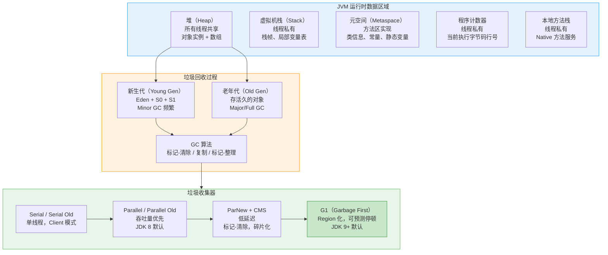
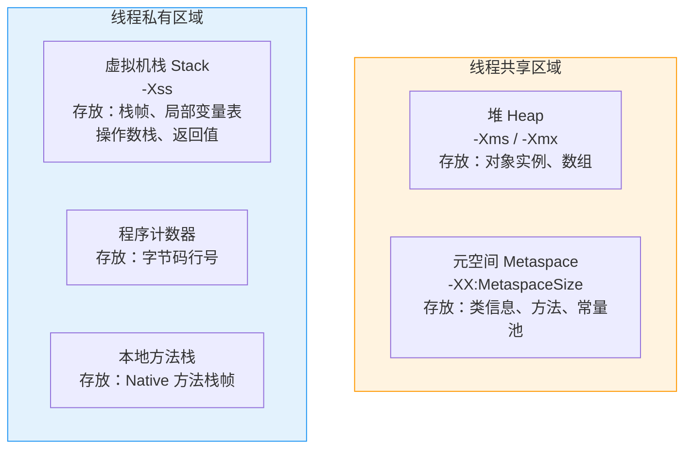
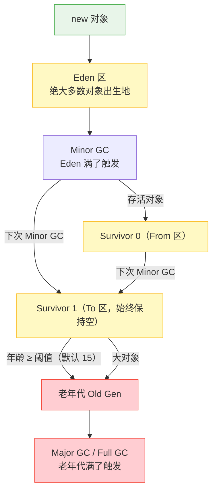
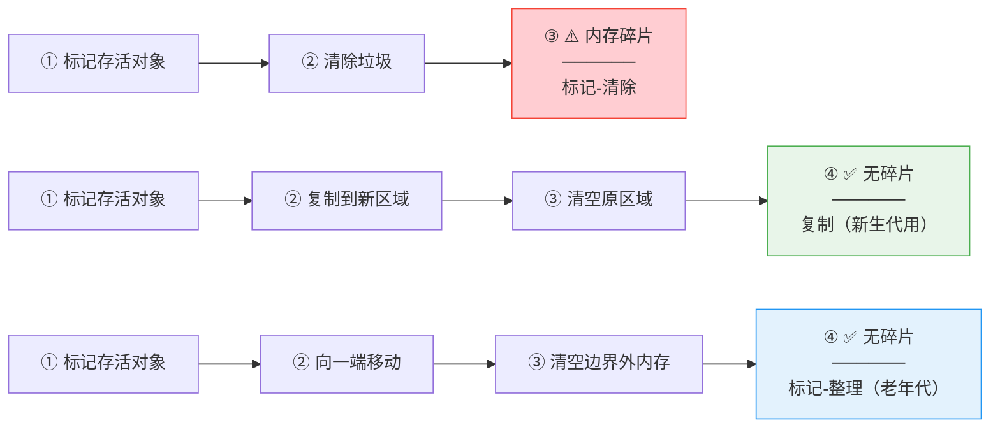
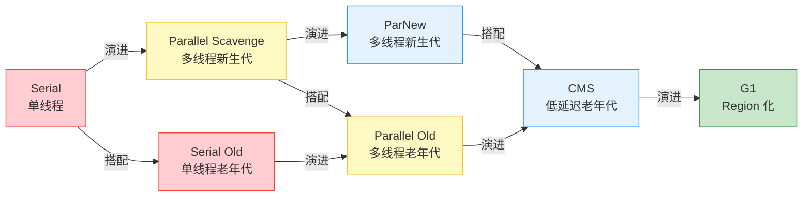
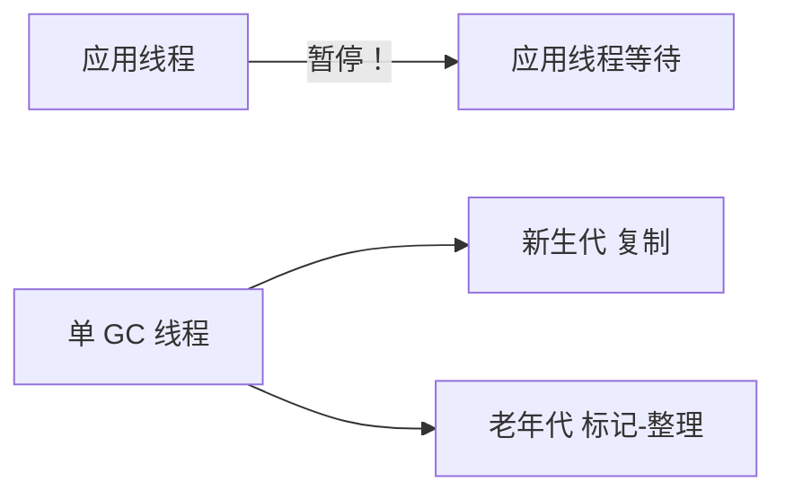
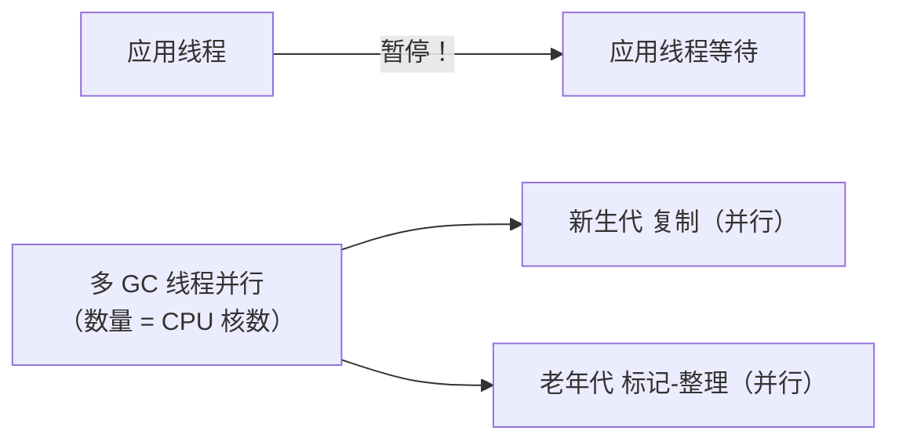
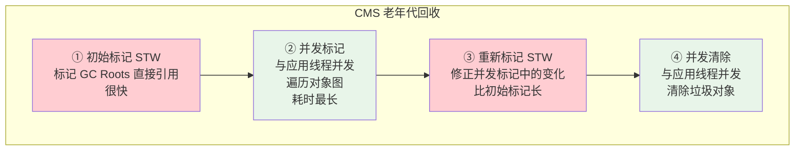
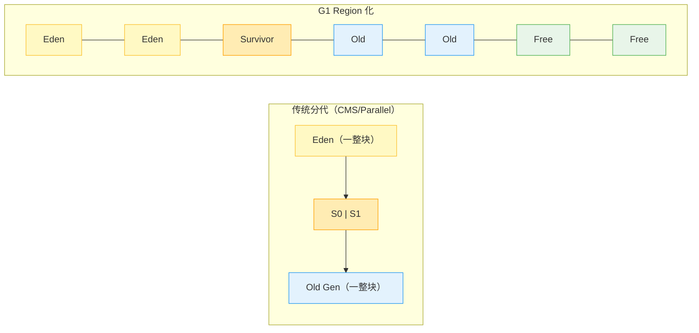

# JVM 内存模型与垃圾回收：GC 算法、收集器、调优实战

## 核心概念全览



> 💡 **阅读指引**：本文先讲 JVM 内存结构（堆、栈、元空间各放什么），再讲 GC 算法原理（标记复制、标记整理怎么工作的），最后落到实际用的收集器（Serial → Parallel → CMS → G1 的演进路线）和调优实践。建议按这个顺序读，先懂"内存长什么样"，再懂"垃圾怎么收"，最后才知道"参数怎么调"。
>
> ⚠️ **概念区分**：本文讲的"JVM 内存模型"是 **JVM 运行时数据区域**（Run-Time Data Areas），即堆、栈、方法区等。不要和 **JMM（Java Memory Model）** 混淆——JMM 是多线程并发编程的可见性/有序性规范。
>
> 🔗 **关联阅读**：[JMM 文章](JMM-Notes.md) ；[线程池](ThreadPool-Notes.md) 中线程运行在虚拟机栈上。
>
> 📖 JVM 启动参数通用格式（下文 GC 参数中会反复用到）：
> - `-XX:+<Option>` — 开启布尔选项（如 `-XX:+UseG1GC`）
> - `-XX:-<Option>` — 关闭布尔选项
> - `-XX:<Option>=<Value>` — 设置数值/字符串（如 `-XX:MaxGCPauseMillis=200`）
>
> ⚠️ **特别注意**：`+/-` 控制的是**布尔开关**，只有 `ON/OFF` 两种状态；`=` 设置的是**具体数值**。千万不要写成 `-XX:+MaxGCPauseMillis=200`（`+` 号后面只能跟选项名，不能跟数值）。
>
> 📖 **`-D` vs `-XX` 的区别**（容易混淆）：
>
> | | `-D` | `-XX` |
> | :--- | :--- | :--- |
> | **给谁用的** | 应用代码（通过 `System.getProperty()` 读取） | JVM 本身（GC、JIT、内存等） |
> | **作用** | 传配置，如 `-Dserver.port=8080` | 调 JVM 行为，如 `-XX:+UseG1GC` |
> | **代码能读到吗** | ✅ `System.getProperty("server.port")` | ❌ 代码读不到 |
>
> 另外 `-X` 开头的（如 `-Xmx`、`-Xms`）是 `-XX` 的简写别名，也是调 JVM 的：`-Xmx2g` 等价于 `-XX:MaxHeapSize=2g`。


---

## 一、JVM 运行时数据区域

### 1.1 全景图



| 区域 | 线程 | 存储内容 | 可能异常 | 参数 |
| :--- | :--- | :--- | :--- | :--- |
| **堆（Heap）** | 共享 | 对象实例、数组 | `OutOfMemoryError: Java heap space` | `-Xms`/`-Xmx` |
| **虚拟机栈（Stack）** | 私有 | 栈帧（局部变量表、操作数栈、返回值地址） | `StackOverflowError` | `-Xss`（默认约 1MB） |
| **元空间（Metaspace）** | 共享 | 类元数据、方法信息、运行时常量池 | `OutOfMemoryError: Metaspace` | `-XX:MetaspaceSize`/`-XX:MaxMetaspaceSize` |
| **程序计数器** | 私有 | 当前线程执行字节码的行号 | 不会 OOM | — |
| **本地方法栈** | 私有 | Native 方法的栈帧 | `StackOverflowError` | — |

> ⚠️ **JDK 8 重大变化**：JDK 8 用**元空间（Metaspace）**取代了之前的**永久代（PermGen）**。元空间使用的是**本地内存**（Native Memory），不再受 `-XX:MaxPermSize` 限制，默认只受物理内存限制。好处是基本不会出现 `PermGen OOM`，但配置 `-XX:MaxMetaspaceSize` 仍然有必要，防止本地内存被无限撑爆。

### 1.2 栈和堆的关系

```java
public void method() {
    int a = 1;                    // ① a 存在栈帧的局部变量表里
    Object obj = new Object();    // ② obj（引用）在栈上，new Object() 实例在堆上
}                                 // ③ 方法结束，栈帧弹出，a 和 obj 引用消失
                                  //    堆上的 Object 实例变成垃圾，等 GC 回收
```

**一句话**：栈管方法执行和局部变量，堆管对象实例。栈的"栈帧弹出"是自动的，堆的"对象回收"要等 GC。

### 1.3 方法区 → 元空间的演变

| 版本 | 实现 | 位置 | 配置参数 |
| :--- | :--- | :--- | :--- |
| JDK 7 及之前 | 永久代（PermGen） | JVM 堆内 | `-XX:PermSize`/`-XX:MaxPermSize` |
| JDK 8+ | 元空间（Metaspace） | 本地内存（堆外） | `-XX:MetaspaceSize`/`-XX:MaxMetaspaceSize` |

为什么换？永久代的 `-XX:MaxPermSize` 很难预估（不同应用加载的类数量差异大），设小了容易 OOM，设大了浪费堆空间。元空间放本地内存里，容量灵活多了。

---

## 二、对象的一生：从创建到回收



### 2.1 分代模型

| 区域 | 大小比例 | 特点 | GC 类型 | 触发条件 |
| :--- | :--- | :--- | :--- | :--- |
| **新生代（Young Gen）** | 堆的 1/3~1/2 | 大部分对象"朝生夕死"，存活率低 | **Minor GC** | Eden 区满了 |
| E — **Eden** | Young 的 80% | 新对象分配在这里 | — | — |
| S0 — **Survivor 0** | Young 的 10% | From 区，GC 时活下来的对象 | — | — |
| S1 — **Survivor 1** | Young 的 10% | To 区，GC 后始终是空的 | — | — |
| **老年代（Old Gen）** | 堆的 2/3~1/2 | 存活时间长、经过多次 GC 的对象 | **Major/Full GC** | 老年代满了 |

> ⚠️ **S0 和 S1 为什么有两个？** 这是复制算法的需要——每次 Minor GC 把 Eden + From 中的存活对象复制到 To 中，然后清空 Eden + From，再交换 From 和 To。**To 区在 GC 后始终保持空**，等待下一次 GC。

### 2.2 对象晋升到老年代的条件

| 条件 | 说明 |
| :--- | :--- |
| **年龄够了** | 对象每熬过一次 Minor GC，年龄 +1，达到 `-XX:MaxTenuringThreshold`（默认 15）就晋升 |
| **动态年龄判断** | Survivor 中年龄 1~N 的对象总大小 ≥ Survivor 的 50%，年龄 ≥ N 的直接晋升 |
| **大对象直接进** | 超过 `-XX:PretenureSizeThreshold` 的大对象直接分配到老年代 |
| **Survivor 放不下** | Minor GC 后存活对象太多，Survivor 放不下，多余的直接进老年代 |

---

## 三、GC 算法基础

### 3.1 如何判断对象是垃圾？

**可达性分析（GC Roots Tracing）** — JVM 的主流方式：

从 **GC Roots** 出发，向下搜索引用链，链上的对象存活，不在链上的就是垃圾。

```java
// GC Roots 包括以下几种：
Object obj = new Object();               // ① 虚拟机栈引用的对象
static Object staticObj = new Object();  // ② 静态变量引用的对象（在方法区）
static final String S = "hello";         // ③ 常量引用的对象（运行时常量池）
                                         // ④ JNI 引用的对象（Native 方法中创建的全局对象）
```

### 3.2 三种基础 GC 算法



| 算法 | 干了什么 | 优缺点 | 用在哪 |
| :--- | :--- | :--- | :--- |
| **标记-清除** | 标记存活 → 清除垃圾 | ✅ 简单 ❌ 碎片多 | CMS 的基础 |
| **复制** | 标记存活 → 复制到新空间 → 清空旧空间 | ✅ 无碎片 ❌ 只用一半空间 | **新生代**（Minor GC） |
| **标记-整理** | 标记存活 → 向前移动 → 清空尾部 | ✅ 无碎片 ❌ 暂停时间长 | **老年代**（Serial/Parallel Old） |

### 3.3 分代收集——JVM 的统一策略

> 新生代对象存活率低 → 用**复制算法**（复制的对象少，性价比高）
> 老年代对象存活率高 → 用**标记-清除**或**标记-整理**（不需要浪费一半空间）

---

## 四、Java 8 时代的垃圾收集器

### 4.1 收集器演进全景



### 4.2 四种组合对比

| 组合 | 新生代 | 老年代 | 设计目标 | JDK 8 是否默认 |
| :--- | :--- | :--- | :--- | :---: |
| **Serial + Serial Old** | Serial | Serial Old | 单线程，小内存 Client 模式 | ❌ |
| **Parallel + Parallel Old** | Parallel Scavenge | Parallel Old | **吞吐量优先** | ✅ **默认** |
| **ParNew + CMS** | ParNew | CMS | **低延迟优先**，减少 STW | ❌（手动开） |
| **G1** | G1（Region 统一管理） | G1 | 可预测停顿，大堆内存 | ❌（JDK 9+ 默认） |

### 4.3 Serial / Serial Old —— 单线程，简单可靠



- **新生代**：Serial（复制算法，单线程）
- **老年代**：Serial Old（标记-整理，单线程）
- **特点**：GC 时 **所有应用线程暂停**，简单高效，没有线程切换开销
- **适用**：几百 MB 的小堆、桌面应用

```bash
-XX:+UseSerialGC
```

### 4.4 Parallel / Parallel Old —— 吞吐量优先



- **新生代**：Parallel Scavenge（复制算法，多线程并行）
- **老年代**：Parallel Old（标记-整理，多线程并行）
- **特点**：关注**吞吐量**（用户代码运行时间 / 总时间）
- **适用**：后台计算、批处理
- **JDK 8 默认收集器**

核心参数：

```
吞吐量 = 用户代码运行时间 / (用户代码运行时间 + GC 时间)

-XX:MaxGCPauseMillis=<N>    # 最大 GC 暂停时间（毫秒）
-XX:GCTimeRatio=<N>         # 吞吐量目标：1/(1+N)，默认 99 → 1% GC 时间
-XX:+UseAdaptiveSizePolicy  # 自适应调节新生代大小（默认开启）
```

> ⚠️ `MaxGCPauseMillis` 设得越小，GC 频率越高 → 总吞吐量反而下降。比如要求 80ms 以内 → JVM 缩小新生代 → GC 更频繁 → 总 GC 时间反而变长。

### 4.5 ParNew + CMS —— 低延迟，互联网标配



- **新生代**：ParNew（复制算法，多线程，和 CMS 配套）
- **老年代**：CMS（标记-清除，并发回收）
- **特点**：两次 STW 时间短，大部分时间 GC 和应用线程并发执行
- **适用**：互联网服务端，要求快速响应

**CMS 的三个致命缺陷**：

| 问题 | 原因 | 后果 |
| :--- | :--- | :--- |
| **碎片化** | 标记-清除不整理 | 老年代有空间但没有连续空间 → **Concurrent Mode Failure** → 退化为 Serial Old 单线程 Full GC |
| **浮动垃圾** | 并发清除时应用线程还在产生新垃圾 | 必须预留空间，老年代使用率达阈值（默认 92%）就触发 GC |
| **CPU 敏感** | 并发标记/清除占用 CPU 线程 | CPU 核数少时和应用抢 CPU |

> ⚠️ **Concurrent Mode Failure 是 CMS 最常见的噩梦**：CMS 并发清除过程中老年代满了 → 没有连续空间分配 → CMS 失败 → JVM 用 Serial Old 单线程 Full GC → STW 暴增。

```bash
-XX:+UseConcMarkSweepGC               # 开启 CMS
-XX:CMSInitiatingOccupancyFraction=70  # 老年代占用 70% 触发 CMS（默认 92%，建议设低）
-XX:+UseCMSCompactAtFullCollection    # Full GC 后整理碎片
```

---

## 五、G1（Garbage First）—— 从小白到理解

### 5.1 先搞清楚：为什么要有 G1？

前面讲了 CMS，它能并发回收、低延迟。但它有两个要命的毛病：

1. **碎片问题**：CMS 用"标记-清除"，老年代会碎成马蜂窝。碎到极致没连续空间了，只能用单线程 Full GC 救场，一卡好几秒。
2. **大堆不行**：堆超过 6~8GB，CMS 扫一次老年代太慢了。

G1 就是为了解决这两个问题设计的——**既能用在大堆上，又不会碎成一地，而且暂停时间可控。**

---

### 5.2 G1 的核心思路：把堆切成麻将牌



G1 不再把堆分成"一整块新生代 + 一整块老年代"，而是切成 N 个**同等大小的小方块**（Region，默认 1~32MB）。**每个 Region 可以随时切换角色**：这一刻是 Eden，回收后就变成 Free，下一次又可以被分配给 Old。

> **通俗理解**：传统分代像是把房间硬隔成"卧室"和"客厅"，墙不能动。G1 像摆了满地的**积木块**，这块当卧室、那块当客厅，随时可以重新摆——哪儿需要就挪到哪。

**那 From/To 区呢？** 逻辑还在（存活对象从旧 Survivor Region 复制到新 Region），但没有固定的 S0/S1 了。每轮 Young GC：旧 Survivor Region 直接释放 → 存活对象搬到空闲 Region → 新 Region 打上 Survivor 标签。

---

### 5.3 G1 怎么收垃圾？—— 三种模式

| 模式 | 什么时候触发 | 干什么 | 卡多久 |
| :--- | :--- | :--- | :---: |
| **Young GC** | 所有 Eden Region 整体都塞不下了（不是某个 Region 满） | 清空 Eden，存活对象搬到 Survivor | 很快（几十 ms） |
| **Mixed GC** | 堆用了 45%（默认） | 清 Eden + **挑几个垃圾最多的老年代 Region** 回收 | 可控（百 ms 级） |
| **Full GC** | Mixed GC 跟不上分配速度 | 退化成单线程扫全堆 | **灾难（秒级）** |

> 💡 Eden Region 虽然分散在 N 个物理 Region 上，但逻辑上是一个**整体空间池**——分配对象时挨个 Eden Region 找空位，只有全部 Eden Region 都装不下了才触发 Young GC。就像一个超市有多排货架，某一排放满没事，换个货架继续放；所有货架都满了才叫"没地儿了"。

**"Garbage First" 的精髓就在 Mixed GC**：不是整个老年代一起收，而是算一下——哪个 Region 里垃圾比例最高就先收哪个。收够 Region 了，哪怕老年代还剩一些垃圾也不管了，先停。下一次 Mixed GC 再接着收。

> **类比**：CMS 像"全班大扫除"，所有人一起把整个教室扫一遍，但中途你可以干别的（并发）。G1 像"值日生制度"——只打扫最脏的几个位置，扫差不多就停，保证课间只有 5 分钟（`MaxGCPauseMillis`）。

> ⚠️ **G1 Full GC 是灾难**：如果对象分配太快、Mixed GC 来不及收 → G1 退化成**单线程** Serial Old Full GC → STW 可能秒级甚至分钟级。生产环境一定要避免。

---

### 5.4 Mixed GC 六步走（带读）


**不用死记**，记住核心节奏就行：**标一下（停很短）→ 慢慢扫（不停，边扫边干活）→ 对一下答案（再停）→ 只搬垃圾最多的（停）**。

其中 ③ 并发标记是占时最长的阶段，但好在**用户线程不暂停**，所以对线上请求几乎无感。STW 只发生在 ①（极短）、④（短）、⑤⑥（这两步只处理筛选出来的少数 Region，也不长）。

---

### 5.5 G1 的"通讯录"：RSet（Remembered Set）

这是 G1 能"只收部分 Region"的关键技术。先说问题：**如果要回收 Region A，上哪儿找谁引用了 A 里的对象？** 不解决这个问题，就得扫全堆——那和 CMS 一样慢了。

G1 的解法：**每个 Region 随身带个小本本（RSet），记录着"外人指向我的引用"**。

```
Region A（要被回收）的 RSet：
  "Region X 里有个字段指向 A 里 offset=16 的对象"
  "Region Y 里有个字段指向 A 里 offset=128 的对象"

→ 回收 A 时，只看这个本本，不用扫整个堆
```

> 💡 **一句话**：RSet 就是**"谁指着我"的通讯录**。GC 只回收部分 Region 时不需要全堆扫描，照着通讯录找就行。

**那 CMS 用的 Card Table 和 RSet 啥区别？**

| | Card Table（CMS） | RSet（G1） |
| :--- | :--- | :--- |
| 粒度 | 整个堆一张大表，卡了才查 | **每个 Region 自己一张** |
| 查"谁指着我" | 要扫整张 Card Table 才知道 | 直接看本 Region 的 RSet，O(1) |
| 适合 | 全堆回收 | **Partial GC**（只收一部分） |

---

### 5.6 G1 常用参数（带人话解释）

```bash
-XX:+UseG1GC                        # 用 G1（JDK 9+ 默认已经是 G1，不用加）
-XX:MaxGCPauseMillis=200            # 每次 GC 最多停 200ms（软目标，非硬保证）
-XX:InitiatingHeapOccupancyPercent=45
# ↑ 堆用了 45% 就开始触发 Mixed GC。设太高→来不及收就 Full GC；设太低→GC 太频繁
-XX:G1HeapRegionSize=4m
# ↑ 每个 Region 多大（1/2/4/8/16/32M），堆大就用大 Region，一般 4m 够用
-XX:G1NewSizePercent=5              # 新生代至少占堆的 5%
-XX:G1MaxNewSizePercent=60          # 新生代最多占堆的 60%
-XX:ParallelGCThreads=8             # 并行阶段用几个线程干活（一般设 CPU 核数）
-XX:ConcGCThreads=2                 # 并发阶段用几个线程（一般设为 ParallelGCThreads 的 1/4）
```

> ⚠️ `MaxGCPauseMillis` 设太小（比如 10ms）反而坏事——G1 为了达标会疯狂做小范围 GC，吞吐量直接崩掉。互联网 API 建议 100~200ms。

---

### 5.7 一句话总结 G1

```
传统 GC： 把堆分成"卧室+客厅"，收的时候要么全扫、要么碎一地
G1：     把堆切成"积木块"，只扫最脏的几块，不碎、不慢、暂停可控
```

| 什么时候用 G1 | 什么时候不用 |
| :--- | :--- |
| 堆 ≥ 6GB，想控制暂停时间 | 堆 < 2GB，Serial/Parallel 更简单高效 |
| JDK 11+（CMS 已废弃，G1 是默认） | 对吞吐量要求极高（比如纯离线批处理，Parallel 更合适） |
| 容器/K8s 环境（内存稳定、碎片少） | — |

### 5.8 JDK 17+ 新一代收集器速览：ZGC 和 Shenandoah

如果你的项目跑在 JDK 17 或 21 上，除了 G1 还有两个"狠货"可选，它们的目标更激进——**暂停时间做到亚毫秒级（< 1ms）**。

| | G1 | ZGC | Shenandoah |
| :--- | :--- | :--- | :--- |
| JDK 引入 | JDK 7（实验性） | JDK 11（实验性），**JDK 15 生产可用** | JDK 12（实验性），**JDK 15 生产可用** |
| 暂停时间 | 百 ms 级 | **亚毫秒级（< 1ms）** | **亚毫秒级（< 1ms）** |
| 核心思路 | 挑垃圾多的 Region 回收 | **染色指针 + 并发整理**（一边搬对象一边改引用颜色） | **并发整理**（Brooks 转发指针） |
| 堆大小 | ≤ 几十 GB 表现良好 | **TB 级堆**也能保持低停顿 | ≤ 几十 GB |
| 分代？ | ✅ 有 | JDK 21 之前无分代，**JDK 21 起支持分代 ZGC** | ❌ 无分代 |
| 吞吐量 | 较高 | 比 G1 略低（< 15%） | 比 G1 略低（< 10%） |

**几个关键认知：**

1. **ZGC 不是"更好的 G1"，是另一种思路**。G1 靠分代 + 挑着收来控制停顿；ZGC 靠**染色指针**（把对象地址顺便当标记位用）做到并发整理，全程 STW < 1ms。
2. **Shenandoah 对标 ZGC**，也是亚毫秒级。区别是技术路线不同（Shenandoah 用转发指针，ZGC 用染色指针），且 Shenandoah 只有 OpenJDK 才有，Oracle JDK 不支持。
3. **不是堆越大越该用 ZGC**。堆几百 MB 的小应用用 Serial 或 Parallel 比 ZGC 快得多。ZGC 擅长的是**大堆（> 16GB）+ 低延迟**场景。

**开启方式**：

```bash
# ZGC（JDK 17+）
-XX:+UseZGC

# ZGC 分代模式（JDK 21+，默认开启）
-XX:+UseZGC -XX:+ZGenerational

# Shenandoah（仅 OpenJDK）
-XX:+UseShenandoahGC
```

> 💡 **一句话选型**：JDK 8 用 CMS/Parallel，JDK 11~17 G1 一统天下，JDK 17+ 大堆低延迟场景可以试 ZGC。如果不是 TB 级堆 + 极致延迟要求，G1 一般够用。

---

## 六、GC 调优实战

### 6.1 看懂 GC 日志

开启 GC 日志的参数：

```bash
# JDK 8
-XX:+PrintGCDetails -XX:+PrintGCDateStamps
-Xloggc:/var/log/app/gc-%t.log
-XX:+UseGCLogFileRotation
-XX:NumberOfGCLogFiles=10 -XX:GCLogFileSize=100M

# JDK 9+
-Xlog:gc*=info:file=/var/log/app/gc.log:time,level,tags
```

**日志示例解读**：

```
2025-05-20T10:15:30.123+0800: 120.456: [GC (Allocation Failure)
  [PSYoungGen: 65536K->10748K(76288K)]
  65536K->10748K(251392K), 0.0123456 secs]
  [Times: user=0.05 sys=0.01, real=0.01 secs]
```

| 字段 | 含义 | 示例解读 |
| :--- | :--- | :--- |
| `GC (Allocation Failure)` | GC 类型 + 原因 | 新生代分配失败，Minor GC，如果是 Full GC 才是标准的全堆垃圾收集 |
| `PSYoungGen` | 使用的收集器 |PS = Parallel Scavenge（新生代） YoungGen = 新生代 |
| `65536K->10748K(76288K)` | 回收前→回收后（总大小） | 64MB→10MB |
| `0.0123456 secs` | GC 耗时 | 12ms |
| `user=0.05 sys=0.01, real=0.01` | CPU 时间（用户/系统/真实） | — |

### 6.2 调优目标选择

| 场景 | 目标 | 推荐收集器 | 核心参数 |
| :--- | :--- | :--- | :--- |
| 互联网 API 服务 | **低延迟** | G1 / CMS | 调 `MaxGCPauseMillis`，控制 GC 频率 |
| 后台计算/批处理 | **高吞吐** | Parallel | 调 `GCTimeRatio`，增大新生代 |
| 小内存（< 2GB） | 简单可靠 | Serial | 基本不用调 |
| 大堆（> 8GB） | 大内存 + 可控延迟 | G1 | 调 `IHOP` + Region Size |

### 6.3 常见 GC 问题排查

| 现象 | 可能原因 | 排查方向 |
| :--- | :--- | :--- |
| **频繁 Minor GC** | 新生代太小 | 调大 `-Xmn` 或 NewRatio |
| **频繁 Full GC** | 老年代增长太快 | 检查大对象、晋升阈值、内存泄漏 |
| **CMS Concurrent Mode Failure** | 老年代碎片化 | 降低 `CMSInitiatingOccupancyFraction` |
| **G1 Full GC** | Mixed GC 跟不上分配速度 | 降低 `IHOP`、调大 `ConcGCThreads` |
| **OOM** | 堆不够或内存泄漏 | dump 堆分析：`jmap -dump:live,file=heap.hprof <pid>` |

### 6.4 为什么 `-Xms` 必须等于 `-Xmx`？

> ⚠️ 这是一个经典面试题。生产环境几乎无例外地把 `-Xms` 和 `-Xmx` 设成一样，原因不是省配置，而是**避免两个致命的坑**。

#### 坑一：扩容可能伴随 Full GC，线上突然卡顿

```
-Xms1g -Xmx4g
     ↓
应用跑到 1.2g，堆不够用了
     ↓
JVM 触发 Minor GC → 不够
     ↓
JVM 向 OS 申请更多内存，把堆扩到 2g
     ↓
扩容时，为了保证新生代/老年代的物理分界对齐，
JVM 很可能顺带做一次 Full GC（整理老年代碎片再扩展）
     ↓
线上请求突然卡住几百毫秒甚至几秒 😱
```

**为什么扩容会触发 Full GC？** 堆的扩容不是简单的"在末尾追加一块"。新生代和老年代的大小是按照 `NewRatio` 等参数比例分配的——堆变大了，这个分界线就要重新划。如果老年代已经满了，JVM 必须先 Full GC 整理出连续空间，才能挪动分界线。

> 💡 **扩容是一把梭还是渐进式？** 渐进式，每次只扩当前大小的 20% 左右（由 `-XX:YoungGenerationSizeIncrement` 控制）。从 2g 到 4g 可能是 2g→2.4g→2.8g→3.2g→...一步步爬上去，不是瞬间拉满。
>
> 💡 **扩了以后会缩回去吗？** 会。JVM 发现"堆太空了"会在 GC 后把多余内存还给 OS，一步步降回 `Xms` 附近。这个过程是按 GC 触发频率走的，不像线程池有固定存活时间。而且早期 JDK 8 的 Parallel GC "小气"，内部标记为空闲但 OS 看的 `RSS` 不一定降下来——实际缩了回去但操作系统看起来没缩。这也是不靠动态伸缩的另一个理由。

#### 坑二：GC 行为不可预测，调优参数白费

```
第一天：堆在 1.2g，Eden 区小，Minor GC 每 3 秒一次
第二天：堆自己扩到了 3g，Eden 区大了，Minor GC 每 30 秒一次
第三天：堆又缩回去了，GC 频率又变了...
```

**相同的流量，不同的 GC 行为。** 你 `MaxGCPauseMillis` 调得再精细也没用——堆大小一变，Eden 大小跟着变，一切重新洗牌。这就是"明明参数没动，GC 表现却忽好忽坏"的根本原因。

> 💡 **核心认知**：固定 `-Xms = -Xmx` 让 JVM 一启动就把堆全占了，后面不再伸缩。对 JVM 来说，在 OS 分配好的固定区域内高效搬对象，远比动态要新空间再搬快得多。而且容器/K8s 场景下，堆如果忽大忽小，pod 内存超 limit 就被 OOMKilled，更是雪上加霜。

### 6.5 生产配置范例

```bash
# G1 配置（互联网 API 服务，4 核 8G 内存）
-Xms4g -Xmx4g                      # 堆 4G，初始=最大避免动态扩缩
-XX:+UseG1GC                       # 启用 G1
-XX:MaxGCPauseMillis=200           # 目标暂停 200ms
-XX:InitiatingHeapOccupancyPercent=45  # 堆 45% 触发 Mixed GC
-XX:G1HeapRegionSize=4m            # Region 大小
-XX:MaxMetaspaceSize=256m          # 限制元空间
-XX:+HeapDumpOnOutOfMemoryError    # OOM 自动 dump
-XX:HeapDumpPath=/var/log/app/     # dump 文件路径
-XX:+PrintGCDetails                # 打印 GC 详情
-Xloggc:/var/log/app/gc.log        # GC 日志位置
```

### 6.6 JVM 诊断工具速查（jps / jstack / jmap / jstat / jinfo）

生产环境出问题时，这些命令行工具是**第一反应**——比 Arthas 更轻量，不需要额外安装，JDK 自带。

---

#### 6.6.1 `jps` —— 列出 Java 进程

```bash
jps -l        # 显示完整主类名
jps -v        # 显示 JVM 启动参数
jps -m        # 显示传给 main() 的参数
```

**输出示例**：

```
4765 spring-boot-app.jar
12340 sun.tools.jps.Jps
```

> 💡 **最常见用法**：`jps -l` 拿到 Java 进程 PID，然后用下面的工具针对这个 PID 做诊断。

---

#### 6.6.2 `jstack` —— 线程快照（查死锁、查线程卡在哪）

```bash
jstack <pid>                  # 打印所有线程的堆栈
jstack -l <pid>               # 额外显示锁信息
jstack <pid> > thread.dump    # 输出到文件
```

**什么时候用**：

| 场景 | 怎么看 |
| :--- | :--- |
| 程序卡死不响应 | 看线程是否全是 `WAITING` / `BLOCKED` |
| **查死锁** | 输出末尾自动打印死锁检测结果：`Found 1 deadlock.` |
| CPU 飙高 | 找到 CPU 高的线程，看它在执行什么代码 |
| 线程池满 | 看大量线程是否 `WAITING` 在同一个阻塞队列上 |

**死锁检测示例**：

```
Found one Java-level deadlock:
==============================
"Thread-1":
  waiting to lock monitor 0x00007f8a1c001808 (object 0x000000076ab9ce08, a java.lang.Object),
  which is held by "Thread-0"

"Thread-0":
  waiting to lock monitor 0x00007f8a1c002e58 (object 0x000000076ab9ce18, a java.lang.Object),
  which is held by "Thread-1"
```

---

#### 6.6.3 `jmap` —— 查看堆内存（查 OOM、查大对象）

```bash
# 查看堆中对象的统计信息（类名 + 实例数 + 占用空间）
jmap -histo <pid>                       # 全部对象
jmap -histo:live <pid>                  # 只统计存活对象（会触发 Full GC！）

# 导出堆 dump（用于 MAT / JProfiler 分析）
jmap -dump:live,format=b,file=heap.hprof <pid>
```

**histo 输出示例**：

```
 num     #instances         #bytes  class name
----------------------------------------------
   1:       1234567       98765432  [C           ← char[] 占用最多
   2:        567890       45678912  java.lang.String
   3:        123456       34567890  [B           ← byte[]
```

> ⚠️ **`jmap -dump:live` 会触发 Full GC！** 生产环境慎用，建议优先用 `jmap -dump`（不加 `:live`）或用 `-XX:+HeapDumpOnOutOfMemoryError` 在 OOM 时自动 dump。

---

#### 6.6.4 `jstat` —— GC 实时监控（⭐ 最常用）

```bash
# 每隔 1 秒输出一次 GC 统计，共输出 10 次
jstat -gc <pid> 1000 10
```

**输出列解读**：

```bash
 S0C    S1C    S0U    S1U      EC       EU        OC         OU       MC     MU    YGC     YGCT    FGC    FGCT     GCT
 0.0   1024.0  0.0   512.0   8192.0   4096.0   16384.0    8192.0   4864.0 4500.0   12    0.234    0     0.000   0.234
```

| 列 | 含义 | 关注点 |
| :--- | :--- | :--- |
| `S0C/S1C` | Survivor 0/1 容量（KB） | — |
| `S0U/S1U` | Survivor 0/1 已用 | — |
| `EC/EU` | Eden 容量/已用 | `EU` 接近 `EC` 时即将触发 Minor GC |
| `OC/OU` | 老年代容量/已用 | `OU` 持续增长 → 可能有泄漏 |
| `MC/MU` | 元空间容量/已用 | `MU` 接近 `MC` → 类加载过多 |
| **`YGC`** | Young GC 次数 | 增长太快 → 新生代太小 |
| **`YGCT`** | Young GC 总耗时（秒） | — |
| **`FGC`** | Full GC 次数 | **不为 0 就要关注！** |
| **`FGCT`** | Full GC 总耗时 | — |
| **`GCT`** | 所有 GC 总耗时 | — |

> 💡 **快速判断**：`jstat -gc <pid> 1000` 连跑几秒，看 `FGC` 有没有变化、`OU` 有没有持续上升。`FGC` 增长 + `OU` 下不来 = 老年代有内存泄漏。

**其他常用 jstat 选项**：

```bash
jstat -gcutil <pid> 1000     # 只看使用率百分比（更直观）
jstat -class <pid>           # 类加载/卸载统计
jstat -compiler <pid>        # JIT 编译统计
```

---

#### 6.6.5 `jinfo` —— 查看 JVM 参数

```bash
jinfo <pid>                            # 查看所有 JVM 参数和系统属性
jinfo -flag UseG1GC <pid>              # 查看某个参数的值
jinfo -flag MaxHeapSize <pid>
```

输出示例：

```
-XX:+UseG1GC
-XX:MaxHeapSize=4294967296             # 即 4GB
```

> 💡 **用来确认**：线上跑的 JVM 实际用的参数是不是你配置的那些。有时候配置写错了、没生效，用 `jinfo` 一查就知道。

---

#### 工具选择速查

| 问题 | 用哪个工具 |
| :--- | :--- |
| 不知道 PID 是多少 | `jps -l` |
| 程序卡死 / 线程池满 / 死锁 | `jstack <pid>` |
| OOM / 内存泄漏 / 大对象 | `jmap -histo <pid>` → `jmap -dump` → MAT 分析 |
| GC 频繁 / Full GC / 调优效果验证 | `jstat -gc <pid> 1000` |
| 看线上 JVM 用了什么参数 | `jinfo <pid>` |

---

## 七、关键问答速查

**Q1: Minor GC、Major GC、Full GC 到底有什么区别？**

| 类型 | 回收区域 | 触发条件 | 影响 |
| :--- | :--- | :--- | :--- |
| **Minor GC** | 仅新生代 | Eden 区满了 | STW 短（几十 ms），频繁 |
| **Major GC** | 仅老年代 | 老年代满了 | STW 较长，通常伴随 Minor GC |
| **Full GC** | 整个堆 + 元空间 | System.gc()、老年代/元空间满了、CMS 失败 | STW 最长，尽量避免 |

> 实际操作中大家常把 Major GC 和 Full GC 混用，统一理解成"回收老年代的 GC"即可。

**Q2: CMS 和 G1 到底怎么选？**

> JDK 8 部署：堆 < 6GB 用 Parallel 或 CMS，堆 > 6GB 或对延迟敏感用 G1。
> JDK 11+ 部署：无脑 G1，CMS 在 JDK 14 已被正式移除。

**Q3: `MaxGCPauseMillis` 设多少合适？**

> 互联网 API 服务：100~200ms。后台/批处理：不需要设置，用默认值。关键不是"越小越好"——设太小（如 10ms）会导致 GC 极其频繁、吞吐量崩溃。

**Q4: GC 调优最重要的原则是什么？**

> **不要凭空调优，先看日志。** 很多人一上来就调参数，结果越调越差。正确流程：① 开 GC 日志 → ② 观测 GC 频率和暂停时间 → ③ 找到瓶颈（次数多还是时间长？）→ ④ 针对性调参 → ⑤ 压测验证。

**Q5: OOM 了怎么排查？**

> ① `jmap -dump:live,file=heap.hprof <pid>` 导出堆 dump
> ② 用 MAT 或 JProfiler 分析，看哪个类的对象占了最多空间
> ③ 找到这些对象的 GC Root 引用链，定位是谁产生的
> ④ 检查是否存在内存泄漏（无用的对象一直被引用）

**Q6: `-Xms` 和 `-Xmx` 要不要设成一样？**

> **建议设成一样**。如果不设一样，JVM 在堆不够时会动态扩容——扩容本身有性能开销，而且扩容可能导致 GC时机不可预测。生产环境直接设成一样（如 `-Xms4g -Xmx4g`），避免运行时波动。

**Q7: `-Xmx8g` 是不是一启动就吃掉 8G 物理内存？**

> **不是。** `-Xmx8g` 只是向操作系统**预留了 8GB 的虚拟地址空间**，相当于"占了个坑位"，实际物理内存（RSS）是按需分配的——Linux 的**按需分页**机制只在 JVM 真正往某块内存写数据时才分配物理页。
>
> ```
> -Xms2g -Xmx8g 启动时（默认）：
>   VIRT ≈ 8GB（虚拟地址空间，包括堆+栈+共享库）        ← top 的 VIRT 列
>   RSS  ≈ 几百MB（只有类加载、JIT 等非堆内存真正占着物理页）
>   HEAP ≈ 2GB（堆 committed 大小，因为 -Xms=2g）
>
> -Xms8g -Xmx8g 启动时（默认，不加 AlwaysPreTouch）：
>   VIRT ≈ 8.5GB   RSS ≈ 几百MB（堆页还没被真正"碰过"）
>   → 堆的物理内存是跟着对象的创建逐步涨上去的
>
> -Xms8g -Xmx8g -XX:+AlwaysPreTouch 启动时：
>   VIRT ≈ 8.5GB   RSS ≈ 8.5GB（JVM 启动时把堆的每一页都写一遍，强制 OS 分配物理页）
>   → 启动变慢，但运行时省去了缺页中断的开销，GC 更稳定
> ```
>
> 无论哪种情况，JVM 实际总内存 = 堆 + 元空间 + 线程栈（每线程默认 1MB） + JIT 编译缓存 + Native 内存，真实占用一定比堆大，有时能多出 30%~50%。所以**容器内存 limit 不能等于堆大小，要留余量**。

**Q8: Java 进程实际占多少物理内存怎么看？**

> ```bash
> # 方法一：top 看 RES（最直接）
> top -p <pid>    # RES 列 = 常驻物理内存
> 
> # 方法二：/proc 精确查看
> cat /proc/<pid>/status | grep -E "VmRSS|VmSize"
> # VmSize  = 虚拟内存（≈ top 的 VIRT）
> # VmRSS   = 物理内存（≈ top 的 RES）
> 
> # 方法三：jcmd 看 JVM 内部分布
> jcmd <pid> VM.native_memory summary
> ```
>
> **容器场景估算公式**：`总内存 = Xmx + MaxMetaspaceSize + (线程数 × 1MB) + 1GB（安全余量）`。比如 `-Xmx4g -XX:MaxMetaspaceSize=256m` + 200线程 + 1G 余量 ≈ 5.5GB，容器 limit 至少设 6GB。

---

## 八、总结

| 层次 | 核心点 | 一句话 |
| :--- | :--- | :--- |
| **内存结构** | 堆（对象）、栈（方法执行）、元空间（类信息） | 栈管执行，堆管对象 |
| **对象生命周期** | Eden → Survivor → Old Gen → GC | 活的越久，升的越老 |
| **GC 算法** | 标记-清除 / 复制 / 标记-整理 / 分代收集 | 新生代复制，老年代整理 |
| **收集器演进** | Serial → Parallel → CMS → G1 | 从单线程到并行，从吞吐到低延迟 |
| **G1 精髓** | Region + Mixed GC + 可预测停顿 | 挑着收，不扫全堆 |
| **调优** | 先看日志再调参 | 不盲目调参，以数据说话 |