# Java 锁机制：synchronized、ReentrantLock、volatile、CAS

## 核心概念全览

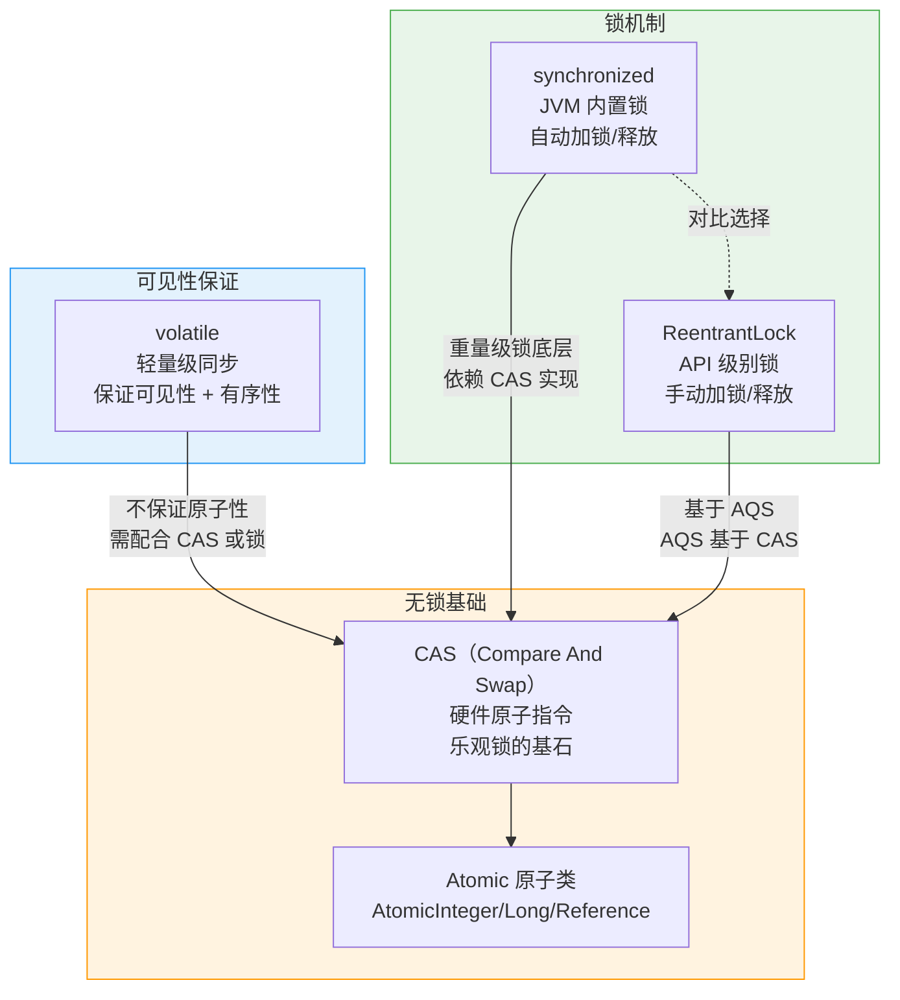

> 💡 **阅读指引**：本文按"**锁 → 可见性 → 无锁基础**"的依赖关系展开。synchronized 和 ReentrantLock 是日常开发中最常用的两种锁，volatile 解决可见性问题，CAS 是它们在底层的硬件基础。建议按顺序阅读，理解每一层的"为什么"。

---

## 一、synchronized：JVM 内置锁

### 1.1 什么是 synchronized？

synchronized 是 Java 提供的一种**内置互斥锁**机制。它保证同一时刻只有一个线程能执行被锁保护的代码块。它的核心能力是：

| 能力 | 说明 | 为什么重要 |
| :--- | :--- | :--- |
| **互斥性** | 同一时刻只有一个线程能进入 | 防止多线程同时修改共享数据 |
| **可见性** | 解锁前对变量的修改，对其他线程可见 | 解决 CPU 缓存导致的"数据不一致" |
| **可重入性** | 同一线程可以多次获取同一把锁 | 递归调用或嵌套同步方法时不会死锁 |

> ⚠️ **关键认知**：synchronized 不仅仅是一把锁，它还**隐式保证了内存可见性**。线程在进入 synchronized 块时，会从主内存重新加载变量；退出时，会把修改刷新到主内存。这和 volatile 的可见性语义类似，但范围更大。

### 1.2 三种使用方式

```java
// 方式一：修饰实例方法 —— 锁是当前实例对象
public synchronized void instanceMethod() {
    // 等价于 synchronized(this) { ... }
}

// 方式二：修饰静态方法 —— 锁是当前类的 Class 对象
public static synchronized void staticMethod() {
    // 等价于 synchronized(MyClass.class) { ... }
}

// 方式三：修饰代码块 —— 锁是指定的对象
public void blockMethod() {
    synchronized (lockObject) {
        // 临界区代码
    }
}
```

| 使用方式 | 锁对象 | 影响范围 | 典型场景 |
| :--- | :--- | :--- | :--- |
| 实例方法 | `this`（当前实例） | 同一实例的多个线程互斥 | 保护实例级别的共享状态 |
| 静态方法 | `类名.class`（Class 对象） | 所有实例互斥 | 保护类级别的共享状态 |
| 代码块 | 任意指定对象 | 同一锁对象的线程互斥 | 细粒度控制，减少锁竞争 |

### 1.3 锁升级：从无锁到重量级锁

synchronized 在 JDK 1.6 之后做了重大优化，**不再是"一锁到底"**，而是根据竞争情况逐步升级：

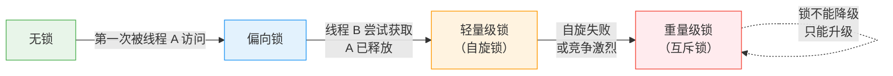

| 锁状态 | 触发条件 | 实现方式 | 开销 | 适用场景 |
| :--- | :--- | :--- | :--- | :--- |
| **无锁** | 初始状态 | 无 | 无 | 没有线程竞争 |
| **偏向锁** | 同一个线程反复获取同一把锁 | 在对象头标记线程 ID，无需 CAS | 极低 | 大部分时间只有一个线程访问 |
| **轻量级锁** | 另一个线程尝试获取已偏向的锁 | CAS 自旋，不阻塞线程 | 中等（CPU 空转） | 线程交替执行，锁持有时间短 |
| **重量级锁** | 自旋失败或竞争激烈 | 操作系统互斥量（mutex），线程阻塞 | 高（上下文切换） | 锁持有时间长，竞争激烈 |

> ⚠️ **锁升级是不可逆的**。一旦升级到重量级锁，不会再降回轻量级锁或偏向锁。如果你的应用从低并发变成高并发，锁会一直停留在重量级，不会"恢复"。

### 1.4 对象头：锁信息存在哪里？

每个 Java 对象在内存中都有一个**对象头（Object Header）**，锁的状态信息就记录在这里：

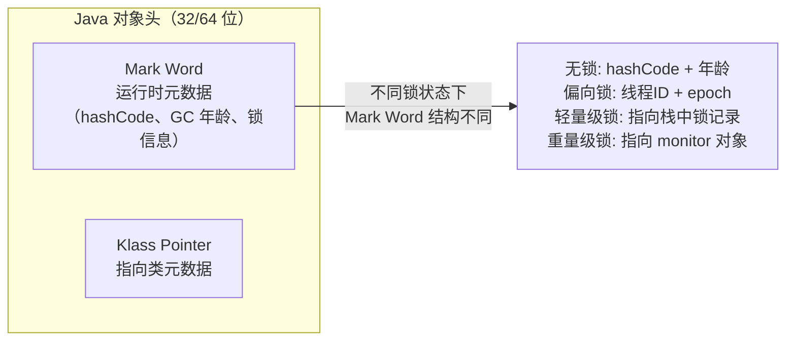

> 💡 **通俗理解**：对象头就像身份证，Mark Word 是"备注栏"——根据对象当前状态，里面记录的东西不一样。无锁时记录 hashCode，有锁时记录线程和锁信息。

### 1.5 Monitor 机制：重量级锁的底层实现

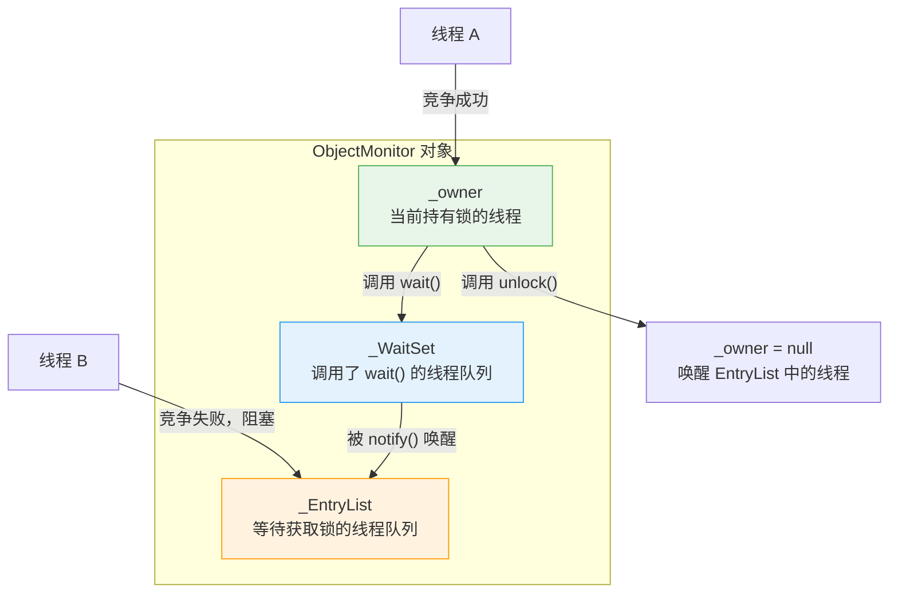

每个 Java 对象都可以关联一个 **Monitor**（管程/监视器），它由 C++ 的 `ObjectMonitor` 实现。三个核心字段：

- **`_owner`**：指向当前持有锁的线程，没锁时是 null
- **`_EntryList`**：想要获取锁但被阻塞的线程队列
- **`_WaitSet`**：调用了 `wait()` 释放锁并等待的线程队列

> 💡 **对比 wait/notify 和 sleep**：`wait()` 会释放锁，让出 CPU，进入 WaitSet 等待被唤醒；`sleep()` 不会释放锁，只是让出 CPU 一段时间。这是面试中的经典区分点。

---

## 二、ReentrantLock：API 级别的锁

### 2.1 什么是 ReentrantLock？

ReentrantLock 是 `java.util.concurrent.locks` 包下的**显式锁**，提供了比 synchronized 更丰富的功能：

```java
// 基本用法
Lock lock = new ReentrantLock();
lock.lock();
try {
    // 临界区代码
} finally {
    lock.unlock();  // 必须在 finally 中释放！
}
```

| 能力 | synchronized | ReentrantLock |
| :--- | :--- | :--- |
| 可重入 | ✅ 天然支持 | ✅ 支持 |
| 公平锁 | ❌ 非公平 | ✅ 可选公平/非公平 |
| 可中断获取锁 | ❌ 不可中断 | ✅ `lockInterruptibly()` |
| 尝试获取锁 | ❌ 只能阻塞等待 | ✅ `tryLock()` 支持超时 |
| 多条件等待 | ❌ 一个 waitSet | ✅ 多个 Condition |
| 自动释放 | ✅ 代码块结束时自动释放 | ❌ 必须手动 unlock |
| 性能 | JDK 1.6+ 两者接近 | JDK 1.6+ 两者接近 |

> 💡 **选择建议**：**能用 synchronized 就用 synchronized**。只有在需要公平锁、可中断、超时获取、多条件等待这些高级特性时，才用 ReentrantLock。

### 2.2 AQS 核心原理：锁是如何实现的？

ReentrantLock 的底层依赖 **AQS（AbstractQueuedSynchronizer）**，这是 Java 并发包的基石。几乎所有锁和同步器（CountDownLatch、Semaphore 等）都基于 AQS 实现。

**AQS 的两个核心组成**：

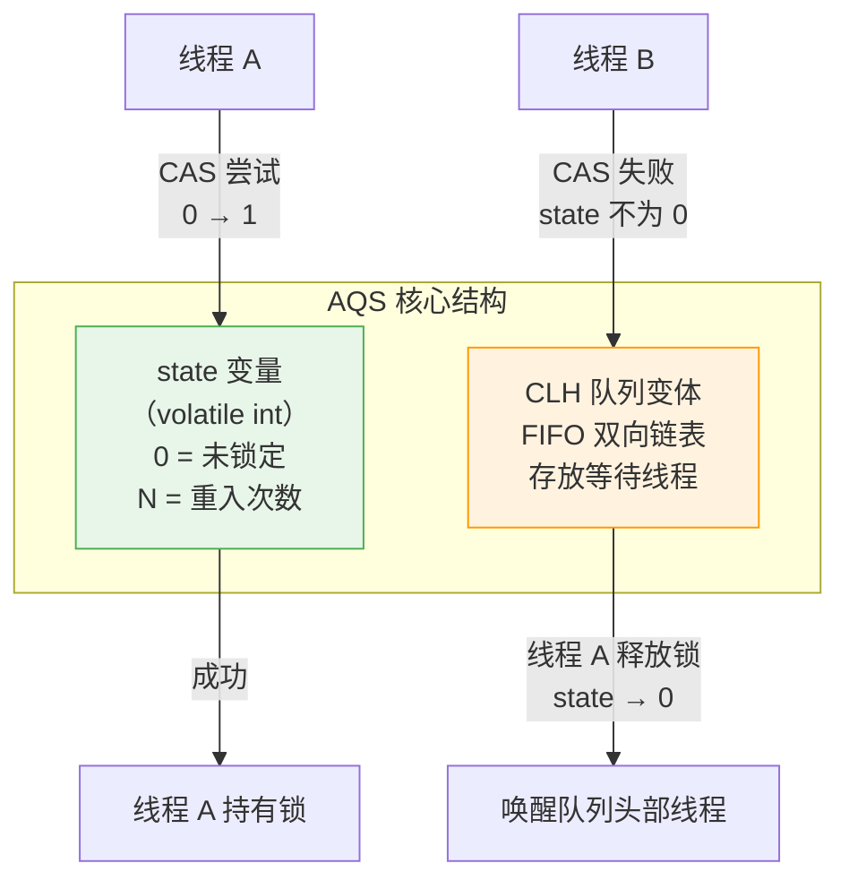

**获取锁的流程**：

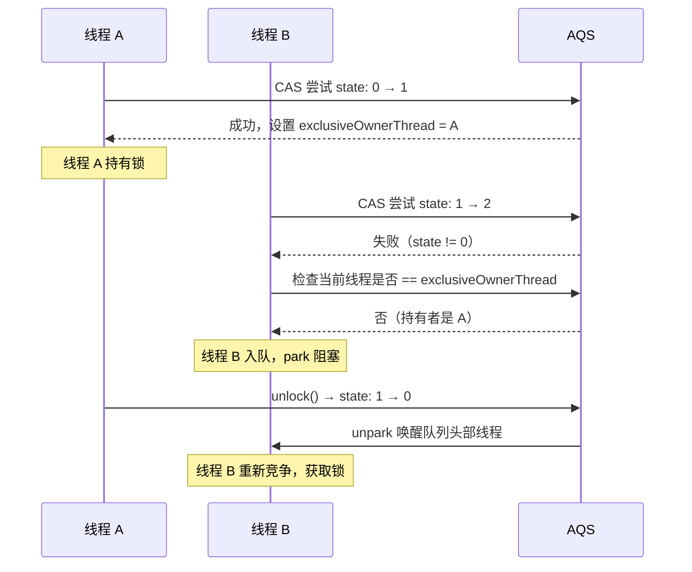

> 💡 **通俗理解**：AQS 就像银行柜台，`state` 是"正在办理"的指示灯（0=空闲，1=有人）。CLH 队列是排队区。新来的线程先看灯亮不亮——不亮就 CAS 去点亮（抢锁），亮了就乖乖排队（入队阻塞）。

### 2.3 公平锁 vs 非公平锁

```java
// 非公平锁（默认）
ReentrantLock lock = new ReentrantLock();

// 公平锁
ReentrantLock fairLock = new ReentrantLock(true);
```

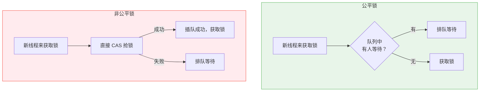

| 维度 | 公平锁 | 非公平锁 |
| :--- | :--- | :--- |
| **获取策略** | 先来后到，严格排队 | 新线程可以先"插队"抢一次 |
| **性能** | 较低（频繁上下文切换） | 较高（新线程可能直接拿到锁，减少切换） |
| **饥饿风险** | 无 | 有（排队线程可能一直抢不到） |
| **默认** | 否 | 是（ReentrantLock 默认非公平） |
| **synchronized** | 非公平 | 非公平 |

> 💡 **为什么默认非公平？** 因为公平锁每次都要唤醒队列头部线程，涉及上下文切换开销。而非公平锁允许新来的线程直接抢——如果此时锁刚好被释放，新线程能立刻拿到，避免了唤醒排队的线程。这是典型的"性能优先于公平"的设计选择。

### 2.4 Condition：多条件等待

这是 synchronized 的 `wait/notify` 做不到的——**多条件精确唤醒**：

```java
Lock lock = new ReentrantLock();
Condition notFull = lock.newCondition();   // "缓冲区没满"条件
Condition notEmpty = lock.newCondition();  // "缓冲区不空"条件

// 生产者
public void put(Object item) throws InterruptedException {
    lock.lock();
    try {
        while (buffer.isFull()) {
            notFull.await();  // 缓冲区满了，等待"没满"信号
        }
        buffer.add(item);
        notEmpty.signal();     // 放入数据后，通知"不空"条件
    } finally {
        lock.unlock();
    }
}

// 消费者
public Object take() throws InterruptedException {
    lock.lock();
    try {
        while (buffer.isEmpty()) {
            notEmpty.await();  // 缓冲区空了，等待"不空"信号
        }
        Object item = buffer.remove();
        notFull.signal();      // 取出数据后，通知"没满"条件
        return item;
    } finally {
        lock.unlock();
    }
}
```

> 💡 **对比 synchronized**：synchronized 只有一个 waitSet，`notify()` 随机唤醒一个等待线程，`notifyAll()` 唤醒全部。而 Condition 可以创建多个等待队列，精确唤醒特定条件的线程，减少无效唤醒。

---

## 三、volatile：轻量级同步

### 3.1 什么是 volatile？

volatile 是 Java 中最轻量的同步机制，它只保证两件事：

| 保证 | 说明 | 不保证 |
| :--- | :--- | :--- |
| **可见性** | 一个线程修改 volatile 变量后，其他线程能立即看到最新值 | — |
| **有序性** | 禁止指令重排序（内存屏障） | — |
| ❌ 原子性 | — | **不保证**！`i++` 这种复合操作仍然不安全 |

### 3.2 可见性问题：为什么需要 volatile？

现代 CPU 有多级缓存，每个 CPU 核心有自己的 L1/L2 缓存，共享一个 L3 缓存。线程修改变量时，可能只改了 CPU 缓存中的值，还没刷回主内存：

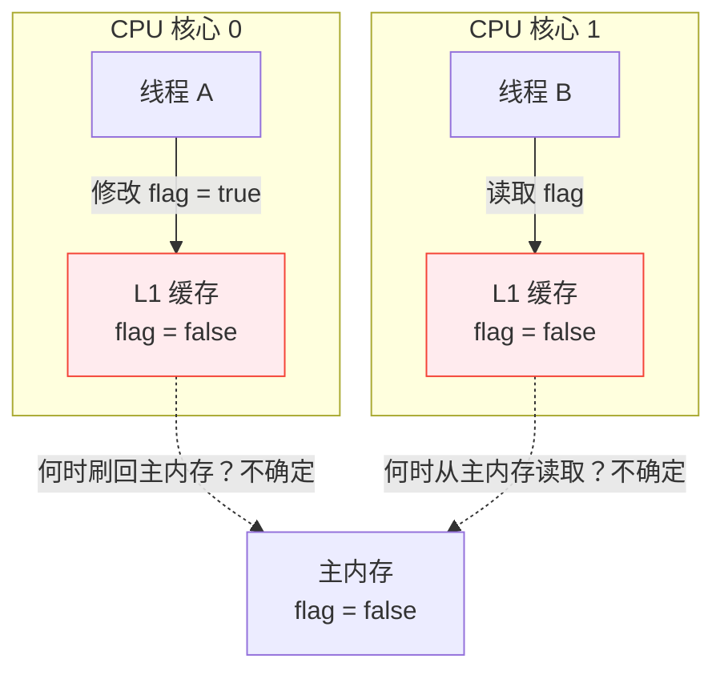

**经典问题代码**：

```java
// 线程 A 执行
while (!flag) {
    // 即使线程 B 改了 flag，线程 A 可能永远看不到
}
```

当 `flag` 没有 volatile 修饰时，线程 A 可能一直读自己 CPU 缓存中的旧值，陷入死循环。加上 volatile 后，**每次读取都从主内存拿，每次写入都立即刷回主内存**。

### 3.3 有序性问题：指令重排与 DCL 单例

CPU 和编译器为了性能，可能会**打乱指令的执行顺序**。这在单线程下没问题，但在多线程下可能导致严重 bug。

**经典的 DCL（Double-Checked Locking）单例**：

```java
public class Singleton {
    private static volatile Singleton instance;  // ← volatile 必须加！

    public static Singleton getInstance() {
        if (instance == null) {                    // 第一次检查
            synchronized (Singleton.class) {
                if (instance == null) {            // 第二次检查
                    instance = new Singleton();    // ← 这里可能重排序！
                }
            }
        }
        return instance;
    }
}
```

`new Singleton()` 不是原子操作，它分三步：
1. 分配内存空间
2. 初始化对象（构造函数执行）
3. 将引用指向内存空间

**如果步骤 2 和 3 被重排序**，变成 1 → 3 → 2：

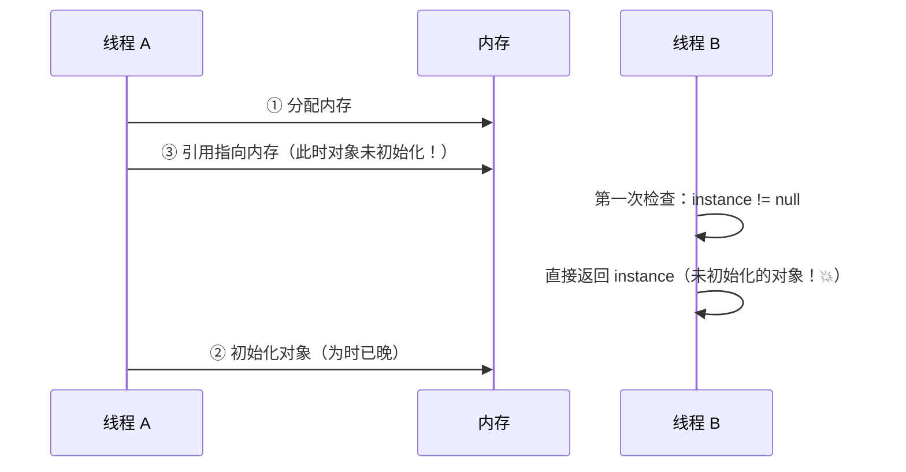

> ⚠️ **volatile 在这里的作用**：禁止 `new Singleton()` 的指令重排序，保证步骤 2 一定在步骤 3 之前完成。没有 volatile，DCL 单例在极端情况下会返回一个**未初始化完成的对象**。

### 3.4 内存屏障：volatile 是怎么做到的？

volatile 的底层通过 **内存屏障（Memory Barrier）** 实现：

```java
// volatile 写
// StoreStore 屏障：禁止上面的普通写和下面的 volatile 写重排序
// [其他写操作]
instance = new Singleton();  // volatile 写
// StoreLoad 屏障：禁止下面的读和上面的 volatile 写重排序

// volatile 读
// LoadLoad 屏障：禁止下面的读和上面的 volatile 读重排序
Singleton s = instance;      // volatile 读
// LoadStore 屏障：禁止下面的写和上面的 volatile 读重排序
```

| 屏障类型 | 作用 | 通俗理解 |
| :--- | :--- | :--- |
| StoreStore | 禁止上面的写和下面的 volatile 写重排序 | "写完了再写 volatile" |
| StoreLoad | 禁止上面的 volatile 写和下面的读重排序 | "volatile 写完了才能读" |
| LoadLoad | 禁止上面的 volatile 读和下面的读重排序 | "volatile 读完了才能读别的" |
| LoadStore | 禁止上面的 volatile 读和下面的写重排序 | "volatile 读完了才能写别的" |

### 3.5 volatile 的使用场景

| 适用 | 不适用 |
| :--- | :--- |
| 状态标志（如 `boolean running`） | 复合操作（如 `i++`、`count += 1`） |
| DCL 单例的 instance 引用 | 需要保证原子性的计数器 |
| 独立变量的读写 | 多变量有依赖关系的场景 |

```java
// ✅ 正确用法：状态标志
volatile boolean shutdown = false;
// 线程 A：shutdown = true;
// 线程 B：while (!shutdown) { work(); }

// ✅ 正确用法：DCL 单例
private static volatile Singleton instance;

// ❌ 错误用法：复合操作
volatile int count = 0;
// count++;  // 不安全！read-modify-write 三步，不是原子操作
```

---

## 四、CAS：无锁的基石

### 4.1 什么是 CAS？

CAS（Compare And Swap，比较并交换）是一条 **CPU 原子指令**，由硬件保证不可被中断。它不需要加锁，是乐观锁思想的实现基础。

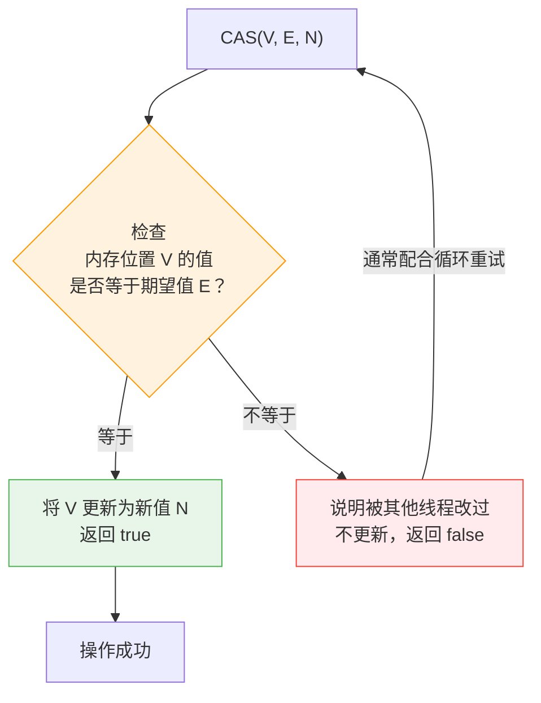

> 💡 **通俗理解**：CAS 就像"去银行查余额然后取钱"。你先记下余额是 1000（期望值 E），然后说"如果余额还是 1000，就取 500（改为 500）"。如果在你操作的瞬间，别人存了 200 进去，余额变成了 1200，CAS 检测到"期望值 1000 ≠ 实际值 1200"，操作失败，你重新读取余额再来一次。

### 4.2 CAS 在 Java 中的实现

Java 通过 `sun.misc.Unsafe` 类调用本地 CAS 指令：

```java
public class AtomicIntegerDemo {
    private AtomicInteger count = new AtomicInteger(0);

    public void increment() {
        // 等价于 count++，但线程安全
        count.incrementAndGet();
    }
}

// AtomicInteger 底层实现（简化）
public class AtomicInteger {
    private volatile int value;  // ← volatile 保证可见性

    public final int incrementAndGet() {
        // CAS 自旋
        for (;;) {
            int current = get();  // 读取当前值
            int next = current + 1;
            if (compareAndSet(current, next)) {  // CAS 尝试更新
                return next;
            }
            // 如果失败（被其他线程改了），循环重试
        }
    }
}
```

### 4.3 ABA 问题：CAS 的阿喀琉斯之踵

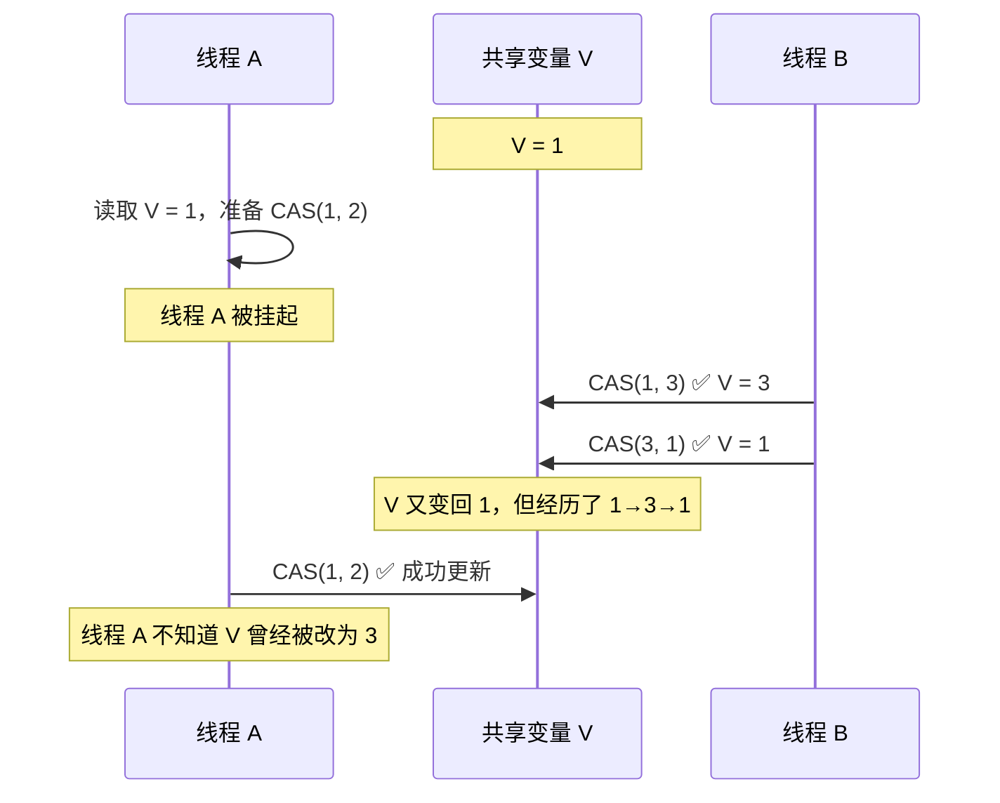

**问题**：线程 A 只比较了"值是否还是 1"，但不知道值经历了 **1 → 3 → 1** 的变化。在链表的场景下，这可能导致节点被错误地删除或引用丢失。

**解决方案**：

| 方案 | 实现 | 原理 | 适用场景 |
| :--- | :--- | :--- | :--- |
| **AtomicStampedReference** | 加版本号 | 每次更新版本号 +1，CAS 同时比较值和版本号 | 需要精确知道"是否被改过" |
| **AtomicMarkableReference** | 加布尔标记 | 只关心"是否被改过"，不关心次数 | 垃圾回收标记等简单场景 |

```java
// AtomicStampedReference 使用示例
AtomicStampedReference<Integer> ref = new AtomicStampedReference<>(1, 0);
int[] stampHolder = new int[1];
int value = ref.get(stampHolder);       // 获取值和版本号
int stamp = stampHolder[0];
// CAS 同时比较值和版本号
ref.compareAndSet(value, 2, stamp, stamp + 1);
```

### 4.4 CAS 的问题与局限

| 问题 | 说明 | 影响 |
| :--- | :--- | :--- |
| **ABA 问题** | 值被改过又改回来，CAS 无法感知 | 链表操作中可能造成数据丢失 |
| **自旋开销** | CAS 失败后循环重试，消耗 CPU | 高并发下 CPU 空转严重 |
| **只能保证一个变量的原子性** | CAS 只能对单个内存位置做原子操作 | 多变量操作需要 AtomicReference 或锁 |

---

## 五、综合对比

### 5.1 synchronized vs ReentrantLock

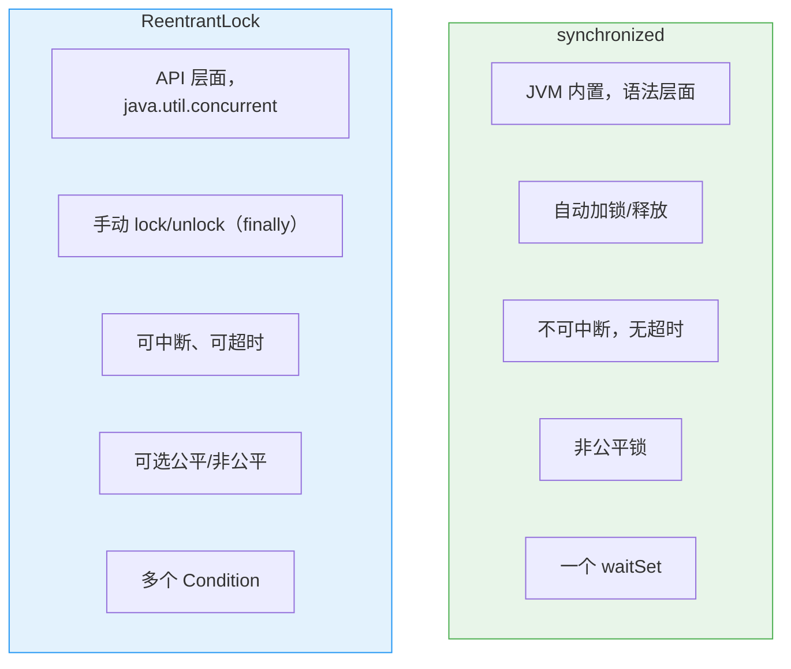

### 5.2 四种机制全景对比

| 维度 | synchronized | ReentrantLock | volatile | CAS（Atomic 类） |
| :--- | :--- | :--- | :--- | :--- |
| **互斥性** | ✅ | ✅ | ❌ | ❌（无锁） |
| **可见性** | ✅ | ✅ | ✅ | ✅（volatile 配合） |
| **原子性** | ✅ | ✅ | ❌ | ✅（单个变量） |
| **有序性** | ✅（部分） | ✅（部分） | ✅（禁止重排） | ✅（volatile 配合） |
| **阻塞** | 阻塞 | 可阻塞/可非阻塞 | 非阻塞 | 非阻塞（自旋） |
| **性能** | JDK 6+ 优化后好 | 与 synchronized 接近 | 极高（无锁） | 高（无锁自旋） |
| **使用复杂度** | 低 | 中 | 低 | 中 |

---

## 六、面试高频问题速答

### Q1：synchronized 和 ReentrantLock 有什么区别？怎么选？

synchronized 是 JVM 内置的隐式锁，自动释放，语法简单；ReentrantLock 是 API 层面的显式锁，需要手动 unlock，但支持公平锁、可中断、超时、多条件等待等高级特性。JDK 1.6 之后两者性能接近。**能用 synchronized 就用 synchronized**，只有在需要高级特性（公平锁、可中断、tryLock、多 Condition）时才用 ReentrantLock。

### Q2：synchronized 的锁升级过程是怎样的？

四种状态：**无锁 → 偏向锁 → 轻量级锁 → 重量级锁**。偏向锁用于单线程反复访问同一个锁，轻量级锁通过 CAS 自旋处理交替执行，重量级锁在竞争激烈时通过 OS 互斥量阻塞线程。**锁只能升级不能降级**，这是为了防止频繁的锁状态切换开销。

### Q3：volatile 能保证原子性吗？为什么？

**不能**。volatile 只保证可见性和有序性（禁止指令重排）。`i++` 这种操作本质是 read-modify-write 三步，即使 volatile 保证了每次读/写都是最新的值，但"读-改-写"之间仍可能被其他线程打断。需要用 synchronized、ReentrantLock 或 AtomicInteger（CAS）来保证原子性。

### Q4：DCL 单例为什么要加 volatile？

```java
private static volatile Singleton instance;  // ← 这个 volatile 不能省
```

`new Singleton()` 包含三个步骤：① 分配内存 → ② 初始化对象 → ③ 引用指向内存。步骤 ② 和 ③ 可能被指令重排，导致其他线程拿到一个**尚未初始化完成的对象**。volatile 通过内存屏障禁止这种重排序，保证对象初始化完成后引用才可见。

### Q5：什么是 CAS？它有什么问题？

CAS（Compare And Swap）是一条 CPU 原子指令，通过比较内存值是否等于期望值来决定是否更新，不需要加锁。它是 Atomic 类、AQS 等并发工具的底层基础。主要问题：① **ABA 问题**（用 AtomicStampedReference 解决）；② **自旋 CPU 开销**（高并发下空转）；③ **只能保证单个变量的原子性**。

### 记忆口诀

```
同步互斥两把锁，内置显式各有托
无锁可见 volatile，不能原子要记牢
CAS 乐观自旋跑，ABA 版本号来保
锁升级不可逆，JVM 优化不用愁
```