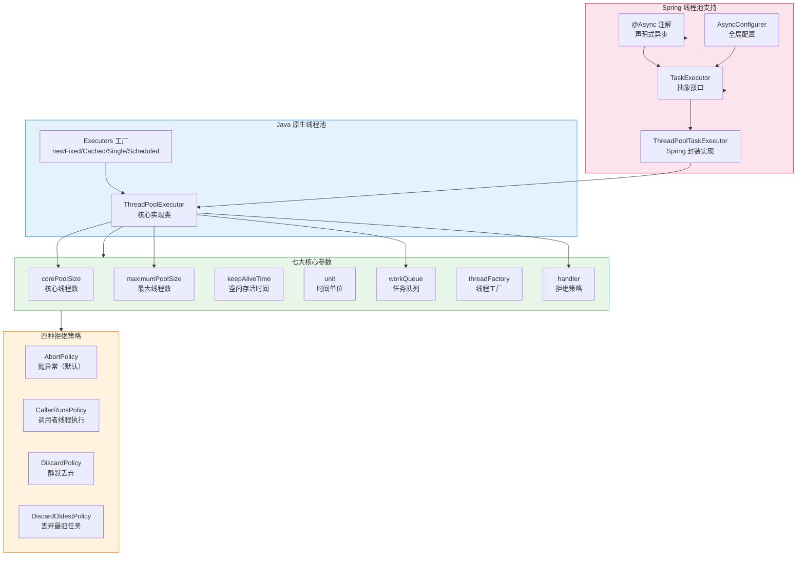
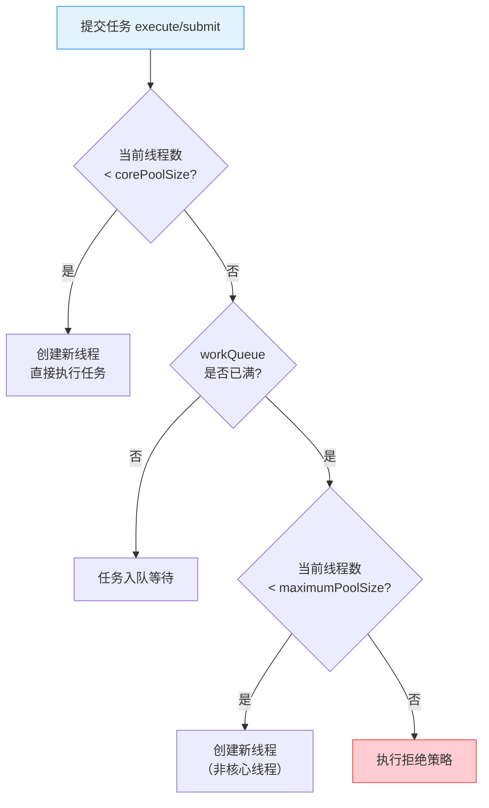
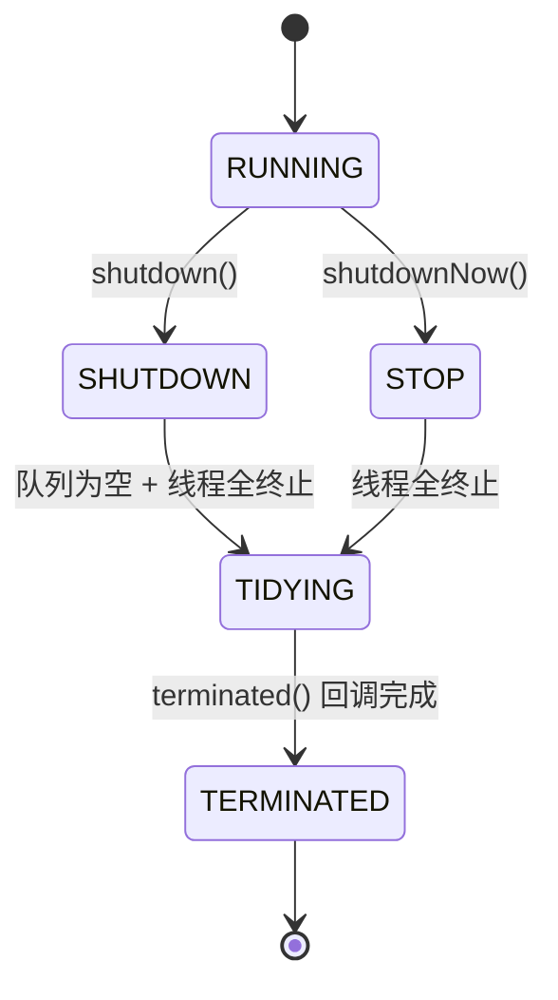
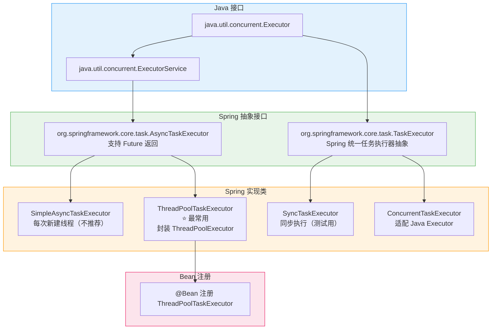

# 线程池：核心参数、拒绝策略、生产配置实践与 Spring @Async

## 核心概念全览



> 💡 **阅读指引**：这篇文章覆盖了线程池的完整知识体系。第一部分讲 Java 原生 `ThreadPoolExecutor` 的核心参数、拒绝策略和工作流程，这是所有线程池知识的根基。第二部分讲 Spring 框架下的线程池支持（`@Async`、`TaskExecutor`），这是在 Spring 项目中正确使用线程池的关键。第三部分给出生产环境配置的最佳实践和常见避坑指南。建议先理解 Java 原生线程池，再学 Spring 封装，最后落到生产实践。

---

## 一、为什么需要线程池？

### 1.1 线程复用的价值

| 维度 | 每次 new Thread() | 使用线程池 |
| :--- | :--- | :--- |
| **线程创建/销毁** | 频繁创建销毁，开销大 | 复用已有线程，几乎零开销 |
| **资源控制** | 无上限，可能 OOM | 可精确控制并发数 |
| **任务管理** | 无法管理排队和拒绝 | 支持任务排队、超时、拒绝策略 |
| **监控能力** | 线程状态不可观测 | 可获取线程池状态、任务统计 |
| **优雅停机** | 强制终止 | 支持 shutdown / shutdownNow |

> ⚠️ **关键认知**：《阿里巴巴 Java 开发手册》明确规定——**不允许**使用 `Executors` 创建线程池，而应通过 `ThreadPoolExecutor` 的方式显式指定参数。原因：

```java
// ❌ 禁止这样写
Executors.newFixedThreadPool(10);
Executors.newCachedThreadPool();

// ✅ 必须这样写
new ThreadPoolExecutor(
    10, 20,
    60L, TimeUnit.SECONDS,
    new LinkedBlockingQueue<>(100),
    new ThreadPoolExecutor.CallerRunsPolicy()
);
```

- `newFixedThreadPool` 使用**无界队列** `LinkedBlockingQueue`，队列无限增长会导致 OOM
- `newCachedThreadPool` 允许**无限创建线程**，线程数不可控，也会导致 OOM

---

## 二、ThreadPoolExecutor 七大核心参数

### 2.1 参数一览

```java
public ThreadPoolExecutor(
    int corePoolSize,              // 核心线程数
    int maximumPoolSize,           // 最大线程数
    long keepAliveTime,            // 非核心线程空闲存活时间
    TimeUnit unit,                 // 时间单位
    BlockingQueue<Runnable> workQueue,  // 任务队列
    ThreadFactory threadFactory,   // 线程工厂
    RejectedExecutionHandler handler    // 拒绝策略
)
```

### 2.2 各参数详解

#### corePoolSize（核心线程数）

- 即使线程空闲，也会保留的线程数量（除非设置了 `allowCoreThreadTimeOut(true)`）
- 设置原则：**CPU 密集型** `N_CPU + 1`，**IO 密集型** `N_CPU * 2`（或按公式 `N_CPU / (1 - 阻塞系数)`，阻塞系数通常取 0.8~0.9）

#### maximumPoolSize（最大线程数）

- 线程池允许的最大线程数
- 只有当 `workQueue` 满了之后，才会创建超过 `corePoolSize` 的新线程

#### keepAliveTime（存活时间）

- 非核心线程（超过 `corePoolSize` 的线程）空闲超过此时间后会被回收
- 如果设置了 `allowCoreThreadTimeOut(true)`，核心线程也会被回收

#### workQueue（任务队列）

| 队列类型 | 特性 | 适用场景 |
| :--- | :--- | :--- |
| `LinkedBlockingQueue`（无界） | 长度无限制，可无限堆积任务 | **不推荐**，可能导致 OOM |
| `LinkedBlockingQueue`（有界） | 指定容量，任务排队到上限后创建新线程 | ✅ **推荐**，配合合理的容量使用 |
| `SynchronousQueue` | 不存储任务，直接提交给线程 | 配合 `maximumPoolSize` 很大时使用 |
| `ArrayBlockingQueue`（有界） | 数组实现的有界队列，支持公平模式 | 需要严格容量控制的场景 |
| `PriorityBlockingQueue` | 按优先级排序的无界队列 | 需要按优先级执行的场景 |
| `DelayQueue` | 延迟队列，元素需实现 Delayed 接口 | 定时任务、超时订单处理 |

#### threadFactory（线程工厂）

- 自定义线程命名、是否守护线程、优先级等
- **生产环境必须自定义线程名**，方便排查问题

```java
new ThreadFactoryBuilder()
    .setNameFormat("order-processor-%d")
    .setDaemon(false)
    .build();

// 或手动实现
ThreadFactory factory = r -> {
    Thread t = new Thread(r, "biz-pool-" + threadCount.incrementAndGet());
    t.setDaemon(false);
    t.setUncaughtExceptionHandler((thread, ex) -> 
        log.error("Uncaught exception in thread {}", thread.getName(), ex));
    return t;
};
```

#### handler（拒绝策略）

> 下文 2.3 节详细讲解。

### 2.3 线程池工作流程（任务提交全过程）



> 💡 **记忆口诀**：**核心 → 队列 → 最大 → 拒绝**。先尝试用核心线程处理，核心线程满了任务排队，队列满了就扩容到最大线程数，最大线程数也满了就执行拒绝策略。

---

## 三、四种拒绝策略详解

### 3.1 策略对比

| 拒绝策略 | 行为 | 抛出异常 | 适用场景 |
| :--- | :--- | :---: | :--- |
| **AbortPolicy**（默认） | 抛出 `RejectedExecutionException` | ✅ | 要求任务必须执行成功，由上层感知处理 |
| **CallerRunsPolicy** | 由提交任务的线程（调用者线程）直接执行 | ❌ | ✅ **生产最常用**，提供背压（Backpressure） |
| **DiscardPolicy** | 静默丢弃，不抛异常 | ❌ | ⚠️ 允许丢任务的非关键场景 |
| **DiscardOldestPolicy** | 丢弃队列中最旧未执行的任务，重新提交 | ❌ | ⚠️ 新任务优先于旧任务的场景 |

### 3.2 CallerRunsPolicy 的背压机制

`CallerRunsPolicy` 是生产环境**最推荐**的默认选择：

```java
// 当线程池满了 + 队列满了 → 由 main 线程自己执行任务
ThreadPoolExecutor pool = new ThreadPoolExecutor(
    5, 10,
    60L, TimeUnit.SECONDS,
    new LinkedBlockingQueue<>(100),
    new ThreadPoolExecutor.CallerRunsPolicy()
);

// main 线程提交 200 个任务，前 110 个进入线程池（5核心 + 100队列 + 5非核心）
// 第 111~200 个任务由 main 线程自己执行
// 这自然地将 main 线程"拉下水"，降低了任务提交速度 = 背压（Backpressure）
```

> ⚠️ **注意**：`CallerRunsPolicy` 会让调用者线程"卡住"执行任务。如果调用者线程是 Tomcat 的 `http-nio` 线程，会拖慢 HTTP 请求的响应。**要根据业务场景选择合适的拒绝策略**，避免拖慢核心 IO 线程。

### 3.3 自定义拒绝策略

```java
RejectedExecutionHandler customHandler = (r, executor) -> {
    // 1. 记录日志
    log.error("任务被拒绝：{}，线程池状态：{}", r, executor);

    // 2. 持久化到数据库 / 消息队列，稍后重试
    failedTaskRepository.save(new FailedTask(r.toString()));

    // 3. 监控告警
    alertService.send("线程池拒绝任务", executor.toString());

    // 4. 可选：放到重试队列
    retryQueue.offer(r);
};
```

---

## 四、线程池的状态与生命周期

### 4.1 五种状态



| 状态 | 描述 | 是否接受新任务 | 是否处理队列中任务 |
| :--- | :--- | :---: | :---: |
| **RUNNING** | 正常运行 | ✅ | ✅ |
| **SHUTDOWN** | 调用 `shutdown()` 后 | ❌ | ✅ |
| **STOP** | 调用 `shutdownNow()` 后 | ❌ | ❌（尝试中断正在执行的线程） |
| **TIDYING** | 过渡状态，所有任务终止 | ❌ | ❌ |
| **TERMINATED** | `terminated()` 回调执行完毕 | ❌ | ❌ |

### 4.2 优雅停机

```java
// ✅ 推荐：优雅停机两步走
public void gracefulShutdown(ExecutorService pool) {
    // 第一步：停止接收新任务
    pool.shutdown();
    try {
        // 第二步：等待已有任务执行完毕（最多等 60 秒）
        if (!pool.awaitTermination(60, TimeUnit.SECONDS)) {
            // 超时，强制终止
            pool.shutdownNow();
            // 再等 10 秒
            if (!pool.awaitTermination(10, TimeUnit.SECONDS)) {
                log.error("线程池未能完全终止");
            }
        }
    } catch (InterruptedException e) {
        pool.shutdownNow();
        Thread.currentThread().interrupt();
    }
}
```

> ⚠️ **关键区别**：`shutdown()` 是**温柔的**，已提交的任务会执行完；`shutdownNow()` 是**暴力的**，会中断正在执行的任务并返回未执行任务列表。

### 4.3 kill 信号与优雅停机 ⚠️

线程池的优雅停机**完全依赖 JVM 能正常执行 ShutdownHook**。不同 kill 信号对优雅停机的影响：

| 信号 | 命令 | 说明 | 优雅关闭生效？ | JVM 生命周期 |
| :--- | :--- | :--- | :---: | :--- |
| `SIGTERM` | `kill <pid>` 或 `kill -15 <pid>` | 请求进程自行退出，**可捕获** | ✅ **生效** | JVM 执行 ShutdownHook → `@PreDestroy` → 线程池 `shutdown()` → `awaitTermination()` |
| `SIGINT` | `Ctrl+C` 或 `kill -2 <pid>` | 中断信号，**可捕获** | ✅ **生效** | 同上 |
| `SIGKILL` | `kill -9 <pid>` | **强制杀死，不可捕获** | ❌ **完全无效** | JVM 被操作系统立即终止，无任何清理机会 |

> ⚠️ **关键认知**：`kill -9` 是操作系统层面的"暴力杀"，JVM 根本来不及执行任何清理代码。无论你线程池配置了多完善的 `waitForTasksToCompleteOnShutdown`、`@PreDestroy`、ShutdownHook，**`kill -9` 一律无效**，线程池中未完成的任务直接丢失。

**生产环境正确做法**：

```bash
# ✅ 正确：先发 SIGTERM，给应用 30~60 秒优雅退出
kill -15 <pid>

# 等待超时后，如果进程还没退出，再用 kill -9 兜底
sleep 60
if ps -p <pid> > /dev/null; then
    kill -9 <pid>
fi
```

这也是 K8s Pod 删除的标准流程：先发 `SIGTERM` → 等待 `terminationGracePeriodSeconds`（默认 30s）→ 超时发 `SIGKILL`。

---

## 五、Spring 框架下的线程池

### 5.1 Spring TaskExecutor 抽象体系



### 5.2 ThreadPoolTaskExecutor 配置

`ThreadPoolTaskExecutor` 是 Spring 对 `ThreadPoolExecutor` 的封装，**是生产环境下最推荐的线程池实现**。

#### 基础配置（单个线程池）

```java
@Configuration
@EnableAsync
public class ThreadPoolConfig {

    @Bean("defaultExecutor")
    public ThreadPoolTaskExecutor defaultExecutor() {
        ThreadPoolTaskExecutor executor = new ThreadPoolTaskExecutor();
        // 核心线程数
        executor.setCorePoolSize(10);
        // 最大线程数
        executor.setMaxPoolSize(20);
        // 队列容量
        executor.setQueueCapacity(200);
        // 非核心线程空闲存活时间
        executor.setKeepAliveSeconds(60);
        // 线程名前缀（⭐ 生产必须设置）
        executor.setThreadNamePrefix("default-exec-");
        // 拒绝策略
        executor.setRejectedExecutionHandler(new ThreadPoolExecutor.CallerRunsPolicy());
        // ⭐ 等待任务完成后关闭
        executor.setWaitForTasksToCompleteOnShutdown(true);
        // 关闭等待时间
        executor.setAwaitTerminationSeconds(60);
        // 初始化线程池
        executor.initialize();
        return executor;
    }
}
```

#### 多线程池配置（按业务隔离）

```java
@Configuration
@EnableAsync
public class ThreadPoolConfig {

    @Bean("orderExecutor")
    public ThreadPoolTaskExecutor orderExecutor() {
        ThreadPoolTaskExecutor executor = new ThreadPoolTaskExecutor();
        executor.setCorePoolSize(20);
        executor.setMaxPoolSize(50);
        executor.setQueueCapacity(500);
        executor.setThreadNamePrefix("order-exec-");
        executor.setRejectedExecutionHandler(new ThreadPoolExecutor.CallerRunsPolicy());
        executor.initialize();
        return executor;
    }

    @Bean("notifyExecutor")
    public ThreadPoolTaskExecutor notifyExecutor() {
        ThreadPoolTaskExecutor executor = new ThreadPoolTaskExecutor();
        executor.setCorePoolSize(5);
        executor.setMaxPoolSize(10);
        executor.setQueueCapacity(100);
        executor.setThreadNamePrefix("notify-exec-");
        // 通知类任务允许丢弃
        executor.setRejectedExecutionHandler(new ThreadPoolExecutor.DiscardPolicy());
        executor.initialize();
        return executor;
    }

    @Bean("heavyExecutor")
    public ThreadPoolTaskExecutor heavyExecutor() {
        ThreadPoolTaskExecutor executor = new ThreadPoolTaskExecutor();
        executor.setCorePoolSize(5);
        executor.setMaxPoolSize(5);    // 最大 = 核心，防止无限扩容
        executor.setQueueCapacity(100);
        executor.setThreadNamePrefix("heavy-exec-");
        executor.setRejectedExecutionHandler(new ThreadPoolExecutor.CallerRunsPolicy());
        executor.initialize();
        return executor;
    }
}
```

> 💡 **为什么要多线程池？**：不同业务任务混用同一个线程池会导致**相互影响**。比如一个慢任务占满线程，会让其他快任务无法执行。通过业务隔离，可以避免"一颗老鼠屎坏了一锅粥"。

### 5.3 @Async 声明式异步

`@Async` 是 Spring 提供的最便捷的异步执行方式，只需要加一个注解即可。

#### 开启异步支持

```java
@Configuration
@EnableAsync
public class AsyncConfig implements AsyncConfigurer {

    @Override
    public Executor getAsyncExecutor() {
        // 返回默认的异步执行器
        ThreadPoolTaskExecutor executor = new ThreadPoolTaskExecutor();
        executor.setCorePoolSize(10);
        executor.setMaxPoolSize(20);
        executor.setQueueCapacity(200);
        executor.setThreadNamePrefix("async-default-");
        executor.setRejectedExecutionHandler(new ThreadPoolExecutor.CallerRunsPolicy());
        executor.initialize();
        return executor;
    }

    @Override
    public AsyncUncaughtExceptionHandler getAsyncUncaughtExceptionHandler() {
        // ⭐ 处理异步方法未捕获的异常
        return (ex, method, params) -> {
            log.error("Async method {} threw exception, params: {}",
                method.getName(), Arrays.toString(params), ex);
        };
    }
}
```

> ⚠️ **AsyncConfigurer 不是必须的！** 它的唯一作用是为 **不带 Bean 名的 `@Async`**（即 `@Async` 不指定值）设置默认线程池和全局异常处理器。如果你的项目中所有 `@Async` 都带 Bean 名（如 `@Async("bizExecutor")`），完全可以不实现 `AsyncConfigurer`，只声明 `ThreadPoolTaskExecutor` 的 `@Bean` 即可。很多项目都是这么做的。

#### 基本使用

```java
@Service
public class OrderService {

    // 使用默认线程池（AsyncConfigurer 配置的）
    @Async
    public CompletableFuture<String> processOrder(String orderId) {
        // 异步处理订单逻辑
        log.info("处理订单：{}，线程：{}", orderId, Thread.currentThread().getName());
        String result = doHeavyWork(orderId);
        return CompletableFuture.completedFuture(result);
    }

    // 指定使用名为 "orderExecutor" 的线程池
    @Async("orderExecutor")
    public void sendNotification(String userId, String message) {
        log.info("发送通知给：{}，线程：{}", userId, Thread.currentThread().getName());
        // 发送短信/推送/邮件
    }

    // 指定使用名为 "notifyExecutor" 的线程池
    @Async("notifyExecutor")
    public void asyncLog(String content) {
        log.info("异步日志：{}", content);
    }
}
```

#### 调用方式与返回值

| 返回值类型 | 使用场景 | 示例 |
| :--- | :--- | :--- |
| `void` | 纯异步执行，不关心结果 | `@Async void sendEmail()` |
| `Future<T>` | 需要获取结果，支持 `get()` 阻塞等待 | `@Async Future<String> doWork()` |
| `CompletableFuture<T>` | ✅ **推荐**，支持链式回调、组合操作 | `@Async CompletableFuture<String> doWork()` |
| `ListenableFuture<T>` | Spring 4.x 风格，可添加回调 | `@Async ListenableFuture<String> doWork()` |

```java
// ✅ 推荐：使用 CompletableFuture 获取异步结果
@RestController
public class OrderController {

    @Autowired
    private OrderService orderService;

    @GetMapping("/order/{id}")
    public String createOrder(@PathVariable String id) throws Exception {
        CompletableFuture<String> future = orderService.processOrder(id);

        // 不阻塞主线程，注册回调
        future.thenAccept(result -> log.info("订单处理完成：{}", result));

        return "订单已提交处理";
    }
}
```

### 5.4 @Async 常见失效场景 ⚠️

| 失效场景 | 原因 | 解决方案 |
| :--- | :--- | :--- |
| **同类方法调用** | Spring AOP 代理无法拦截内部调用（this 调用绕过代理） | 将异步方法移到另一个 Bean 中 |
| **未开启 @EnableAsync** | 缺少注解，Spring 不会处理 @Async | 在配置类上加 `@EnableAsync` |
| **方法非 public** | CGLIB/JDK 动态代理无法代理非 public 方法 | 改为 `public` |
| **返回值类型错误** | 返回值不是 `void`/`Future`/`CompletableFuture` | 修改返回值类型 |
| **未配置线程池** | Spring 默认用 `SimpleAsyncTaskExecutor`，每次新建线程 | 配置 `ThreadPoolTaskExecutor` |
| **static 方法** | Spring AOP 无法代理静态方法 | 去掉 static |

```java
// ❌ 失效示例：同类方法内部调用
@Service
public class UserService {

    public void register(User user) {
        // 保存用户（同步）
        this.saveUser(user);
        // 发送欢迎邮件（异步）—— ❌ 这里不会异步执行！
        // 因为 this.sendWelcomeEmail() 绕过了 Spring AOP 代理
        this.sendWelcomeEmail(user);
    }

    @Async
    public void sendWelcomeEmail(User user) {
        // ...
    }
}

// ✅ 正确写法：将异步方法拆分到独立的 Bean
@Service
public class UserService {
    @Autowired
    private NotificationService notificationService;

    public void register(User user) {
        this.saveUser(user);
        // 通过注入的 Bean 调用，走 Spring AOP 代理
        notificationService.sendWelcomeEmail(user);
    }
}

@Service
public class NotificationService {
    @Async
    public void sendWelcomeEmail(User user) {
        // ...
    }
}
```

---

## 六、生产环境配置最佳实践

### 6.1 线程池参数设置公式

| 任务类型 | corePoolSize 建议 | 说明 |
| :--- | :--- | :--- |
| **CPU 密集型** | `N_CPU + 1` | 计算为主，线程数过多反而因上下文切换降低效率 |
| **IO 密集型** | `N_CPU * 2` | 大部分时间在等待 IO，可多创建线程 |
| **混合型** | `N_CPU / (1 - 阻塞系数)` | 阻塞系数一般为 0.8~0.9 |
| **经验值** | `N_CPU * 2` 作为起点，压测调整 | 实际参数需要通过压测确认 |

> 💡 **公式是起点，压测是终点**。任何公式都只是初始值，最终参数需要通过生产压测来确认。

```java
int cpuCores = Runtime.getRuntime().availableProcessors();
int corePoolSize = cpuCores * 2;        // IO 密集型
int maxPoolSize = cpuCores * 4;
int queueCapacity = 500;                 // 根据业务估算
```

### 6.2 完整的生产级线程池配置模板

```java
@Configuration
@EnableAsync
public class ProductionThreadPoolConfig implements AsyncConfigurer {

    @Bean("bizExecutor")
    public ThreadPoolTaskExecutor bizExecutor() {
        int cpuCores = Runtime.getRuntime().availableProcessors();

        ThreadPoolTaskExecutor executor = new ThreadPoolTaskExecutor();
        // 1. 核心线程数：IO 密集型，2倍 CPU 核数
        executor.setCorePoolSize(cpuCores * 2);
        // 2. 最大线程数：4倍 CPU 核数
        executor.setMaxPoolSize(cpuCores * 4);
        // 3. 有界队列：防止 OOM
        executor.setQueueCapacity(500);
        // 4. 空闲存活 120 秒
        executor.setKeepAliveSeconds(120);
        // 5. 线程名前缀（⭐ 必备，用于排查问题）
        executor.setThreadNamePrefix("biz-exec-");
        // 6. 拒绝策略：CallerRunsPolicy 提供背压
        executor.setRejectedExecutionHandler(new ThreadPoolExecutor.CallerRunsPolicy());
        // 7. 优雅停机
        executor.setWaitForTasksToCompleteOnShutdown(true);
        executor.setAwaitTerminationSeconds(60);
        // 8. 核心线程也可超时回收（节省资源）
        executor.setAllowCoreThreadTimeOut(true);
        // 9. 初始化
        executor.initialize();
        return executor;
    }

    @Override
    public Executor getAsyncExecutor() {
        return bizExecutor();
    }

    @Override
    public AsyncUncaughtExceptionHandler getAsyncUncaughtExceptionHandler() {
        return (ex, method, params) ->
            log.error("@Async method [{}] threw exception, params: {}",
                method.getName(), Arrays.toString(params), ex);
    }
}
```

### 6.3 线程池监控指标

```java
@Component
public class ThreadPoolMonitor {

    private final Map<String, ThreadPoolTaskExecutor> executors;

    @Autowired
    public ThreadPoolMonitor(Map<String, ThreadPoolTaskExecutor> executors) {
        this.executors = executors;
    }

    @Scheduled(fixedRate = 10_000) // 每 10 秒采集一次
    public void monitor() {
        executors.forEach((name, executor) -> {
            ThreadPoolExecutor pool = executor.getThreadPoolExecutor();
            log.info("线程池监控 [{}]: " +
                    "核心线程数={}, 当前线程数={}, 活跃线程数={}, " +
                    "队列大小={}/{}, 已完成任务={}, 总任务={}",
                name,
                pool.getCorePoolSize(),
                pool.getPoolSize(),
                pool.getActiveCount(),
                pool.getQueue().size(),
                pool.getQueue().remainingCapacity() + pool.getQueue().size(),
                pool.getCompletedTaskCount(),
                pool.getTaskCount()
            );

            // 告警：队列使用率 > 80%
            double queueUsage = (double) pool.getQueue().size() /
                (pool.getQueue().size() + pool.getQueue().remainingCapacity());
            if (queueUsage > 0.8) {
                log.warn("⚠️ 线程池 [{}] 队列使用率超过 80%：{}%", name,
                    String.format("%.1f", queueUsage * 100));
            }
        });
    }
}
```

### 6.4 避坑清单

| 坑 | 问题 | 正确做法 |
| :--- | :--- | :--- |
| **用 Executors 创建** | 无界队列或无限线程，可能 OOM | 手动 `new ThreadPoolExecutor` |
| **使用无界队列** | 流量突发时队列无限增长，OOM | 设置合理的 `queueCapacity` |
| **不自定义线程名** | 出问题时无法定位是哪个线程池 | 设置 `threadNamePrefix` |
| **忘记 shutdown** | 线程池泄漏，应用无法正常关闭 | 设置 `waitForTasksToCompleteOnShutdown` |
| **@Async 同类调用** | 绕过代理，异步失效 | 拆分到独立 Bean |
| **所有业务共用一个线程池** | 互相影响，雪崩效应 | 按业务维度隔离线程池 |
| **不监控线程池** | 问题发生时无从排查 | 接入监控，设置告警阈值 |
| **submit 不获取异常** | `Future.get()` 才能捕获异常 | `submit()` 后用 `Future.get()` 或用 `execute()` |

---

## 七、常用线程池 API 速查

### 7.1 提交任务

```java
ThreadPoolExecutor pool = new ThreadPoolExecutor(...);

// execute：无返回值，异常直接抛出到线程
pool.execute(() -> doSomething());

// submit：返回 Future，异常被封装，get() 时抛出 ExecutionException
Future<String> future = pool.submit(() -> doSomethingAndReturn());
String result = future.get(5, TimeUnit.SECONDS); // 带超时

// submit + Runnable + 指定返回值
Future<String> future2 = pool.submit(() -> doSomething(), "DEFAULT");

// invokeAll：批量提交，等待全部完成
List<Callable<String>> tasks = Arrays.asList(task1, task2, task3);
List<Future<String>> results = pool.invokeAll(tasks, 10, TimeUnit.SECONDS);

// invokeAny：批量提交，返回第一个完成的
String firstResult = pool.invokeAny(tasks, 10, TimeUnit.SECONDS);
```

### 7.2 submit vs execute

| 对比维度 | `execute(Runnable)` | `submit(Callable<T>)` |
| :--- | :--- | :--- |
| 返回值 | 无 | `Future<T>` |
| 异常处理 | 直接抛出到线程的 UncaughtExceptionHandler | 封装在 Future 中，`get()` 时抛出 ExecutionException |
| 参数类型 | `Runnable` | `Runnable` / `Callable<T>` |
| 使用场景 | 纯异步执行，不关心结果 | 需要获取异步计算结果 |

---

## 八、关键问答速查

**Q1: 线程池核心线程数设置为多少合适？**

> CPU 密集型 `N_CPU + 1`，IO 密集型 `N_CPU * 2`。这只是起点，必须通过压测确认。关键指标：CPU 利用率 70%~80% 为宜，线程过多会导致上下文切换开销激增。

**Q2: 为什么不推荐用 Executors 创建线程池？**

> `newFixedThreadPool` 和 `newSingleThreadExecutor` 使用无界 `LinkedBlockingQueue`，队列无限增长会导致 OOM。`newCachedThreadPool` 和 `newScheduledThreadPool` 允许无限创建线程，也会 OOM。必须手动 `new ThreadPoolExecutor` 并指定有界队列。

**Q3: @Async 不生效的常见原因有哪些？**

> ① 同类方法内部调用（绕过 AOP 代理）；② 没有 `@EnableAsync`；③ 方法不是 public；④ 返回值不是 void/Future/CompletableFuture；⑤ static 方法。

**Q4: 如何选择合适的拒绝策略？**

> 通用推荐 `CallerRunsPolicy`，提供自然的背压机制。如果调用者是核心 IO 线程（如 Tomcat 线程），需要慎重考虑，以免拖慢请求响应。可选择自定义策略：记录日志 + 告警 + 持久化到数据库等待重试。

**Q5: 线程池怎么做到优雅停机？**

> 三步：① `shutdown()` 停止接收新任务；② `awaitTermination(timeout)` 等待已有任务完成；③ 超时则 `shutdownNow()` 强制终止。Spring 的 `ThreadPoolTaskExecutor` 可通过 `setWaitForTasksToCompleteOnShutdown(true)` 自动处理。

**Q6: 多个 @Async 方法可以共用一个线程池吗？**

> 可以但不推荐。建议按业务维度隔离线程池：订单处理、通知发送、日志记录分别使用独立线程池，避免慢任务拖垮快任务。通过 `@Async("bizExecutor")` 指定线程池 Bean 名即可。

**Q7: @Async 方法怎么拿到返回值？**

> 返回值声明为 `CompletableFuture<T>`，在方法内返回 `CompletableFuture.completedFuture(result)`。调用方通过 `future.get()` 或 `future.thenAccept()` 处理结果。

---

## 九、总结

| 层次 | 关键点 | 一句话总结 |
| :--- | :--- | :--- |
| **Java 原生** | `ThreadPoolExecutor` 七大参数、四种拒绝策略、工作流程 | 任务提交：核心 → 队列 → 最大 → 拒绝 |
| **Spring 封装** | `ThreadPoolTaskExecutor`、`@Async`、`AsyncConfigurer` | Spring 做了更好的封装和生命周期管理 |
| **生产实践** | 有界队列、多池隔离、线程命名、拒绝策略、优雅停机、监控告警 | 公式给起点，压测定终点；隔离防雪崩，监控保平安 |