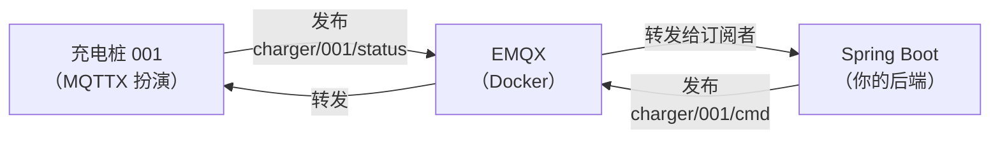

# MQTT 入门：把一个"充电桩"接进你的 Spring Boot

> 一句话：MQTT 是物联网世界的消息队列——设备网络差、电量少、脑子小，所以协议设计得极简。今天三步走：Docker 起一个 EMQX（中转站）→ 用 MQTTX 手动扮演充电桩 → 让你熟悉的 Spring Boot 收到设备消息。全程不需要任何硬件。

## 零、先搞清定位：为什么物联网不直接用 HTTP / Kafka？

写后端的你肯定想过：设备上报数据，发个 HTTP POST 不就行了？为什么要专门造一个协议？

问题出在**设备这一端太惨了**，和服务端完全不是一个生存环境：

| | 你的服务器 | 一台充电桩 |
| :--- | :--- | :--- |
| 网络 | 机房千兆光纤 | 地下停车场角落，信号时好时坏 |
| 供电 | 电网直供 | 可能电池供电，每毫安都要省 |
| 算力 | 32 核 64G | 一块几块钱的小芯片 |
| 数量 | 部署几十个 | 全国部署几十万个 |

HTTP 的痛点：设备每次都要"敲门→递信→等回复→挂断"，连接一来一回开销大；而且**服务端没法主动通知设备**（HTTP 里你永远是"被调用方"，想下发命令只能让设备不停地来问："有命令吗？没有？那我过会儿再来问"——纯轮询，浪费电）。

Kafka 的痛点：它是个"重型仓库"，要 ZooKeeper/KRaft、要磁盘日志、协议头都很大。让小芯片跑 Kafka 客户端，好比让电瓶车拉集装箱。

MQTT 的解法简单粗暴：

```
HTTP：  设备 ──每次敲门──> 服务端          服务端无法主动找设备
MQTT：  设备 ──常驻一条小连接──> 中转站 <──常驻── 服务端
                双方谁想说话，随时递信给中转站
```

- **报文头最小只有 2 字节**（HTTP 光一个头就几百字节）——省流量就是省电
- **双方都和中转站保持长连接**——云端随时可以"反向"给设备下命令
- 协议简单到一块小芯片就能实现——几十万个设备也不怕

> 💡 后端类比：**MQTT ≈ 物联网版的 Redis Pub/Sub + 轻量 Broker**。而 EMQX 就是那个 Broker——你可以把它理解成"物联网界的 Kafka 服务器"，只不过它服务的不是微服务，是一堆充电桩、传感器、智能灯泡。

## 一、五个词，MQTT 就懂了一大半

| 术语 | 大白话 | 类比 |
| :--- | :--- | :--- |
| Broker（如 EMQX） | 中转站，所有信都经过它 | 邮局 |
| Client | 任何连上中转站的东西（设备、后端、调试工具） | 寄信人/收信人 |
| Topic | 信箱地址，自己定的字符串 | `charger/001/status` |
| 发布 publish | 往某个地址寄一封信 | 塞信进邮筒 |
| 订阅 subscribe | 登记说"这个地址来信了通知我" | 订报纸 |

注意两个反直觉的点：

1. **发布方和订阅方互相不认识**。充电桩只管把信塞进邮筒，它不知道（也不关心）后面是 1 个后端还是 10 个后端在收。这就是解耦——和你用 Kafka 时的体感一样。
2. **协议层面人人平等**。不像 HTTP 分"客户端/服务端"，MQTT 里后端和充电桩都只是"连上邮局的客户"，谁都能寄信、谁都能收信。

今天要搭的完整链路长这样：



Topic 的写法约定俗成像 URL 路径，用 `/` 分层：`charger/001/status` = 充电桩 / 001 号 / 状态。后端订阅时可以用通配符：

- `charger/+/status`：`+` 匹配任意一层 → **所有**充电桩的状态都能收到
- `charger/#`：`#` 匹配后面所有层 → 001 号桩的任何消息

## 二、第一步：Docker 起 EMQX（中转站开业）

```bash
docker run -d --name emqx \
  -p 1883:1883 \
  -p 18083:18083 \
  emqx/emqx:latest
```

两个端口记住就够：

| 端口 | 谁用 | 说明 |
| :--- | :--- | :--- |
| 1883 | 程序 | MQTT 协议本体，设备和后端都连它 |
| 18083 | 你 | 管理后台，浏览器打开人看的 |

验证：浏览器打开 `http://localhost:18083`，默认账号 `admin` / `public`（首次登录会让你改密码）。能进 Dashboard 就说明中转站开业了——此刻连接数是 0，一个客户都还没有，很正常。

> 💡 EMQX 装好 = 一栋空邮局。Dashboard 相当于邮局的监控大屏：几个客户在线、今天寄了多少信，后面每一步操作都能在"监控大屏"上看到数字跳动，强烈建议浏览器一直开着，很有"物联网中控室"的感觉。

## 三、第二步：用 MQTTX 扮演一个充电桩

真实世界里，充电桩里有一块小芯片负责联网收发。我们没有硬件，就用 **MQTTX**（EMQ 官方的开源客户端，有图形界面，官网 mqttx.app 下载 Windows 版）来**人工扮演**这块芯片。

### 3.1 连上中转站

MQTTX 里新建连接，填三样：

```
Name:    charger-001        （随便起，给人看的）
Host:    mqtt://localhost:1883
Client ID: charger-001      （工牌，必须唯一，见下方提示）
```

点 Connect，变绿即成功。此时回头看 EMQX Dashboard，连接数变成 1 了。

> 💡 **Client ID 是工牌，全 Broker 范围内不能重复**。两个程序用同一个 Client ID 连接，后者会把前者踢下线——这是新手最常见的"我客户端怎么老掉线"的原因。Spring Boot 那边记得别也叫 `charger-001`。

### 3.2 发布：上报充电状态（模拟桩 → 云端）

在 MQTTX 里发布一条消息：

```
Topic: charger/001/status
Payload:
{
  "chargerId": "001",
  "status": "charging",
  "current": 32,
  "voltage": 220,
  "ts": 1765843200000
}
```

发送成功。但你会发现**什么都没发生**——消息进了中转站，就石沉大海了。

这不是 bug，是 MQTT 的正常行为：**邮局只负责投递给"登记过的人"，没登记就当没这封信**。这条消息现在正等着一个订阅者出现。别急，第四步让它"有人收"。

（那如果订阅者一直不来呢？这条消息最后去哪了？第六节专门补这一课。）

（顺便：Payload 就是信的内容，格式随便定，物联网惯例用 JSON，字段自己商量。）

### 3.3 订阅：接收云端命令（模拟桩 ← 云端）

在 MQTTX 里再点 New Subscription，订阅：

```
Topic: charger/001/cmd
```

这就等于充电桩挂牌："云端有命令发到这个地址，直接给我。"此刻它安静地等着一封信——第五节的加餐里，我们让 Spring Boot 发一封过来。

## 四、第三步：Spring Boot 收到充电桩消息

后端要干的事，翻译成大白话就是：**去邮局登记一个信箱，说 `charger/+/status` 来信了通知我**。

### 4.1 加依赖

不需要整个 Spring Integration 那套（概念多、配置绕），用最底层的官方客户端 Paho，十几行代码搞定：

```xml
<dependency>
    <groupId>org.eclipse.paho</groupId>
    <artifactId>org.eclipse.paho.client.mqttv3</artifactId>
    <version>1.2.5</version>
</dependency>
```

### 4.2 消费者代码

```java
package com.example.mqtt;

import org.eclipse.paho.client.mqttv3.MqttClient;
import org.eclipse.paho.client.mqttv3.MqttMessage;
import org.eclipse.paho.client.mqttv3.persist.MemoryPersistence;
import org.springframework.boot.ApplicationArguments;
import org.springframework.boot.ApplicationRunner;
import org.springframework.stereotype.Component;

import java.nio.charset.StandardCharsets;

@Component
public class ChargerConsumer implements ApplicationRunner {

    @Override
    public void run(ApplicationArguments args) throws Exception {
        // 连哪个邮局、戴什么工牌（注意别和 MQTTX 的 charger-001 重名）
        MqttClient client = new MqttClient(
                "tcp://localhost:1883",
                "spring-boot-backend-01",
                new MemoryPersistence());

        client.connect();

        // 登记信箱：+ 是通配符，意思是"所有编号的充电桩的状态信"都通知我
        client.subscribe("charger/+/status", (topic, message) -> {
            String payload = new String(message.getPayload(), StandardCharsets.UTF_8);
            System.out.println("收到来自 [" + topic + "] 的消息: " + payload);
        });

        System.out.println("后端已就绪，正在监听所有充电桩上报...");
    }
}
```

对照着 MQTTX 的操作看，三行核心代码一点都不神秘：

| 代码 | 大白话 | 对应 MQTTX 里的动作 |
| :--- | :--- | :--- |
| `new MqttClient(地址, 工牌, ...)` | 填邮局地址，别好工牌 | New Connection 填 Host / Client ID |
| `client.connect()` | 走进邮局 | 点 Connect |
| `client.subscribe(主题, 回调)` | 登记"来信通知我" | New Subscription |

唯一的区别：MQTTX 来信了显示在聊天窗口，代码里来信了执行你的 lambda。

### 4.3 验收：完整链路跑通

1. 启动 Spring Boot，控制台出现 `后端已就绪...`
2. 切到 MQTTX，往 `charger/001/status` 再发一条消息
3. 回看控制台：

```
收到来自 [charger/001/status] 的消息: {"chargerId":"001","status":"charging","current":32,...}
```

**这一行打印出来的瞬间，你已经完成了物联网最核心的一件事：设备到云端的数据上行。** 顺手把消息改成 `charger/002/status` 再发——不换任何代码，后端一样能收到，这就是订阅通配符 `+` 的意义。

## 五、加餐：反向命令（云端 → 设备）

上面只通了半条路。MQTT 真正的价值在另一半：**云端主动找设备**——这在 HTTP 里没有原生对应物。

在消费者代码里加一个"下发命令"的方法（或者直接放在 `run` 末尾）：

```java
// 模拟运营后台点了"降低充电功率"
String cmd = "{\"action\": \"reduce_power\", \"value\": 16}";
client.publish("charger/001/cmd",
        new MqttMessage(cmd.getBytes(StandardCharsets.UTF_8)));
System.out.println("已下发命令: " + cmd);
```

启动程序，然后切到 MQTTX 看你订阅的 `charger/001/cmd`——**那封"降低功率"的信到了**。此时你手动扮演的充电桩就可以"收到命令、执行、再上报新状态"，形成闭环：

```
桩上报状态 ──> EMQX ──> 后端收到、判断电流过高
后端下命令 ──> EMQX ──> 桩收到、降功率
桩再上报  ──> EMQX ──> 后端确认生效        ← 一个最小的"设备管控"系统
```

> 💡 再体会一次：**发布和订阅是同一个 client 的两个方法**。设备端和服务器端在 MQTT 协议层面长得一模一样，所谓"云"和"端"只是业务分工，不是技术分界。这是和 HTTP（你永远是 server，等你被调）最不同的思维方式。

## 六、灵魂拷问：晚到的订阅者，能收到之前的消息吗？

不能。这大概是 MQTT 被后端开发者问得最多的问题——默认规则是：**消息发布的那一瞬间，Broker 只投递给"此刻在线且订阅了"的人，转发完这条消息就删了**。当时没人订阅，消息直接蒸发。

对比 Kafka 就清楚了：

| | Kafka | MQTT (EMQX) |
| :--- | :--- | :--- |
| 消息存储 | 落磁盘，默认保留 7 天 | **不存**，转发完就扔 |
| 消费者晚到 | 可以从头回放历史 | 历史早没了 |
| 类比 | 水缸：水存着，随取随舀 | 水管：流过去就没了 |

这不是缺陷，是为物联网量身设计的：传感器每 5 秒报一次温度，第 832 次读数毫无意义，只有"最新值"有意义，存历史纯属浪费。真需要历史，那是云端数据库的活——你的 Spring Boot 收到就落库，Broker 从不越俎代庖。

但有两个例外机制，救不同的场：

### 例外一：保留消息—— 给 topic 贴一张公告

发布时带个 retain 标志（MQTTX 里就是发送时勾上 Retain 选项），Broker 会把这条消息钉在 topic 上，之后任何新订阅者一上线立刻收到。自己试一下：

```
1. MQTTX 往 charger/001/status 发消息，这次勾上 Retain
2. 重启 Spring Boot（模拟一个"晚到的订阅者"上线）
3. 程序刚一订阅，那条消息立刻被推过来——不用等设备的下一次上报
```

注意细节：**每个 topic 只保留最后一条**，新公告贴上去会揭掉旧公告——它是"公告栏"，不是"历史记录"。retain 是“寄信时顺手贴到公告栏”的一个标志，公告栏永远只有一张、永远可被覆盖/撤下，**每个新订阅者进门第一眼看到的永远是它**。后端视角：先被塞一张“最新快照”，然后开始接实况直播。

典型用法：设备上报状态时全部带 retain，这样后端每次重启都能瞬间恢复"所有桩的当前状态"全景，而不是干等每根桩的下一次心跳。代码里就多两行：

```java
MqttMessage msg = new MqttMessage(payload);
msg.setRetained(true);
client.publish("charger/001/status", msg);
```

### 例外二：持久会话—— 只管"订阅过但掉线"的人

连接时设置 `cleanSession=false`，Broker 会在你掉线期间替你攒着消息（限 QoS≥1），重连后补发。但它只服务**订阅过的人**——从没订阅过的客户，Broker 不会为它占内存：

```
从没订阅过          → 没辙（除非发布者用了 retain）
订阅过、然后掉线了  → 攒着，重连补发
```

一句话记住：

> **MQTT 只保证"在线的人收到"，不保证"晚到的人补齐"。晚到的想要点东西，要么发布者提前贴好公告，要么自己早点来。**

## 七、总结

今天的三步，对应三个角色：

| 步骤 | 扮演的角色 | 干的事 |
| :--- | :--- | :--- |
| Docker 起 EMQX | 邮局 | 中转所有消息，Dashboard 监控 |
| MQTTX 操作 | 充电桩 | 发布状态、订阅命令 |
| Spring Boot | 云端后端 | 订阅状态、发布命令 |

和熟悉的东西放一起对比：

| | HTTP | Kafka | MQTT |
| :--- | :--- | :--- | :--- |
| 谁能先说话 | 只有客户端先请求 | 生产者/消费者都可以 | **双向随时** |
| 重量级 | 中 | 重（磁盘日志、集群） | 轻（小芯片能跑） |
| 典型连接数 | 几百 | 几百 | **几十万** |
| 服务端能主动找设备吗 | ❌ | ❌（它也只在"被拉取"时给数据） | ✅ |

几个今天没展开、但迟早会撞上的词，一句话预个习：

- **QoS（服务质量）**：寄信方式——明信片（发了就不管）/ 挂号信（保证至少送到一次）。今天全程用默认，命令下发这种不能丢的场景才需要关心
- **遗嘱**：设备连上时先留一封"如果我断线了，替我把这封信发出去"——云端靠它感知设备掉线

一句话记住 MQTT：

> **所有东西都只跟邮局说话，寄信的不管谁收、收信的不问谁寄——设备再多、网络再烂，这个结构都不塌。**
