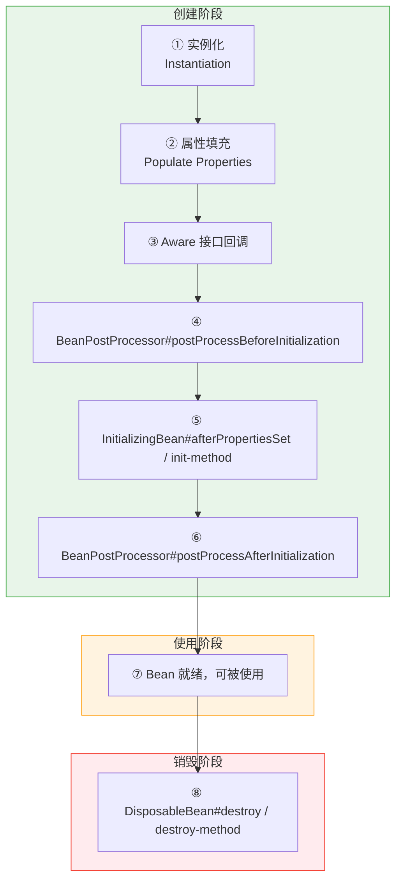
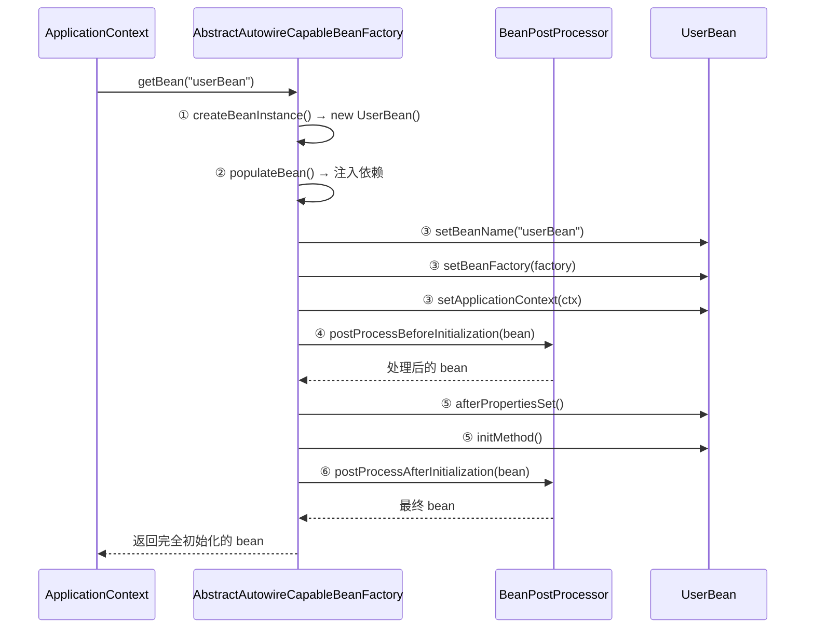
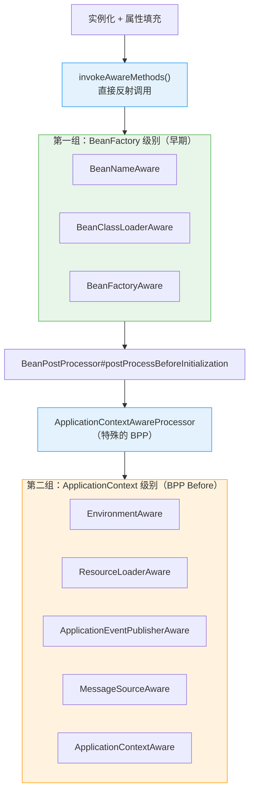

# Spring Bean 的生命周期

## 核心流程全览



> 💡 **阅读指引**：Bean 生命周期是 Spring 面试的**超高频考点**。本文按"**创建 → 使用 → 销毁**"三阶段展开，每个阶段标注源码入口和扩展点。依赖注入的细节见 [Spring 依赖注入实现原理](Spring-DI-Notes.md)。

---

## 一、创建阶段（6 步）

### 1.1 完整时序图



### 1.2 逐步详解

| 步骤 | 名称 | 源码入口 | 说明 |
| :--- | :--- | :--- | :--- |
| ① | **实例化** | `createBeanInstance()` | 通过反射/CGLIB 创建 Bean 实例，此时属性为空 |
| ② | **属性填充** | `populateBean()` | 注入 @Autowired/@Value 等依赖（详见 DI 笔记） |
| ③ | **Aware 接口回调** | `invokeAwareMethods()` + `ApplicationContextAwareProcessor` | 注入容器相关引用 |
| ④ | **BPP Before** | `applyBeanPostProcessorsBeforeInitialization()` | 所有 BeanPostProcessor 的前置处理 |
| ⑤ | **初始化** | `invokeInitMethods()` | InitializingBean + init-method |
| ⑥ | **BPP After** | `applyBeanPostProcessorsAfterInitialization()` | 所有 BeanPostProcessor 的后置处理（AOP 代理在此创建） |

### 1.3 Aware 接口详解

#### 什么是 Aware？

Aware 是 Spring 提供的一组**回调接口**，命名规则为 `XxxAware`。当你的 Bean 实现了某个 Aware 接口，Spring 会在生命周期中**自动把对应的容器组件注入进来**。

> 💡 **本质**：Aware 是一种**被动获取容器能力**的机制。你不需要 `@Autowired`，只要实现接口，Spring 就会主动"塞"给你。它解决的核心问题是：**Bean 如何在不耦合具体实现的前提下，获得容器的底层能力**。比如 `BeanNameAware` 会塞 beanName 到接口上，`BeanClassLoaderAware` 会塞 ClassLoader 进接口。

#### 两类 Aware 的区别

Spring 的 Aware 接口分为两组，**调用时机和注入方式完全不同**：



| 分组 | 包含接口 | 调用时机 | 调用方式 | 为什么分两组 |
| :--- | :--- | :--- | :--- | :--- |
| **BeanFactory 级别** | BeanNameAware、BeanClassLoaderAware、BeanFactoryAware | 属性填充之后、BPP Before 之前 | `invokeAwareMethods()` 直接反射调用 | 这些是 BeanFactory 的基础能力，不依赖 ApplicationContext |
| **ApplicationContext 级别** | EnvironmentAware、ResourceLoaderAware、ApplicationEventPublisherAware、MessageSourceAware、ApplicationContextAware | BPP Before 阶段 | 通过 `ApplicationContextAwareProcessor`（一个特殊的 BeanPostProcessor）调用 | 这些能力属于 ApplicationContext，而 BeanFactory 不一定有 |

> ⚠️ **关键认知**：如果你用的是纯 `BeanFactory`（而非 `ApplicationContext`），第二组 Aware **永远不会被调用**，因为 `ApplicationContextAwareProcessor` 根本不存在。这也是为什么 Spring 要把它们分开——保证 BeanFactory 级别的 Aware 在任何容器下都能工作。

#### 每个 Aware 的实际用途

| Aware 接口 | 注入什么 | 实际使用场景 | 日常频率 |
| :--- | :--- | :--- | :--- |
| `BeanNameAware` | 当前 Bean 的名称（String） | 日志中标识自己、动态注册时记录名称 | ⭐ 低 |
| `BeanClassLoaderAware` | 加载当前类的 ClassLoader | 动态加载资源/类时需要指定 ClassLoader | ⭐ 低 |
| `BeanFactoryAware` | BeanFactory 实例 | 手动 getBean()、编程式注册 Bean | ⭐⭐ 中 |
| `EnvironmentAware` | Environment（配置+Profile） | 读取配置属性、判断当前 Profile | ⭐⭐⭐ 高 |
| `ResourceLoaderAware` | ResourceLoader | 加载 classpath/file/url 资源 | ⭐⭐ 中 |
| `ApplicationEventPublisherAware` | ApplicationEventPublisher | 发布自定义事件 | ⭐⭐⭐ 高 |
| `MessageSourceAware` | MessageSource | 国际化消息解析 | ⭐ 低 |
| `ApplicationContextAware` | ApplicationContext | 获取任意 Bean、发布事件、读取配置（万能钥匙） | ⭐⭐⭐⭐ 最高 |

#### 实战示例

**示例 1：用 EnvironmentAware 读取配置（比 @Value 更灵活）**

```java
@Component
public class FeatureFlagService implements EnvironmentAware {

    private Environment environment;

    @Override
    public void setEnvironment(Environment environment) {
        this.environment = environment;
    }

    public boolean isNewFeatureEnabled() {
        // 支持占位符解析、默认值、Profile 条件判断
        return environment.getProperty("feature.new-ui.enabled", Boolean.class, false);
    }

    public String getActiveProfile() {
        return environment.getActiveProfiles().length > 0
            ? environment.getActiveProfiles()[0]
            : "default";
    }
}
```

> 💡 **vs @Value**：`@Value` 适合简单注入；`EnvironmentAware` 适合需要**动态判断、条件读取、运行时查询**的场景。

**示例 2：用 ApplicationEventPublisherAware 解耦业务通知**

```java
@Service
public class OrderService implements ApplicationEventPublisherAware {

    private ApplicationEventPublisher publisher;

    @Override
    public void setApplicationEventPublisher(ApplicationEventPublisher publisher) {
        this.publisher = publisher;
    }

    public void createOrder(CreateOrderRequest request) {
        Order order = saveOrder(request);
        // 发布事件，不直接依赖短信/邮件服务
        publisher.publishEvent(new OrderCreatedEvent(order));
    }
}
```

> 💡 **vs @Autowired**：这里用 Aware 和 `@Autowired ApplicationEventPublisher` 效果一样。但 Aware 的优势是**不引入 Spring 注解依赖**，如果将来换框架，只需改接口实现。

**示例 3：用 ApplicationContextAware 做工具类（常见但需谨慎）**

```java
@Component
public class SpringContextHolder implements ApplicationContextAware {

    private static ApplicationContext context;

    @Override
    public void setApplicationContext(ApplicationContext applicationContext) {
        context = applicationContext;
    }

    public static <T> T getBean(Class<T> clazz) {
        return context.getBean(clazz);
    }

    public static String getProperty(String key) {
        return context.getEnvironment().getProperty(key);
    }
}
```

> ⚠️ **警告**：这种静态工具类模式虽然方便，但**破坏了 IoC 原则**，让代码隐式依赖容器。仅在框架代码、拦截器、定时任务等无法注入的场景下使用。业务代码优先用 `@Autowired`。

#### Aware vs @Autowired：什么时候用哪个？

| 维度 | Aware 接口 | @Autowired |
| :--- | :--- | :--- |
| **耦合度** | 实现接口，不依赖注解 | 依赖 Spring 注解 |
| **可测试性** | 需 mock 接口方法 | 可直接 new + setter/构造器注入 |
| **灵活性** | 固定注入特定类型 | 可注入任意 Bean |
| **适用场景** | 框架级组件、需要解耦 Spring 注解、获取容器底层能力 | 业务代码、常规依赖注入 |
| **推荐度** | ⚠️ 按需使用 | ✅ 日常首选 |

> 💡 **决策原则**：**90% 的场景用 @Autowired 就够了**。只有当你需要获取容器底层能力（Environment、Publisher、ResourceLoader）、或者编写不依赖 Spring 注解的框架级组件时，才考虑 Aware。

#### 面试话术

> "Aware 接口是 Spring 提供的被动注入机制，Bean 实现 XxxAware 接口后，容器会自动注入对应组件。Aware 分两组：BeanFactory 级别（BeanNameAware、BeanFactoryAware 等）在属性填充后直接调用；ApplicationContext 级别（EnvironmentAware、ApplicationContextAware 等）通过 ApplicationContextAwareProcessor 在 BPP Before 阶段调用。日常开发中 @Autowired 能解决大部分需求，Aware 主要用于框架级组件或需要解耦 Spring 注解的场景。"

### 1.4 BeanPostProcessor 的核心作用

BeanPostProcessor 是 Spring 提供的**最核心的扩展点**，几乎所有高级功能都通过它实现：

| BPP 实现类 | 作用 | 阶段 |
| :--- | :--- | :--- |
| `AutowiredAnnotationBeanPostProcessor` | 处理 @Autowired/@Value 注入 | Before |
| `CommonAnnotationBeanPostProcessor` | 处理 @Resource/@PostConstruct/@PreDestroy | Before/After |
| `ApplicationContextAwareProcessor` | 处理 Aware 接口 | Before |
| `AbstractAutoProxyCreator` | 创建 AOP 代理 | **After** |
| `AsyncAnnotationBeanPostProcessor` | 处理 @Async | After |
| `ScheduledAnnotationBeanPostProcessor` | 处理 @Scheduled | After |

> 💡 **关键认知**：**AOP 代理是在 BPP After 阶段创建的**，不是实例化阶段。这就是为什么三级缓存需要 ObjectFactory——为了在循环依赖时也能正确创建代理。

---

## 二、使用阶段

Bean 完成创建后存入一级缓存 `singletonObjects`，可被其他 Bean 引用。

### 2.1 Singleton vs Prototype

| 维度 | Singleton | Prototype |
| :--- | :--- | :--- |
| 创建次数 | 容器启动时创建一次 | 每次 getBean() 都创建 |
| 缓存 | 存入 singletonObjects | 不缓存 |
| 生命周期管理 | 容器管理创建和销毁 | 容器只管创建，不管销毁 |
| 线程安全 | 需注意（共享实例） | 天然安全（每次新实例） |

### 2.2 Lazy Init

```java
@Lazy
@Service
public class HeavyService { }
```

- 标记 @Lazy 的 Singleton Bean 不在容器启动时创建
- 首次 getBean() 时才触发完整的创建流程
- 适用场景：启动慢的重型 Bean、可选依赖

---

## 三、销毁阶段

### 3.1 销毁触发条件

| Scope | 销毁时机 | 说明 |
| :--- | :--- | :--- |
| Singleton | 容器关闭时（`context.close()`） | 自动触发 |
| Prototype | **不会自动销毁** | 需手动管理或使用自定义 Scope |
| Request/Session | 请求/会话结束时 | Web 环境 |

### 3.2 销毁方式优先级


| 优先级 | 方式 | 说明 |
| :--- | :--- | :--- |
| ① | `@PreDestroy` | JSR-250 注解，推荐 |
| ② | `DisposableBean#destroy()` | Spring 接口 |
| ③ | `destroy-method` | XML/@Bean 配置 |

> ⚠️ **三者可以共存**，按上述顺序依次执行。但通常只用一种。

### 3.3 销毁流程源码

```
AbstractApplicationContext.doClose()
  → destroyBeans()
    → DisposableBeanAdapter.destroy()
      → invokeCustomDestroyMethod()     // destroy-method
      → DisposableBean.destroy()        // DisposableBean 接口
      → CommonAnnotationBeanPostProcessor.postProcessBeforeDestruction()  // @PreDestroy
```

---

## 四、扩展点对比

### 4.1 初始化扩展点对比

| 扩展点 | 类型 | 粒度 | 推荐度 | 典型用途 |
| :--- | :--- | :--- | :--- | :--- |
| `@PostConstruct` | 注解 | 单个 Bean | ⭐️ 推荐 | 业务初始化 |
| `InitializingBean#afterPropertiesSet` | 接口 | 单个 Bean | ⚠️ 可选 | 框架级初始化 |
| `init-method` | 配置 | 单个 Bean | ⚠️ 可选 | XML 时代遗留 |
| `BeanPostProcessor#postProcessBeforeInitialization` | 接口 | 所有 Bean | ⭐️ 框架扩展 | 通用前置处理 |
| `BeanPostProcessor#postProcessAfterInitialization` | 接口 | 所有 Bean | ⭐️ 框架扩展 | AOP 代理、异步包装 |
| `SmartInitializingSingleton#afterSingletonsInstantiated` | 接口 | 所有单例完成后 | ⭐️ 特殊场景 | 需要所有 Bean 都就绪后执行 |

### 4.2 SmartInitializingSingleton 的特殊价值

```java
@Component
public class RouteInitializer implements SmartInitializingSingleton {
    @Override
    public void afterSingletonsInstantiated() {
        // 此时所有单例 Bean 都已创建完毕
        // 适合做路由注册、缓存预热等需要全部 Bean 就绪的操作
    }
}
```

> 💡 **与 InitializingBean 的区别**：InitializingBean 在每个 Bean 初始化时调用；SmartInitializingSingleton 在**所有单例 Bean 都初始化完成后**才调用一次。

---

## 五、面试高频问题速答

### Q1：Spring Bean 的生命周期是怎样的？

Bean 生命周期分三阶段：**创建 → 使用 → 销毁**。创建阶段 6 步：① 实例化（new 空对象）→ ② 属性填充（注入依赖）→ ③ Aware 接口回调 → ④ BeanPostProcessor Before → ⑤ InitializingBean/init-method → ⑥ BeanPostProcessor After（AOP 代理在此创建）。销毁阶段按 @PreDestroy → DisposableBean → destroy-method 顺序执行。Prototype Bean 容器不管销毁。

### Q2：BeanPostProcessor 的作用是什么？有哪些典型实现？

BeanPostProcessor 是 Spring 最核心的扩展点，允许在所有 Bean 初始化前后插入自定义逻辑。**Before 阶段**：AutowiredAnnotationBeanPostProcessor 处理 @Autowired、ApplicationContextAwareProcessor 处理 Aware 接口。**After 阶段**：AbstractAutoProxyCreator 创建 AOP 代理、AsyncAnnotationBeanPostProcessor 处理 @Async。几乎所有 Spring 高级功能都通过 BPP 实现。

### Q3：@PostConstruct、InitializingBean、init-method 的执行顺序？

执行顺序：@PostConstruct → InitializingBean#afterPropertiesSet → init-method。三者可以共存，按此顺序依次执行。推荐用 @PostConstruct（JSR-250 标准，不耦合 Spring）；InitializingBean 适合框架级组件；init-method 是 XML 时代遗留方式。

### Q4：AOP 代理是在生命周期的哪个阶段创建的？

AOP 代理在 **BeanPostProcessor#postProcessAfterInitialization** 阶段创建，由 `AbstractAutoProxyCreator` 实现。这也是为什么三级缓存需要 ObjectFactory——在循环依赖场景下，需要提前暴露一个能创建代理的工厂，而非原始对象的引用。如果在 Before 阶段就创建代理，会导致代理对象被当作普通 Bean 处理，破坏 AOP 语义。

### Q5：Singleton 和 Prototype Bean 的生命周期有什么区别？

Singleton Bean 由容器完整管理：启动时创建一次，存入一级缓存，容器关闭时自动销毁。Prototype Bean 容器只管创建不管销毁：每次 getBean() 都创建新实例，不缓存，不会自动调用销毁方法。如果 Prototype Bean 持有资源（如数据库连接），需要手动释放或使用自定义 Scope。

---

## 小结

- **创建 6 步**：实例化 → 属性填充 → Aware → BPP Before → 初始化 → BPP After
- **销毁 3 种**：@PreDestroy → DisposableBean → destroy-method
- **核心扩展点**：BeanPostProcessor（Before/After）、SmartInitializingSingleton
- **AOP 代理时机**：BPP After 阶段，这是三级缓存存在的根本原因
- **Prototype 不管销毁**：容器只负责创建，不负责销毁

> 💡 **记忆口诀**：**实填感前后，初始化在后；销毁三件套，代理在最后；单例管到底，原型只管生；扩展靠 BPP，框架全靠它**。
