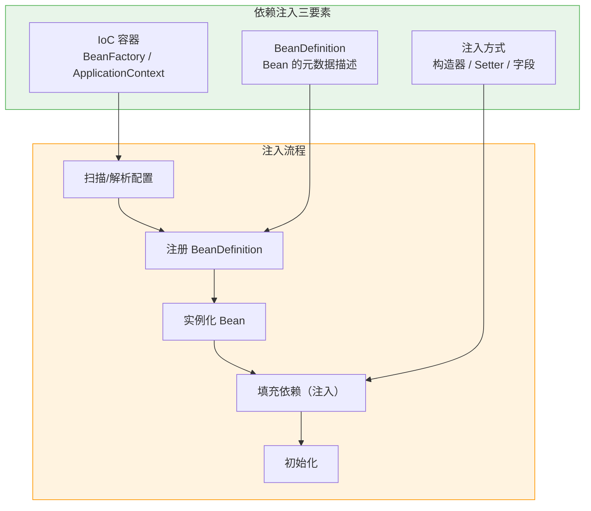
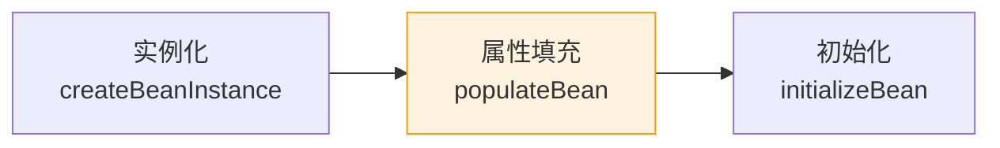
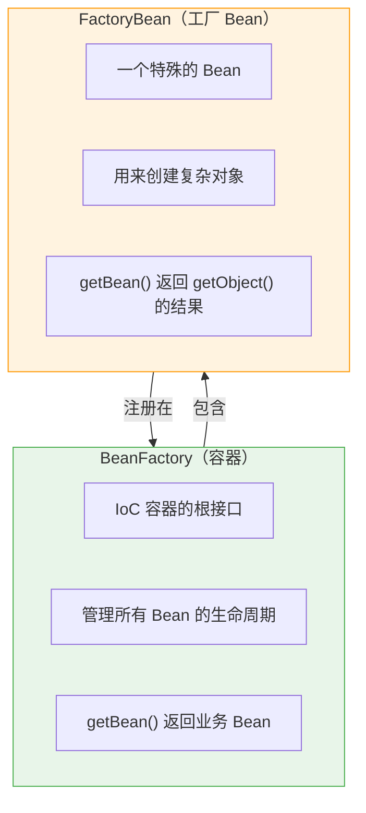
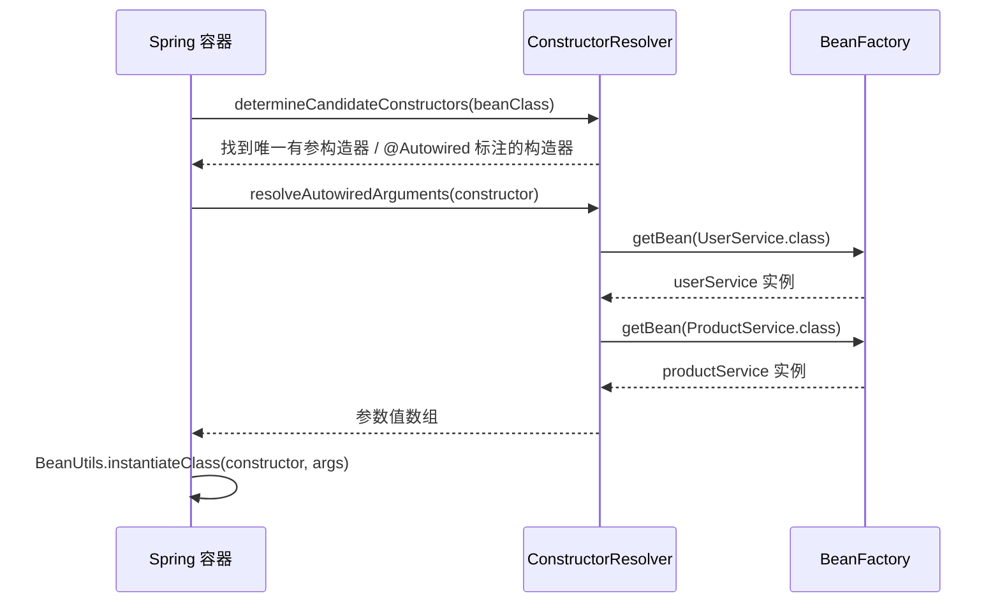
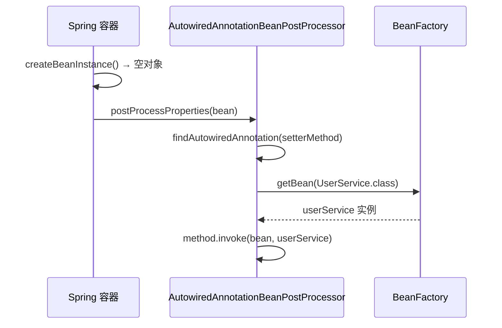
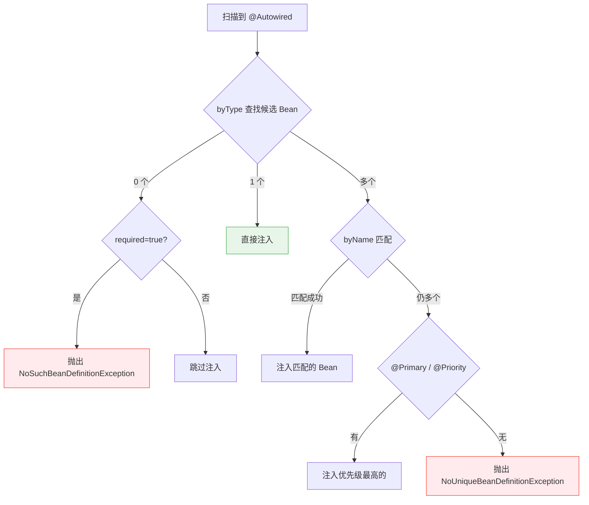
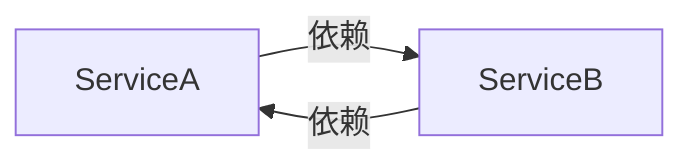
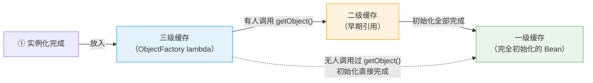

# Spring 依赖注入实现原理

## 核心概念全览



> 💡 **阅读指引**：依赖注入的本质是**控制反转（IoC）**——对象的创建和依赖关系不再由代码自己管理，而是交给 Spring 容器。本文聚焦"**Spring 是怎么把依赖塞进去的**"，不涉及 Bean 生命周期的完整细节（那部分见 [Spring Bean 生命周期](Spring-Bean-Lifecycle-Notes.md)）。

---

## 一、依赖注入的核心原理

### 1.1 什么是依赖注入？

| 概念 | 说明 |
| :--- | :--- |
| **依赖** | A 类需要 B 类的实例才能工作，B 就是 A 的依赖 |
| **注入** | 容器在创建 A 时，自动把 B 的实例"塞"给 A |
| **控制反转** | A 不再 `new B()`，而是被动接收 B，控制权从代码转移到容器 |

### 1.2 Spring 如何知道要注入什么？

Spring 通过 **BeanDefinition** 描述每个 Bean 的元数据：

```java
// BeanDefinition 核心字段（简化）
public class BeanDefinition {
    private String beanClassName;      // 类名
    private String scope;              // singleton / prototype
    private boolean lazyInit;          // 是否懒加载
    private ConstructorArgumentValues constructorArgs; // 构造器参数
    private MutablePropertyValues propertyValues;      // setter/字段属性
    private String[] dependsOn;        // 显式依赖
}
```

BeanDefinition 的来源：
- **XML 配置**：`<bean>` 标签解析
- **注解扫描**：`@Component` + `@Autowired` 扫描
- **Java Config**：`@Bean` 方法解析
- **自动装配**：`@Configuration` + `@Import`

### 1.3 注入的时机



> ⚠️ **关键认知**：依赖注入发生在**属性填充阶段（populateBean）**，不是实例化阶段，也不是初始化阶段。实例化只是 `new` 了一个空对象，注入是在这之后把依赖"填"进去。

### 1.4 BeanFactory vs FactoryBean（经典面试题）

这两个名字相似但职责完全不同，是 Spring 面试的**古早高频题**。



| 维度 | BeanFactory | FactoryBean |
| :--- | :--- | :--- |
| **本质** | IoC 容器的根接口 | 一个特殊的 Bean（本身也是 Bean） |
| **职责** | 管理所有 Bean 的创建、获取、生命周期 | 封装复杂对象的创建逻辑 |
| **getBean("x") 返回** | x 对应的业务 Bean | 如果 x 是 FactoryBean，返回 `getObject()` 的结果 |
| **获取 FactoryBean 本身** | — | `getBean("&x")`（加 & 前缀） |
| **典型实现** | DefaultListableBeanFactory、ApplicationContext | SqlSessionFactoryBean、FeignClientFactoryBean |
| **使用场景** | 底层容器，开发者极少直接使用 | 创建过程复杂的对象（如 MyBatis 的 SqlSession） |

#### FactoryBean 的三个核心方法

```java
public interface FactoryBean<T> {
    // 返回实际要使用的对象（getBean 拿到的就是这个）
    T getObject() throws Exception;
    
    // 返回 getObject() 的类型
    Class<?> getObjectType();
    
    // 是否单例（默认 true）
    boolean isSingleton();
}
```

#### 实际案例：MyBatis 的 SqlSessionFactoryBean

```java
// MyBatis-Spring 中的 FactoryBean
public class SqlSessionFactoryBean implements FactoryBean<SqlSessionFactory> {
    
    @Override
    public SqlSessionFactory getObject() throws Exception {
        // 复杂的创建逻辑：解析配置、构建环境、创建工厂
        return buildSqlSessionFactory();
    }
    
    @Override
    public Class<?> getObjectType() {
        return SqlSessionFactory.class;
    }
}
```

```java
// 使用时
@Autowired
private SqlSessionFactory sqlSessionFactory;  // ← 拿到的是 getObject() 返回的对象

// 如果想拿 FactoryBean 本身
@Autowired
@Qualifier("&sqlSessionFactory")
private SqlSessionFactoryBean factoryBean;    // ← 拿到的是 FactoryBean 实例
```

> 💡 **记忆口诀**：**BeanFactory 是容器，FactoryBean 是工人；容器管所有 Bean，工人造复杂对象；getBean 拿产品，& 前缀拿工人**。

---

## 二、三种注入方式的实现原理

### 2.1 构造器注入（推荐）

```java
@Service
public class OrderService {
    private final UserService userService;
    private final ProductService productService;

    // Spring 自动匹配构造器参数类型
    public OrderService(UserService userService, ProductService productService) {
        this.userService = userService;
        this.productService = productService;
    }
}
```

**实现原理**：



**源码关键路径**：
```
AbstractAutowireCapableBeanFactory.createBeanInstance()
  → ConstructorResolver.autowireConstructor()
    → resolveAutowiredArguments()  // 递归获取依赖 Bean
      → BeanUtils.instantiateClass()  // 反射调用构造器
```

### 2.2 Setter 注入

```java
@Service
public class OrderService {
    private UserService userService;

    @Autowired
    public void setUserService(UserService userService) {
        this.userService = userService;
    }
}
```

**实现原理**：



**源码关键路径**：
```
AbstractAutowireCapableBeanFactory.populateBean()
  → AutowiredAnnotationBeanPostProcessor.postProcessProperties()
    → InjectionMetadata.inject()
      → Method.invoke()  // 反射调用 setter
```

### 2.3 字段注入（不推荐）

```java
@Service
public class OrderService {
    @Autowired
    private UserService userService;  // 直接注入字段
}
```

**实现原理**：与 Setter 注入类似，但通过 `Field.set()` 反射赋值，绕过 setter 方法。

### 2.4 三种方式对比

| 维度 | 构造器注入 | Setter 注入 | 字段注入 |
| :--- | :--- | :--- | :--- |
| **不可变性** | ✅ 可声明 final | ❌ 不可 final | ❌ 不可 final |
| **必填依赖** | ✅ 天然强制 | ❌ 可能忘记调用 | ❌ 可能为 null |
| **循环依赖** | ❌ 无法解决 | ✅ 可通过三级缓存解决 | ✅ 可通过三级缓存解决 |
| **测试友好** | ✅ new 即可测试 | ⚠️ 需 setter | ❌ 需反射 |
| **Spring 官方推荐** | ✅ 推荐 | ⚠️ 可选依赖时用 | ❌ 不推荐 |
| **IDE 支持** | ✅ 提示缺失依赖 | ⚠️ 一般 | ⚠️ 一般 |

> 💡 **最佳实践**：**优先构造器注入**。仅在可选依赖或循环依赖场景下使用 Setter 注入。避免字段注入。

---

## 三、自动装配的核心机制

### 3.1 @Autowired 的工作流程



### 3.2 候选 Bean 的筛选规则

| 优先级 | 规则 | 说明 |
| :--- | :--- | :--- |
| ① | **类型匹配** | 按参数/字段类型查找所有候选 Bean |
| ② | **名称匹配** | 多个候选时，按变量名/参数名匹配 beanName |
| ③ | **@Primary** | 标记为主要的候选 Bean |
| ④ | **@Priority** | 数值越小优先级越高 |
| ⑤ | **@Qualifier** | 精确指定 beanName |

### 3.3 @Resource vs @Autowired

| 维度 | @Autowired | @Resource |
| :--- | :--- | :--- |
| 来源 | Spring 注解 | JSR-250 标准注解 |
| 默认匹配 | byType | byName |
| 多候选处理 | byName → @Primary → @Priority | byName → byType |
| required 属性 | ✅ 支持 | ❌ 不支持 |
| 推荐场景 | Spring 项目通用 | 需要解耦 Spring 时 |

> "@Autowired 和 @Resource 的区别不是简单的'一个按名字、一个按类型'。两者都支持 byName 和 byType，只是默认优先级相反：@Autowired 先 byType 再 byName，@Resource 先 byName 再 byType。此外 @Autowired 是 Spring 专属注解，支持 required、@Primary、@Priority 等消歧机制；@Resource 是 JSR-250 标准注解，不支持这些特性，但在需要解耦 Spring 框架时更有优势。"

---

## 四、循环依赖与三级缓存

### 4.1 什么是循环依赖？



A 创建时需要 B，B 创建时需要 A，形成死锁。Spring 通过三级缓存打破这个死锁。

### 4.2 三个核心概念的精确定义

在理解三级缓存之前，必须先搞清楚三个容易混淆的概念：

| 术语 | 精确定义 | 不是什么 |
| :--- | :--- | :--- |
| **完全初始化的 Bean** | 完成了**实例化 + 属性填充 + Aware回调 + BeanPostProcessor Before + InitializingBean/init-method + BeanPostProcessor After** 全部步骤的 Bean | 不是"属性填完了就行"，还必须走完所有初始化回调和后置处理 |
| **半成品 Bean（早期引用）** | 只完成了**实例化**，属性还没填充、初始化回调还没执行的 Bean 实例 | 不是"填了一半属性"，而是**一个属性都没填**的空壳对象 |
| **ObjectFactory** | Spring 内部自动创建的一个**临时 lambda**，唯一作用是：当别人需要提前拿到当前 Bean 时，决定返回原始对象还是 AOP 代理 | 不是 FactoryBean，不是 SqlSessionFactoryBean，不是任何你写的类 |

> ⚠️ **关于"半成品"的常见误解**：
> - "半成品"不是"填了一半属性"，而是**实例化刚完成、一个属性都没填**的空壳对象
> - 没有无参构造的类也可以成为半成品（如通过 @Bean 工厂方法创建），但在**循环依赖 + 仅有参构造**的场景下，实例化本身就需要依赖，无法产出空壳 → 这就是构造器注入无法解决循环依赖的根本原因

### 4.3 三级缓存到底存了什么？

| 缓存 | Map 类型 | Key | Value | 何时放入 | 何时移除 |
| :--- | :--- | :--- | :--- | :--- | :--- |
| **一级** `singletonObjects` | `ConcurrentHashMap<String, Object>` | beanName | **完全初始化的 Bean**（可能是代理） | 所有步骤完成后 | 容器关闭时 |
| **二级** `earlySingletonObjects` | `ConcurrentHashMap<String, Object>` | beanName | **早期引用**（原始对象或代理） | ObjectFactory.getObject() 被调用后 | Bean 完全初始化后 |
| **三级** `singletonFactories` | `ConcurrentHashMap<String, ObjectFactory<?>>` | beanName | **一个临时 lambda** | 实例化之后、属性填充之前 | ObjectFactory 被调用后 或 Bean 完全初始化后 |

> 💡 **关键澄清**：三级缓存存的不是 Bean，也不是 FactoryBean，而是一个 Spring 内部创建的**临时 lambda**，用完即弃。二级缓存存的才是早期引用（原始对象或代理），它是 ObjectFactory.getObject() 的返回值。

### 4.4 Bean 在三级缓存中的流转

一个 Bean 在创建过程中会在三级缓存中**单向流转**，永远不会反向：



#### 两条流转路径

| 路径 | 触发条件 | 流转过程 | 典型场景 |
| :--- | :--- | :--- | :--- |
| **路径 A** | 其他 Bean 在创建过程中需要提前拿到当前 Bean（循环依赖） | 三级 → 二级 → 一级 | ServiceA ↔ ServiceB 循环依赖 |
| **路径 B** | 没有其他 Bean 提前引用当前 Bean | 三级 → 一级（跳过二级） | 普通 Bean，无循环依赖 |


### 4.5 完整示例：循环依赖 + AOP 代理

假设有两个 Service 循环依赖，且 A 有 `@Transactional`（需要 AOP 代理）：

```java
@Service
public class ServiceA {
    @Autowired
    private ServiceB serviceB;  // ← 字段注入

    @Transactional
    public void methodA() { }
}

@Service
public class ServiceB {
    @Autowired
    private ServiceA serviceA;  // ← 字段注入

    public void methodB() { }
}
```

**Spring 创建过程的完整流转**：

```
═══ ServiceA 创建开始 ═══

步骤① 实例化 ServiceA
  → new ServiceA()
  → 此时 serviceB 字段 = null（这就是"半成品"）
  
步骤② 将 ObjectFactory 放入三级缓存
  → singletonFactories.put("serviceA", () -> {
        if (需要AOP代理) return createProxy(serviceA);
        else return serviceA;
    })
  → 【ServiceA 进入三级缓存】
  
步骤③ 开始填充 ServiceA 的属性
  → 发现需要注入 serviceB → getBean("serviceB")
  
  ┌─── ServiceB 创建开始 ─────────────────────────────┐
  │ 步骤① new ServiceB()                              │
  │ 步骤② ObjectFactory 放入三级缓存                   │
  │   → 【ServiceB 进入三级缓存】                      │
  │ 步骤③ 填充属性 → 需要 serviceA → getBean("serviceA")│
  │                                                   │
  │   查找 serviceA：                                  │
  │     一级 ❌ → 二级 ❌ → 三级 ✅                    │
  │     → 调用 ObjectFactory.getObject()               │
  │     → ServiceA 有 @Transactional → 返回代理对象     │
  │     → 【ServiceA 从三级转移到二级】← 关键转移       │
  │     → 将代理注入给 ServiceB.serviceA                │
  │                                                   │
  │ 步骤④ ServiceB 初始化完成                           │
  │   → 【ServiceB 从三级转移到一级】                   │
  │   → 移除三级                                       │
  └────────────────────────────────────────────────────┘
  
步骤④ 继续填充 ServiceA → serviceB 从一级拿到，注入成功

步骤⑤ ServiceA 初始化（Aware → BeanPostProcessor Before → init → BeanPostProcessor After）
  → BeanPostProcessor After 发现已有代理 → 直接使用，不重复创建

步骤⑥ ServiceA 完全初始化完成
  → 【ServiceA 从二级转移到一级】← 第二次转移
  → 移除二级、三级

═══ ServiceA 创建结束 ═══
```

### 4.6 为什么需要三级而不是两级？

假设只有两级缓存（一级 + 二级），看看会出什么问题：

| 场景 | 两级缓存的做法 | 问题 |
| :--- | :--- | :--- |
| A 无 AOP | 实例化后直接把原始对象放入二级缓存 | ✅ 没问题 |
| A 有 AOP | 实例化后直接把原始对象放入二级缓存 | ❌ B 拿到原始对象，但 A 最终是代理。**B 持有的引用 ≠ 容器里的 Bean** |
| A 有 AOP（改进） | 实例化后立即创建代理放入二级缓存 | ❌ 过早创建代理，可能错过某些 BeanPostProcessor 的处理 |

**三级缓存的解法**：把"是否创建代理"这个决策**延迟到真正有人需要的时候**（ObjectFactory.getObject() 被调用时）。

| 缓存 | 作用 | 为什么不能省 |
| :--- | :--- | :--- |
| 一级 | 存完全初始化的 Bean | 必须有，最终结果 |
| 二级 | 存早期引用 | 避免重复调用 ObjectFactory（B 和 C 都依赖 A 时，第二次直接从二级拿） |
| 三级 | 存 ObjectFactory | **核心原因**：延迟决定原始/代理，确保循环依赖 + AOP 场景下引用一致且正确 |

> 💡 **一句话总结**：三级缓存不是为了"存更多东西"，而是为了**把"创建代理"这个动作延迟到正确的时机**。如果没有 AOP，两级缓存确实够了；但 Spring 必须支持 AOP，所以三级缓存是必要的。

### 4.7 构造器注入为什么无法解决循环依赖？

| 注入方式 | 能否解决循环依赖 | 原因 |
| :--- | :--- | :--- |
| 构造器注入 | ❌ | 实例化时就需要依赖，无法产出空壳对象放入缓存 |
| Setter 注入 | ✅ | 先 `new` 出空壳放入三级缓存，再慢慢填充属性 |
| 字段注入 | ✅ | 同上 |

> 💡 **补充说明**：没有无参构造的类通过 @Bean 工厂方法等方式仍可成为半成品，但在**循环依赖 + 仅有参构造**的场景下，实例化本身就需要依赖，根本无法产出空壳 → 这是构造器注入无法解决循环依赖的根本原因。

### 4.8 Spring Boot 高版本对循环依赖的态度

> 💡 **面试高频追问**："听说 Spring Boot 高版本不解决循环依赖了？"

**准确说法**：从 **Spring Boot 2.6** 开始，官方**默认禁止循环依赖**，而非"不解决"。

| 版本 | 默认行为 | 配置项 |
| :--- | :--- | :--- |
| Spring Boot < 2.6 | 允许循环依赖（三级缓存自动解决） | — |
| Spring Boot ≥ 2.6 | **禁止循环依赖**（启动报错） | `spring.main.allow-circular-references=false`（默认） |
| Spring Boot ≥ 2.6 | 可手动恢复旧行为 | `spring.main.allow-circular-references=true` |

**官方理由**：
- 循环依赖通常是**设计缺陷的信号**，不应被默默修复
- 三级缓存虽然技术上可行，但掩盖了架构问题
- 强制开发者重构（提取公共类、使用事件、延迟注入等）比隐藏问题更好

> ⚠️ **关键区分**：Spring Framework 的三级缓存机制**并未移除**，只是 Spring Boot 默认关闭了它。设置 `allow-circular-references=true` 后，三级缓存仍正常工作。

**遇到循环依赖时的正确做法**：

| 方案 | 适用场景 | 示例 |
| :--- | :--- | :--- |
| **重构消除循环** | 首选，根本解决 | 提取公共 Service、合并职责 |
| **@Lazy 延迟注入** | 临时过渡 | `@Autowired @Lazy private B b;` |
| **事件解耦** | 通知型依赖 | A 发布事件，B 监听处理 |
| **Setter + @Lazy** | 必须保留循环时 | 配合 `allow-circular-references=true` |

---

## 五、面试高频问题速答

### Q1：Spring 依赖注入的实现原理是什么？

Spring 通过 BeanDefinition 描述 Bean 的元数据，在容器启动时扫描并注册所有 BeanDefinition。创建 Bean 时分为三步：实例化（new 空对象）→ 属性填充（populateBean，注入依赖）→ 初始化。**依赖注入发生在属性填充阶段**，通过反射调用构造器/setter/Field.set 将依赖 Bean 注入。@Autowired 的匹配规则是 byType → byName → @Primary → @Priority。

### Q2：构造器注入和 Setter 注入有什么区别？为什么推荐构造器注入？

构造器注入保证依赖不可变（final）、必填、测试友好；Setter 注入适用于可选依赖和循环依赖场景。Spring 官方推荐构造器注入，因为它天然保证了依赖的完整性和不可变性。字段注入不推荐，因为无法声明 final、不利于测试、隐藏了依赖关系。

### Q3：Spring 如何解决循环依赖？

通过三级缓存：一级缓存存完全初始化的 Bean，二级缓存存提前暴露的半成品 Bean，三级缓存存 ObjectFactory（用于创建 AOP 代理）。当 A 和 B 循环依赖时，A 实例化后将早期引用放入三级缓存，B 创建时从三级缓存拿到 A 的早期引用完成注入，A 再继续完成初始化。构造器注入无法解决循环依赖，因为实例化时就需要依赖，无法提前暴露。

### Q4：@Autowired 和 @Resource 有什么区别？

@Autowired 是 Spring 注解，默认 byType 匹配；@Resource 是 JSR-250 标准注解，默认 byName 匹配。@Autowired 支持 required 属性和 @Primary/@Priority 消歧；@Resource 不支持 required，多候选时先 byName 再 byType。Spring 项目中两者都可用，需要解耦 Spring 时优先 @Resource。

---

## 小结

- **注入时机**：属性填充阶段（populateBean），不是实例化也不是初始化
- **三种方式**：构造器（推荐）> Setter（可选依赖）> 字段（不推荐）
- **匹配规则**：byType → byName → @Primary → @Priority → @Qualifier
- **循环依赖**：三级缓存解决，核心是为了支持 AOP 代理
- **构造器注入无法解决循环依赖**：因为实例化时就需要依赖

> 💡 **记忆口诀**：**注入在填充，构造最优先；类型先匹配，名称再消歧；三级解循环，代理是关键；构造破不了，Setter 来救急**。
