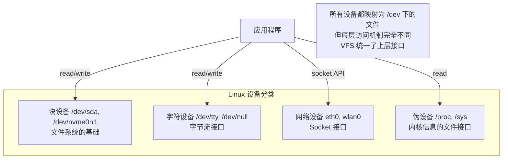
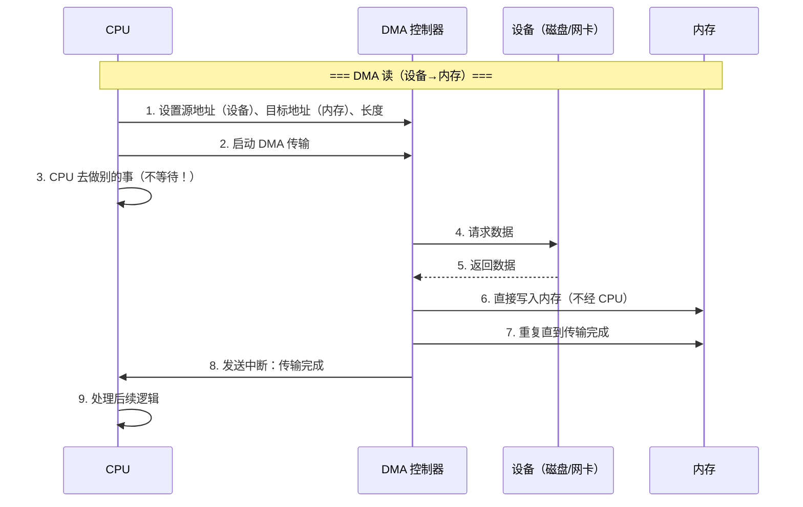
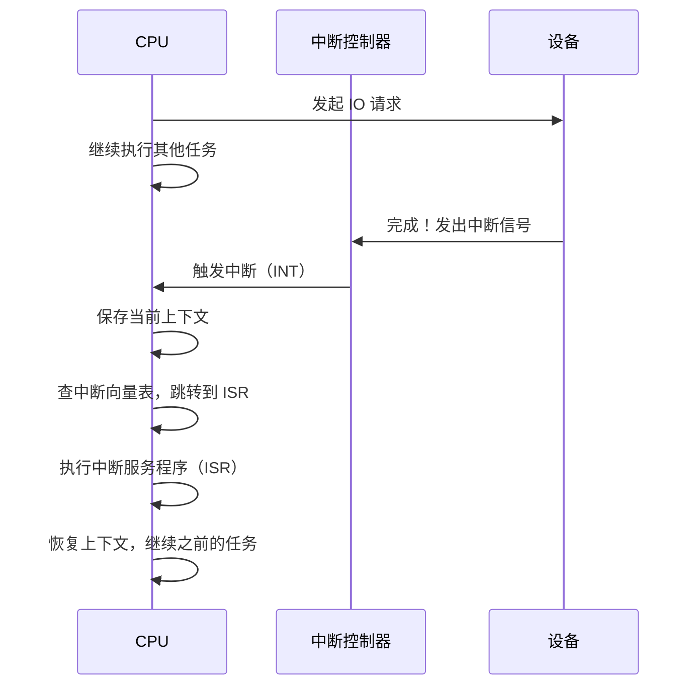
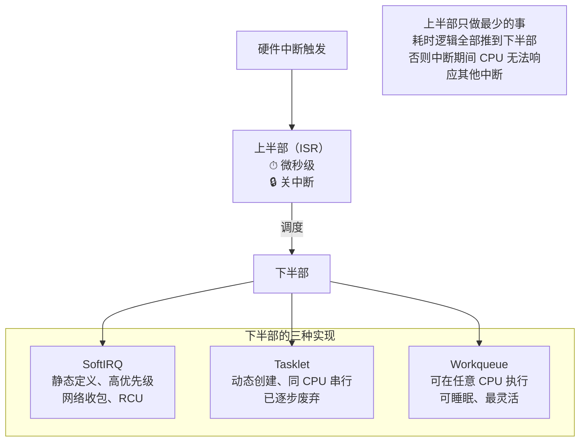
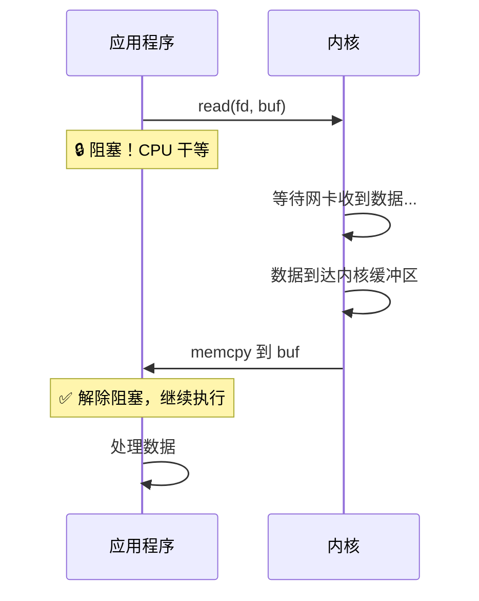
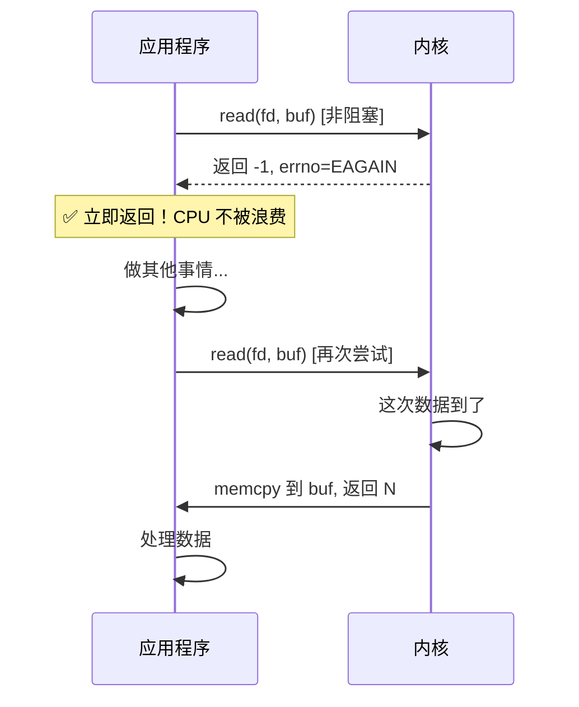
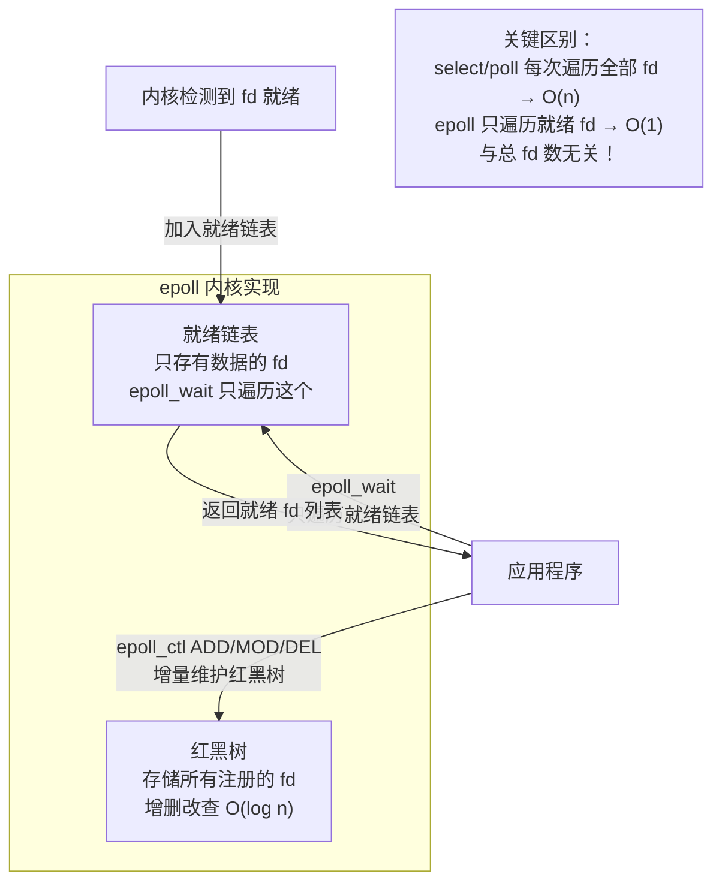
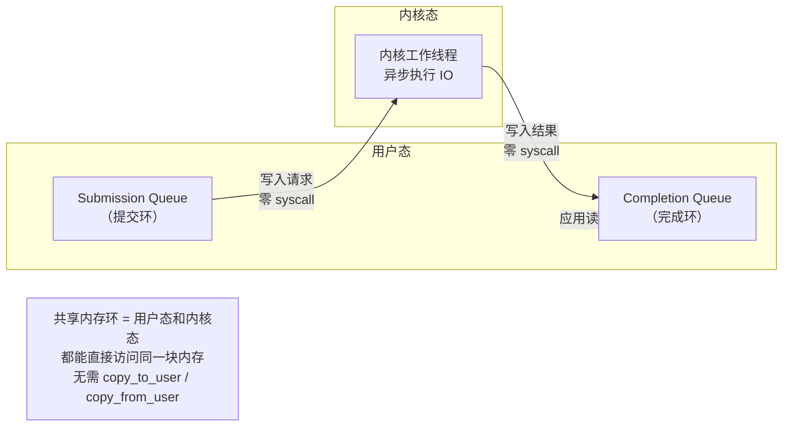
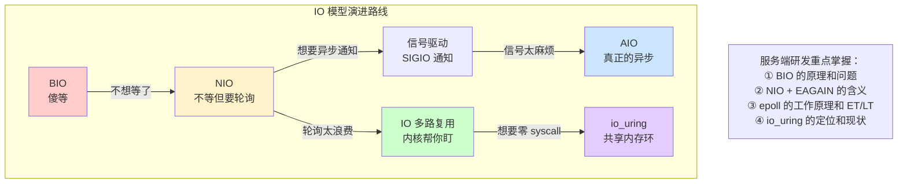

# 设备管理：从 IO 模型到 DMA、从驱动架构到中断处理

## 一、设备的本质：CPU 与外部世界的桥梁

### 1.1 为什么需要设备管理？

CPU 的速度远超任何外部设备，且不同设备的访问方式千差万别。OS 的设备管理子系统要解决三个核心问题：

| 问题 | 说明 |
| :--- | :--- |
| **速度差异** | CPU 纳秒级，磁盘微秒~毫秒级，网络毫秒级——不能让 CPU 傻等 |
| **接口差异** | 键盘、磁盘、网卡、GPU 的硬件协议完全不同——需要统一抽象 |
| **并发访问** | 多个进程可能同时操作同一设备——需要调度和同步 |

### 1.2 设备的分类

| 分类维度 | 类型 | 示例 | 特点 |
| :--- | :--- | :--- | :--- |
| **按数据传输单位** | 块设备（Block） | 磁盘、SSD、U盘 | 以固定大小的块为单位读写，支持随机访问 |
| | 字符设备（Char） | 键盘、串口、终端 | 以字节流为单位，顺序访问 |
| | 网络设备 | 网卡 | 既非块也非字符，通过 Socket 接口访问 |
| **按共享性** | 独占设备 | 打印机、磁带机 | 同一时刻只能被一个进程使用 |
| | 共享设备 | 磁盘、SSD | 多个进程可并发访问（由 OS 调度） |
| **按传输速率** | 低速设备 | 键盘、鼠标 | 几 KB/s |
| | 中速设备 | 打印机 | 几 MB/s |
| | 高速设备 | SSD、NVMe | 几 GB/s |



---

## 二、IO 控制方式演进

### 2.1 四种 IO 控制方式

CPU 与设备之间的数据交换经历了四代演进，每一代都在减少 CPU 的参与度：


| 方式 | CPU 参与程度 | 原理 | 适用场景 |
| :--- | :--- | :--- | :--- |
| **程序查询（Polling）** | 100% 忙等 | CPU 循环检查设备状态寄存器 | 极简单嵌入式系统 |
| **中断驱动** | 仅在中断时参与 | 设备完成后发中断通知 CPU | 键盘、鼠标等低速设备 |
| **DMA** | 仅启动和完成时参与 | DMA 控制器直接在设备和内存间搬运数据 | 磁盘、网卡等高速设备 |
| **通道 / IO 处理器** | 仅下发命令 | 专用处理器执行 IO 程序 | 大型机、高端存储阵列 |

### 2.2 DMA 详解：现代 IO 的基石

DMA（Direct Memory Access）是现代计算机 IO 性能的核心。**它让设备可以直接读写内存，不需要 CPU 逐字节搬运**。



#### DMA 的关键特性

| 特性 | 说明 |
| :--- | :--- |
| **CPU 解放** | 传输过程中 CPU 完全自由，可以执行其他任务 |
| **总线占用** | DMA 传输时会占用内存总线，CPU 可能被短暂暂停（cycle stealing） |
| **对齐要求** | DMA 通常要求内存地址和传输长度按特定边界对齐 |
| **连续 vs 散列** | 传统 DMA 要求连续内存；SG-DMA（Scatter-Gather）支持不连续的内存区域 |
| **Cache 一致性** | DMA 直接写内存，绕过 CPU Cache，内核通过 dma_map/dma_unmap API 自动处理 |

> 💡 **服务端研发只需知道**：DMA 绕过 CPU Cache 直接操作内存，Linux 内核通过 `dma_map_single()` / `dma_unmap_single()` 等 API 自动维护 Cache 一致性。应用层开发者无需关心此细节，但理解这一点有助于排查"数据不一致"类问题。

### 2.3 SG-DMA：零拷贝的硬件基础

传统 DMA 要求源和目标都是**连续内存**。但 Page Cache 中的页在物理上可能不连续。SG-DMA（Scatter-Gather DMA）允许设备一次性从不连续的多个内存区域收集/分发数据：

```
传统 DMA：
内存 [Page A][Page B][Page C] → 必须先拷贝到连续缓冲区 → DMA 传输

SG-DMA：
内存 [Page A] ... [Page B] ... [Page C]
       ↓              ↓              ↓
     描述符链表告诉设备每个页的物理地址
       ↓
     设备直接从三个不连续位置读取，一次完成
```

> 💡 **SG-DMA 是 sendfile/splice 零拷贝的硬件前提**。没有 SG-DMA，即使内核把数据留在 Page Cache 里，发送到网卡时仍然需要先拷贝到连续的 Socket 缓冲区。有了 SG-DMA，网卡可以直接从 Page Cache 的不连续页中收集数据。

---

## 三、中断机制：设备的异步通知

### 3.1 为什么需要中断？

如果 CPU 用轮询（Polling）等待设备完成，会浪费大量 CPU 时间。中断让设备**主动通知** CPU："我做完了"。



### 3.2 中断处理的两个阶段

Linux 将中断处理分为**上半部**和**下半部**，平衡响应速度和吞吐量：

| 阶段 | 执行时机 | 特点 | 做什么 |
| :--- | :--- | :--- | :--- |
| **上半部（Top Half）** | 中断发生时立即执行 | 关中断、不可抢占、必须极快 | 确认中断、读取设备状态、调度下半部 |
| **下半部（Bottom Half）** | 稍后在合适时机执行 | 开中断、可抢占、可以较慢 | 数据处理、唤醒等待进程、复杂逻辑 |



> ⚠️ **上半部过长是系统卡顿的元凶**：如果 ISR 执行时间过长，期间所有同级和低级中断都被屏蔽，可能导致丢包、音频爆音、鼠标卡顿。Linux 内核开发者社区对上半部的代码审查极其严格。

### 3.3 中断 vs 轮询：如何选择？

| 维度 | 中断 | 轮询（Polling） |
| :--- | :--- | :--- |
| **适合场景** | 事件稀疏、延迟敏感 | 事件密集、吞吐优先 |
| **CPU 开销** | 事件少时低，事件多时中断风暴 | 持续消耗 CPU |
| **延迟** | 低（硬件触发） | 取决于轮询间隔 |
| **典型应用** | 键盘、鼠标、磁盘 IO 完成 | 高速网卡（NAPI）、DPDK |

> 💡 **NAPI（New API）**：Linux 网络子系统的混合模式。低流量时用中断通知；高流量时自动切换到轮询，避免中断风暴。这是"中断和轮询不是非此即彼"的最佳实践。

---

## 四、IO 模型：从零理解应用如何与设备交互

> 🎯 **本章目标**：让你彻底搞懂 BIO/NIO/epoll/io_uring 到底是什么、为什么需要它们、在实际代码中长什么样。即使你从未写过网络编程，读完也能理解 Nginx 为什么快、Java NIO 是什么、面试怎么答。

### 4.1 先搞清楚：什么是 IO？什么叫"阻塞"？

**IO（Input/Output）** = 程序与外部世界交换数据。对服务端研发来说，最常见的 IO 就是**网络读写**（recv/send）和**磁盘读写**（read/write）。

一次 `read()` 系统调用实际上包含**两个阶段**：

```
阶段 1：等待数据就绪（Wait for data）
  → 数据还没到（比如 TCP 包还在路上），CPU 怎么办？

阶段 2：拷贝数据（Copy data from kernel to user）
  → 数据到了，从内核缓冲区复制到用户缓冲区
```

**"阻塞"的本质**：CPU 在某个阶段**什么都不做，干等**。不同的 IO 模型，区别就在于**这两个阶段分别是否阻塞**。

> 💡 **生活类比**：你去餐厅点餐。
> - **阶段 1** = 等厨房做好菜（数据就绪）
> - **阶段 2** = 服务员把菜端到你桌上（数据拷贝）
> 
> 不同的 IO 模型 = 你在等菜时的不同策略：傻坐着等、先去刷手机、让服务员做好了叫你、还是自己进厨房盯着。

### 4.2 BIO（Blocking IO）：最朴素的"傻等"

**BIO 的行为**：调用 `read()` 后，如果数据没到，进程**整个挂起**，两个阶段都阻塞，直到数据完整拷贝到用户缓冲区才返回。

```c
// BIO 代码示例
int sockfd = socket(AF_INET, SOCK_STREAM, 0);
connect(sockfd, ...);

char buf[1024];
ssize_t n = read(sockfd, buf, sizeof(buf));  // ← 这里会一直阻塞！
// 如果对方还没发数据，这行代码永远不会往下走
// CPU 在这个进程上完全浪费，什么都做不了

printf("收到 %zd 字节\n", n);
```



**BIO 的问题**：一个线程同一时刻只能处理一个连接。要同时服务 1000 个客户端，就需要 1000 个线程。线程切换开销巨大，内存消耗高（每个线程栈默认 8MB）。

> 💡 **BIO 的典型场景**：简单的命令行工具、短连接的 HTTP/1.0 请求、教学示例。**不适合高并发服务端**。

### 4.3 NIO（Non-blocking IO）：不等了，先干别的

**NIO 的核心改变**：把 Socket 设置为**非阻塞模式**后，`read()` 在数据没到时**不再阻塞**，而是**立即返回一个特殊错误码 `EAGAIN`**（或 `EWOULDBLOCK`），告诉你"现在没数据，你稍后再试"。

#### 什么是 EAGAIN？

`EAGAIN` 是 Linux 的一个**错误码常量**（值为 11），全称 "Try Again"。它**不是真正的错误**，而是一个**状态信号**：

| 返回值 | 含义 | 你应该怎么做 |
| :--- | :--- | :--- |
| `> 0` | 成功读取了 N 字节 | 正常处理数据 |
| `== 0` | 对端关闭了连接 | 关闭 fd，清理资源 |
| `-1` 且 `errno == EAGAIN` | 数据还没到，但不是错误 | **稍后重试**，不要当错误处理 |
| `-1` 且 `errno == 其他` | 真正的错误（如连接断开） | 报错、关闭连接 |

```c
// NIO 代码示例
int sockfd = socket(AF_INET, SOCK_STREAM, 0);
// ⭐ 关键：设置为非阻塞模式
fcntl(sockfd, F_SETFL, fcntl(sockfd, F_GETFL) | O_NONBLOCK);

// ⭐ 非阻塞模式下 connect 不会等连接建立，而是立即返回 -1, errno=EINPROGRESS
// 这表示"连接正在进行中"，不是错误。需要用 select/poll 等待连接真正完成：
int ret = connect(sockfd, (struct sockaddr*)&addr, sizeof(addr));
if (ret == -1 && errno == EINPROGRESS) {
    // 用 select 等待 sockfd 可写（可写 = 连接建立成功）
    fd_set wfds;
    FD_ZERO(&wfds);
    FD_SET(sockfd, &wfds);
    struct timeval tv = { .tv_sec = 5 };  // 5 秒超时
    if (select(sockfd + 1, NULL, &wfds, NULL, &tv) > 0) {
        // 连接成功，可以开始 read/write
    } else {
        // 超时或失败
    }
}

char buf[1024];
while (1) {
    ssize_t n = read(sockfd, buf, sizeof(buf));
    
    if (n > 0) {
        // 读到数据了，处理它
        printf("收到 %zd 字节\n", n);
    } else if (n == -1 && errno == EAGAIN) {
        // ⭐ 没数据，但不是错误！去做别的事，过一会儿再来试
        do_other_work();
        usleep(1000);  // 简单示例：等 1ms 再试
    } else if (n == 0) {
        // 对端关闭
        break;
    } else {
        // 真正的错误
        perror("read");
        break;
    }
}
```



**NIO 的问题**：虽然不阻塞了，但你需要**不断轮询**（反复调用 read 检查有没有数据）。如果你要监控 1000 个 fd，就要循环调用 1000 次 read，大部分都返回 EAGAIN，**CPU 空转浪费严重**。

> 💡 **NIO 单独使用几乎没人这么干**。它的真正价值是作为 **IO 多路复用的基础**——下面讲的 select/poll/epoll 都是建立在 NIO 之上的。

### 4.4 IO 多路复用：一个线程监控多个 fd

**核心思想**：既然单个 fd 的 NIO 需要轮询浪费 CPU，那能不能让**内核帮你盯着多个 fd**，哪个有数据了就告诉你？这就是 IO 多路复用（IO Multiplexing）。

> 💡 **生活类比升级**：你不是一个人去餐厅了，你带了 100 个朋友。
> - **BIO** = 每人派一个服务员盯着厨房 → 需要 100 个服务员（100 个线程）
> - **NIO** = 你自己轮流问 100 个厨房"好了没" → 累死（CPU 空转）
> - **IO 多路复用** = 雇一个总管，让他盯着所有厨房，哪个好了就喊你 → **一个线程搞定所有连接**

Linux 提供了三代 IO 多路复用机制：**select → poll → epoll**，一代比一代强。

#### 4.4.1 select：最早的方案，但有硬伤

```c
// select 的基本用法
fd_set readfds;
FD_ZERO(&readfds);
FD_SET(sockfd1, &readfds);
FD_SET(sockfd2, &readfds);
FD_SET(sockfd3, &readfds);

// ⭐ select 会阻塞，直到某个 fd 有数据，或者超时
int ready = select(max_fd + 1, &readfds, NULL, NULL, &timeout);

if (ready > 0) {
    // 遍历所有 fd，检查哪个在 readfds 中被标记为就绪
    for (int i = 0; i < max_fd + 1; i++) {
        if (FD_ISSET(i, &readfds)) {
            // 这个 fd 有数据了，去 read 它
            read(i, buf, sizeof(buf));
        }
    }
}
```

**select 的三个致命问题**：

| 问题 | 详细说明 | 影响 |
| :--- | :--- | :--- |
| **fd 数量上限 1024** | `fd_set` 是一个固定大小的位图（bitmap），默认 1024 bit。这不是配置问题，是**数据结构设计缺陷** | 无法支撑高并发 |
| **每次都要全量拷贝** | 每次调用 select，都要把整个 `fd_set` 从用户态拷贝到内核态。监控 1000 个 fd 就要拷贝 1000 个 bit | 开销随 fd 数线性增长 |
| **返回后要全量遍历** | select 只告诉你"有 fd 就绪了"，但不告诉你是**哪个**。你必须遍历全部 fd 逐一检查 `FD_ISSET` | O(n) 复杂度，fd 越多越慢 |

> 💡 **"select: 1024"到底什么意思？** 这是 `fd_set` 位图的硬编码上限。Linux 内核中 `FD_SETSIZE` 默认为 1024，意味着你最多只能监控 fd 编号 0~1023 的文件描述符。即使你的系统允许打开更多文件，select 也用不了。**这不是 bug，是设计局限**。

#### 4.4.2 poll：解决了 1024 限制，但还是慢

poll 用**数组**替代了 select 的位图，理论上没有 fd 数量限制：

```c
// poll 的基本用法
struct pollfd fds[10000];  // 可以放任意多个 fd
fds[0].fd = sockfd1;
fds[0].events = POLLIN;   // 关注可读事件
fds[1].fd = sockfd2;
fds[1].events = POLLIN;

// ⭐ 同样阻塞等待，但没有 1024 限制
int ready = poll(fds, nfds, timeout);

for (int i = 0; i < nfds; i++) {
    if (fds[i].revents & POLLIN) {
        // 这个 fd 有数据了
        read(fds[i].fd, buf, sizeof(buf));
    }
}
```

**poll 改进了什么？没改进什么？**

| 维度 | select | poll | 改进？ |
| :--- | :--- | :--- | :--- |
| fd 数量限制 | 1024 | 无上限 | ✅ |
| 每次全量拷贝 fd 集合 | 是 | 是（数组也要拷贝） | ❌ |
| 返回后全量遍历找就绪 fd | 是 | 是 | ❌ |
| 时间复杂度 | O(n) | O(n) | ❌ |

> 💡 **为什么说"poll 无上限但慢"？** poll 虽然没有 1024 的硬限制，但它仍然每次都要把整个 fd 数组拷贝进内核、返回后又要遍历整个数组。当 fd 数量达到几万时，这些 O(n) 操作的开销变得不可接受。**poll 只是 select 的小幅改良，不是质变**。

#### 4.4.3 epoll：Linux 的终极答案

epoll 从根本上重新设计了 IO 多路复用，解决了 select/poll 的所有问题：

```c
// epoll 的完整用法（三步走）

// 第一步：创建 epoll 实例（只需一次）
int epfd = epoll_create1(0);

// 第二步：注册感兴趣的 fd（增量操作，不用每次全量传）
struct epoll_event ev;
ev.events = EPOLLIN;       // 关注可读
ev.data.fd = sockfd1;
epoll_ctl(epfd, EPOLL_CTL_ADD, sockfd1, &ev);  // 添加 fd

ev.data.fd = sockfd2;
epoll_ctl(epfd, EPOLL_CTL_ADD, sockfd2, &ev);  // 再加一个

// 第三步：等待就绪事件（只返回有数据的 fd！）
struct epoll_event events[64];
int ready = epoll_wait(epfd, events, 64, -1);  // 阻塞等待

// ⭐ 只遍历就绪的 fd，不是全部 fd！
for (int i = 0; i < ready; i++) {
    int fd = events[i].data.fd;
    // 这个 fd 一定有数据，直接读
    read(fd, buf, sizeof(buf));
}
```



**epoll 为什么快？三个核心改进**：

| 维度 | select/poll | epoll | 为什么重要 |
| :--- | :--- | :--- | :--- |
| **fd 管理方式** | 每次全量拷贝 fd 集合 | `epoll_ctl` 增量维护，fd 信息常驻内核 | 避免重复拷贝，fd 越多优势越大 |
| **就绪检测方式** | 返回后遍历全部 fd | 内核主动将就绪 fd 加入链表，`epoll_wait` 只返回就绪的 | O(1) vs O(n)，万级连接下差距百倍 |
| **fd 数量限制** | select: 1024; poll: 无上限但慢 | 无上限，性能不随 fd 数下降 | 单机轻松支撑 10 万+ 连接 |

> 💡 **一句话总结 epoll**：select/poll 是"你每次去问所有厨房好了没"，epoll 是"厨房好了主动喊你，你只听喊声"。前者 O(n)，后者 O(1)。

#### 4.4.4 ET vs LT：epoll 的两种触发模式

epoll 有两种通知模式，选错了会导致**数据丢失或性能问题**：

| 模式 | 全称 | 行为 | 编程要求 | 典型使用者 |
| :--- | :--- | :--- | :--- | :--- |
| **LT** | Level Triggered（水平触发） | 只要 fd 可读，**每次** epoll_wait 都通知 | 简单，读多少都行，没读完下次还会通知 | 大多数应用（推荐默认） |
| **ET** | Edge Triggered（边缘触发） | 只在 fd **从无数据变为有数据**的那一刻通知一次 | 必须一次性读完所有数据（循环 read 直到 EAGAIN），否则丢数据 | Nginx、高性能框架 |

```c
// ET 模式的正确写法（必须循环读到 EAGAIN）
if (events[i].events & EPOLLIN) {
    while (1) {
        ssize_t n = read(fd, buf, sizeof(buf));
        if (n > 0) {
            process(buf, n);
        } else if (n == -1 && errno == EAGAIN) {
            // ⭐ ET 模式下，EAGAIN 表示"本次数据已全部读完"
            break;
        } else {
            // 错误或连接关闭
            break;
        }
    }
}
```

> ⚠️ **ET 模式的常见坑**：如果你用 ET 但只 read 了一次就回去 epoll_wait，剩余数据不会再通知你，**数据永久丢失**。这就是为什么 ET 编程更复杂。**除非你有明确的性能需求，否则一律用 LT**。

### 4.5 信号驱动 IO：被遗忘的中间方案

信号驱动 IO 的思路是：告诉内核"数据到了给我发个 SIGIO 信号"，然后进程可以继续做别的事。收到信号后再去 read。

```c
// 信号驱动 IO 的基本设置
signal(SIGIO, sigio_handler);          // 注册信号处理函数
fcntl(sockfd, F_SETOWN, getpid());     // 指定接收信号的进程
fcntl(sockfd, F_SETFL, O_ASYNC);       // 开启异步信号通知
```

**为什么很少用？**
- 信号处理函数中不能调用大多数库函数（async-signal-safe 限制）
- 信号可能被合并（连续两次数据到达只触发一次信号）
- 多线程环境下信号处理极其复杂
- epoll 已经完美解决了"异步通知"的需求

> 💡 **了解即可，不需要掌握**。面试中提到信号驱动 IO，知道它的存在和缺点就够了。

### 4.6 AIO（Asynchronous IO）：真正的异步

前面所有模型（BIO/NIO/select/poll/epoll/信号驱动）都有一个共同点：**数据拷贝阶段仍然是同步的**——即使数据就绪的通知是异步的，`read()` 本身还是要等拷贝完成。

**真正的 AIO**：连数据拷贝都由内核异步完成，应用提交请求后**完全不等待**，内核完成后通过回调/信号/事件通知应用。

```
传统模型（包括 epoll）：
  应用 → 告诉内核"我要读" → 内核通知"数据到了" → 应用调用 read() → 阻塞等拷贝完成

真正的 AIO：
  应用 → 告诉内核"帮我读到这个 buffer" → 应用去做别的事 → 内核完成拷贝后通知应用
```

#### Linux 上的 AIO 现状

| 方案 | 特点 | 问题 |
| :--- | :--- | :--- |
| **glibc aio** | POSIX 标准接口 | 底层用线程池模拟，不是真异步，性能差 |
| **libaio** | Linux 原生 AIO | 仅支持 `O_DIRECT`（打开文件时跳过 Page Cache，直接读写磁盘），API 复杂，生态差 |
| **io_uring** | Linux 5.1+ 新一代异步 IO | 真异步、支持 buffered IO、零 syscall，但生态尚在成熟中 |

#### io_uring：下一代异步 IO 框架

io_uring 的核心创新是用**共享环形缓冲区（Ring Buffer）** 在用户态和内核态之间通信，**完全消除系统调用开销**：

```
传统方式：每次 IO 都要 syscall → 用户态/内核态切换 → 开销大
io_uring：用户态和内核态共享一块内存环
  - 提交请求：写入 Submission Queue Ring（无需 syscall）
  - 获取结果：读取 Completion Queue Ring（无需 syscall）
  - 只有初始化和极少数操作才需要 syscall
```



> 💡 **io_uring 的现实**：
> - **优势**：性能极高（DPDK 是用户态网络驱动框架，绕过内核实现极致网络性能；io_uring 在内核态就能接近这个水平），支持 buffered IO（走 Page Cache），支持批量提交、链接操作、超时
> - **现状**：RocksDB、libuv、Netty（实验性）已开始采用
> - **风险**：由于安全审计问题（历史上出现过多个 CVE），**部分云厂商（如 AWS、GCP）默认禁用了 io_uring**
> - **建议**：它是未来方向，但生产环境采用前务必确认云平台支持和安全补丁状态

### 4.7 五种 IO 模型全景对比

| IO 模型 | 等待数据阶段 | 拷贝数据阶段 | 并发能力 | 编程难度 | 典型应用 |
| :--- | :--- | :--- | :--- | :--- | :--- |
| **BIO** | 🔒 阻塞 | 🔒 阻塞 | 1 连接/线程 | 最简单，一行 read 搞定 | 简单脚本、CLI 工具 |
| **NIO** | ✅ 不阻塞（EAGAIN） | 🔒 阻塞 | 需轮询，CPU 浪费 | 需处理 EAGAIN 返回值 | 作为多路复用的基础 |
| **IO 多路复用** | 🔒 阻塞在 epoll_wait | 🔒 阻塞 | 1 线程/万连接 | 需理解 epoll API 和 ET/LT | Nginx、Node.js、Netty、Redis |
| **信号驱动** | ✅ 不阻塞（SIGIO） | 🔒 阻塞 | 信号处理复杂 | 信号安全限制多，极易出错 | 极少使用 |
| **AIO** | ✅ 不阻塞 | ✅ 不阻塞 | 完全异步 | API 复杂，需理解共享内存环 | 数据库、高性能存储（io_uring） |



> 💡 **面试回答模板**："IO 模型的核心区别在于等待数据和拷贝数据两个阶段是否阻塞。BIO 两阶段都阻塞；NIO 等待阶段不阻塞但需轮询；IO 多路复用（epoll）让内核帮忙监控多个 fd，只返回就绪的，O(1) 复杂度；AIO（io_uring）两阶段都不阻塞，通过共享内存环实现零 syscall。服务端高并发主要用 epoll，未来趋势是 io_uring。"

---

## 五、设备文件与 /dev 目录

### 5.1 设备文件的类型

| 类型 | 标识 | 示例 | 说明 |
| :--- | :--- | :--- | :--- |
| **块设备** | `b` | `/dev/sda`、`/dev/nvme0n1` | 支持随机访问，有缓冲 |
| **字符设备** | `c` | `/dev/tty`、`/dev/null`、`/dev/zero` | 字节流，无缓冲 |
| **伪设备** | — | `/dev/null`、`/dev/urandom` | 不对应真实硬件 |

```bash
# 查看设备文件类型
$ ls -l /dev/sda /dev/tty /dev/null
brw-rw---- 1 root disk 8, 0 Aug 27 10:00 /dev/sda    # b = 块设备
crw-rw-rw- 1 root tty  5, 0 Aug 27 10:00 /dev/tty    # c = 字符设备
crw-rw-rw- 1 root root 1, 3 Aug 27 10:00 /dev/null   # c = 字符设备（伪设备）
#             ↑  ↑
#          主设备号 次设备号
```

### 5.2 主设备号与次设备号

| 概念 | 作用 | 示例 |
| :--- | :--- | :--- |
| **主设备号（Major）** | 标识驱动程序 | 8 = SCSI/SATA 磁盘驱动 |
| **次设备号（Minor）** | 标识具体设备实例 | 0 = /dev/sda, 16 = /dev/sdb |

> 💡 **查看已注册的设备号**：`cat /proc/devices` 列出所有已注册的字符和块设备驱动及其主设备号。

### 5.3 常见的特殊设备文件

| 设备 | 用途 | 常见用法 |
| :--- | :--- | :--- |
| `/dev/null` | 黑洞，丢弃所有写入 | `command > /dev/null 2>&1` |
| `/dev/zero` | 无限零字节流 | `dd if=/dev/zero of=file bs=1M count=100` |
| `/dev/urandom` | 伪随机数生成器 | 生成密钥、测试数据 |
| `/dev/shm` | tmpfs 挂载点（共享内存） | POSIX 共享内存的默认位置 |
| `/dev/mem` | 物理内存的直接访问 | 调试、嵌入式（需 root） |
| `/dev/fb0` | Framebuffer | 直接操作显示输出 |

---

## 六、实战：研发中常见的设备管理问题

### 6.1 磁盘 IO 排查

```bash
# 查看磁盘 IO 使用情况
$ iostat -xz 1
Device  r/s     w/s     rkB/s   wkB/s   await  svctm  %util
sda     120.5   45.2    4820    1808    2.3    0.8    15.2
#                                        ↑              ↑
#                                   平均等待(ms)    利用率(%)

# await > 10ms 或 %util > 80% 通常需要关注
```

| 指标 | 健康范围 | 异常含义 |
| :--- | :--- | :--- |
| **await** | < 5ms（SSD）/ < 15ms（HDD） | IO 延迟过高，可能有队列堆积 |
| **%util** | < 80% | 设备接近饱和 |
| **avgqu-sz** | < 2 | 平均队列深度过大 |
| **r/s + w/s** | 取决于设备规格 | IOPS 是否达到瓶颈 |

### 6.2 网卡与网络 IO 排查

```bash
# 查看网卡统计
$ ethtool -S eth0 | grep -E "rx_packets|tx_packets|rx_errors|tx_errors"

# 查看软中断分布（网络收包主要在软中断中处理）
$ cat /proc/softirqs | head -5
```

> 💡 **网络性能优化三板斧**：① 开启 NAPI（默认已开）；② 调整 ring buffer 大小（`ethtool -G`）；③ 绑定 CPU 亲和性（`irqbalance` 或手动绑核），避免跨 NUMA 访问。

### 6.3 设备相关的常见问题

| 问题 | 可能原因 | 排查方向 |
| :--- | :--- | :--- |
| `No space left on device` | inode 耗尽或磁盘满 | `df -i` 查 inode，`df -h` 查空间 |
| `Input/output error` | 硬件故障或文件系统损坏 | `dmesg \| tail`，SMART 检测 |
| `Permission denied` | 设备文件权限不足 | `ls -l /dev/xxx`，检查 udev 规则 |
| `Device or resource busy` | 设备被其他进程占用 | `lsof /dev/xxx` 或 `fuser` |
| 系统卡死，大量 D 状态进程 | 设备 IO 挂起 | `dmesg` 查硬件错误，检查 NFS/RAID |

---

## 七、面试高频问题速答

### Q1：DMA 是什么？为什么重要？

> **答**：DMA（Direct Memory Access）让外设直接与内存交换数据，不需要 CPU 逐字节搬运。CPU 只需设置源地址、目标地址和长度，然后就可以去做别的事，传输完成后 DMA 控制器发中断通知 CPU。它是现代高速 IO（磁盘、网卡）的性能基础，也是零拷贝技术的硬件前提。

### Q2：中断的上半部和下半部分别做什么？

> **答**：上半部在中断触发时立即执行，必须极快（微秒级），只做确认中断、读状态、调度下半部等最少工作。下半部在稍后的合适时机执行，可以较慢、可抢占、可睡眠，负责数据处理和复杂逻辑。这样设计是为了避免长时间关中断导致系统响应变差。

### Q3：epoll 比 select 好在哪？

> **答**：三点优势：① 无 fd 数量限制；② epoll_wait 只返回就绪 fd，O(1) 复杂度，与总 fd 数无关；③ fd 集合通过 epoll_ctl 增量维护在内核中，epoll_wait 无需每次从用户态拷贝。select 每次都要遍历全部 fd 且拷贝 fd 集合，O(n) 复杂度。

### Q4：块设备和字符设备的区别？

> **答**：块设备以固定大小的块为单位读写，支持随机访问，有缓冲（经过 Page Cache），如磁盘、SSD。字符设备以字节流为单位，顺序访问，通常无缓冲，如键盘、串口。两者在 /dev 下分别用 `b` 和 `c` 标识，通过主设备号区分驱动，次设备号区分实例。

### Q5：什么是 NAPI？为什么需要它？

> **答**：NAPI 是 Linux 网络子系统的混合 IO 模式。低流量时用中断通知 CPU 有新包到达；高流量时自动切换到轮询模式，批量处理数据包，避免中断风暴（每秒数万次中断导致 CPU 全花在上下文切换上）。这是中断和轮询优势互补的典型设计。

### Q6：io_uring 和传统 AIO 有什么区别？

> **答**：传统 libaio 仅支持 O_DIRECT（绕过 Page Cache），API 复杂，本质是同步+线程池模拟。io_uring 通过共享环形缓冲区实现真正的异步，支持 buffered IO，提交和完成都零系统调用，性能远超传统 AIO。但生态尚不成熟，部分云平台出于安全考虑禁用了它。

---

## 九、名词速查表

| 名词 | 英文 | 一句话解释 |
| :--- | :--- | :--- |
| DMA | Direct Memory Access | 设备直接读写内存，不经 CPU 搬运 |
| SG-DMA | Scatter-Gather DMA | 支持不连续内存区域的 DMA |
| ISR | Interrupt Service Routine | 中断服务程序（上半部） |
| SoftIRQ | Software Interrupt | 内核级软中断，下半部实现之一 |
| Workqueue | — | 工作队列，可睡眠的下半部实现 |
| NAPI | New API | 网络子系统的中断/轮询混合模式 |
| epoll | Event Poll | Linux 高性能 IO 多路复用 |
| io_uring | — | Linux 5.1+ 的异步 IO 框架 |
| VFS | Virtual File System | 统一设备/文件访问接口 |
| Major/Minor | 主/次设备号 | 标识驱动和设备实例 |
| Probe | — | 驱动匹配设备时的初始化函数 |
| Ring Buffer | 环形缓冲区 | io_uring 的共享通信机制 |

---

## 小结

1. **设备管理的核心矛盾**是 CPU 与外设的速度差异，所有技术演进都围绕"减少 CPU 等待"展开
2. **DMA 是现代 IO 的基石**，让设备直接读写内存，CPU 只在启动和完成时参与
3. **中断分上下两半**，上半部必须极快，耗时逻辑推到下半部（SoftIRQ/Workqueue）
4. **epoll 是 Linux 高并发的基础**，O(1) 就绪检测 + 增量 fd 管理，支撑了 Nginx/Netty 等框架
5. **块设备 vs 字符设备**：块设备有缓冲、支持随机访问；字符设备是字节流、通常无缓冲
6. **设备驱动 = Bus + Driver + Device 三要素**，通过 probe 匹配，热插拔靠总线枚举
7. **io_uring 是下一代异步 IO**，共享环形缓冲区零 syscall，但生态和安全审计仍在完善
8. **NAPI 是中断与轮询的最佳折中**，低流量中断、高流量轮询，避免中断风暴

### 🧠 记忆口诀

> **IO 四代进化**：忙等→中断→DMA→通道
> **中断两 halves**：上半快确认，下半慢处理
> **epoll 三优势**：无上限、O(1)、零拷贝
> **DMA 一句话**：设备自己搬数据，CPU 只管发号令
> **驱动三要素**：Bus 找 Device，Driver 来 Probe
