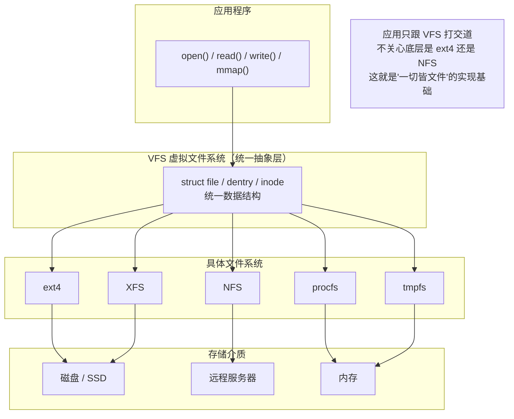
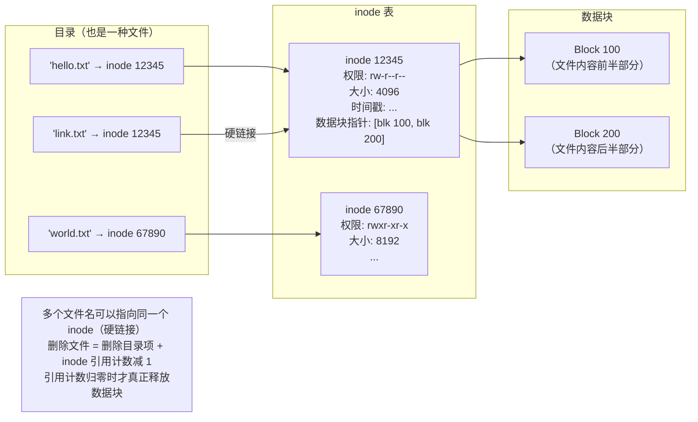
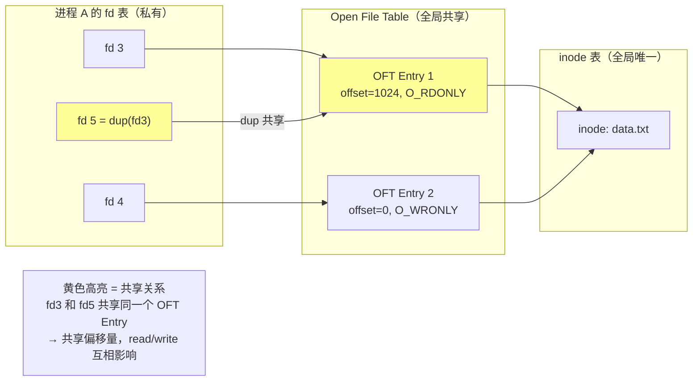
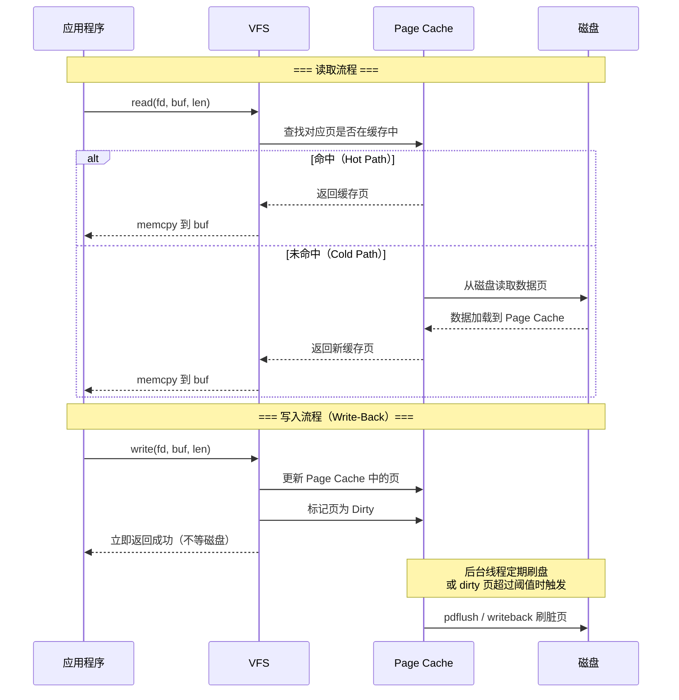

# 文件管理：从 inode 到 VFS、从 Page Cache 到零拷贝

## 一、文件的本质：一切皆文件

### 1.1 Unix 哲学："一切皆文件"

Unix/Linux 将几乎所有资源都抽象为**文件**，用统一的 read/write/open/close 接口操作：

| 资源类型 | 文件路径示例 | 说明 |
| :--- | :--- | :--- |
| **普通文件** | `/home/user/data.txt` | 磁盘上的数据 |
| **目录** | `/home/user/` | 文件名 → inode 的映射表 |
| **设备** | `/dev/sda`、`/dev/null` | 硬件设备的访问接口 |
| **管道** | `mkfifo /tmp/myfifo` | 进程间通信通道 |
| **Socket** | `/var/run/docker.sock` | 本地网络通信端点 |
| **内核信息** | `/proc/cpuinfo`、`/sys/class/net/` | 内核状态的只读/读写接口 |

> 💡 **"一切皆文件"的真正含义**：不是所有东西真的存在磁盘上，而是 OS 提供了**统一的文件操作接口**（open/read/write/ioctl/mmap），让应用程序可以用同一套 API 操作完全不同的底层资源。

### 1.2 文件系统 ≠ 文件管理

| 概念 | 范围 | 说明 |
| :--- | :--- | :--- |
| **文件系统（Filesystem）** | 具体格式 | ext4、XFS、NTFS、Btrfs 等，负责磁盘上的数据组织 |
| **VFS（虚拟文件系统）** | 抽象层 | 统一接口，屏蔽底层文件系统差异 |
| **文件管理** | OS 子系统 | VFS + 文件系统 + Page Cache + 文件描述符管理的总和 |



---

## 二、文件的存储结构：inode 与 dentry

### 2.1 inode：文件的身份证

在 Linux 中，**文件名和文件内容是分离的**。inode（index node）存储文件的元数据和数据块指针，不包含文件名。



#### inode 里存了什么？

| 字段 | 说明 |
| :--- | :--- |
| **文件类型** | 普通文件、目录、符号链接、设备、管道、Socket |
| **权限** | rwxrwxrwx（owner/group/other） |
| **所有者** | UID + GID |
| **文件大小** | 字节数 |
| **时间戳** | atime（访问）、mtime（修改）、ctime（元数据变更） |
| **链接计数** | 有多少个目录项指向这个 inode |
| **数据块指针** | 直接指针 + 间接指针 + 双重间接 + 三重间接 |

#### inode 里**不**存什么？

> ⚠️ **inode 不包含文件名**。文件名存储在目录文件中（目录本质上是一个 "文件名 → inode号" 的映射表）。这就是为什么：
> - 硬链接可以有不同的名字但指向同一个文件
> - `mv` 在同一文件系统内只是改目录项，不移动数据
> - `rm` 只是删除目录项并减少引用计数

### 2.2 硬链接 vs 软链接

| 维度 | 硬链接（Hard Link） | 软链接（Symbolic Link） |
| :--- | :--- | :--- |
| **本质** | 另一个目录项指向同一个 inode | 一个特殊文件，内容是目标路径字符串 |
| **inode** | 与原文件相同 | 有自己的独立 inode |
| **跨文件系统** | ❌ 不可以 | ✅ 可以 |
| **链接目录** | ❌ 不可以（防止环路） | ✅ 可以 |
| **原文件删除后** | 仍然可用（引用计数 > 0） | 变成悬空链接（dangling） |
| **创建命令** | `ln source link` | `ln -s source link` |
| **ls -l 显示** | 看不出区别 | 显示 `-> target` |

```bash
# 硬链接：两个名字，同一个文件
$ ln file.txt hard_link.txt
$ stat file.txt hard_link.txt   # inode 相同，Links: 2

# 软链接：一个快捷方式
$ ln -s file.txt soft_link.txt
$ ls -l soft_link.txt           # soft_link.txt -> file.txt
$ stat soft_link.txt            # inode 不同，类型是 symlink
```

#### 什么时候用硬链接？什么时候用软链接？

| 场景 | 推荐 | 原因 |
| :--- | :--- | :--- |
| **同一文件系统内的备份/多入口** | 硬链接 | 不占额外空间，删除任一名字不影响数据 |
| **Time Machine / rsnapshot 增量备份** | 硬链接 | 未修改的文件用硬链接指向上一份快照，节省大量磁盘空间 |
| **Git 对象存储（.git/objects）** | 硬链接 | 相同内容的 blob 共享同一个 inode，去重 |
| **跨文件系统引用** | 软链接 | 硬链接不支持跨分区/跨挂载点 |
| **链接目录** | 软链接 | 硬链接禁止链接目录（防止文件系统环路） |
| **配置文件指向版本化文件** | 软链接 | 如 `/etc/nginx/sites-enabled/default → ../sites-available/default`，切换配置只需改链接目标 |
| **库文件版本管理** | 软链接 | `libssl.so → libssl.so.3.0.1`，升级时只改链接，应用无需重新编译 |
| **Docker 镜像层** | 软链接 + COW | 上层通过软链接引用下层文件，修改时 COW 复制 |
| **临时/开发环境的快捷方式** | 软链接 | 方便随时更改目标，且目标不存在时不会误操作真实数据 |

> 💡 **简单决策规则**：**需要"同一个文件的多个名字"→ 硬链接；需要"指向某个路径的快捷方式"→ 软链接**。硬链接更安全（不怕目标被删），软链接更灵活（可跨分区、可链目录、可随时改目标）。

### 2.3 dentry：目录项缓存

每次路径解析（如 `/home/user/file.txt`）都要逐级查目录文件，非常慢。Linux 用 **dentry cache** 缓存最近使用的目录项：

```
路径解析 /home/user/file.txt：
1. 根目录 "/" → 查 dentry cache → 命中 → 拿到 inode
2. "home" → 查 dentry cache → 命中 → 拿到 inode
3. "user" → 查 dentry cache → 未命中 → 读磁盘 → 加入 cache
4. "file.txt" → 查 dentry cache → 未命中 → 读磁盘 → 加入 cache

下次再访问同一路径：全部命中 cache，零磁盘 IO
```

> 💡 **dentry cache 是 Linux 文件系统性能的关键**。`slabtop` 中看到大量 `dentry` 对象是正常的，说明缓存在工作。如果 dentry cache 被挤占（如扫描海量小文件），后续的路径解析会显著变慢。

---

## 三、文件描述符：进程眼中的文件

### 3.1 三层数据结构

进程打开文件时，内核维护**三层结构**。理解这三层的关键是搞清楚：**谁拥有它、谁共享它**。

#### 用一个生活类比理解

想象一个图书馆系统：

```
你（进程）手里有一张借书卡（fd 表）
  ↓ 卡片上写着编号
图书借阅记录本（Open File Table）—— 全馆共用一本
  ↓ 记录本上写着书名
书架上的书（inode 表）—— 每本书只有一本实体
```

- **借书卡（fd 表）**：每人一张，你的卡不能给别人用 → **per-process**
- **借阅记录本（Open File Table）**：全馆共用，记录了谁借了什么书、读到第几页 → **全局共享**
- **书本身（inode）**：同一本书不管被多少人借，实体只有一本 → **全局唯一**

#### 代码视角的对应关系

```c
// 第一次 open：创建新的 Open File Entry
int fd3 = open("data.txt", O_RDONLY);   // fd3 → OFT_Entry_1 → inode(data.txt)

// 第二次 open 同一个文件：创建另一个 Open File Entry
int fd4 = open("data.txt", O_WRONLY);   // fd4 → OFT_Entry_2 → inode(data.txt)
//                                         ↑ 不同的 OFT Entry！
//                                           各自有独立的偏移量

// dup 复制 fd：共享同一个 Open File Entry
int fd5 = dup(fd3);                     // fd5 → OFT_Entry_1 → inode(data.txt)
//                                         ↑ 和 fd3 指向同一个 OFT Entry！
//                                           共享偏移量，fd3 read 后 fd5 的偏移也变了
```



#### 三层总结

| 层级 | 作用域 | 关键字段 | 何时创建 | 共享规则 |
| :--- | :--- | :--- | :--- | :--- |
| **fd 表** | per-process | fd → OFT Entry 指针 | 进程创建时 | fork 时复制副本；dup 时共享同一个 OFT Entry |
| **Open File Table** | 全局 | 偏移量、打开标志、引用计数 | 每次 `open()` | 同一个 `open()` 返回的 fd 共享；不同 `open()` 各自独立 |
| **inode 表** | 全局 | 元数据、数据块指针、引用计数 | 首次访问文件 | 同一个文件的所有 OFT Entry 都指向同一个 inode |

> ⚠️ **最容易搞混的点**：`open()` 两次同一个文件 → 两个独立的 OFT Entry（独立偏移量）；`dup()` 复制 fd → 共享同一个 OFT Entry（共享偏移量）。面试常考这个区别。

> ⚠️ **fork 后的 fd 行为**：fork 复制了 fd 表，父子进程的相同 fd 指向**同一个** OFT Entry，共享偏移量。如果不想共享，子进程应关闭不需要的 fd 或重新 open。

### 3.2 文件描述符的限制

| 限制 | 查看方式 | 默认值 | 说明 |
| :--- | :--- | :--- | :--- |
| **per-process** | `ulimit -n` | 1024 | 单个进程最多打开的文件数 |
| **系统级** | `/proc/sys/fs/file-max` | ~65536 | 全系统最多打开的文件数 |
| **当前使用量** | `/proc/sys/fs/file-nr` | — | 已分配 / 空闲 / 上限 |

> 💡 **高并发服务必调**：Nginx、Java 应用等高并发服务启动前必须 `ulimit -n 65535` 或在 systemd unit 中设置 `LimitNOFILE`，否则连接数上来后会报 `Too many open files`。

---

## 四、Page Cache：文件数据的内存缓存

### 4.1 为什么需要 Page Cache？

磁盘 IO 比内存慢 **5~6 个数量级**。如果每次 read/write 都直接访问磁盘，系统性能不可接受。

```
访问延迟对比：
L1 Cache:     ~1 ns
L2 Cache:     ~4 ns
DRAM:         ~100 ns
NVMe SSD:   ~10 μs      ← 比内存慢 100 倍
HDD:        ~5 ms       ← 比内存慢 50000 倍
```

Page Cache 的策略：**把最近访问过的文件数据缓存在内存中**，后续读写优先走内存。

### 4.2 Page Cache 的工作流程



### 4.3 Write-Back vs Write-Through

| 策略 | 行为 | 优点 | 缺点 |
| :--- | :--- | :--- | :--- |
| **Write-Back（默认）** | write 只更新 Page Cache，标记 Dirty，后台异步刷盘 | 写性能极高 | 掉电可能丢失未刷盘的脏页 |
| **Write-Through** | write 同时更新 Page Cache 和磁盘 | 数据安全 | 写性能差，每次 write 都等磁盘 |
| **O_SYNC** | 类似 Write-Through，per-fd 级别 | 关键数据可单独保证 | 仅对该 fd 生效 |
| **fsync/fdatasync** | 手动将指定文件的脏页刷到磁盘 | 精确控制持久化时机 | 调用时阻塞直到刷盘完成 |

> ⚠️ **Write-Back 的数据安全**：Linux 默认的 Write-Back 模式下，write 返回成功 ≠ 数据已落盘。数据库（MySQL、PostgreSQL）在事务提交时会主动调用 fsync 确保 WAL 落盘；普通应用如果对数据安全性有要求，也应合理使用 fsync。

### 4.4 Page Cache 与 Buffer Cache 的关系

> 💡 **历史澄清**：早期 Unix 有两个独立缓存——Buffer Cache（块设备级别）和 Page Cache（文件级别）。**Linux 2.4+ 已将两者合并为统一的 Page Cache**。现在所有文件 IO 和块设备 IO 都经过 Page Cache，不再有独立的 Buffer Cache。面试中说"Linux 有独立的 Buffer Cache"会被判定为知识过时。

### 4.5 查看和管理 Page Cache

#### `free -h` 各列详解

```bash
$ free -h
              total        used        free      shared  buff/cache   available
Mem:           7.6G        2.2G        299M        672K        5.2G        5.2G
Swap:            0B          0B          0B
```

| 列 | 含义 | 计算方式 | 注意事项 |
| :--- | :--- | :--- | :--- |
| **total** | 物理内存总量 | 硬件决定 | 不包含 Swap |
| **used** | 已被进程实际占用的内存 | total - free - buff/cache | 对应所有进程的 RSS 总和 |
| **free** | 完全空闲、未被任何人使用的内存 | 内核统计 | **这个值小不代表内存紧张！** Linux 会主动把空闲内存用于缓存 |
| **shared** | 多个进程共享的内存 | tmpfs + 共享库映射等 | 通常很小 |
| **buff/cache** | Page Cache + Buffer Cache | 文件数据的内存缓存 | Linux 2.4+ 已合并为统一 Page Cache；这部分**可被自动回收** |
| **available** | 应用程序还能使用的内存估算值 | free + 可回收的 buff/cache | ⭐ **判断内存是否充足只看这一列** |
| **Swap total/used/free** | 交换区总量/已用/空闲 | — | 0B 表示未配置 Swap |

> ⚠️ **核心认知：看内存够不够，永远看 `available`，不要看 `free`！**
>
> Linux 的设计哲学是"空闲内存不如拿来做缓存"。上例中 `free` 只有 299M，但 `available` 有 5.2G——因为 5.2G 的 buff/cache 在内存紧张时会被内核**自动回收**。`free` 小只说明系统在积极利用内存加速 IO，不是问题。
>
> ```
> 实际可用 ≈ free (299M) + 可回收的 buff/cache (~4.9G) = available (5.2G)
> ```

#### 管理命令

```bash
# 手动释放 Page Cache（仅用于测试，生产环境不要这样做！）
$ echo 3 > /proc/sys/vm/drop_caches

# 查看某个文件的缓存状态
$ vmtouch -v myfile.txt
```

> ⚠️ **drop_caches 的危险性**：在生产环境执行 `echo 3 > /proc/sys/vm/drop_caches` 会导致所有缓存失效，后续 IO 全部走磁盘，可能引发严重的性能抖动甚至服务不可用。**仅在测试/基准测试环境中使用**。

---

## 五、VFS 四大核心对象

VFS 用四个核心数据结构统一了所有文件系统。理解它们的关键是搞清楚**各自描述什么、何时创建销毁**：

| 对象 | 一句话描述 | 生命周期 | 数量关系 |
| :--- | :--- | :--- | :--- |
| **super_block** | 一个已挂载文件系统的"全局配置" | mount 时创建，umount 时销毁 | 每个挂载点一个 |
| **inode** | 一个文件的元数据（权限、大小、数据块指针） | 首次访问时加载，不用时回收 | 每个文件一个 |
| **dentry** | 路径中一个组件的缓存（文件名 → inode 的映射） | 路径解析时创建，LRU 回收 | 每个路径组件一个（有缓存） |
| **file** | 一次 `open()` 的会话状态（偏移量、打开标志） | open 时创建，close 时销毁 | 每次 open 一个 |

> 💡 **类比理解**：super_block 像"图书馆的规章制度"，inode 像"书的编目卡"，dentry 像"书架上的标签"，file 像"你手里的借阅记录"。应用通过 file 对象操作文件，VFS 自动找到对应的 inode 和底层文件系统。

---

## 六、零拷贝技术家族

### 6.1 什么是零拷贝？

传统文件传输（如 Web 服务器发送静态文件）需要 **4 次拷贝 + 4 次上下文切换**：

```
传统 send() 的数据流：
1. 磁盘 ──DMA──→ Page Cache          （拷贝 1，DMA）
2. Page Cache ──memcpy──→ 内核 buf    （拷贝 2，CPU）
3. 内核 buf ──memcpy──→ Socket buf   （拷贝 3，CPU）
4. Socket buf ──DMA──→ 网卡           （拷贝 4，DMA）

其中拷贝 2 和 3 是完全可以避免的！
```

**零拷贝的目标**：消除不必要的 CPU 拷贝，让数据直接在 DMA  capable 的缓冲区之间流转。

### 6.2 四种零拷贝技术对比

| 技术 | 原理 | 拷贝次数 | 适用场景 | 限制 |
| :--- | :--- | :--- | :--- | :--- |
| **mmap + write** | 将文件映射到用户空间，write 时内核直接从 Page Cache 发数据 | 3→2 | 通用文件传输 | 仍需一次 write 的系统调用开销 |
| **sendfile** | 内核态直接将 Page Cache 数据传输到 Socket | 2 | 文件→Socket 直传 | 源必须是文件，目标必须是 Socket |
| **splice** | 在内核 pipe 缓冲区之间移动数据（零拷贝管道） | 2 | 任意 fd→fd | Linux 2.6.17+，需要 pipe 作为中间媒介 |
| **SG-DMA** | 网卡支持 Scatter-Gather DMA，直接从多个不连续内存区域收集数据 | 1 | 高性能网络服务器 | 需要网卡硬件支持 |

```mermaid
graph TB
    subgraph Traditional["传统方式（4 次拷贝）"]
        T1["磁盘"] -->|"DMA"| T2["Page Cache"]
        T2 -->|"memcpy"| T3["内核 buf"]
        T3 -->|"memcpy"| T4["Socket buf"]
        T4 -->|"DMA"| T5["网卡"]
    end

    subgraph Sendfile["sendfile（2 次拷贝）"]
        S1["磁盘"] -->|"DMA"| S2["Page Cache"]
        S2 -->|"SG-DMA 直传"| S3["网卡"]
    end

    subgraph Splice["splice（2 次拷贝）"]
        SP1["磁盘"] -->|"DMA"| SP2["Page Cache"]
        SP2 -->|"move page ref"| SP3["pipe buffer"]
        SP3 -->|"SG-DMA"| SP4["网卡"]
    end

    Note["sendfile 最常用：Nginx 的 sendfile on;<br/>splice 更灵活：可用于非 Socket 目标<br/>SG-DMA 是硬件加速，通常与前两者配合使用"]
```



### 6.3 sendfile 的使用条件

```c
// sendfile 的经典用法
ssize_t sendfile(int out_fd, int in_fd, off_t *offset, size_t count);

// 限制：
// 1. in_fd 必须是普通文件（不能是 Socket、管道）
// 2. out_fd 必须是 Socket
// 3. 不支持 O_DIRECT 打开的文件
// 4. 传输大小受限于 ssize_t（通常 2GB）
```

> 💡 **Nginx 配置**：`sendfile on;` 开启后，Nginx 发送静态文件时使用 sendfile 系统调用，避免用户态拷贝。配合 `tcp_nopush on;` 可以让内核攒够数据再发送，减少 TCP 包数量。

### 6.4 mmap 与零拷贝的关系

> ⚠️ **澄清**：mmap 本身是一种零拷贝手段（页表直接映射 Page Cache，无需 memcpy），但它不是唯一的零拷贝技术。完整的零拷贝技术家族包括 mmap、sendfile、splice、SG-DMA。面试中被问到"零拷贝"时，应该回答整个家族，而不是只说 mmap。

---

## 七、实战：研发中常见的文件管理问题

### 7.1 大文件处理

| 场景 | 推荐方案 | 原因 |
| :--- | :--- | :--- |
| 读取大文件的一部分 | `pread()` / `mmap + 偏移` | 不需要 seek，不影响其他线程的偏移量 |
| 顺序扫描大文件 | `posix_fadvise(FADV_SEQUENTIAL)` | 提示内核预读，优化 Page Cache 策略 |
| 随机访问大文件 | `mmap` | 按需缺页加载，不需要一次性读入 |
| 写入大文件 | `pwrite()` + 定期 `fdatasync()` | 平衡性能和数据安全 |
| 复制大文件 | `sendfile` / `copy_file_range()` | 内核态直传，避免用户态拷贝 |

### 7.2 文件锁

| 锁类型 | 范围 | 强制性 | 适用场景 |
| :--- | :--- | :--- | :--- |
| **flock** | 整个文件 | 建议性 | 简单的进程间互斥 |
| **fcntl (POSIX)** | 字节范围 | 建议性 | 数据库记录级锁 |
| **OFD lock（Linux 3.15+）** | 字节范围 | 建议性 | 修复了 fcntl 锁在 fork/exec 后的语义问题 |

> ⚠️ **建议性锁 vs 强制性锁**：Linux 默认的文件锁都是**建议性的**——只有所有参与者都遵守锁协议才有效。如果某个进程无视锁直接 write，锁不会阻止它。强制性锁需要挂载选项 `mand` + 文件 setgid 位，但已被 Linux 5.15 废弃。**实际工程中靠应用层协议保证锁的有效性**。

### 7.3 inotify：文件系统事件监控

```c
// 监控文件变化的典型用法
int fd = inotify_init();
inotify_add_watch(fd, "/path/to/dir", IN_CREATE | IN_MODIFY | IN_DELETE);

while (1) {
    read(fd, buf, sizeof(buf));  // 阻塞等待事件
    // 解析 inotify_event，处理文件变化
}
```

> 💡 **实际应用**：Webpack/Vite 的热更新、IDE 的文件监听、配置中心的热加载、日志采集器的文件轮转检测，底层都依赖 inotify（macOS 上是 FSEvents）。注意 inotify 监控的是目录，递归监控需要手动添加子目录。

---

## 八、面试高频问题速答

### Q1：inode 是什么？为什么不存文件名？

> **答**：inode 是文件系统中存储文件元数据和数据块指针的结构体。文件名不存储在 inode 中，而是存储在目录文件里（目录是"文件名→inode号"的映射表）。这样设计的好处是支持硬链接（多个文件名指向同一个 inode），且 mv 在同一文件系统内只需修改目录项，不需要移动数据。

### Q2：硬链接和软链接的区别？

> **答**：硬链接是另一个目录项指向同一个 inode，不能跨文件系统、不能链接目录，删除原文件后仍可用。软链接是一个独立文件，内容是目标路径字符串，可以跨文件系统、可以链接目录，删除原文件后变成悬空链接。

### Q3：Page Cache 的作用是什么？Write-Back 有什么风险？

> **答**：Page Cache 将最近访问的文件数据缓存在内存中，避免重复磁盘 IO。Linux 默认使用 Write-Back 策略，write 只更新缓存并标记 Dirty，后台异步刷盘。风险是掉电可能丢失未刷盘的脏页。数据库通过 fsync 在事务提交时强制刷盘来保证数据安全。

### Q4：什么是零拷贝？有哪些实现方式？

> **答**：零拷贝是消除不必要的 CPU 内存拷贝，让数据在 DMA-capable 缓冲区之间直接流转的技术统称。实现方式包括：mmap（页表映射）、sendfile（内核态文件→Socket 直传）、splice（内核 pipe 间移动）、SG-DMA（网卡硬件收集）。Nginx 的 sendfile on 就是利用了 sendfile 系统调用。

### Q5：VFS 是怎么做到"一切皆文件"的？

> **答**：VFS 定义了 super_block、inode、dentry、file 四个核心对象，每个对象包含一组 ops 函数指针。不同文件系统实现各自的 ops，VFS 通过函数指针分发调用，实现了 C 语言层面的多态。应用只跟 VFS 的统一接口打交道，不感知底层文件系统差异。

### Q6：文件描述符的三层结构是什么？

> **答**：① per-process 的 fd 表（fd→Open File Entry 指针）；② 全局 Open File Table（偏移量、标志、引用计数）；③ 全局 inode 表（元数据、数据块指针）。fork 后父子进程共享同一个 Open File Entry，所以共享偏移量；两次独立 open 则有独立的偏移量。

---

## 九、名词速查表

| 名词 | 英文 | 一句话解释 |
| :--- | :--- | :--- |
| inode | Index Node | 文件元数据和数据块指针的存储结构，不含文件名 |
| dentry | Directory Entry | 文件名→inode 的映射，有 LRU 缓存 |
| VFS | Virtual File System | 统一文件系统接口，屏蔽底层差异 |
| Page Cache | — | 文件数据的内存缓存，读写都经过它 |
| Write-Back | — | 写操作先更新缓存，后台异步刷盘 |
| fsync | File Synchronize | 将指定文件的脏页强制刷到磁盘 |
| sendfile | — | 内核态文件→Socket 零拷贝传输 |
| splice | — | 内核 pipe 缓冲区间的零拷贝移动 |
| flock | File Lock | 整个文件级别的建议性锁 |
| inotify | — | Linux 文件系统事件监控机制 |
| O_DIRECT | — | 绕过 Page Cache 直接读写磁盘 |
| fd | File Descriptor | 进程级别的文件引用，非负整数 |

---

## 小结

1. **一切皆文件**是 Unix 哲学的核心，VFS 通过 ops 函数指针实现多态，统一了所有资源的访问接口
2. **inode 存元数据不存文件名**，文件名在目录文件中，这是硬链接和高效 mv 的基础
3. **文件描述符是三层结构**：fd 表 → Open File Entry → inode，fork 后共享偏移量
4. **Page Cache 是文件 IO 的性能基石**，Write-Back 提升写性能但需 fsync 保证安全
5. **零拷贝是一族技术**：mmap、sendfile、splice、SG-DMA，目标是消除不必要的 CPU 拷贝
6. **VFS 四大对象**（super_block/inode/dentry/file）+ ops 函数指针 = C 语言的多态
7. **文件锁是建议性的**，靠应用层协议保证有效性
8. **inotify 是文件监控的基础设施**，热更新、日志采集等都依赖它

### 🧠 记忆口诀

> **inode 三要素**：元数据、块指针、不含名
> **fd 三层楼**：fd 表、OFT、inode 表
> **缓存两策略**：Write-Back 快但要 fsync
> **零拷四兄弟**：mmap、sendfile、splice、SG-DMA
> **VFS 靠多态**：ops 指针分发，万物皆文件
