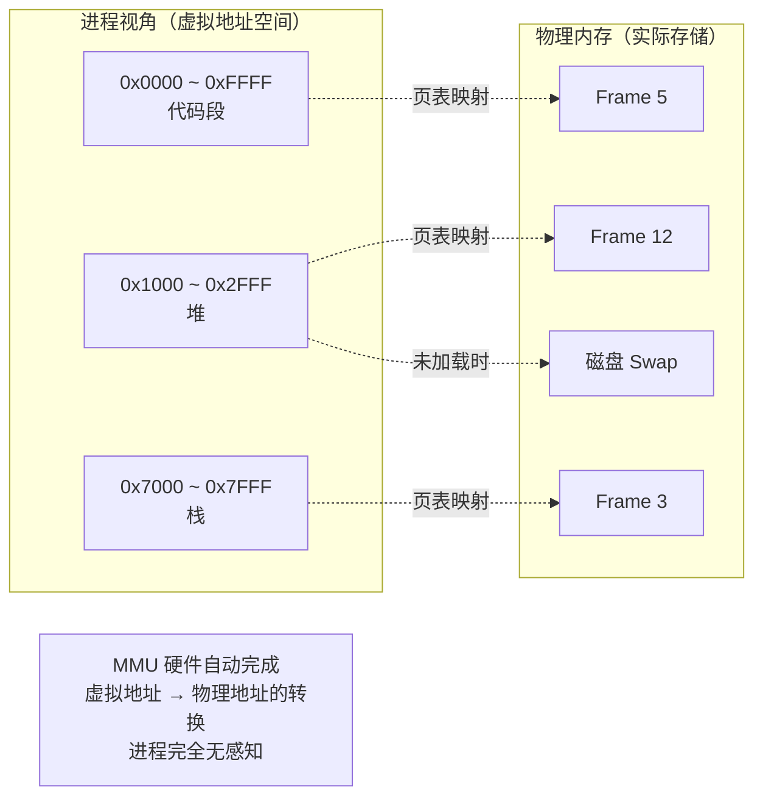
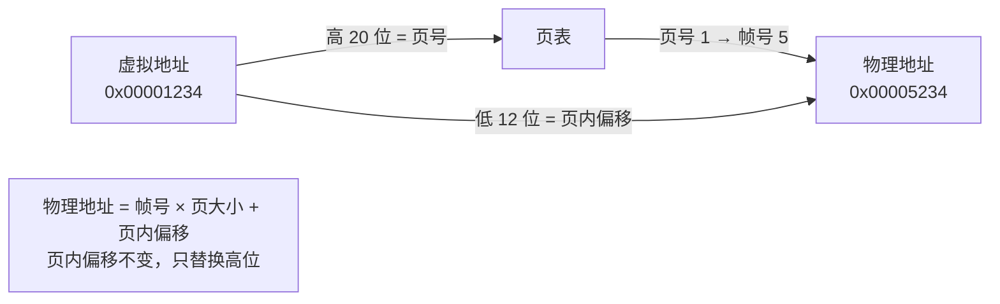
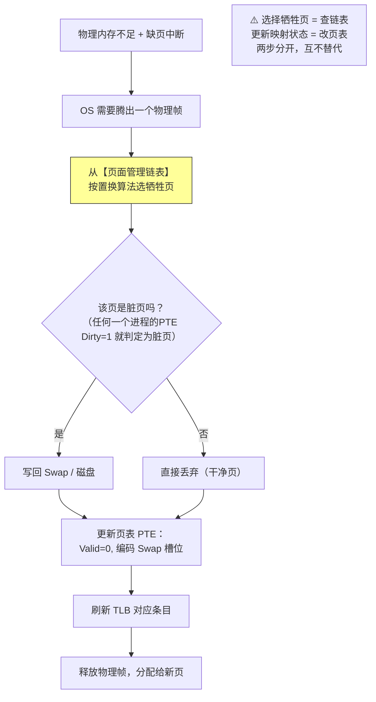
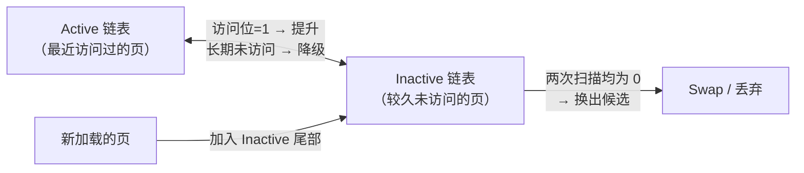
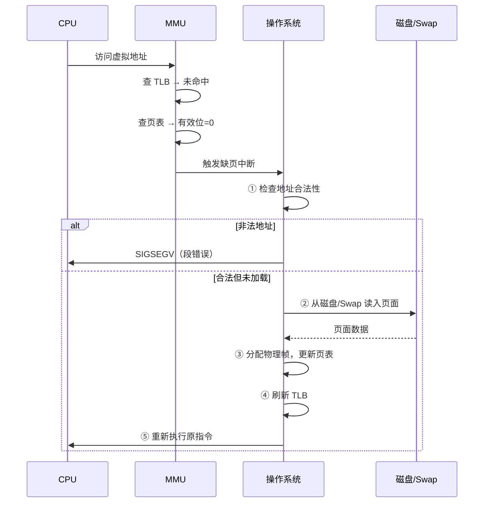
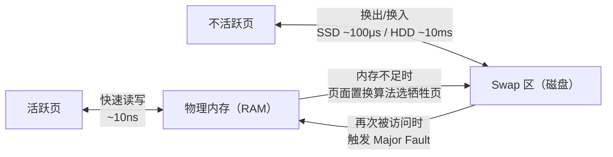
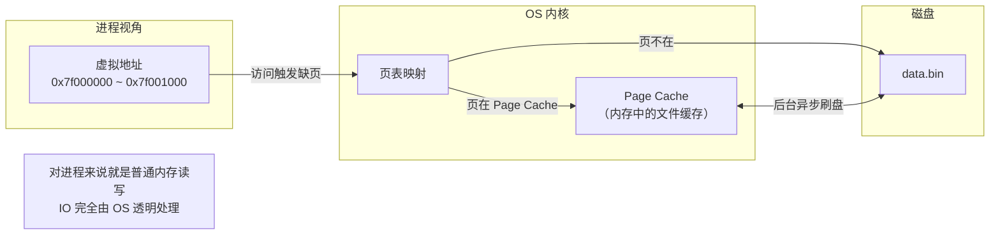
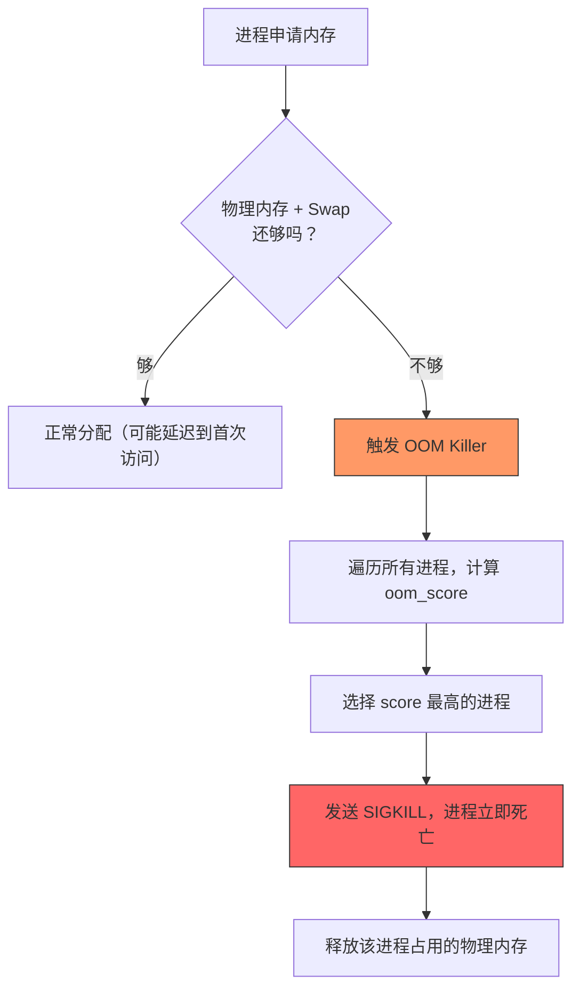

# 内存管理：虚拟内存、分页分段、页面置换

## 一、虚拟内存：为什么需要它？

### 1.1 没有虚拟内存的世界

早期计算机直接使用**物理地址**编程，问题严重：

| 问题 | 说明 |
| :--- | :--- |
| **进程不隔离** | 进程 A 可以直接读写进程 B 的内存，一个 bug 搞崩整个系统 |
| **地址冲突** | 两个程序都想用 0x1000 这个地址，无法同时运行 |
| **内存碎片** | 程序加载/卸载后留下空洞，大程序找不到连续空间 |
| **无法超卖** | 物理内存 8GB 就只能跑 8GB 的程序，不能多任务 |

### 1.2 虚拟内存的核心思想

**给每个进程一个"假象"：你拥有连续的、独占的、巨大的地址空间**。实际上这些地址由操作系统映射到分散的物理内存甚至磁盘上。



### 1.3 虚拟内存解决了什么

| 能力 | 说明 |
| :--- | :--- |
| **进程隔离** | 每个进程有独立的虚拟地址空间，互相不可见 |
| **地址抽象** | 程序员只需关心虚拟地址，不用管物理内存在哪 |
| **内存超卖** | 虚拟地址空间可以远大于物理内存，按需加载 |
| **共享内存** | 多个进程的虚拟页可以映射到同一个物理页（如 libc.so） |
| **按需分配** | malloc 分配的内存不会立即占用物理页，首次访问时才分配（缺页中断） |

### 1.4 容易混淆的概念辨析

| 概念 | 大小取决于 | 说明 |
| :--- | :--- | :--- |
| **虚拟地址空间** | CPU 位数（32 位 = 4GB，64 位 = 256TB） | 每个进程都一样大，与物理内存无关 |
| **物理内存** | 你装了多少 RAM | 所有进程共享，是真实的硬件资源 |
| **进程实际使用的内存（RSS）** | 程序本身 | 真正占用的物理内存，通常远小于虚拟地址空间 |
| **Java -Xmx** | 你设置的值 | 限制的是堆的虚拟地址空间上限，不是物理内存占用 |
| **Docker memory limit** | cgroup 配置 | 限制容器能使用的物理内存上限，容器内仍看到完整虚拟地址空间 |
> ⚠️ **OS 页 ≠ 数据库页**：MySQL InnoDB 的页大小是 16KB，但这不是 OS 的页大小。**OS 页（4KB）由 CPU MMU 硬件决定，进程不能修改；InnoDB 页（16KB）是存储引擎自定义的逻辑单位**，用于磁盘 IO 和 Buffer Pool 管理，底层由 4 个连续的 4KB OS 页承载。InnoDB 选 16KB 是为了减少元数据开销、匹配磁盘顺序 IO 特性、让 B+ 树节点容纳更多记录以降低树高。HugePage（2MB/1GB）是 OS 支持的另一种固定大小选项，也不是让进程随意指定任意大小。

> ⚠️ **关键认知**：虚拟地址空间的大小由 **CPU 位数**决定，跟物理内存多大完全无关。32 位系统每个进程只有 4GB 虚拟地址空间，即使装了 16GB 内存也用不了；64 位系统每个进程有 256TB 虚拟地址空间，即使只有 8GB 内存也能跑（按需加载 + Swap）。
>
> 💡 **排查内存时永远看 RSS/RES，不要看 VIRT**。`top` 命令中 `VIRT` 是虚拟地址空间大小（通常很大但没意义），`RES` 才是真正占用的物理内存。

> 💡 **Java 进程的虚拟地址空间 ≠ -Xmx**：`-Xmx=4GB` 只限制了堆的大小，整个进程的虚拟地址空间还包括 Metaspace、线程栈、堆外内存、Native 库等，通常远大于 4GB。但虚拟地址空间大不代表物理内存占用大——只有真正访问到的页才会分配物理帧（按需分配），所以 VIRT 很大但 RSS 可能只有几百 MB。


---

## 二、分页与分段：虚拟内存的实现方式

### 2.1 分页（Paging）

将虚拟地址空间和物理内存都切成**固定大小的块**：

- 虚拟空间的块叫 **页（Page）**
- 物理内存的块叫 **页框 / 帧（Frame / Page Frame）**
- 大小通常为 **4KB**（Linux x86_64 默认）

#### 页表：虚拟页 → 物理帧的映射



| 特性 | 说明 |
| :--- | :--- |
| **页大小** | 通常 4KB，也有 2MB/1GB 大页（HugePage）用于减少页表项 |
| **页表项（PTE）** | 包含物理帧号 + 有效位 + 读写位 + 脏位 + 访问位 + 用户/内核位（详见下方） |
| **多级页表** | 64 位系统页表太大，采用 4 级页表（PGD → PUD → PMD → PTE）按需分配 |
| **优点** | 消除外部碎片、支持非连续分配、实现简单 |
| **缺点** | 内部碎片（最后一页可能浪费）、页表本身占内存 |


#### 页表项（PTE）详解

页表本质是一个数组，页表的核心职责是存储**虚拟页号 → 物理帧号的映射关系**，每个进程有自己独立的页表，多个进程的页表项可以指向同一个物理帧（比如后面说的 COW 机制），也就是物理帧是共享的。

```text
页表[虚拟页号] = { 物理帧号, Valid, R/W, Dirty, Accessed, U/S }
```

实际硬件中每个 PTE 除了帧号之外，还附带了一组控制位来管理该页的状态和权限：

```
┌─────────────────────────────────────────────┐
│              页表项（PTE）                    │
├──────────┬──────┬──────┬──────┬──────┬──────┤
│ 物理帧号  │ Valid│ R/W  │Dirty │Access│ U/S  │
│ (核心映射) │      │      │      │      │      │
└──────────┴──────┴──────┴──────┴──────┴──────┘
```

| PTE 字段 | 含义 | 作用 |
| :--- | :--- | :--- |
| **物理帧号** | 该虚拟页对应的物理内存帧编号 | 地址转换的核心：虚拟页号 → 物理帧号 |
| **有效位（Valid）** | 1 = 页在内存中；0 = 不在 | 为 0 时触发缺页中断，OS 负责从磁盘加载 |
| **读写位（R/W）** | 1 = 可写；0 = 只读 | COW（写时复制，后文详解）就是靠把这个位置 0 实现的：写入时触发异常，OS 复制页后再置 1 |
| **脏位（Dirty）** | 1 = 被修改过；0 = 未修改 | 换出时脏页需写回磁盘，干净页可直接丢弃 |
| **访问位（Accessed）** | 1 = 最近被访问过；0 = 未访问 | LRU 近似算法靠它判断页面热度，定期清零重新统计 |
| **用户/内核位（U/S）** | 1 = 用户态可访问；0 = 仅内核态 | 防止用户程序越权访问内核内存。用户态 = 应用程序运行的受限模式，不能直接操作硬件；内核态 = OS 运行的特权模式，可以执行任何指令。详见 [进程管理笔记 → 七、用户态与内核态](Process-Management-Notes.md) |

> 💡 **简单记忆**：**页表 = 帧号 + 一组开关**。帧号解决"数据在哪"的问题，开关解决"能不能用、要不要写回、热不热、谁能访问"的问题。

#### TLB：页表的硬件缓存

每次内存访问都要查页表太慢，CPU 内置 **TLB（Translation Lookaside Buffer）** 缓存最近的页表项：

```
虚拟地址 → 查 TLB
├── 命中 → 直接得到物理地址（1~2 个时钟周期）
└── 未命中 → 查页表 → 更新 TLB → 返回物理地址（数十~数百时钟周期）
```

> 💡 **研发感知**：TLB Miss 是性能杀手。频繁访问大量分散内存（如遍历大数组、随机访问 HashMap）会导致 TLB 抖动。HugePage 通过增大页大小减少页表项数量，提升 TLB 命中率。JVM 可通过 `-XX:+UseLargePages` 启用。

### 2.2 分段（Segmentation）

将虚拟地址空间按**逻辑意义**分成可变大小的段：

| 段 | 内容 | 特点 |
| :--- | :--- | :--- |
| **代码段（Text）** | 程序指令 | 只读、可共享 |
| **数据段（Data）** | 全局变量、静态变量 | 可读写 |
| **堆段（Heap）** | 动态分配（malloc/new） | 向高地址增长 |
| **栈段（Stack）** | 局部变量、函数调用帧 | 向低地址增长 |

#### 段表：段号 + 段内偏移 → 物理地址

```
虚拟地址 = 段号 + 段内偏移
段表[段号] = {基址, 长度, 权限}
物理地址 = 基址 + 段内偏移（需检查偏移 < 长度）
```

| 特性 | 说明 |
| :--- | :--- |
| **优点** | 符合程序员思维、便于保护和共享、无内部碎片 |
| **缺点** | 外部碎片严重、分配/回收复杂、硬件支持不如分页普及 |

### 2.3 分页 vs 分段 vs 段页式

| 维度 | 分页 | 分段 | 段页式 |
| :--- | :--- | :--- | :--- |
| **划分依据** | 固定大小（硬件决定） | 逻辑意义（程序决定） | 先分段再分页 |
| **块大小** | 固定（4KB） | 可变 | 段内固定页大小 |
| **碎片** | 内部碎片 | 外部碎片 | 两者都有但较轻 |
| **地址结构** | 页号 + 页内偏移 | 段号 + 段内偏移 | 段号 + 页号 + 页内偏移 |
| **现代 OS** | ✅ 主流（Linux/Windows/macOS） | ❌ 基本弃用 | ⚠️ x86 保留了段寄存器但实际用平坦模型 |
| **类比** | 把书撕成等厚的页 | 按章节分书 | 按章节分，每章再撕成等厚的页 |

> 💡 **关键认知**：现代操作系统几乎都用**纯分页**。x86 架构虽然保留了段寄存器（CS/DS/SS），但在 64 位模式下使用"平坦内存模型"，段基址固定为 0，段限长设为最大值，实际上等于禁用了分段。**面试时说"现代 OS 用分页，分段是历史遗留"即可**。

### 2.4 进程内存全貌：Linux 64 位虚拟地址空间布局

理解了分页的原理后，我们来看一个进程在运行时，它的虚拟地址空间到底长什么样。这一节是连接"分页原理"和"运行时行为"的桥梁。

每个进程的虚拟地址空间是一个**从低地址到高地址的连续范围**。64 位 Linux 中，地址空间被分为两大部分：**低地址的用户空间**和**高地址的内核空间**。

#### 什么是高地址 / 低地址？

地址就是一个数字，数字小的叫"低地址"，数字大的叫"高地址"。就像一栋楼：1 楼是低地址，顶楼是高地址。

```
高地址（数字大）
┌─────────────────────────┐ 0xFFFFFFFFFFFFFFFF
│                         │
│      内核空间            │ ← 操作系统专用，用户程序不能直接访问
│   （所有进程共享）        │
│                         │
├─────────────────────────┤ 0xFFFF800000000000（分界线）
│                         │
│      用户栈（Stack）     │ ← 函数调用时自动分配，向低地址增长 ↓
│                         │
│         ...             │ ← 栈和堆之间的空白区域（安全间隔）
│                         │
│    mmap 映射区           │ ← 动态库（.so）、mmap 文件映射
│                         │
│      堆（Heap）          │ ← malloc/new 分配的内存，向高地址增长 ↑
│                         │
│    BSS 段               │ ← 未初始化的全局/静态变量（自动填 0）
│    Data 段              │ ← 已初始化的全局/静态变量
│    Text 段              │ ← 程序代码（只读）
│                         │
└─────────────────────────┘ 0x0000000000000000
低地址（数字小）
```

#### 各段详解

| 区域 | 全称 | 内容 | 特点 |
| :--- | :--- | :--- | :--- |
| **Text** | Code Segment | 编译后的机器指令 | 只读、可执行；多个进程运行同一程序时共享同一份物理页 |
| **Data** | Initialized Data Segment | 有初始值的全局变量、静态变量 | 如 `int x = 42;`，存储在二进制文件中 |
| **BSS** | Block Started by Symbol | **未初始化**的全局变量、静态变量 | 如 `int y;`，不占二进制文件大小，加载时由 OS 自动填 0 |
| **Heap** | — | `malloc()`/`new` 动态分配的内存 | 向**高地址**增长；通过 `brk`/`sbrk` 系统调用扩展 |
| **mmap 区** | Memory Mapping Area | `mmap()` 映射的文件、匿名内存、动态库（.so） | 位于堆和栈之间，两端都可扩展 |
| **Stack** | — | 局部变量、函数参数、返回地址 | 向**低地址**增长；有大小限制（`ulimit -s`，默认 8MB） |
| **内核空间** | Kernel Space | 操作系统内核代码和数据 | 用户态不可直接访问，必须通过系统调用进入 |

#### 为什么 BSS 单独一段？

```c
int a = 100;    // → Data 段（有初始值，存在二进制文件里）
int b;          // → BSS 段（没有初始值，不需要存在文件里）
```

BSS 段的设计目的是**节省磁盘空间**：未初始化的变量全是 0，没必要在可执行文件中存一大片 0。OS 加载程序时，只需知道 BSS 段的大小，直接在内存中分配并清零即可。

#### 堆和栈为什么相向增长？

```
栈 ↓（向低地址增长）

        ← 中间空白区域 →

堆 ↑（向高地址增长）
```

堆向上长、栈向下长，中间的空白区域作为**缓冲带**。如果两者相遇，说明内存用完了（栈溢出或堆耗尽）。这种设计让堆和栈可以各自独立扩展，最大化利用地址空间。

> 💡 **研发日常**：
> - `cat /proc/<pid>/maps` 查看进程内存布局
> - `pmap -x <pid>` 查看详细映射和权限
> - `ulimit -s` 查看/修改栈大小限制
> - OOM Killer 优先杀内存占用大的进程，理解布局有助于分析 OOM 日志
> - 栈溢出（Stack Overflow）就是栈增长超过了限制或碰到了堆/mmap 区

---

## 三、页面置换：物理内存不够了怎么办？

### 3.1 核心原理：两套独立的数据结构

> ⚠️ **最容易搞混的点**：很多人以为"页面置换就是从页表里找一页换出去"，这是**错误的**。页表和页面置换用的是**两套完全独立的数据结构**，各司其职。

| 数据结构 | 本质 | 组织形式 | 职责 | 谁在用 |
| :--- | :--- | :--- | :--- | :--- |
| **页表（Page Table）** | 地址翻译字典 | 数组 / 多级树 | 虚拟页号 → 物理帧号的映射 | MMU 硬件自动查，O(1) 或 O(log n) |
| **页面管理链表** | 冷热排序队列 | 双向链表 | 跟踪哪些页"热"、哪些页"冷"，决定换出谁 | OS 内核的置换算法 |
| **Swap 元数据** | 磁盘位置索引 | 位图 / 哈希表 | 记录被换出页在磁盘上的位置 | OS 换入时定位 |

**为什么页表不能用来做置换？**

- 页表是按**虚拟页号索引**的数组/树，不是按"访问时间"或"访问频率"排序的
- 如果要从页表中找出"最久未访问的页"，需要遍历所有 PTE，对于 64 位系统可能有数百万个页表项，开销不可接受
- 页表的查找必须是纳秒级（配合 TLB），而置换决策是毫秒级的后台操作，两者性能要求完全不同

**正确的流程是这样的：**



> 💡 **一句话总结**：**页表是"地址翻译字典"（数组/树），页面置换链表是"冷热排序队列"（链表）。内存不足时，OS 从置换链表里选牺牲页，然后去页表里把那一页标记为"不在内存中"。**

### 3.2 常见置换算法对比

理解了"选谁换出"是由独立的置换算法决定的，下面看具体有哪些算法：

| 算法 | 策略 | 优点 | 缺点 | 实际使用 |
| :--- | :--- | :--- | :--- | :--- |
| **OPT** | 换出未来最久不用的页 | 理论最优，缺页率最低 | 需要预知未来，**无法实现** | 仅作为基准对比 |
| **FIFO** | 换出最早进入内存的页 | 实现最简单 | Belady 异常（增加帧数反而缺页更多） | ❌ 不用 |
| **LRU** | 换出最近最久未使用的页 | 接近 OPT，效果好 | 精确实现开销大（需维护时间戳/链表） | ⚠️ 近似实现常用 |
| **Clock / NRU** | LRU 的近似，用访问位环形扫描 | 开销小，效果接近 LRU | 不如精确 LRU | ✅ Linux 基础 |
| **LFU** | 换出访问频率最低的页 | 适合热点稳定的场景 | 计数器溢出/老化问题 | ❌ 少用 |
| **ARC / W-TinyLFU** | 自适应 + 频率+热度综合 | 兼顾突发和稳态 | 实现复杂 | ✅ Caffeine/ZFS |

### 3.3 LRU 详解：面试最高频

**LRU（Least Recently Used）**：淘汰最近最久没有被访问的页面。这是面试中出现频率最高的置换算法，需要掌握精确实现和 Linux 近似实现两种形态。

#### 精确 LRU 的实现

```
数据结构：哈希表 + 双向链表

访问某页：
① 哈希表 O(1) 定位节点
② 将该节点移到链表头部（最近使用）

淘汰时：
删除链表尾部节点（最久未使用）

时间复杂度：访问 O(1)，淘汰 O(1)
空间复杂度：O(n)
```

#### Linux 的近似 LRU：Active/Inactive 双链表

Linux 内核不维护精确的时间戳（开销太大），而是用**两个链表 + PTE 访问位**来近似 LRU：



| 机制 | 说明 | 设计意图 |
| :--- | :--- | :--- |
| **新页进 Inactive** | 新分配的页先放 Inactive 尾部 | 避免一次性大量读取（如 `cat` 大文件）污染 Active 链表 |
| **访问位提升** | Inactive 页被访问后，下次扫描时提升到 Active | 真正活跃的页会被"捞回来" |
| **Active 降级** | Active 页长时间未被访问，扫描时降回 Inactive | 不再活跃的页让出位置 |
| **两次机会（Second Chance）** | Inactive 页第一次扫描清除访问位，第二次仍为 0 才换出 | 给刚被访问过的页一次"自我救赎"的机会，避免误杀 |

> 💡 **研发感知**：
> - `/proc/meminfo` 中的 `Active(anon)`、`Inactive(file)` 等字段反映的就是这两个链表的实时状态
> - 数据库/缓存系统（Redis、MySQL Buffer Pool）也有类似的 LRU 变体，但通常是自己实现的，不依赖 OS 的页面置换
> - JVM 的 `-XX:+UseLargePages` 通过增大页大小减少页表项数量，间接提升 TLB 命中率，但不影响 OS 的置换算法

### 3.4 Belady 异常

**增加物理帧数，缺页率反而上升**的反直觉现象。只有 FIFO 会出现，LRU/OPT 不会。

```
引用串：1, 2, 3, 4, 1, 2, 5, 1, 2, 3, 4, 5

3 个帧（FIFO）：缺页 9 次
4 个帧（FIFO）：缺页 10 次 ← 帧多了，缺页反而更多！
```

**为什么会这样？** FIFO 只看"进入内存的时间"，不看"是否还在被使用"。增加帧数后，某些本应被换出的页多留了一轮，反而把后续需要的页挤出去了。

> 💡 **面试话术**："Belady 异常是 FIFO 特有的病态行为，证明 FIFO 不是栈算法。所谓栈算法，是指'在 N 个帧下被保留的页面集合，一定是 N+1 个帧下被保留页面集合的子集'——简单说就是帧越多，留下的页只多不少。LRU 和 OPT 都满足这个性质，所以增加帧数不会导致缺页率上升。面试中提到 Belady 异常，本质上是在考察你对置换算法数学性质的理解。"

### 3.5 容易混淆的概念辨析

| 概念 | 正确理解 | 常见误区 |
| :--- | :--- | :--- |
| **页表的结构** | 数组 / 多级树，按虚拟页号索引 | ❌ 以为是链表 |
| **页表的归属** | 每个进程有独立的页表 | ❌ 以为所有进程共享一张页表 |
| **物理帧的归属** | 多个进程的页表项可以指向同一个物理帧 | ❌ 以为物理帧也是 per-process 的 |
| **置换算法的数据结构** | 独立的双向链表（Active/Inactive） | ❌ 以为直接遍历页表 |
| **PTE 访问位的作用** | 供置换算法判断页面热度，定期清零重新统计 | ❌ 以为是页表自己在做置换 |
| **脏位的作用** | 决定换出时是否需要写回磁盘 | ❌ 以为脏页不能被换出 |
| **TLB 与置换的关系** | 换出页后必须刷新 TLB 对应条目 | ❌ 以为 TLB 参与置换决策 |

---

## 四、缺页中断、Swap、COW 与 mmap

### 4.1 缺页中断（Page Fault）流程



| 缺页类型 | 原因 | 处理方式 |
| :--- | :--- | :--- |
| **Minor Fault** | 页在内存中但未映射到当前进程（如共享库首次加载） | 无需磁盘 IO，微秒级 |
| **Major Fault** | 页不在内存中，需要从磁盘读取 | 涉及磁盘 IO，毫秒级 |

> 💡 **排查命令**：`time -v ./program` 看 major/minor fault 次数；`perf stat -e page-faults` 实时监控。Major Fault 过多说明内存不足或 Swap 频繁。

### 4.2 Swap 区：磁盘上的"备用内存"

**Swap（交换区）** 是磁盘上预留的一块空间（分区或文件），当物理内存不够用时，OS 把暂时不用的内存页换出到 Swap，腾出物理帧给活跃的页。等这些页再次被访问时，再从 Swap 换回内存。



#### Swap 的两种形式

| 形式 | 说明 | 优缺点 |
| :--- | :--- | :--- |
| **Swap 分区** | 独立的磁盘分区（如 `/dev/sda2`） | 性能略好，但大小固定、调整麻烦 |
| **Swap 文件** | 普通文件（如 `/swapfile`） | 灵活可调大小，现代 Linux 推荐方式 |

#### ⚠️ 关键认知：Swap ≠ 内存扩容

| 对比维度 | 物理内存（RAM） | Swap |
| :--- | :--- | :--- |
| **速度** | 纳秒级（~10ns） | 毫秒级（SSD ~100μs，HDD ~10ms） |
| **差距** | 基准 | **慢 1万~100万倍** |
| **用途** | 正常运行 | 应急兜底，避免 OOM Kill |
| **频繁使用** | 正常 | 系统严重卡顿（thrashing） |

> 💡 **一句话总结**：**Swap 是内存的"急救包"，不是"扩容包"。** 偶尔用一下可以救急，但如果系统频繁换页（thrashing），说明物理内存真的不够了，应该加内存而不是加大 Swap。

#### 研发实战感知

- **查看 Swap 使用情况**：`free -h` 看 Swap 行，`swapon --show` 看 Swap 设备
- **K8s 环境**：容器通常**禁用 Swap**（`swapoff`），因为 cgroup 内存限制依赖精确的物理内存计量，Swap 会干扰 OOM Killer 的判断
- **数据库服务器**：MySQL/Redis 官方建议**关闭 Swap** 或设置 `vm.swappiness=1`，避免关键数据被换出导致性能暴跌
- **Java 服务**：如果 GC 日志显示 Major Fault 激增 + Swap 使用量持续增长，说明堆设太大或存在内存泄漏

### 4.3 Copy-on-Write（COW，写时复制）

> 💡 **COW 是什么？** COW = Copy-on-Write（写时复制），不是某个 Java 中的 COW 容器类，而是一种**"懒复制"的优化思想**：先让多方共享同一份数据，等到某一方真正要写入时才复制出独立副本。读操作不需要隔离，只有写操作才会破坏共享，所以把复制的代价延迟到最后一刻——如果永远不写，就永远不需要复制。操作系统层面靠 PTE 的 R/W 位实现（置 0 → 写入触发异常 → OS 复制 → 置 1），应用层面靠引用计数 + 深拷贝实现。

`fork()` 创建子进程时，**不立即复制父进程的物理内存**，而是让父子进程共享同一组物理页，并将页表的 R/W 位置 0（标记为"只读"）。

```
fork() 之后：
父进程虚拟页 ──→ 物理页 A（只读共享）
子进程虚拟页 ──→ 物理页 A（只读共享）

任一进程写入时：
① 触发写保护缺页中断
② OS 复制物理页 A → 物理页 B
③ 写入方的页表指向 B，标记为可写
④ 另一个进程仍指向 A
```

| 特性 | 说明 |
| :--- | :--- |
| **延迟复制** | 只在真正写入时才复制，大幅减少 fork 开销 |
| **适用场景** | fork + exec（shell 执行命令）、Redis RDB 持久化、Docker 镜像层 |
| **风险** | 如果子进程大量写入，COW 复制可能导致瞬时内存翻倍 |

> 💡 **研发感知**：Redis `BGSAVE` 用 fork 生成子进程做快照，依赖 COW 避免阻塞主线程；但如果写入量大，COW 复制会导致内存暴涨甚至 OOM。Docker 镜像的分层存储也基于 COW 思想。

### 4.4 mmap：把文件"映射"到内存

**mmap（Memory-Mapped I/O）** 是一种将文件或设备直接映射到进程虚拟地址空间的技术。映射后，你可以像访问普通内存一样读写文件内容，**由 OS 自动处理磁盘 IO 和页面调度**，无需手动调用 `read()`/`write()`。

#### 核心原理：mmap 并没有改变缺页加载机制

> ⚠️ **最容易误解的点**：很多人以为 mmap 发明了一套新的"快速读取"机制。实际上 **mmap 和 read() 底层都走同一条路：缺页中断 → 从磁盘加载到 Page Cache → 更新页表**。mmap 改进的不是加载流程本身，而是**加载后的数据放在哪里、以及谁触发加载**。



#### mmap vs read()：本质区别是什么？

在现代 Linux 中，**`read()` 和 `mmap` 的数据都经过 Page Cache**（早期 Unix 有独立的 Buffer Cache，Linux 2.4+ 已合并为统一的 Page Cache）。两者的区别不在于"数据去哪"，而在于 **API 契约决定了是否需要额外拷贝**：

```
read() 的数据流：
磁盘 ──DMA──→ Page Cache ──memcpy──→ 用户 buf
                ↑                        ↑
          数据在这里               必须再拷一份到这里
          （因为 read 的契约是      （因为 buf 是用户自己分配的内存，
           "把数据放到 buf 里"）     物理帧和 Page Cache 不是同一个）

mmap 的数据流：
磁盘 ──DMA──→ Page Cache ←──页表直接指向── 你的虚拟地址
                ↑                              ↑
          数据在这里                     不需要 memcpy！
          （mmap 的契约是                （OS 只需在页表里加一条映射，
           "这段虚拟地址就是文件本身"）     CPU 通过 MMU 直接访问 Page Cache）
```

| 对比维度 | read()/write() | mmap | 为什么有差异 |
| :--- | :--- | :--- | :--- |
| **数据拷贝** | Page Cache → 用户 buf（**1 次 memcpy**） | **零拷贝**（页表直接指向 Page Cache） | API 契约不同：read 要求数据出现在指定 buf，mmap 让虚拟地址直接指向 Page Cache |
| **系统调用** | 每次读写都要 syscall | 映射一次，后续访问是纯内存操作 | mmap 把"读文件"变成了"访问内存" |
| **随机访问** | 需要 `lseek` + `read`，多次 syscall | 直接通过指针偏移访问，零 syscall | 虚拟地址连续，偏移即定位 |
| **缓存利用** | 用户 buf 和 Page Cache 各存一份 | 只有 Page Cache 一份 | mmap 消除了用户态的冗余副本 |
| **磁盘 IO 速度** | 一样快 | 一样快 | 底层都是 DMA + Page Cache，IO 本身没有区别 |

> 💡 **关键认知**：**mmap 不会让磁盘 IO 变快，它省掉的是 IO 之外的开销**（memcpy、syscall、定位）。如果瓶颈在磁盘本身（如 HDD 顺序读），mmap 和 read 差不多；如果瓶颈在 CPU/内存带宽（如频繁随机访问大文件），mmap 优势明显。

> 📖 **mmap 的典型用法（文件映射/匿名映射/共享内存）、风险注意事项、以及零拷贝技术家族的完整介绍**见 [文件管理笔记 → 第六章 零拷贝技术家族](File-Management-Notes.md)。本节仅从内存管理视角解释 mmap 的核心原理：它没有改变缺页加载机制，改进的是数据放置位置和触发方式。
---

## 五、Linux OOM Killer：内存耗尽时谁先死？

### 5.1 为什么需要 OOM Killer？

Linux 采用**内存超额分配（Overcommit）**策略：内核允许进程申请的内存总量超过物理内存 + Swap 的总和。这是因为大多数进程不会同时用完所有申请的内存，超额分配可以提升内存利用率。

但当多个进程的**实际内存需求**真的同时达到峰值，物理内存 + Swap 都不够用时，系统就面临崩溃风险。此时 **OOM Killer（Out Of Memory Killer）** 作为内核级的"最后防线"启动，**选择一个进程杀死以释放内存**，保全系统整体可用。



> ⚠️ **关键认知**：OOM Killer 杀进程是**内核行为**，不是 Java 的 `OutOfMemoryError`。被 OOM Kill 的进程直接消失，日志里可能没有任何应用层异常，只会在 `/var/log/syslog` 或 `dmesg` 中留下内核日志。

### 5.2 OOM Killer 怎么选"牺牲者"？

内核通过 `oom_score` 评分机制选择要杀的进程，**分数越高越容易被杀**：

| 评分因素 | 影响 | 说明 |
| :--- | :--- | :--- |
| **内存占用（RSS）** | 占比越大，分数越高 | 杀一个大的比杀多个小的效率高 |
| **运行时间** | 运行越久，分数越低 | 长期运行的服务通常是重要的 |
| **子进程数量** | 子进程多，分数更高 | 子进程的内存占用会部分计入父进程 |
| **root 权限** | 有 root 权限，分数降低 | 系统进程通常更重要 |
| **直接 IO** | 做磁盘直读直写，分数降低 | 数据库等 IO 密集型进程受保护 |
| **oom_adj / oom_score_adj** | 手动调整 | -1000 = 永不杀，+1000 = 优先杀 |

> 💡 **简单记忆**：**内存大 + 活得短 + 没特权 = 最先被杀**。这就是为什么刚启动就吃满内存的 Java 服务最容易被 OOM Kill。

### 5.3 如何保护重要进程不被杀？

通过调整 `/proc/<pid>/oom_score_adj`（现代内核）或 `/proc/<pid>/oom_adj`（旧内核）：

```bash
# 查看当前进程的 OOM 分数
cat /proc/<pid>/oom_score

# 设置为 -1000：永远不被 OOM Killer 选中
echo -1000 > /proc/<pid>/oom_score_adj

# 设置为 +1000：优先被杀（适合临时任务、批处理作业）
echo 1000 > /proc/<pid>/oom_score_adj
```

在 K8s 环境中，Pod 的 QoS 等级也会影响 OOM 优先级：

| QoS 等级 | OOM 优先级 | 说明 |
| :--- | :--- | :--- |
| **Guaranteed** | 最低（最后被杀） | requests = limits，资源有保障 |
| **Burstable** | 中等 | requests < limits |
| **BestEffort** | 最高（最先被杀） | 未设置 requests/limits |

### 5.4 如何排查 OOM Kill 事件？

```bash
# 查看内核日志中的 OOM Kill 记录
dmesg | grep -i "oom\|killed process" | cat

# 查看系统日志
grep -i "oom" /var/log/syslog | cat       # Debian/Ubuntu
grep -i "oom" /var/log/messages | cat     # CentOS/RHEL

# K8s 环境查看 Pod 是否被 OOM Kill
kubectl describe pod <pod-name> | grep -A5 "Last State" | cat
# 如果 Reason 显示 OOMKilled，就是被内核杀了

# 实时监控内存使用
watch -n 1 'free -h; echo "---"; ps aux --sort=-%mem | head -10'
```

### 5.5 OOM Killer vs Java OutOfMemoryError

这两个概念经常被混淆，但它们是**完全不同层面的事情**：

| 对比维度 | OOM Killer | Java OutOfMemoryError |
| :--- | :--- | :--- |
| **触发层** | Linux 内核 | JVM 运行时 |
| **触发条件** | 系统物理内存 + Swap 耗尽 | JVM 堆/元空间/直接内存耗尽 |
| **处理方式** | 发送 SIGKILL，进程立即死亡 | 抛出异常，程序可以 catch（但通常无法恢复） |
| **日志表现** | 只在 dmesg/syslog 中有记录，应用日志无异常 | 应用日志中有明确的 `java.lang.OutOfMemoryError` |
| **能否恢复** | ❌ 不能，进程已死 | ⚠️ 理论上可以 catch，但实际上几乎不可能恢复 |
| **典型场景** | Pod memory limit 太小、内存泄漏导致 RSS 持续增长 | 堆内存设太小、大对象、内存泄漏 |

> 💡 **研发感知**：如果你的 Java 服务"莫名其妙消失了"，日志里没有任何异常，GC 日志最后一条显示回收耗时很长但之后就没有了——大概率是被 OOM Killer 杀了。这时候要去查 `dmesg` 而不是应用日志。

---

## 六、面试高频问题速答

### Q1：什么是虚拟内存？为什么需要它？

虚拟内存给每个进程一个独立的、连续的、巨大的地址空间假象，由 OS + MMU 映射到实际的物理内存和磁盘。核心价值：进程隔离、地址抽象、内存超卖、共享内存、按需分配。没有虚拟内存，多任务操作系统根本无法实现。

### Q2：分页和分段的区别？现代 OS 用哪个？

分页按固定大小切分，消除外部碎片但有内部碎片；分段按逻辑意义切分，符合程序员思维但有外部碎片。现代 OS（Linux/Windows/macOS）几乎都用纯分页，x86 的段寄存器在 64 位模式下实质禁用。面试说"分页是主流，分段是历史遗留"即可。

### Q3：LRU 怎么实现？Linux 用的是精确 LRU 吗？

精确 LRU 用哈希表 + 双向链表，访问和淘汰都是 O(1)。Linux 不用精确 LRU，而是用 Active/Inactive 双链表 + 访问位的近似算法，开销更小且能抵抗一次性读取对缓存的污染。LeetCode 146 是精确 LRU 的经典实现。

### Q4：什么是缺页中断？Minor 和 Major 的区别？

CPU 访问虚拟地址时，若页表有效位为 0 则触发缺页中断。Minor Fault 是页在内存中但未映射（如共享库首次加载），无需磁盘 IO；Major Fault 是页不在内存中，需要从磁盘/Swap 读入，涉及 IO。Major Fault 过多说明内存压力大。

### Q5：Copy-on-Write 是什么？有什么风险？

COW 是 fork 时的优化：父子进程共享物理页并标记只读，仅在写入时才复制。好处是大幅减少 fork 开销。风险是如果子进程大量写入，COW 复制会导致瞬时内存翻倍，可能触发 OOM。Redis BGSAVE、Docker 镜像层都依赖 COW。

### Q6：TLB 是什么？为什么重要？

TLB 是 CPU 内置的页表缓存，加速虚拟地址到物理地址的转换。TLB 命中只需 1~2 个时钟周期，未命中则要查页表（数十~数百周期）。频繁访问分散内存会导致 TLB 抖动，是性能瓶颈之一。HugePage 通过增大页大小减少页表项，提升 TLB 命中率。

### Q7：Pod 内存限制 2GB，Java -Xmx=8GB，能部署吗？

**能部署，但需要关注实际物理内存使用量（RSS）。**

这是经典的虚拟内存认知陷阱。`-Xmx=8GB` 设置的是 JVM 堆的**虚拟地址空间上限**，不是物理内存占用。JVM 启动时只是预留了 8GB 的虚拟地址范围，并不会立即占用 8GB 物理内存。只要程序实际使用的物理内存（RSS）不超过 Pod 的 cgroup limit（2GB），就能正常运行。

但如果程序真的用到超过 2GB 物理内存，cgroup 会直接 **OOM Kill** 掉容器——注意这不是 Java 的 `OutOfMemoryError`，而是被 Linux 内核杀掉的，进程直接消失，日志里可能没有任何 Java 异常。

| 概念 | 值 | 含义 |
| :--- | :--- | :--- |
| Pod memory limit | 2GB | cgroup 限制的物理内存上限 |
| -Xmx | 8GB | JVM 堆的虚拟地址空间上限 |
| JVM 实际物理内存（RSS） | 取决于真实使用量 | 可能只有几百 MB，也可能超过 2GB |

> 💡 **面试加分回答**：不要只说"能"或"不能"，而是追问"这个服务的实际内存峰值是多少？GC 策略是什么？有没有堆外内存（DirectByteBuffer/NIO）？Metaspace 设了多少？"——这才是有深度的回答。排查时用 `kubectl top pod` 或 `cat /sys/fs/cgroup/memory/memory.usage_in_bytes` 看真实物理内存占用。

### Q8：OOM Killer 和 Java OutOfMemoryError 有什么区别？

**完全不同层面的事情。** OOM Killer 是 Linux 内核在系统物理内存 + Swap 耗尽时杀死进程的机制，进程直接消失，应用日志无异常，只在 `dmesg` 中有记录。Java OOM 是 JVM 堆/元空间/直接内存耗尽时抛出的异常，应用日志中有明确的 `java.lang.OutOfMemoryError`。如果你的 Java 服务"莫名其妙消失了"且日志干净，大概率是被 OOM Kill 了，去查 `dmesg | grep -i oom` 而不是应用日志。OOM Killer 选牺牲者优先杀"内存大 + 活得短 + 没特权"的进程，可通过 `/proc/<pid>/oom_score_adj` 调整优先级。

---

## 七、常见名词速查表

| 名词 | 一句话解释 |
| :--- | :--- |
| **虚拟内存** | 给进程独立连续地址空间的抽象，由 OS + MMU 映射到物理内存/磁盘 |
| **页（Page）** | 虚拟地址空间的固定大小块（通常 4KB） |
| **帧（Frame）** | 物理内存的固定大小块，与页等大 |
| **页表** | 虚拟页号 → 物理帧号的映射表，每个进程独立 |
| **多级页表** | 将页表分层，按需分配，减少内存占用 |
| **TLB** | 页表的硬件缓存，加速地址转换 |
| **分段** | 按逻辑意义划分可变大小的段（代码/数据/堆/栈） |
| **段页式** | 先分段再分页，结合两者优点 |
| **缺页中断** | 访问未加载的页时触发的异常，OS 负责加载 |
| **Minor Fault** | 页在内存中但未映射，无需磁盘 IO |
| **Major Fault** | 页不在内存中，需从磁盘读取 |
| **页面置换** | 物理内存满时选择换出哪个页的策略 |
| **LRU** | 淘汰最近最久未使用的页，面试最高频 |
| **Belady 异常** | FIFO 特有：增加帧数缺页率反而上升 |
| **COW** | fork 时延迟复制，写入时才真正复制物理页 |
| **mmap** | 将文件/设备映射到虚拟地址空间，像访问内存一样读写文件，减少拷贝和 syscall |
| **Swap** | 磁盘上的交换分区/文件，充当虚拟内存的后端存储，是"急救包"不是"扩容包" |
| **HugePage** | 2MB/1GB 大页，减少页表项数量，提升 TLB 命中率 |
| **OOM Killer** | Linux 内核在物理内存 + Swap 耗尽时按 oom_score 选进程杀死的机制，与 Java OOM 完全不同 |
| **Overcommit** | Linux 允许分配内存总量超过物理内存 + Swap 的策略，OOM Killer 是其兜底机制 |
| **oom_score_adj** | 手动调整进程被 OOM Kill 的优先级，-1000 = 永不杀，+1000 = 优先杀 |

---

## 小结

- **虚拟内存**：给进程独立地址空间的抽象，解决隔离、超卖、按需分配三大问题
- **分页 vs 分段**：现代 OS 用纯分页，分段是历史遗留；段页式是折中方案
- **页表与 TLB**：页表是 per-process 的映射关系，TLB 是硬件缓存，TLB Miss 是性能杀手
- **页面置换**：页表和置换链表是两套独立数据结构；LRU 是面试重点，Linux 用 Active/Inactive 双链表近似实现
- **缺页中断**：Minor 无需 IO，Major 涉及磁盘，Major 过多说明内存压力大
- **Swap**：磁盘上的备用内存，速度慢 1万~100万倍，是急救包不是扩容包；K8s/数据库通常禁用
- **COW**：fork 优化的基石，Redis/Docker 都依赖它，但要注意内存翻倍风险
- **mmap**：文件映射到内存，减少拷贝和 syscall；Kafka/ES/Java NIO 都依赖它，注意 SIGBUS 和脏页回写
- **OOM Killer**：内核级最后防线，按 oom_score 选牺牲者；与 Java OOM 完全不同，排查看 dmesg

> 💡 **记忆口诀**：**虚拟内存造幻象，分页切块消碎片；页表映射 TLB 缓，LRU 淘汰双链转；缺页中断分大小，Swap 兜底非扩容；COW 延迟省拷贝，OOM 杀进程保系统**。
ENDOFFILE; __aone_exit=$?; pwd -P > '/var/folders/xf/v73xkqnd7fv8dzfl_967pdk40000gp/T/aone-copilot-cwd-1787816702419-6krbchg745g.txt' 2>/dev/null; exit $__aone_exit