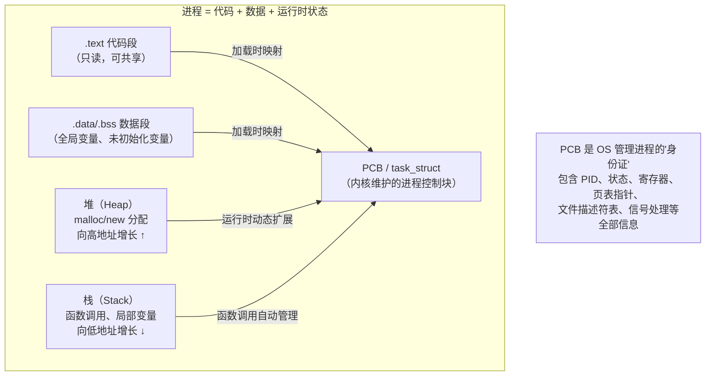
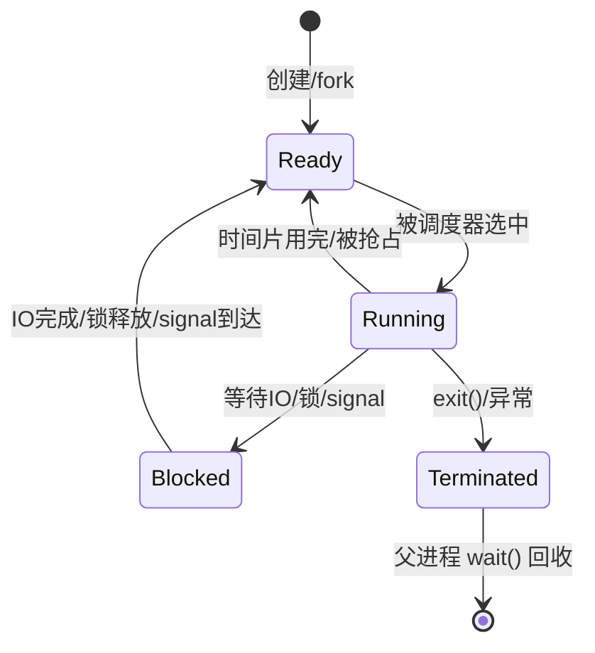
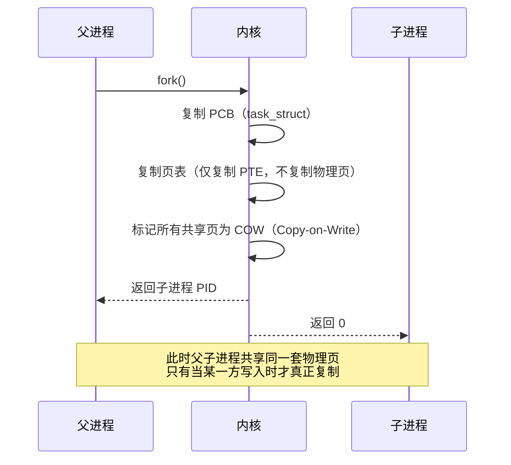
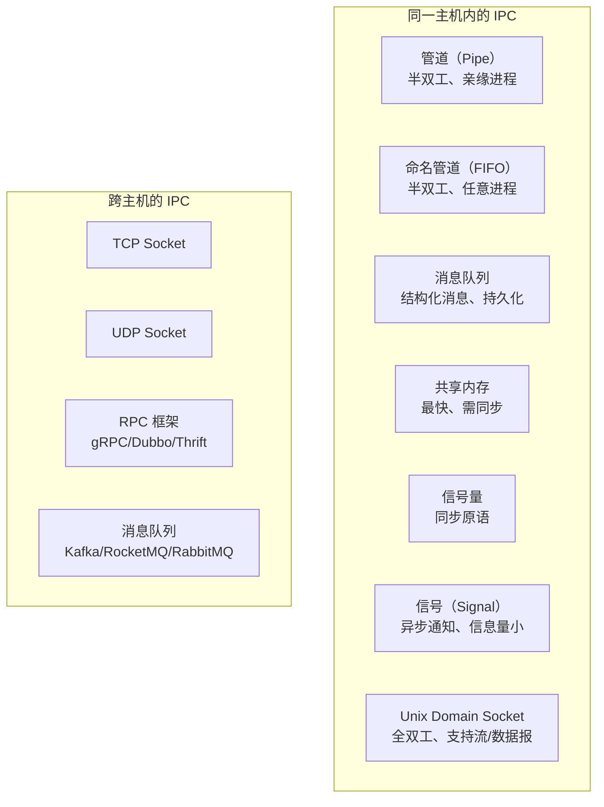
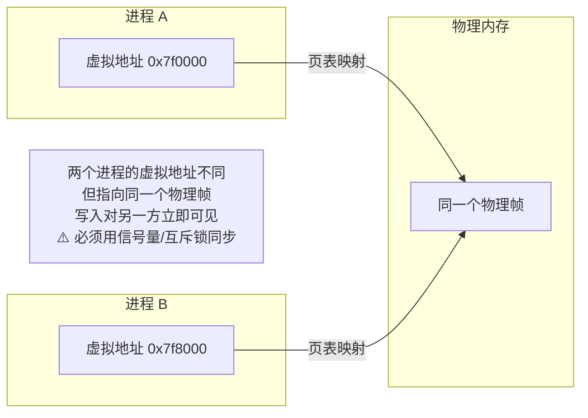
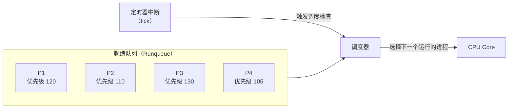
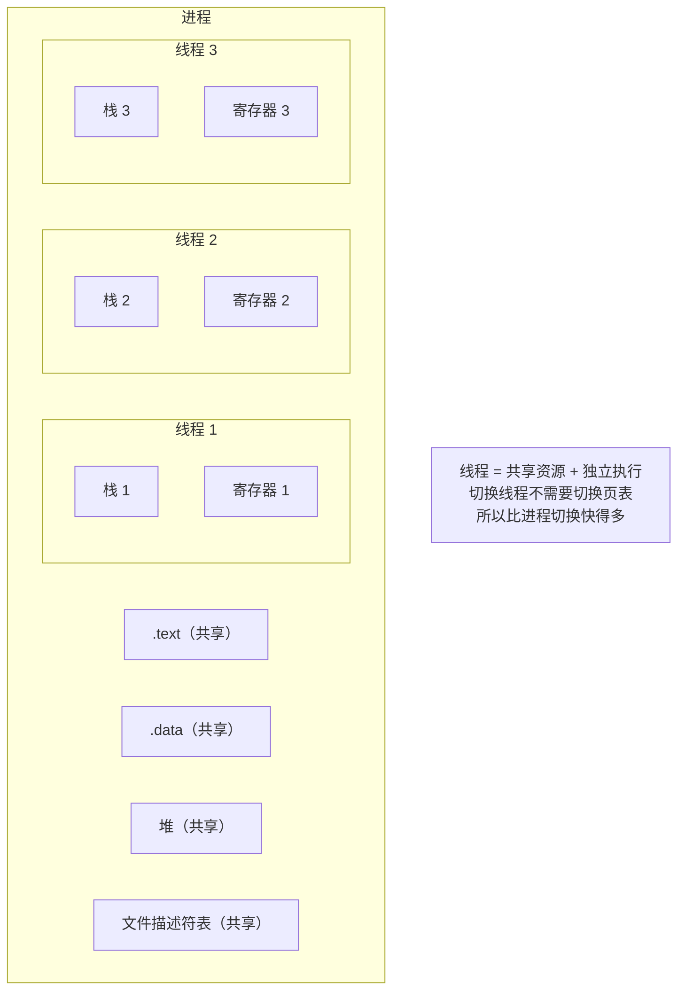
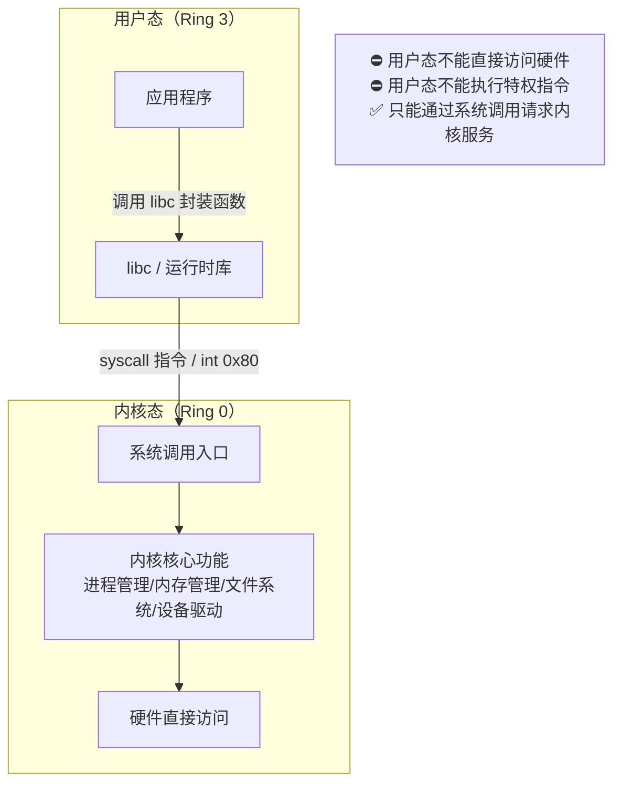

# 进程管理：从 PCB 到调度、从 fork 到线程

## 一、进程的本质：程序的一次执行

### 1.1 程序 vs 进程

| 维度 | 程序（Program） | 进程（Process） |
| :--- | :--- | :--- |
| **本质** | 磁盘上的静态文件（ELF/PE） | 内存中正在运行的动态实体 |
| **生命周期** | 永久存在（除非删除文件） | 有创建、运行、终止的过程 |
| **状态** | 无状态 | 有就绪、运行、阻塞等状态 |
| **资源** | 不占用 CPU/内存 | 占用 CPU、内存、文件描述符等 |
| **类比** | 菜谱 | 正在按菜谱做菜的过程 |

> 💡 **一句话理解**：程序是"做什么"的说明书，进程是"正在做"这件事的实例。同一个程序可以同时产生多个进程（如同时打开 3 个 Chrome 窗口）。

### 1.2 进程的组成

一个进程在内存中的全貌：



### 1.3 PCB（进程控制块）：OS 眼中的进程

OS 并不直接操作"进程"这个抽象概念，而是通过 **PCB（Process Control Block）** 来管理每一个进程。Linux 中对应的结构体是 `task_struct`。

| PCB 关键字段 | 说明 |
| :--- | :--- |
| **PID** | 进程唯一标识符 |
| **状态** | TASK_RUNNING / TASK_INTERRUPTIBLE / TASK_STOPPED / EXIT_ZOMBIE 等 |
| **寄存器上下文** | CPU 切换时保存/恢复的 EIP、ESP、EAX 等 |
| **页表指针（mm_struct）** | 指向该进程的虚拟地址空间映射 |
| **文件描述符表** | 该进程打开的所有文件 |
| **信号处理** | 待处理信号、信号处理函数 |
| **父子关系** | parent、children、sibling 指针 |
| **调度信息** | 优先级、时间片、nice 值 |

> ⚠️ **关键认知**：进程切换 ≠ 简单的跳转。切换时必须保存当前进程的完整寄存器上下文到 PCB，再从目标进程的 PCB 恢复寄存器。这就是为什么进程切换比函数调用慢几个数量级。

---

## 二、进程状态与生命周期

### 2.1 五状态模型



| 状态 | 含义 | 典型触发场景 |
| :--- | :--- | :--- |
| **Ready（就绪）** | 万事俱备，只欠 CPU | 刚创建、IO 完成、时间片被抢 |
| **Running（运行）** | 正在 CPU 上执行 | 被调度器选中 |
| **Blocked（阻塞）** | 等待某个事件，给 CPU 也不干活 | read() 等 IO、wait 锁、sleep |
| **Terminated（终止）** | 执行完毕或异常退出 | exit()、SIGKILL、段错误 |
| **Zombie（僵尸）** | 已终止但 PCB 未被父进程回收 | 子进程 exit 后父进程未 wait |

### 2.2 Linux 中值得关注的状态

Linux 内核状态比五状态模型更细，但服务端研发只需关注以下几个：

| 状态 | `top`命令 显示 | 含义 | 实战意义 |
| :--- | :--- | :--- | :--- |
| **R (Running)** | R | 正在运行或在 runqueue 中等待 CPU | Linux 不区分就绪和运行 |
| **S (Sleeping)** | S | 可中断睡眠，等待事件（如 IO、锁） | 正常状态，可被信号唤醒 |
| **D (Disk Sleep)** | D | 不可中断睡眠，通常在等磁盘 IO | ⚠️ 大量 D 状态 = IO 瓶颈或 NFS 挂死，**kill -9 无效** |
| **Z (Zombie)** | Z | 已退出但父进程未回收 | 父进程 bug，需修复代码 |
| **T (Stopped)** | T | 被 SIGSTOP 暂停或被调试器跟踪 | 调试或手动暂停 |

> 💡 **排查口诀**：R 多 = CPU 瓶颈，D 多 = IO 瓶颈，Z 多 = 代码 bug，S 多 = 正常等待。

### 2.3 僵尸进程与孤儿进程

| 类型 | 产生原因 | 危害 | 解决方式 |
| :--- | :--- | :--- | :--- |
| **僵尸进程** | 子进程 exit 后父进程未调用 wait/waitpid | 占用 PID 和 PCB，大量积累会耗尽 PID | 父进程正确 wait；或用 `kill -SIGCHLD` 通知父进程 |
| **孤儿进程** | 父进程先退出，子进程还在运行 | 本身无害，被 init/systemd 收养 | 无需处理，systemd 会自动 wait 回收 |

```c
// 经典僵尸进程示例
int main() {
    pid_t pid = fork();
    if (pid == 0) {
        // 子进程立即退出 → 变成僵尸
        exit(0);
    }
    // 父进程不调用 wait()，继续干别的事
    sleep(3600);  // 子进程在这 1 小时内一直是僵尸
    return 0;
}
```

> 💡 **最佳实践**：如果父进程不关心子进程返回值，可以 `signal(SIGCHLD, SIG_IGN)` 让内核自动回收，或者使用双重 fork 技巧让子进程成为 init 的子进程。

---

## 三、进程创建与终止

### 3.1 fork：复制一个进程

`fork()` 是 Unix/Linux 创建新进程的**唯一方式**。它创建一个与父进程几乎完全相同的子进程。



#### fork 的核心优化：COW（写时复制）

> 💡 **fork 不会复制父进程的整个内存**。它只复制 PCB 和页表，物理页通过 COW（Copy-on-Write）共享。只有当某一方写入时才真正复制该页。这使得 fork 的开销仅为页表大小（几 KB ~ 几 MB），而非整个进程内存。
>
> 📖 **COW 的完整原理、实现细节和风险**见 [内存管理笔记 → 4.3 Copy-on-Write](Memory-Management-Notes.md)。

> 💡 **这就是为什么 fork + exec 高效**：fork 本身几乎不复制内存，exec 又直接替换了整个地址空间。中间的"短暂共享"窗口极短，COW 几乎没有机会触发。


### 3.2 wait/waitpid：回收子进程

父进程必须调用 `wait` 或 `waitpid` 来回收已终止的子进程，否则子进程会变成僵尸：

```c
// 正确用法
pid_t pid = fork();
if (pid == 0) {
    // 子进程
    execlp("ls", "ls", "-la", NULL);
    _exit(1);  // exec 失败才走到这里
} else {
    // 父进程
    int status;
    waitpid(pid, &status, 0);  // 阻塞等待子进程结束并回收
    if (WIFEXITED(status)) {
        printf("子进程退出码: %d\n", WEXITSTATUS(status));
    }
}
```

---

## 四、进程间通信（IPC）

### 4.1 IPC 方式全景对比



| IPC 方式 | 速度 | 适用场景 | 复杂度 | 特点 |
| :--- | :--- | :--- | :--- | :--- |
| **匿名管道** | ★★★★ | 父子进程单向通信 | ★ | shell 管道 `\|` 的基础 |
| **命名管道** | ★★★★ | 无关进程单向通信 | ★★ | 有文件系统路径 |
| **消息队列** | ★★★ | 结构化消息传递 | ★★ | 消息有类型，可按类型接收 |
| **共享内存** | ★★★★★ | 大数据量高速传输 | ★★★★ | 最快，但需要自己加锁同步 |
| **信号** | ★★ | 异步事件通知 | ★ | 信息量极小（仅信号编号） |
| **Unix Socket** | ★★★★ | 本地全双工通信 | ★★★ | Nginx worker 通信、Docker daemon |
| **TCP Socket** | ★★★ | 跨网络通信 | ★★★ | 可靠、有序、通用 |

### 4.2 共享内存：最快的 IPC

共享内存允许多个进程直接读写同一块物理内存，**零拷贝**：



> ⚠️ **共享内存 ≠ 无脑快**：虽然数据传输零拷贝，但如果缺少正确的同步机制（互斥锁、条件变量），就会出现竞态条件。实际工程中，共享内存 + 环形缓冲区（Ring Buffer）是最常见的高性能 IPC 模式。

### 4.3 信号（Signal）：轻量级异步通知

| 常用信号 | 编号 | 含义 | 默认动作 |
| :--- | :--- | :--- | :--- |
| `SIGINT` | 2 | Ctrl+C | 终止 |
| `SIGTERM` | 15 | 请求优雅退出 | 终止 |
| `SIGKILL` | 9 | 强制杀死 | 终止（**不可捕获**） |
| `SIGSTOP` | 19 | 暂停进程 | 停止（**不可捕获**） |
| `SIGCONT` | 18 | 恢复进程 | 继续 |
| `SIGCHLD` | 17 | 子进程状态变化 | 忽略 |
| `SIGSEGV` | 11 | 非法内存访问 | 终止 + core dump |
| `SIGPIPE` | 13 | 写入已关闭的管道 | 终止 |

> ⚠️ **SIGKILL 和 SIGSTOP 不可被捕获、忽略或阻塞**。这是内核的安全保障，确保任何进程都能被管理员终止或暂停。

---

## 五、CPU 调度

### 5.1 为什么需要调度？

CPU 核心数远少于进程数。调度的目标是：**在有限的 CPU 资源下，让所有进程"感觉"自己在独占 CPU**。



### 5.2 调度算法演进

| 算法 | 时代 | 核心思想 | 优点 | 缺点 |
| :--- | :--- | :--- | :--- | :--- |
| **FCFS** | 早期 | 先来先服务 | 简单公平 | 护航效应，短作业等太久 |
| **SJF** | 理论 | 最短作业优先 | 平均等待时间最优 | 无法预知运行时长，可能饥饿 |
| **RR（时间片轮转）** | 分时系统 | 每个进程轮流跑一个时间片 | 响应性好 | 时间片太大退化为 FCFS，太小切换开销大 |
| **优先级调度** | 通用 | 高优先级先跑 | 重要任务优先 | 低优先级可能饥饿 |
| **MLFQ（多级反馈队列）** | 现代通用 | 多个优先级队列，新进程从高优先级队列开始，用完时间片后降级到低优先级队列；IO 密集型进程会被提升回高优先级 | 兼顾响应和吞吐 | 实现复杂 |
| **CFS（完全公平调度）** | Linux 2.6.23+ | 红黑树按 vruntime 排序 | 数学上精确公平 | 实时性不如专用 RT 调度器 |

### 5.3 Linux CFS 核心原理

CFS（Completely Fair Scheduler）是 Linux 默认的进程调度器，核心思想用一句话概括：**谁跑得少就让谁先跑**。

```
CFS 的工作方式：
1. 每个进程维护一个 vruntime（虚拟运行时间）
2. 高优先级进程的 vruntime 增长慢，低优先级的增长快
3. 调度器总是选 vruntime 最小的进程运行（红黑树 O(log n) 查找）
4. 结果：每个进程获得的 CPU 时间与其优先级成正比
```

#### nice 值与 CFS 权重机制

> 💡 **先澄清一个常见误解**：nice 值不是一个"计算出来"的值，它是**你手动指定的优先级**（-20 到 19），默认 0。nice 值不是公式推导的，而是**你告诉内核**"这个进程有多谦让"。

**nice 值怎么影响 CPU 分配？—— 权重的 vruntime 放大效应**

CFS 为每个 nice 值预设了一个**权重（weight）**，权重决定了 vruntime 的增长速度：

```
nice  →  权重（weight）        vruntime 增长速度
-20   →  ~88761              极慢（几乎不涨）
  0   →  1024   ← 基准       正常速度
 19   →  ~15                 极快（飞速膨胀）
```

实际调度时，CFS 计算每个进程的 **vruntime（虚拟运行时间）**：

```
vruntime = 实际运行时间 × (nice_0的权重 / 当前进程的权重)
```

假设两个进程都实际运行了 **10ms**：

| 进程 | nice | 权重 | vruntime 计算 | vruntime |
| :--- | :--- | ---: | :--- | ---: |
| A（在线服务） | 0 | 1024 | 10 × (1024/1024) | **10ms** |
| B（后台批处理） | 5 | 335 | 10 × (1024/335) | **30.5ms** |

CFS 每次都选 **vruntime 最小**的进程运行：

1. 初始状态，A 和 B 的 vruntime 都是 0，按时间片轮流跑
2. A 跑了 10ms，vruntime 涨到 10ms
3. B 跑了 10ms，vruntime 涨到 30ms ← B 涨得快！
4. 下次再选，A 的 vruntime(10) < B 的 vruntime(30) → **A 被选中**
5. A 又多跑一轮，A 实际得到更多 CPU 时间

> 💡 **一句话总结**：nice 值越低 → 权重越大 → vruntime 涨得越慢 → 被 CFS 选中的次数越多 → CPU 拿得越多。所有 nice 值为 0 的进程权重相同，公平竞争；nice 值不同的进程，按权重比例分配 CPU。

**实际应用**：

```bash
# 在线服务：默认 nice=0，不调整
java -jar api-service.jar

# 后台数据导出：nice=10，别跟在线服务抢 CPU
nice -n 10 java -jar data-export.jar

# 已运行的进程调整优先级
renice -n 10 -p <pid>
```

---

## 六、线程：轻量级进程

### 6.1 进程 vs 线程

| 维度 | 进程 | 线程 |
| :--- | :--- | :--- |
| **资源拥有** | 独立的地址空间、文件描述符表 | 共享进程的地址空间和文件描述符 |
| **独立拥有的** | 全部 | 仅栈、寄存器、TLS（Thread Local Storage，线程本地存储——每个线程私有的变量空间，如 Java 的 `ThreadLocal`、C 的 `__thread`，用于避免共享变量的锁竞争） |
| **创建开销** | 大（复制页表、PCB） | 小（仅分配栈和 thread_struct） |
| **切换开销** | 大（切换页表、刷新 TLB） | 小（同地址空间，TLB 基本命中） |
| **通信** | 需要 IPC 机制 | 直接读写共享内存（需同步） |
| **崩溃影响** | 仅自身 | 一个线程崩溃可能导致整个进程退出 |
| **调度单位** | Linux 中线程也是调度单位 | 同左 |



### 6.2 Linux 的线程模型：1:1

Linux 采用 **1:1 线程模型**：每个用户态线程对应一个内核调度实体（`task_struct`）。

| 线程模型 | 代表系统 | 用户线程:内核线程 | 优缺点 |
| :--- | :--- | :--- | :--- |
| **1:1** | Linux、Windows | 1:1 | 线程切换由内核调度，真正的并行；但创建开销比纯用户态线程大 |
| **M:N** | Go goroutine、Java 21 Virtual Thread | M:N | 用户态调度，创建极轻量；但需要复杂的 runtime 调度器 |
| **N:1** | 早期 pthread 用户态实现 | N:1 | 纯用户态调度，无法利用多核；已基本淘汰 |

> 💡 **Go goroutine 和 Java Virtual Thread 的区别**：它们都是 M:N 模型，但实现层次不同。goroutine 是语言 runtime 层面的协程；Virtual Thread 是 JVM 层面的轻量线程，对现有 Java 代码透明。两者都避免了 1:1 模型的线程创建开销问题。

### 6.3 线程同步原语

| 原语 | 用途 | 粒度 | 性能 |
| :--- | :--- | :--- | :--- |
| **互斥锁（Mutex）** | 保护临界区，同一时刻只有一个线程进入 | 粗 | 竞争激烈时退化 |
| **读写锁（RWLock）** | 读多写少场景，允许多读单写 | 中 | 读密集时优于 Mutex |
| **条件变量（CondVar）** | 等待某个条件成立，配合 Mutex 使用 | — | 避免忙等 |
| **自旋锁（Spinlock）** | 极短临界区，不睡眠地忙等 | 极细 | 持锁时间 < 上下文切换开销时优于 Mutex |
| **原子操作** | 单个变量的无锁并发（CAS、fetch_add） | 最细 | 硬件级别，最快 |
| **信号量（Semaphore）** | 控制并发访问数量（如连接池） | 可调 | 通用 |

> ⚠️ **自旋锁的使用前提**：持锁时间必须**极短**（通常 < 几微秒），且不能在持锁期间睡眠。如果持锁时间长，自旋会白白浪费 CPU。Linux 内核中自旋锁用于中断处理和极短的临界区；用户态应用优先用 Mutex。

---

## 七、用户态与内核态

### 7.1 为什么分两个态？



| 维度 | 用户态 | 内核态 |
| :--- | :--- | :--- |
| **权限级别** | Ring 3（最低） | Ring 0（最高） |
| **可访问内存** | 仅自己的虚拟地址空间 | 全部物理内存 |
| **可执行指令** | 非特权指令 | 全部指令（含 halt、cli 等） |
| **可直接操作硬件** | ❌ | ✅ |
| **崩溃影响** | 仅当前进程 | 整个系统 panic |

### 7.2 系统调用的代价

每次系统调用都是一次**用户态→内核态的上下文切换**：

```
系统调用的完整流程：
1. 用户态：准备参数，执行 syscall 指令
2. CPU：切换到 Ring 0，跳转到内核入口
3. 内核：保存用户态寄存器，查找系统调用号，执行内核函数
4. 内核：将结果放入返回值寄存器
5. CPU：切换回 Ring 3，恢复用户态寄存器
6. 用户态：拿到返回值，继续执行

耗时：约 200~1000 个时钟周期（取决于架构和系统调用类型）
```

> 💡 **性能优化思路**：减少系统调用次数是高性能编程的核心原则之一。批量读写（readv/writev）、内存映射（mmap）、io_uring 等技术都是为了减少用户态/内核态切换的次数。

---

## 八、面试高频问题速答

### Q1：进程和线程的区别？

> **答**：进程是资源分配的基本单位，拥有独立的地址空间；线程是 CPU 调度的基本单位，共享进程的地址空间。线程创建和切换开销远小于进程，但一个线程崩溃可能影响整个进程。Linux 中两者都是 `task_struct`，区别在于是否共享 `mm_struct`。

### Q2：fork 之后父子进程是什么关系？

> **答**：fork 创建子进程时，内核只复制 PCB 和页表，物理页通过 COW 共享。子进程是父进程的副本，拥有独立的 PID，但从 fork 点开始独立执行。父进程返回子进程 PID，子进程返回 0。

### Q3：什么是僵尸进程？如何避免？

> **答**：子进程 exit 后，内核保留其 PCB 中的退出状态等待父进程读取。如果父进程不调用 wait/waitpid，子进程就变成僵尸，占用 PID 资源。避免方式：① 父进程正确 wait；② `signal(SIGCHLD, SIG_IGN)` 让内核自动回收；③ 双重 fork 让子进程被 init 收养。

### Q4：CFS 是怎么保证公平的？

> **答**：CFS 为每个进程维护一个 vruntime（虚拟运行时间），vruntime 增速与进程权重成反比。调度器总是选择 vruntime 最小的进程运行，用红黑树 O(log n) 查找。nice 值通过影响权重来改变 vruntime 增速，从而实现优先级。

### Q5：用户态和内核态怎么切换？

> **答**：用户态通过系统调用（syscall 指令）陷入内核态，CPU 切换到 Ring 0 并跳转到内核入口。内核处理完后通过 iret/sysret 返回用户态。每次切换涉及寄存器保存/恢复和 TLB 可能的刷新，开销约数百个时钟周期。

### Q6：共享内存为什么是最快的 IPC？

> **答**：共享内存让多个进程的虚拟地址映射到同一个物理帧，数据传输零拷贝。其他方式（管道、消息队列、Socket）都需要至少一次内核拷贝。但共享内存需要自行处理同步（互斥锁/信号量），否则会有竞态条件。

---

## 九、名词速查表

| 名词 | 英文 | 一句话解释 |
| :--- | :--- | :--- |
| PCB | Process Control Block | OS 管理进程的数据结构，Linux 中为 task_struct |
| COW | Copy-on-Write | 写入时才复制共享页，fork 的核心优化 |
| CFS | Completely Fair Scheduler | Linux 默认调度器，基于 vruntime 红黑树 |
| vruntime | Virtual Runtime | CFS 中衡量进程"已消耗 CPU 时间"的虚拟值 |
| nice | — | 进程优先级调整值，-20 最高，19 最低 |
| zombie | Zombie Process | 已终止但未被父进程 wait 回收的进程 |
| orphan | Orphan Process | 父进程已退出，被 init/systemd 收养的进程 |
| IPC | Inter-Process Communication | 进程间通信的统称 |
| syscall | System Call | 用户态请求内核服务的唯一合法途径 |
| context switch | Context Switch | CPU 从一个进程/线程切换到另一个的过程 |
| TLS | Thread Local Storage | 每个线程私有的存储区 |
| Ring 0/3 | Protection Ring | x86 的特权级，0=内核，3=用户 |

---

## 小结

1. **进程 = 程序的一次执行**，由 PCB（task_struct）管理，包含代码、数据、堆、栈和运行时状态
2. **fork 不复制内存**，只复制页表，物理页通过 COW 共享，写入时才真正复制
3. **僵尸进程是 bug**，父进程必须 wait 回收；孤儿进程无害，被 systemd 收养
4. **CFS 用 vruntime 实现公平**，nice 值通过权重影响 vruntime 增速
5. **线程共享地址空间**，切换不需要换页表，所以比进程切换快
6. **用户态不能直接碰硬件**，必须通过系统调用陷入内核态，每次切换有固定开销
7. **共享内存是最快的 IPC**，零拷贝但需要自行同步
8. **减少系统调用次数**是高性能编程的核心原则

### 🧠 记忆口诀

> **进程四要素**：代码数据堆栈 + PCB
> **fork 三件事**：复制 PCB、复制页表、标记 COW
> **调度看 vr**：vruntime 最小者得 CPU
> **线程轻在哪**：共享地址空间，不换页表
> **两态一道墙**：syscall 是唯一通行证
