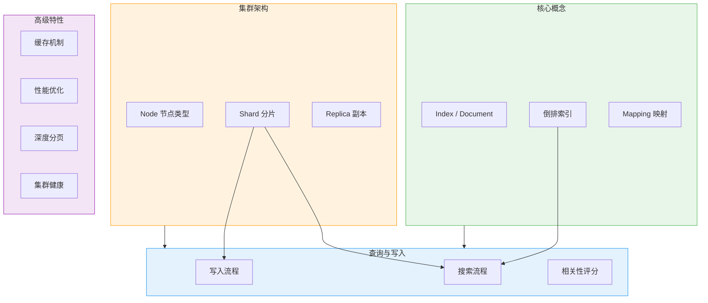
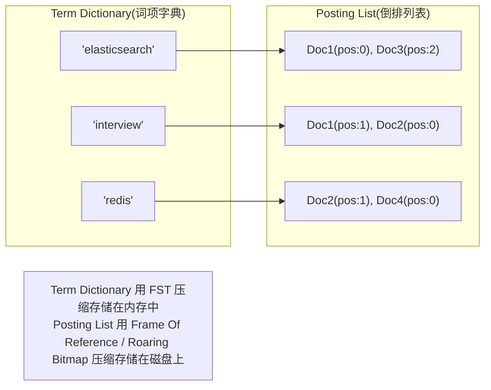
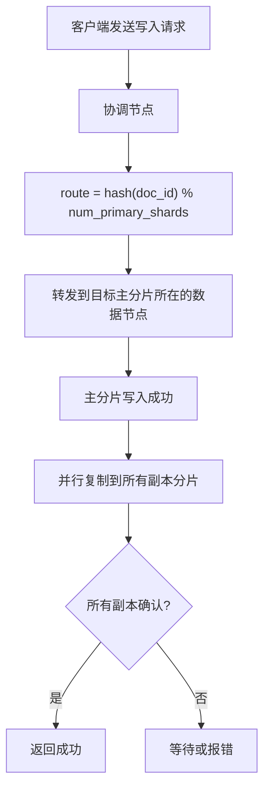
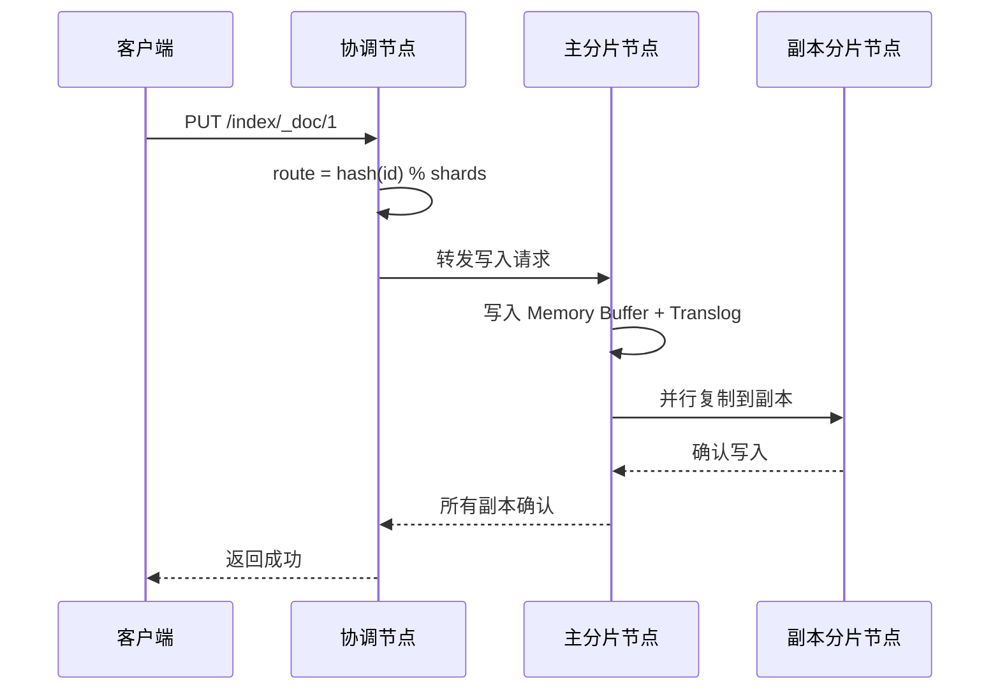
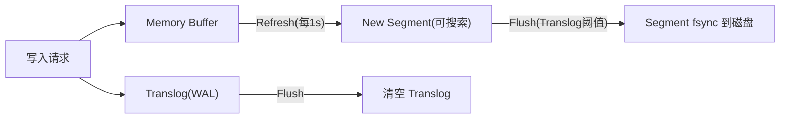
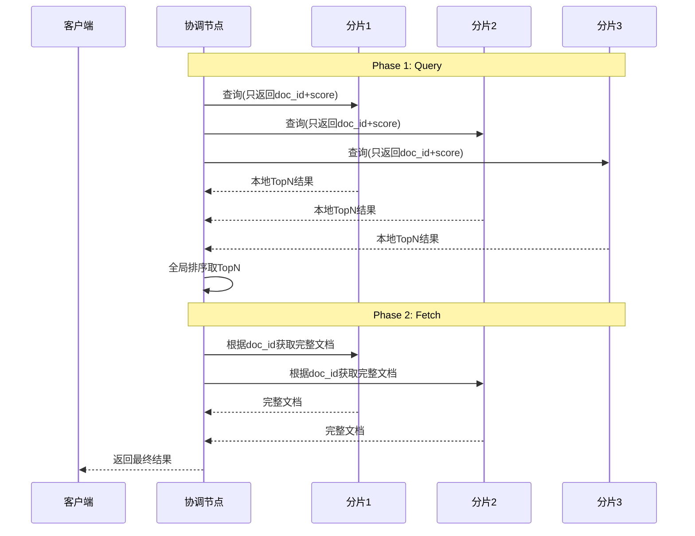

# Elasticsearch 面试常问知识点总结

## 核心知识全览



> 💡 **阅读指引**：本文按"**核心概念 → 集群架构 → 写入流程 → 搜索流程 → 相关性评分 → 缓存机制 → 深度分页 → 性能优化 → 集群运维**"的线性路径展开。面试时可按需跳转。

---

## 一、核心概念：不只是"搜索引擎"

### 1.1 ES 是什么？

Elasticsearch 是基于 **Apache Lucene** 构建的分布式搜索与分析引擎。它不是一个简单的全文检索工具，而是一个支持**近实时搜索、聚合分析、地理空间查询**的分布式数据存储系统。

| 维度 | 传统关系型数据库 | Elasticsearch |
| :--- | :--- | :--- |
| **数据模型** | 行/列（二维表） | JSON 文档（半结构化） |
| **索引结构** | B+树 | 倒排索引 + Doc Values |
| **擅长场景** | 精确查询、事务、关联查询 | 全文检索、模糊匹配、聚合分析 |
| **一致性** | ACID | BASE（最终一致） |
| **扩展方式** | 垂直扩展为主 | 水平扩展（加节点加分片） |

### 1.2 核心术语对照

| ES 术语 | 类比 RDBMS | 说明 |
| :--- | :--- | :--- |
| **Index** | Table | 一类文档的集合 |
| **Document** | Row | 一条 JSON 数据 |
| **Field** | Column | 文档中的一个字段 |
| **Mapping** | Schema | 定义字段的类型和分析器 |
| **Shard** | — | 数据的水平分片，是存储和检索的基本单元 |
| **Type** ⚠️ | — | 7.x 已废弃，一个 Index 只能有一种文档类型 |

> ⚠️ **重要变更**：ES 7.x 起每个 Index 只允许一个 `_doc` 类型，8.x 彻底移除 Type 概念。面试中提到 Type 要说明版本差异。

### 1.3 倒排索引：ES 快的根本原因

这是 ES 最核心的数据结构，必须理解透彻。

#### 正排索引 vs 倒排索引

| 索引类型 | 结构 | 用途 | 示例 |
| :--- | :--- | :--- | :--- |
| **正排索引** | doc_id -> field_value | 根据 ID 查内容 | `doc1 -> "hello world"` |
| **倒排索引** | term -> [doc_id, position, ...] | 根据关键词查文档 | `"hello" -> [doc1:pos0, doc3:pos5]` |

#### 倒排索引的结构



| 组件 | 作用 | 存储位置 |
| :--- | :--- | :--- |
| **Term Dictionary** | 所有去重后的词项及其元数据 | 内存（FST 压缩） |
| **Term Index** | Term Dictionary 的前缀索引，加速定位 | 内存 |
| **Posting List** | 包含该词项的所有文档 ID、位置、频率等 | 磁盘（压缩编码） |

> 💡 **为什么快？** 搜索 "elasticsearch interview" 时，ES 分别从两个词的 Posting List 中取出文档 ID 列表，然后做**交集运算**（用 Roaring Bitmap 高效完成），而不是扫描所有文档。这就是倒排索引的核心优势。

### 1.4 Doc Values：排序和聚合的秘密

倒排索引擅长"根据词找文档"，但不擅长"根据文档取字段值"（比如排序、聚合）。ES 用 **Doc Values** 解决这个问题：

| 维度 | 倒排索引 | Doc Values |
| :--- | :--- | :--- |
| **结构** | term -> doc_ids | doc_id -> field_value |
| **用途** | 搜索、匹配 | 排序、聚合、脚本访问 |
| **存储** | 行式（按 term 组织） | 列式（按 doc 组织） |
| **加载** | 按需加载到内存 | 按需 mmap 到内存 |

> 💡 **text 字段没有 Doc Values**。如果你需要对一个字段既做全文搜索又做聚合，需要设置 `fields` 多字段映射：text 类型用于搜索，keyword 子字段（有 Doc Values）用于聚合。

### 1.5 面试话术

> "ES 的核心是倒排索引：Term Dictionary 用 FST 压缩存内存，Posting List 用 Roaring Bitmap 压缩存磁盘。搜索时对多个词的 Posting List 做交集运算，避免全量扫描。排序和聚合靠 Doc Values（列式存储），text 字段没有 Doc Values，需要用 keyword 子字段。"

---

## 二、集群架构：节点、分片与副本

### 2.1 节点类型

| 节点类型 | 职责 | 配置建议 |
| :--- | :--- | :--- |
| **Master Node** | 管理集群元数据（创建/删除索引、分片分配） | 轻量级任务，不要存大量数据 |
| **Data Node** | 存储数据、执行 CRUD 和搜索 | 大内存、高速磁盘 |
| **Coordinating Node** | 接收请求、分发到各节点、汇总结果 | 所有节点默认都是协调节点 |
| **Ingest Node** | 数据预处理（Pipeline） | 可选，复杂 ETL 时独立部署 |

> ⚠️ **生产建议**：Master 节点独立部署（至少 3 个防脑裂），不要和数据节点混部。Master 节点只做轻量级集群管理，不承担数据读写压力。

### 2.2 分片（Shard）

分片是 ES 数据水平扩展的基本单元：

| 概念 | 说明 |
| :--- | :--- |
| **Primary Shard** | 主分片，数据写入的入口。数量在创建索引时确定，**不可更改** |
| **Replica Shard** | 副本分片，主分片的完整拷贝。提供高可用和读扩展 |
| **分片大小建议** | 单个分片 10GB ~ 50GB，过大恢复慢，过小开销大 |
| **分片数量建议** | 单节点分片数不超过每 GB 堆内存 20 个 |

### 2.3 分片分配与路由



> 💡 **自定义路由**：写入时可以指定 `routing` 参数，让相关文档落到同一分片。这对"按用户 ID 查询"等场景很有用，可以避免跨分片查询。

### 2.4 脑裂问题

当网络分区导致集群分裂成多个子集群时，每个子集群可能各自选出 Master，产生数据不一致——这就是**脑裂**。

| 解决方案 | 说明 |
| :--- | :--- |
| **discovery.zen.minimum_master_nodes**（6.x 及以前） | 设置为 `(master_eligible_nodes / 2) + 1`，确保多数派才能选主 |
| **cluster.initial_master_nodes**（7.x+） | 启动时指定初始 Master 候选列表，7.x+ 自动处理多数派选举 |
| **专用 Master 节点** | 至少 3 个专用 Master 节点，降低脑裂概率 |

### 2.5 面试话术

> "ES 集群由 Master、Data、Coordinating、Ingest 四种节点组成。数据通过 Primary Shard 写入，并行复制到 Replica Shard。分片数量创建后不可改，单分片建议 10-50GB。脑裂通过多数派选举机制防止，7.x+ 自动处理。生产环境 Master 节点应独立部署至少 3 个。"

---

## 三、写入流程：从请求到落盘

### 3.1 写入全流程



### 3.2 Refresh 与 Flush

这是理解 ES "近实时"特性的关键：

| 操作 | 触发条件 | 行为 | 影响 |
| :--- | :--- | :--- | :--- |
| **Refresh** | 默认每 1 秒 | Memory Buffer 写入新的 Segment，变为可搜索 | 新文档最多 1 秒后可被搜到（近实时） |
| **Flush** | Translog 达到阈值或定时 | Segment fsync 到磁盘 + 清空 Translog | 数据持久化，防止宕机丢失 |



> 💡 **近实时的代价**：Refresh 每秒生成一个新 Segment，小 Segment 太多会影响搜索性能。ES 后台有 **Merge** 进程将小 Segment 合并为大 Segment，同时清理已删除文档（ES 删除是标记删除，Merge 时才真正清除）。

### 3.3 Translog 的作用

Translog 类似数据库的 WAL（Write-Ahead Log）：

- 写入时先写 Memory Buffer + Translog
- Refresh 后数据可搜索但还在 OS Page Cache 中，未 fsync
- 如果此时宕机，重启后从 Translog 重放未 fsync 的数据
- Flush 后 Translog 清空

> ⚠️ **durability 参数**：`index.translog.durability` 默认为 `request`（每次写入都 fsync Translog），保证不丢数据。设为 `async` 可提升写入性能，但可能丢少量数据。

### 3.4 面试话术

> "ES 写入流程：协调节点路由到主分片 → 写 Memory Buffer + Translog → 并行复制到副本 → 全部确认后返回。Refresh 每秒生成新 Segment 使文档可搜索（近实时），Flush 将 Segment fsync 到磁盘并清空 Translog（持久化）。删除是标记删除，Merge 时才真正清除。"

---

## 四、搜索流程：Query Then Fetch

### 4.1 两阶段搜索

ES 的分布式搜索采用 **Query Then Fetch** 两阶段模式：



| 阶段 | 做什么 | 为什么分两阶段 |
| :--- | :--- | :--- |
| **Query** | 各分片本地搜索，返回 doc_id + score | 减少网络传输（不传完整文档） |
| **Fetch** | 根据 doc_id 获取完整文档 | 只对最终需要的文档做 Fetch |

> ⚠️ **性能陷阱**：如果请求 `from=10000, size=10`，每个分片需要返回 Top 10010 条结果给协调节点排序。分片越多、翻页越深，Query 阶段的开销越大。这就是**深度分页问题**（后面详解）。

### 4.2 搜索类型

| 类型 | 说明 |
| :--- | :--- |
| **match** | 全文搜索，对查询文本做分词后匹配 |
| **term** | 精确匹配，不分词（用于 keyword、numeric 等字段） |
| **bool** | 组合查询：must / should / must_not / filter |
| **range** | 范围查询（日期、数值） |
| **aggs** | 聚合分析（terms、histogram、date_histogram 等） |

### 4.3 match vs term 的区别

这是面试高频考点：

| 维度 | match | term |
| :--- | :--- | :--- |
| **是否分词** | ✅ 对查询文本分词 | ❌ 不分词，原样匹配 |
| **适用字段** | text | keyword, numeric, date |
| **示例** | `match: {"title": "Redis Interview"}` → 搜 "redis" OR "interview" | `term: {"status": "published"}` → 精确匹配 "published" |
| **常见错误** | — | 对 text 字段用 term 搜不到（因为 text 字段存储的是分词后的 term） |

> 💡 **黄金法则**：全文搜索用 match，精确过滤用 term。对 text 字段永远不要用 term 查询。

### 4.4 bool 查询中的 filter vs must

| 子句 | 参与评分 | 缓存 | 用途 |
| :--- | :--- | :--- | :--- |
| **must** | ✅ | ❌ | 必须匹配且影响相关性 |
| **filter** | ❌ | ✅ | 必须匹配但不影响相关性，结果被缓存 |
| **should** | ✅ | ❌ | 应该匹配，提升相关性 |
| **must_not** | ❌ | ✅ | 必须不匹配 |

> 💡 **最佳实践**：不需要评分的条件（如状态过滤、时间范围）放在 filter 中，享受缓存加速。只有需要影响排序的条件才放 must/should。

### 4.5 面试话术

> "ES 搜索分两阶段：Query 阶段各分片返回 doc_id+score，协调节点全局排序；Fetch 阶段获取完整文档。match 对查询文本分词做全文搜索，term 不分词做精确匹配。bool 查询中 filter 不参与评分且结果被缓存，适合做条件过滤；must 参与评分，适合做相关性匹配。"

---

## 五、相关性评分：BM25

### 5.1 从 TF-IDF 到 BM25

ES 5.0 之前用 TF-IDF，5.0+ 默认用 **BM25**：

| 维度 | TF-IDF | BM25 |
| :--- | :--- | :--- |
| **TF（词频）** | 词频越高分数越高（无上限） | 词频有饱和效应（出现 100 次不比 10 次高多少） |
| **IDF（逆文档频率）** | 相同 | 相同：词越罕见权重越高 |
| **文档长度归一化** | 简单归一化 | 更精细的长度归一化参数 |
| **实际效果** | 长文档中重复词会导致分数虚高 | 更符合人类直觉 |

### 5.2 BM25 的核心思想（通俗版）

一个文档和查询的相关性取决于三个因素：

1. **词频（TF）**：这个词在文档中出现了几次？但出现太多次也不会无限加分（饱和效应）
2. **逆文档频率（IDF）**：这个词在所有文档中有多罕见？越罕见的词权重越高
3. **文档长度**：短文档中出现一次比长文档中出现一次更有意义

### 5.3 如何干预评分？

| 方法 | 说明 | 使用场景 |
| :--- | :--- | :--- |
| **boost** | 给特定字段加权 | 标题比正文更重要 |
| **function_score** | 自定义评分函数 | 结合业务指标（销量、热度） |
| **constant_score** | 固定分数 | 纯过滤不需要评分时 |
| **rescore** | 二次打分 | 先用简单查询召回，再用复杂模型精排 |

### 5.4 面试话术

> "ES 5.0+ 默认用 BM25 评分，相比 TF-IDF 增加了词频饱和效应和更精细的长度归一化，避免长文档中重复词导致分数虚高。可以通过 boost 给字段加权、function_score 自定义评分、rescore 二次打分来干预相关性。"

---

## 六、缓存机制

### 6.1 ES 的三层缓存

| 缓存层 | 内容 | 生命周期 | 作用 |
| :--- | :--- | :--- | :--- |
| **Node Query Cache** | filter 查询的结果（BitSet） | 节点级别，LRU 淘汰 | 加速重复的 filter 查询 |
| **Shard Request Cache** | 整个搜索请求的结果（含聚合） | 分片级别，Refresh 后失效 | 加速完全相同的搜索请求 |
| **Filesystem Cache (OS)** | Segment 文件、Doc Values | OS 管理 | 加速磁盘读取 |

> 💡 **关键区别**：
> - **Query Cache** 缓存的是 filter 子句的结果（BitSet），不是整个查询结果
> - **Request Cache** 缓存的是整个请求的结果，但只在 `size=0`（纯聚合）时生效
> - 两者都在 Refresh 后自动失效（因为数据变了）

### 6.2 缓存的最佳实践

| 做法 | 原因 |
| :--- | :--- |
| 过滤条件放 filter 而非 must | filter 结果被 Query Cache 缓存 |
| 避免在 filter 中使用高基数字段 | 如 user_id，缓存命中率极低 |
| 纯聚合查询设 `size: 0` | 命中 Request Cache |
| 合理设置 Refresh 间隔 | 频繁 Refresh 导致缓存频繁失效 |

### 6.3 面试话术

> "ES 有三层缓存：Node Query Cache 缓存 filter 结果的 BitSet，Shard Request Cache 缓存纯聚合请求结果，OS Filesystem Cache 缓存 Segment 文件。filter 子句的结果会被缓存，所以过滤条件应放 filter 而非 must。缓存都在 Refresh 后失效。"

---

## 七、深度分页问题

### 7.1 问题本质

请求 `from=10000, size=10` 时，每个分片需要返回 Top 10010 条结果，协调节点需要从 `分片数 x 10010` 条结果中排序取 Top 10。

| from + size | 5 分片时协调节点处理量 | 问题 |
| :--- | :--- | :--- |
| 10 | 50 | 正常 |
| 1000 | 5000 | 开始变慢 |
| 10000 | 50050 | 明显延迟 |
| 100000 | 500050 | 可能 OOM |

> ⚠️ ES 默认限制 `max_result_window = 10000`，超过会直接报错。这不是 bug，是保护机制。

### 7.2 解决方案对比

| 方案 | 原理 | 优点 | 缺点 | 适用场景 |
| :--- | :--- | :--- | :--- | :--- |
| **search_after** ⭐️ | 用上一页最后一条的 sort value 作为下一页起点 | 无状态、性能稳定 | 只能向后翻，不能跳页 | 无限滚动、日志浏览 |
| **scroll** | 创建快照上下文，保持搜索结果不变 | 支持遍历全量数据 | 占用资源，不适合实时搜索 | 数据导出、批量处理 |
| **PIT + search_after** | Point In Time 快照 + search_after | 一致性视图 + 高性能 | 7.10+ 才有 | 需要一致性视图的分页 |

### 7.3 search_after 示例

```json
// 第一页
GET /orders/_search
{
  "size": 10,
  "sort": [{"created_at": "desc"}, {"_id": "asc"}]
}

// 第二页：用上一页最后一条的 sort 值
GET /orders/_search
{
  "size": 10,
  "search_after": ["2024-01-15T10:30:00Z", "order_12345"],
  "sort": [{"created_at": "desc"}, {"_id": "asc"}]
}
```

> 💡 **sort 必须包含唯一值**（如 `_id`），否则相同 sort value 的文档可能丢失或重复。

### 7.4 面试话术

> "深度分页问题是 from+size 过大时每个分片返回大量结果导致协调节点压力剧增。ES 默认限制 max_result_window=10000。解决方案：实时搜索用 search_after（无状态、性能稳定），数据导出用 scroll（快照上下文），7.10+ 可用 PIT+search_after 获得一致性视图。禁止用 from+size 做深度翻页。"

---

## 八、性能优化

### 8.1 写入性能优化

| 优化手段 | 说明 | 注意事项 |
| :--- | :--- | :--- |
| **批量写入（Bulk API）** | 单次请求包含多条操作，减少网络开销 | 单批 5-15MB，过大会增加内存压力 |
| **增大 Refresh 间隔** | `index.refresh_interval: 30s` | 牺牲近实时性换写入吞吐 |
| **增大 Translog 刷盘间隔** | `translog.durability: async` + `sync_interval: 30s` | 可能丢少量数据 |
| **调大 indexing buffer** | `indices.memory.index_buffer_size` | 占用更多堆内存 |
| **关闭副本再写入** | 写入完成后恢复副本 | 适合大批量导入 |
| **使用自动生成 ID** | 避免版本查找开销 | 业务允许时用 |

### 8.2 查询性能优化

| 优化手段 | 说明 |
| :--- | :--- |
| **filter 代替 must** | filter 不参与评分且结果被缓存 |
| **避免 wildcard 前缀通配** | `*keyword` 无法利用倒排索引，全量扫描 |
| **避免 deep paging** | 用 search_after 替代 from+size |
| **路由（routing）** | 相关数据落同一分片，减少跨分片查询 |
| **预计算聚合结果** | 写入时计算好存入文档，查询时直接读取 |
| **合理设置分片数** | 过多分片增加协调开销，过少限制并发 |
| **使用 profile API** | 分析查询耗时瓶颈 |

### 8.3 JVM 与系统调优

| 配置 | 建议值 | 原因 |
| :--- | :--- | :--- |
| **JVM Heap** | 不超过物理内存 50%，且不超过 32GB | 剩余内存留给 OS Filesystem Cache |
| **GC** | G1GC（7.x+默认） | 低停顿，适合大堆 |
| **Swap** | 禁用 | Swap 会导致性能断崖式下降 |
| **mmapfs** | 确保 `vm.max_map_count >= 262144` | ES 大量使用 mmap 映射 Segment 文件 |

> 💡 **32GB 压缩指针阈值**：JVM 堆小于 32GB 时使用压缩普通对象指针（Compressed Oops），每个引用占 4 字节；超过 32GB 则用 8 字节，实际可用内存反而更少。所以堆不要设超过 31GB。

### 8.4 面试话术

> "写入优化：Bulk API 批量写入、增大 Refresh 间隔、异步 Translog、自动生成 ID。查询优化：filter 代替 must、避免前缀通配、search_after 替代深度分页、routing 减少跨分片。JVM 堆不超过物理内存 50% 且不超 32GB，剩余内存留给 OS 文件系统缓存。禁用 Swap。"

---

## 九、集群运维与健康状态

### 9.1 集群健康状态

| 状态 | 含义 | 是否需要处理 |
| :--- | :--- | :--- |
| **Green** ✅ | 所有主分片和副本分片都正常 | 无需处理 |
| **Yellow** ⚠️ | 所有主分片正常，但有副本分片未分配 | 数据不丢但无冗余，尽快修复 |
| **Red** 🔴 | 有主分片未分配 | 部分数据不可用，紧急处理 |

### 9.2 常见运维操作

| 操作 | 命令/说明 |
| :--- | :--- |
| **查看集群健康** | `GET _cluster/health` |
| **查看未分配分片原因** | `GET _cluster/allocation/explain` |
| **手动重新分配分片** | `POST _cluster/reroute` |
| **滚动重启** | 先禁用分片分配 → flush → 停节点 → 升级 → 启节点 → 恢复分配 |
| **索引生命周期管理（ILM）** | 自动 Hot-Warm-Cold-Delete 流转 |

### 9.3 Hot-Warm-Cold 架构


| 层级 | 硬件 | 数据特征 | 用途 |
| :--- | :--- | :--- | :--- |
| **Hot** | SSD、高 CPU | 近期数据、高频读写 | 实时搜索、写入 |
| **Warm** | HDD、中等配置 | 历史数据、低频查询 | 归档查询 |
| **Cold** | 大容量 HDD / 对象存储 | 冷数据、极少查询 | 合规留存 |

> 💡 **ILM（Index Lifecycle Management）** 可以自动将索引在各层之间流转，无需手动操作。配合 Rollup 和 Snapshot 可进一步降低成本。

### 9.4 面试话术

> "ES 集群健康分 Green/Yellow/Red 三级：Green 全正常，Yellow 副本缺失，Red 主分片缺失。运维要点：滚动重启时先禁用分片分配再操作；用 ILM 实现 Hot-Warm-Cold 自动流转降低存储成本；JVM 堆不超 32GB，剩余内存留给文件系统缓存。"

---

## 十、面试高频问题速答

### Q1：ES 为什么这么快？

① 倒排索引避免全量扫描，Term Dictionary 在内存中用 FST 压缩；② Posting List 用 Roaring Bitmap 压缩，交集运算极快；③ 分布式分片并行搜索；④ 多层缓存（Query Cache + Request Cache + OS Filesystem Cache）；⑤ Doc Values 列式存储加速排序聚合。

### Q2：ES 如何实现近实时搜索？

写入后数据进入 Memory Buffer，默认每 1 秒 Refresh 生成新 Segment 变为可搜索。Refresh 不是 fsync，数据还在 OS Page Cache 中。Flush 才真正持久化到磁盘。近实时的代价是小 Segment 多，后台 Merge 进程负责合并。

### Q3：ES 如何保证数据不丢失？

写入时同时写 Memory Buffer 和 Translog（WAL）。即使 Refresh 后未 Flush 就宕机，重启后从 Translog 重放未持久化的数据。`translog.durability=request`（默认）保证每次写入都 fsync Translog。

### Q4：深度分页怎么解决？

禁止用 from+size 做深度翻页（默认限制 10000）。实时搜索用 search_after（无状态、性能稳定），数据导出用 scroll（快照上下文），7.10+ 用 PIT+search_after 获得一致性视图。

### Q5：ES 集群 Yellow/Red 怎么处理？

Yellow：检查副本分片未分配原因（`_cluster/allocation/explain`），通常是节点不足或磁盘水位线触发。Red：主分片未分配，可能有数据丢失，优先恢复节点或从快照恢复。日常监控集群健康，设置告警。

### Q6：ES 和 Solr 怎么选？

ES：近实时搜索、分布式能力强、生态丰富（ELK Stack）、社区活跃、云原生友好。Solr：传统全文检索强、单机性能好、配置灵活。新项目选 ES，已有 Solr 且满足需求可不迁移。

### Q7：text 和 keyword 的区别？

text：分词、支持全文搜索、无 Doc Values、不能排序聚合。keyword：不分词、精确匹配、有 Doc Values、可排序聚合。需要同时搜索和聚合时用 fields 多字段映射。

---

## 小结

- **核心概念**：倒排索引是快的根本，Doc Values 支撑排序聚合，text/keyword 分工明确
- **集群架构**：Master/Data/Coordinating 节点分离，分片水平扩展，多数派选举防脑裂
- **写入流程**：Memory Buffer → Refresh → Segment → Flush → 持久化，Translog 保证不丢数据
- **搜索流程**：Query Then Fetch 两阶段，filter 缓存加速，match vs term 别搞混
- **相关性评分**：BM25 替代 TF-IDF，词频饱和效应更符合直觉
- **缓存机制**：Query Cache 缓存 filter 结果，Request Cache 缓存纯聚合，Refresh 后失效
- **深度分页**：search_after 是标准解法，禁止 from+size 深度翻页
- **性能优化**：写入靠 Bulk + 调 Refresh，查询靠 filter + routing，JVM 堆不超 32GB
- **集群运维**：Green/Yellow/Red 三级健康，ILM 实现 Hot-Warm-Cold 自动流转

> 💡 **记忆口诀**：**ES快在倒排索引，FST词典Bitmap表；Refresh秒级近实时，Translog兜底不丢数；Query Fetch两阶段，filter缓存must评分；BM25词频有饱和，深度分页search_after；JVM堆留半给OS，Hot Warm Cold自动转**。
