hai'y# MySQL 面试常问知识点总结

## 核心知识全览

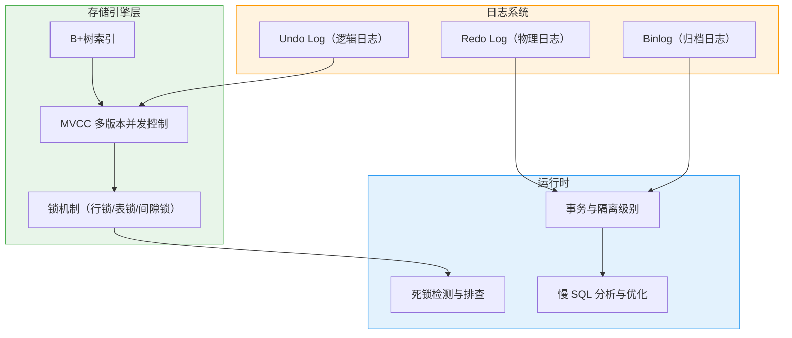

> 💡 **阅读指引**：本文按"**索引 → MVCC → 日志 → 锁 → 死锁 → 事务 → 慢SQL**"的线性路径展开，每个章节独立成章、职责单一。面试时可按需跳转，不必从头读到尾。

---

## 一、B+树与索引基础

### 1.1 为什么用 B+树而不是 B树/Hash/红黑树？

| 数据结构 | 查找复杂度 | 磁盘IO次数 | 范围查询 | 排序 | 适用场景 |
| :--- | :--- | :--- | :--- | :--- | :--- |
| **Hash** | O(1) | 1次 | ❌ 不支持 | ❌ 无序 | 等值查询（Memory引擎） |
| **红黑树** | O(logN) | 树高次 | ✅ 支持 | ✅ 有序 | 内存中（Java TreeMap） |
| **B树** | O(logN) | 树高次 | ✅ 支持 | ✅ 有序 | 早期文件系统 |
| **B+树** ⭐️ | O(logN) | 树高次（更矮） | ✅ 叶子链表 | ✅ 叶子有序 | **InnoDB 默认索引** |

#### B+树的核心优势


| 优势 | 说明 |
| :--- | :--- |
| **更矮** | 内部节点不存数据，单页能放更多键，树高通常只有 3-4 层 → **更少磁盘 IO** |
| **范围查询快** | 叶子节点通过双向链表串联，找到起点后顺序扫描即可 |
| **排序天然支持** | 叶子节点按键有序排列，ORDER BY 可直接利用索引 |
| **全表扫描稳定** | 只需遍历叶子链表，不受内部节点影响 |

> 💡 **关键数字**：InnoDB 默认页大小 16KB，主键为 BIGINT 时，单个内部节点可容纳约 1200 个键。**3 层 B+树可存储约 2000万行数据**，查找只需 3 次磁盘 IO。

### 1.2 聚簇索引 vs 二级索引

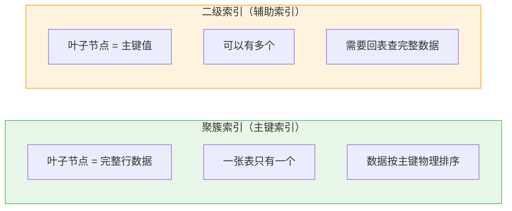

| 维度 | 聚簇索引 | 二级索引 |
| :--- | :--- | :--- |
| **叶子存什么** | 完整行数据 | 索引列值 + 主键值 |
| **数量** | 有且仅有一个 | 可以多个 |
| **查询特点** | 直接拿到数据 | 先查到主键，再**回表**查聚簇索引 |
| **选择规则** | 主键 > 唯一非空索引 > 隐藏 rowid | CREATE INDEX 创建的索引 |

#### 回表与覆盖索引

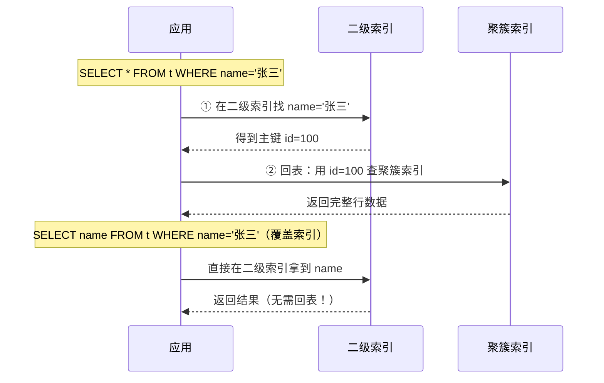

> 💡 **覆盖索引**：查询的列全部包含在索引中，无需回表。这是**最重要的索引优化手段之一**。`EXPLAIN` 中 `Extra: Using index` 表示命中覆盖索引。

#### 索引条件下推（ICP）

ICP（Index Condition Pushdown）是 MySQL 5.6+ 引入的优化机制，核心思想是：**把原本在 Server 层做的 WHERE 条件过滤，下推到存储引擎层，在索引遍历过程中就提前过滤掉不满足条件的行，从而减少回表次数**。

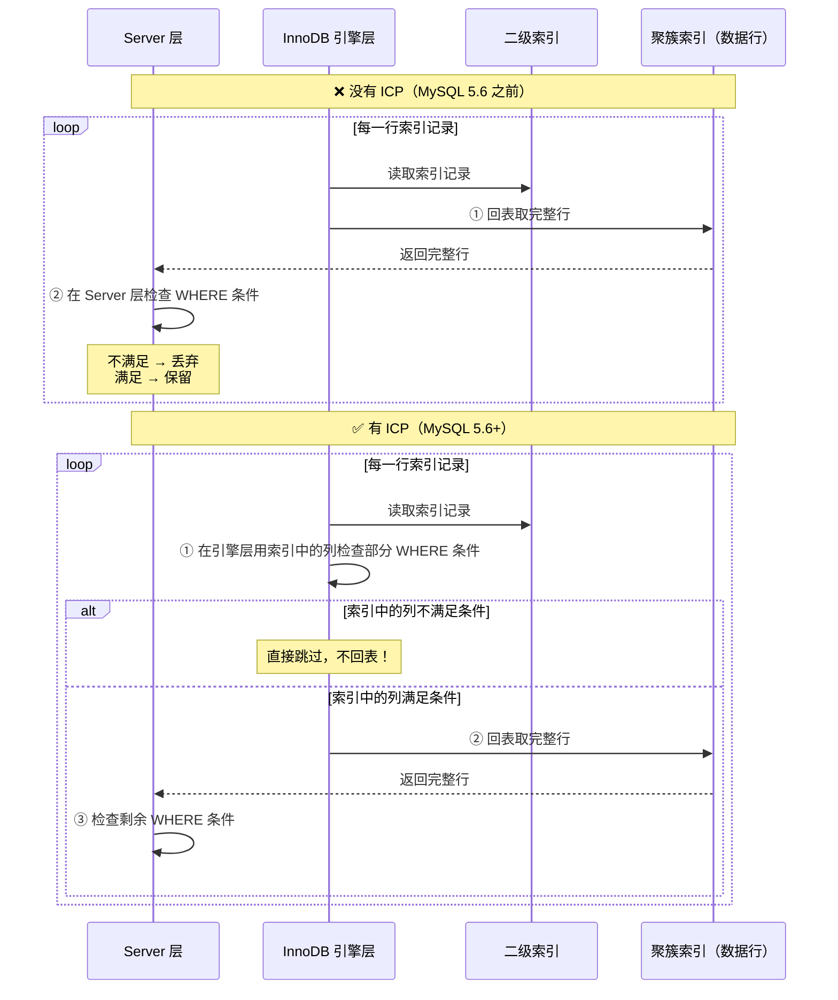

**具体例子**：

```sql
-- 表结构：users(id PK, name, age, city)
-- 索引：idx_name_age(name, age)

SELECT * FROM users WHERE name LIKE '张%' AND age > 20;
```

| 阶段 | 没有 ICP | 有 ICP |
| :--- | :--- | :--- |
| 索引扫描 | 找到所有 `name LIKE '张%'` 的记录 | 同左 |
| 过滤 `age > 20` | 每行回表，Server 层检查 age | **age 在索引中！** 引擎层直接检查 age > 20，不满足的跳过不回表 |
| 回表次数 | = 匹配 name 的行数 | = 同时匹配 name 和 age 的行数（**大幅减少**） |

| 要点 | 说明 |
| :--- | :--- |
| **前提** | WHERE 条件中的列必须**存在于当前使用的索引中** |
| **效果** | 减少回表次数，不是减少索引扫描行数 |
| **EXPLAIN 标志** | `Extra: Using index condition` |
| **版本** | MySQL 5.6+ 默认开启 |
| **vs 覆盖索引** | 覆盖索引是**完全不需要回表**；ICP 是**减少回表次数**，仍可能需要回表 |

> 💡 **三者关系**：**覆盖索引（零回表）> ICP（减少回表）> 普通回表（每行都回表）**。优化优先级：先争取覆盖索引，做不到再争取 ICP，最后才接受全量回表。

### 1.3 最左前缀原则

联合索引 `(a, b, c)` 的 B+树按 `a → b → c` 排序：

| 查询条件 | 能否走索引 | 原因 |
| :--- | :--- | :--- |
| `WHERE a=1` | ✅ | 匹配最左列 |
| `WHERE a=1 AND b=2` | ✅ | 连续匹配前两列 |
| `WHERE a=1 AND b=2 AND c=3` | ✅ | 全部匹配 |
| `WHERE a=1 AND c=3` | ⚠️ 部分 | a 走索引，c 不走（b 缺失，c 无序） |
| `WHERE b=2` | ❌ | 缺少最左列 a |
| `WHERE a=1 ORDER BY b` | ✅ | a 等值 + b 排序，可利用索引排序 |
| `WHERE a=1 ORDER BY c` | ❌ | b 缺失，c 在索引中无序 |

> ⚠️ **MySQL 8.0+ 优化器增强**：即使不满足最左前缀，优化器也可能使用 **Index Skip Scan** 或 **Index Condition Pushdown (ICP)** 来部分利用索引。但面试时仍以经典最左前缀为准，实际开发中以 `EXPLAIN` 结果为准。

### 1.4 索引失效的常见场景

| 场景 | 示例 | 原因 |
| :--- | :--- | :--- |
| **函数/表达式包裹** | `WHERE YEAR(create_time)=2024` | 无法利用索引有序性 |
| **隐式类型转换** | `WHERE phone=13800138000`（phone 是 VARCHAR） | 字符串转数字，索引失效 |
| **LIKE 左模糊** | `WHERE name LIKE '%张'` | 前缀不确定，无法定位 |
| **OR 连接非索引列** | `WHERE a=1 OR b=2`（b 无索引） | 全表扫描更安全 |
| **!= / NOT IN** | `WHERE status != 0` | 优化器认为全表扫描更快 |
| **联合索引跳列** | `WHERE a=1 AND c=3`（缺 b） | c 在索引中无序 |

> 💡 **研发日常**：写完 SQL 务必 `EXPLAIN` 确认走了预期索引。索引不是越多越好，每个索引都有写入和空间成本。**一般单表索引不超过 5-6 个**。

### 1.5 面试话术

> "InnoDB 使用 B+树作为索引结构，相比 B树，内部节点不存数据所以更矮，减少磁盘 IO；叶子节点通过链表串联，支持高效范围查询。聚簇索引叶子存完整行数据，二级索引叶子存主键值，查询时需回表；如果查询列全在索引中则为覆盖索引，无需回表。联合索引遵循最左前缀原则，函数包裹、隐式转换、左模糊等会导致索引失效。"

---

## 二、MVCC：多版本并发控制

### 2.1 MVCC 解决什么问题？

在没有 MVCC 的世界里，读写互斥：读要加锁等写释放，写要加锁等读释放。MVCC 的核心价值是：**读不加锁，读写不冲突**，大幅提升并发性能。

### 2.2 核心组件

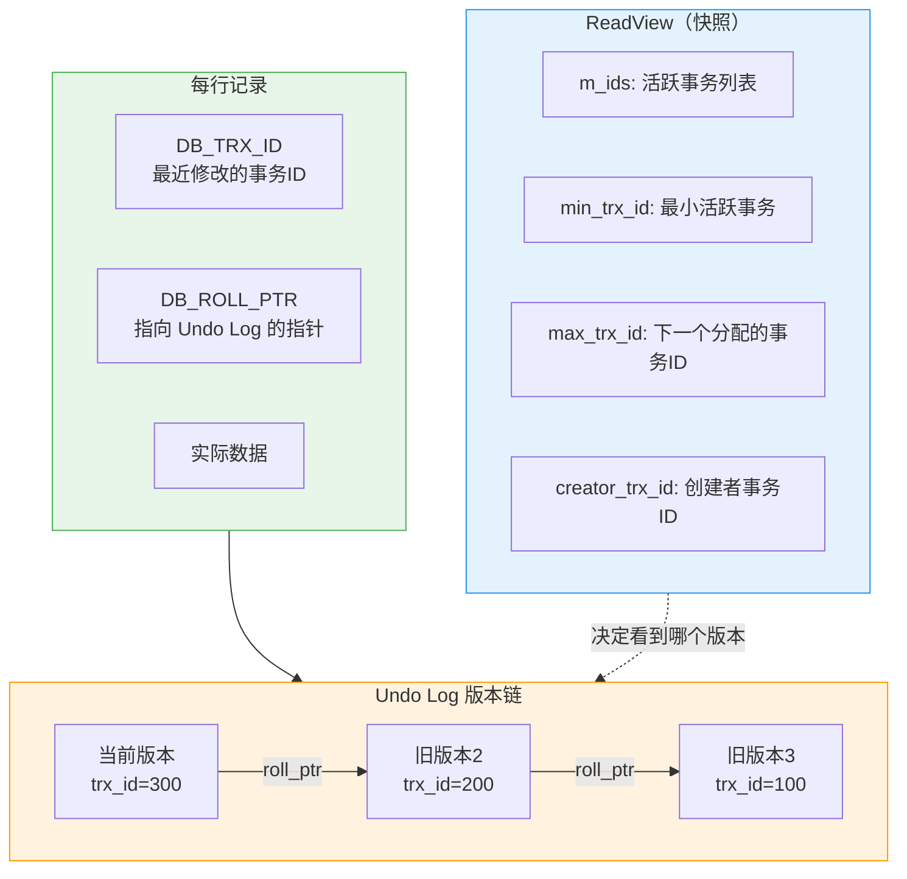

| 组件 | 作用 |
| :--- | :--- |
| **隐藏字段** | 每行记录有 `DB_TRX_ID`（最后修改的事务ID）和 `DB_ROLL_PTR`（指向 undo log 的指针） |
| **Undo Log 版本链** | 每次 UPDATE/DELETE 都把旧版本写入 undo log，通过 roll_ptr 串成链表 |
| **ReadView** | 事务读取时创建的"快照"，记录当前活跃事务列表，决定能看到哪个版本 |

### 2.3 ReadView 的可见性判断规则

当事务读取一行时，沿版本链从最新版本往旧版本遍历，对每个版本执行以下判断：

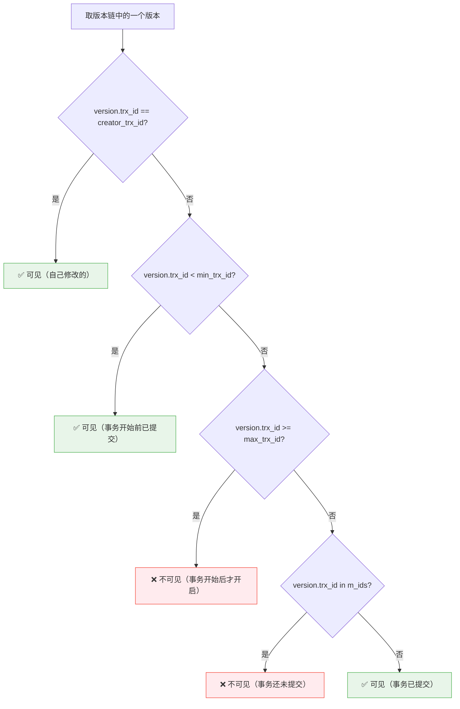

> 💡 **简化记忆**：版本的事务ID **小于 min_trx_id** 或在 **m_ids 之外且小于 max_trx_id** → 可见；否则不可见，继续沿版本链找更早的版本。

### 2.4 RC vs RR 的本质区别

| 隔离级别 | ReadView 创建时机 | 效果 |
| :--- | :--- | :--- |
| **Read Committed (RC)** | **每次 SELECT 都创建新 ReadView** | 能看到其他事务已提交的最新数据 → **不可重复读** |
| **Repeatable Read (RR)** | **只在第一次 SELECT 时创建 ReadView** | 整个事务期间看到的快照一致 → **可重复读** |

#### RR 隔离级别下的执行流程

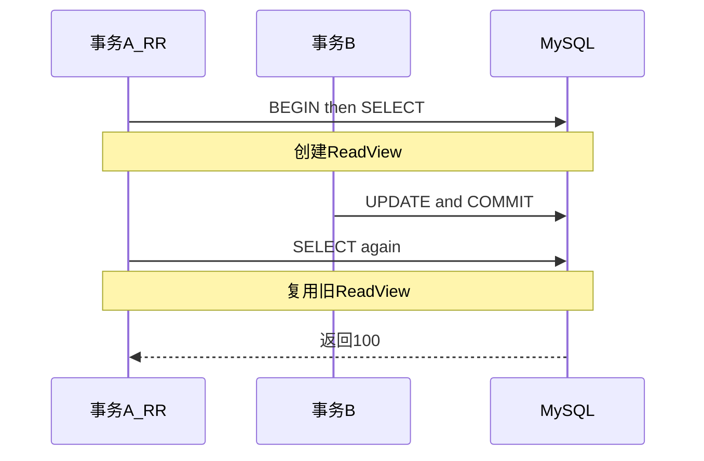

#### RC 隔离级别下的执行流程


### 2.5 MVCC 能完全避免幻读吗？

**不能**。MVCC 只能避免**快照读**（普通 SELECT）的幻读。对于**当前读**（SELECT FOR UPDATE / INSERT / UPDATE / DELETE），仍需依赖 **Next-Key Lock（间隙锁+记录锁）** 来防止其他事务在范围内插入新行。

> 💡 **RR 级别下防幻读的完整方案**：快照读靠 MVCC，当前读靠 Next-Key Lock。两者配合才能实现完整的可重复读语义。

### 2.6 面试话术

> "MVCC 通过隐藏字段（DB_TRX_ID、DB_ROLL_PTR）+ Undo Log 版本链 + ReadView 实现多版本并发控制。读取时沿版本链找到第一个对当前 ReadView 可见的版本，实现读不加锁。RC 每次 SELECT 创建新 ReadView，RR 只在首次 SELECT 创建并复用，这就是两者隔离级别差异的本质。MVCC 只解决快照读的幻读，当前读的幻读需要 Next-Key Lock 配合。"

---

## 三、日志系统：Redo Log / Undo Log / Binlog

### 3.1 三种日志的定位

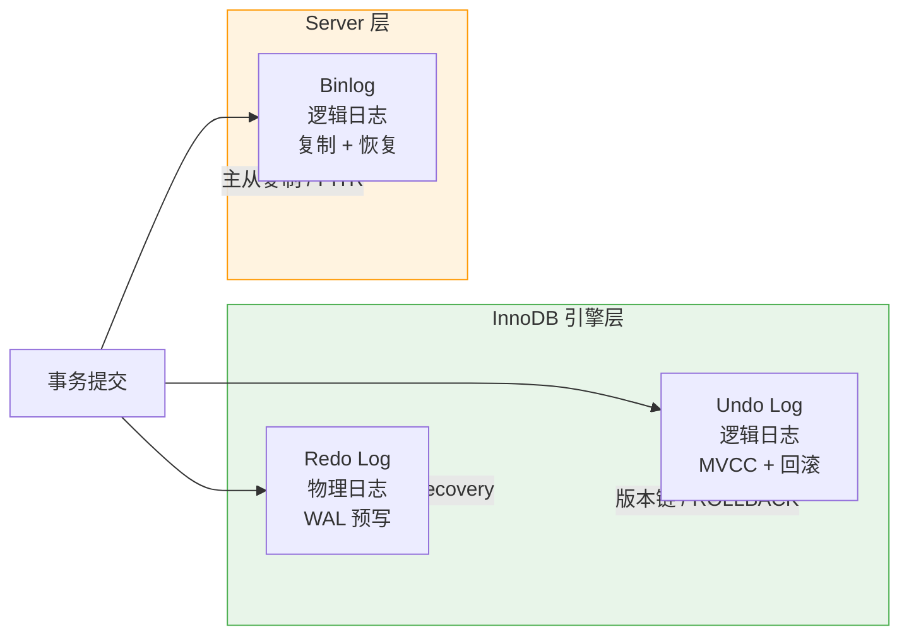

| 维度 | Redo Log | Undo Log | Binlog |
| :--- | :--- | :--- | :--- |
| **归属** | InnoDB 引擎层 | InnoDB 引擎层 | Server 层 |
| **日志内容** | 物理操作（"在页X偏移Y处写了Z"） | 逻辑操作（"将id=1的balance从100改为200"） | 逻辑操作（SQL 或行变更） |
| **用途** | **崩溃恢复**（crash-safe） | **事务回滚 + MVCC 版本链** | **主从复制 + 时间点恢复** |
| **写入时机** | 事务执行过程中持续写入 | 事务执行过程中持续写入 | 事务提交时写入 |
| **文件格式** | 循环写（固定大小，首尾相连） | 追加写 | 追加写 |
| **刷盘策略** | `innodb_flush_log_at_trx_commit` | 随脏页刷盘 | `sync_binlog` |

### 3.2 Redo Log：崩溃恢复的保障

#### WAL（Write-Ahead Logging）原则

> **先写日志，再写磁盘**。即使数据库崩溃，也能通过 redo log 重做未刷盘的修改，保证已提交事务不丢失。数据页可以丢（异步刷盘），但 redo log 不能丢（提交时同步 fsync）。WAL 的核心思想就是：只要你保证 redo log 在事务提交时一定落盘，数据页什么时候刷盘都无所谓——因为崩溃后可以用 redo log 重建所有已提交的修改。这就是为什么叫 Write-Ahead Logging（预写日志）：日志永远走在数据前面。

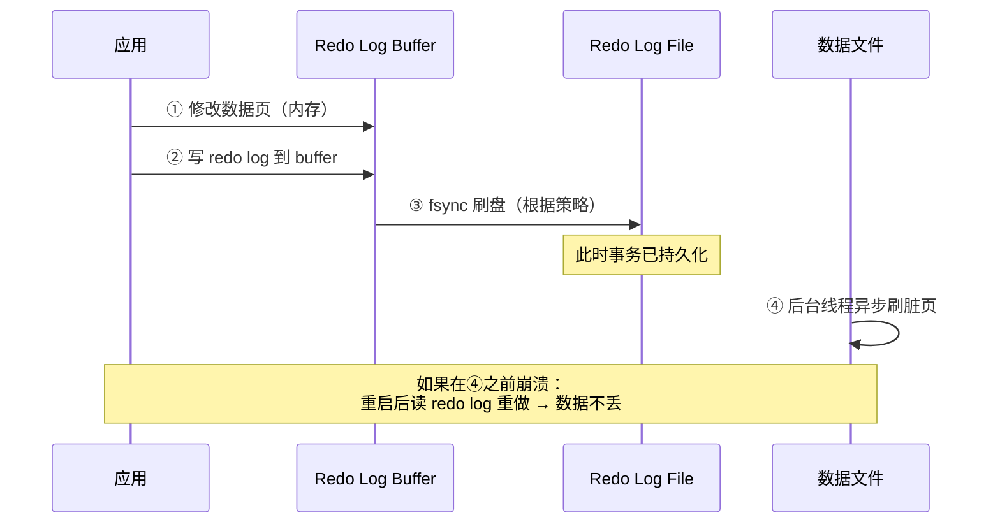

#### innodb_flush_log_at_trx_commit

| 值 | 行为 | 安全性 | 性能 |
| :--- | :--- | :--- | :--- |
| **0** | 每秒刷一次 redo log | ❌ 崩溃可能丢 1 秒数据 | ⭐️ 最高 |
| **1** ⭐️ | 每次提交都 fsync | ✅ 不丢数据 | ⚠️ 较慢 |
| **2** | 每次提交写 OS cache，每秒 fsync | ⚠️ OS 崩溃可能丢数据 | ⭐️ 较高 |

> 💡 **生产环境**：金融级用 1，允许少量丢失用 2，测试环境可用 0。

### 3.3 Undo Log：回滚与 MVCC 的基石

| 用途 | 说明 |
| :--- | :--- |
| **事务回滚** | ROLLBACK 时沿 undo log 反向操作，恢复数据到事务开始前 |
| **MVCC 版本链** | UPDATE/DELETE 产生的旧版本存入 undo log，供其他事务读取历史快照 |
| **purge 清理** | 当没有事务需要某个旧版本时，purge 线程回收 undo log 空间 |

> ⚠️ **长事务的危害**：长事务持有旧版本的 ReadView，导致 purge 无法清理对应的 undo log → undo tablespace 膨胀 → 磁盘占满。**监控长事务是 DBA 的日常必修课**。

### 3.4 Binlog：复制与恢复

#### Binlog 格式

| 格式 | 优点 | 缺点 |
| :--- | :--- | :--- |
| **STATEMENT** | 日志量小 | 某些函数（NOW()/UUID()）导致主从不一致 |
| **ROW** ⭐️ | 精确记录行变更，不会不一致 | 日志量大（批量更新时尤其明显） |
| **MIXED** | 自动切换 STATEMENT/ROW | 兼顾两者，推荐 |

> 💡 **生产推荐**：`binlog_format=MIXED` 或 `ROW`。纯 STATEMENT 在主从复制中风险较高。

#### 两阶段提交：Redo Log 与 Binlog 的一致性

用一个具体例子走一遍完整流程。假设执行以下 SQL：

```sql
UPDATE account SET balance = 200 WHERE id = 1;
COMMIT;
```

**执行这条 UPDATE 时，InnoDB 和 Server 层按以下顺序协作：**

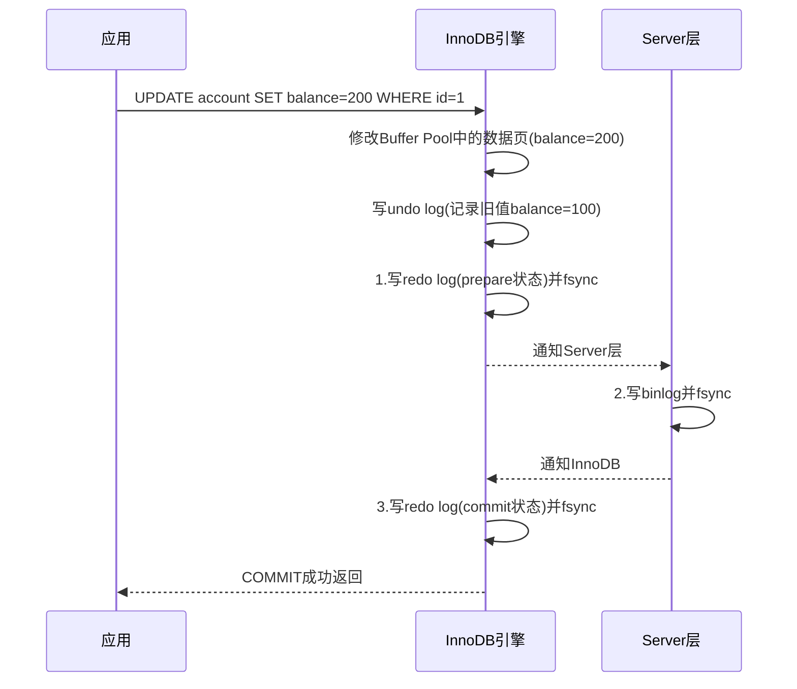

**关键认知：事务提交的返回 = 第 3 步 fsync 完成**。在此之前，对客户端来说事务还没有提交。

##### 如果在不同阶段断电，会怎样？

| 断电时机 | redo log | binlog | 重启后恢复行为 | 结果是否正确 |
| :--- | :--- | :--- | :--- | :--- |
| **第 1 步之后、第 2 步之前** | prepare | ❌ 没有 | redo=prepare + binlog缺失 → **回滚** | ✅ 正确（binlog没写，从库也不该有这个变更） |
| **第 2 步之后、第 3 步之前** | prepare | ✅ 完整 | redo=prepare + binlog完整 → **补提交** | ✅ 正确（binlog已写，说明应该提交） |
| **第 3 步之后** | commit | ✅ 完整 | redo=commit → **已提交** | ✅ 正确 |
| **第 1 步之前** | ❌ 没有 | ❌ 没有 | 无记录 → **忽略** | ✅ 正确（事务根本没开始） |

> 💡 **核心判断标准：以 binlog 是否完整为准**。
> - binlog 完整 → 提交（即使 redo 还是 prepare，也补提交）
> - binlog 不完整/缺失 → 回滚（即使 redo 是 prepare，也回滚）
>
> **为什么以 binlog 为准？** 因为 binlog 是主从复制的依据。如果主库提交了但 binlog 没写，从库就不会有这个变更，导致主从不一致。所以必须以 binlog 作为"仲裁者"，保证主库和从库看到的事务集合完全一致。

> 💡 **为什么不能只写一个日志？**
> - **只写 redo 不写 binlog**：崩溃恢复没问题，但从库缺少这个变更 → 主从不一致
> - **只写 binlog 不写 redo**：从库同步没问题，但主库崩溃后无法恢复这个变更 → 数据丢失
> - **两阶段提交**：两者要么都生效，要么都回滚 → 既保证崩溃恢复，又保证主从一致

### 3.5 面试话术

> "Redo Log 是 InnoDB 的物理日志，遵循 WAL 原则，用于崩溃恢复，保证已提交事务不丢失；Undo Log 是逻辑日志，用于事务回滚和 MVCC 版本链；Binlog 是 Server 层的逻辑日志，用于主从复制和时间点恢复。三者通过两阶段提交保证一致性：先写 redo prepare，再写 binlog，最后写 redo commit。生产环境推荐 innodb_flush_log_at_trx_commit=1 + binlog_format=ROW/MIXED。"

---

## 四、锁机制：行锁、SELECT FOR UPDATE、乐观锁

### 4.1 InnoDB 锁的类型总览

InnoDB 的锁可以从两个独立维度来理解：**粒度**（锁多大范围）和**模式**（锁多严格）。这两个维度是正交的，就像"颜色"和"大小"是描述物体的两个不同属性一样。

#### 按粒度分类

| 粒度 | 包含的锁类型 | 说明 |
| :--- | :--- | :--- |
| **表级锁** | IS、IX、AUTO-INC | 锁住整张表，粒度粗，并发低 |
| **行级锁** | Record Lock、Gap Lock、Next-Key Lock、Insert Intention Lock | 锁住索引上的特定记录或间隙，粒度细，并发高 |

#### 按模式分类

| 模式 | 含义 | 兼容性 |
| :--- | :--- | :--- |
| **共享锁（S）** | 允许其他事务同时加 S 锁读取 | S 与 S 兼容 |
| **排他锁（X）** | 独占访问，其他事务不能加任何锁 | X 与一切互斥 |
| **意向锁（IS/IX）** | 表级的"打招呼"锁，表示事务打算给行加 S/X 锁 | 几乎与一切兼容（详见 4.4 兼容矩阵） |

#### 各锁类型详解

| 锁类型 | 粒度 | 模式 | 作用 | 触发场景 |
| :--- | :--- | :--- | :--- | :--- |
| **Record Lock** | 行级 | S 或 X | 锁定索引上的单条记录 | UPDATE/DELETE/SELECT FOR UPDATE 精确命中索引 |
| **Gap Lock** | 行级 | S 或 X | 锁定两个索引值之间的"空隙"，防止其他事务在间隙中插入新行 | RR 级别下范围查询的当前读 |
| **Next-Key Lock** | 行级 | S 或 X | Record Lock + Gap Lock 的组合，既锁记录又锁间隙 | RR 级别下范围查询的当前读（**默认加锁方式**） |
| **Insert Intention Lock** | 行级 | X | 表示"我要在这个间隙中插入"，多个插入意向锁之间互相兼容 | INSERT 操作 |
| **IS（意向共享）** | 表级 | S | 表示事务打算给某些行加 S 锁 | 加行级 S 锁前自动加 |
| **IX（意向排他）** | 表级 | X | 表示事务打算给某些行加 X 锁 | 加行级 X 锁前自动加 |
| **AUTO-INC** | 表级 | X | 自增列分配时短暂持有，语句结束后立即释放（不等事务结束） | INSERT 使用 AUTO_INCREMENT 列 |

> ⚠️ **关键认知**：
> - **InnoDB 的行锁是加在索引上的，不是加在数据行上的**。如果 UPDATE 语句没有走索引，会退化为**表锁**。
> - **意向锁是自动加的**，不需要手动管理。它的作用是让表级锁和行级锁能共存：比如一个事务要给某行加 X 锁，先自动给表加 IX 锁；另一个事务想给整张表加 S 锁时，发现表上有 IX 锁就知道有行被排他锁住了，直接等待，避免逐行检查。

### 4.2 SELECT FOR UPDATE 详解

```sql
-- 当前读：读取最新版本并加排他锁
SELECT * FROM orders WHERE user_id = 100 FOR UPDATE;
```

| 维度 | 普通 SELECT（快照读） | SELECT FOR UPDATE（当前读） |
| :--- | :--- | :--- |
| **读取版本** | MVCC 快照版本 | 最新已提交版本 |
| **是否加锁** | ❌ 不加锁 | ✅ 加排他锁（X锁） |
| **阻塞其他事务** | 不阻塞 | 阻塞其他事务的 FOR UPDATE / UPDATE / DELETE |
| **MVCC** | 使用 ReadView | 不使用 ReadView，直接读最新 |
| **适用场景** | 普通查询 | 需要先读后写的原子操作（如扣库存） |

#### FOR UPDATE 加锁规则（RR 级别）

| 查询条件 | 加的锁 | 说明 |
| :--- | :--- | :--- |
| `WHERE id=1`（主键等值） | Record Lock on id=1 | 只锁这一行 |
| `WHERE id>5 AND id<10`（主键范围） | Next-Key Lock on (5,10] | 锁住范围内的记录+间隙 |
| `WHERE name='张三'`（二级索引等值） | Next-Key Lock on name='张三' + Record Lock on 对应主键 | 锁二级索引记录 + 回表锁主键 |
| `WHERE age>20`（无索引） | **表锁** | ⚠️ 没走索引，锁全表 |

> 💡 **研发铁律**：FOR UPDATE **必须走索引**，否则锁全表，并发直接归零。使用前务必 EXPLAIN 确认。

### 4.3 乐观锁 vs 悲观锁

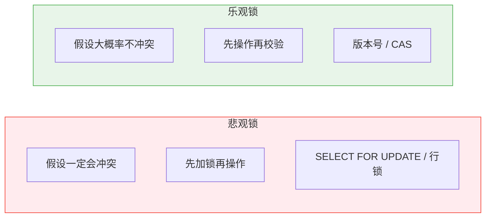

| 维度 | 悲观锁 | 乐观锁 |
| :--- | :--- | :--- |
| **思想** | 先加锁，再操作 | 先操作，提交时校验版本 |
| **实现** | SELECT FOR UPDATE / 数据库行锁 | version 字段 / CAS |
| **冲突处理** | 阻塞等待 | 重试或报错 |
| **适用场景** | 写多读少、冲突频繁 | 读多写少、冲突概率低 |
| **性能** | 并发低（锁竞争） | 并发高（无锁），但冲突时重试开销大 |

#### 乐观锁实战：版本号方案

```sql
-- 建表时加 version 字段
CREATE TABLE product (
    id BIGINT PRIMARY KEY,
    stock INT NOT NULL,
    version INT NOT NULL DEFAULT 0
);

-- 扣减库存（原子操作）
UPDATE product 
SET stock = stock - 1, version = version + 1
WHERE id = 100 AND version = 5;

-- affected_rows = 0 → 版本已被其他事务修改 → 重试或报错
-- affected_rows = 1 → 扣减成功
```

> 💡 **vs Redis 乐观锁**：Redis 的 WATCH + MULTI/EXEC 也是乐观锁思想，但粒度是整个 key；数据库版本号方案粒度是单行，更适合业务级并发控制。

### 4.4 锁的兼容矩阵

| 已持有 ↓ / 请求 → | IS | IX | S | X |
| :--- | :--- | :--- | :--- | :--- |
| **IS** | ✅ | ✅ | ✅ | ❌ |
| **IX** | ✅ | ✅ | ❌ | ❌ |
| **S** | ✅ | ❌ | ✅ | ❌ |
| **X** | ❌ | ❌ | ❌ | ❌ |

> 💡 **记忆技巧**：X 锁与一切互斥；S 锁之间兼容；IS/IX 是"打招呼"，几乎与一切兼容（除了 X/S 与 IX 互斥）。

### 4.5 面试话术

> "InnoDB 行锁加在索引上，包括 Record Lock、Gap Lock、Next-Key Lock 三种。SELECT FOR UPDATE 是当前读，加排他锁，必须走索引否则退化为表锁。乐观锁通过版本号实现，适合读多写少场景；悲观锁通过 FOR UPDATE 实现，适合写多读少场景。RR 级别下 Next-Key Lock 防止幻读，RC 级别下只有 Record Lock。"

---

## 五、死锁：定位与排查

### 5.1 什么是死锁？

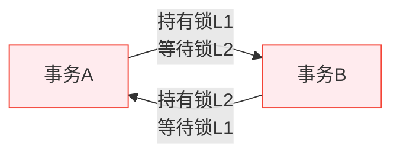

两个或多个事务互相持有对方需要的锁，形成循环等待，谁也无法继续。

### 5.2 死锁产生的四个必要条件

| 条件 | 说明 |
| :--- | :--- |
| **互斥** | 资源同一时刻只能被一个事务持有 |
| **占有并等待** | 持有一个锁的同时等待另一个锁 |
| **不可剥夺** | 锁不能被强制释放，只能由持有者主动释放 |
| **循环等待** | 形成环形依赖链 |

> 💡 **打破任一条件即可避免死锁**。实践中最可行的是**破坏循环等待**：统一加锁顺序。

### 5.3 MySQL 的自动死锁处理

InnoDB 内置了**死锁检测器（Deadlock Detector）**，会实时监控事务之间的锁等待关系图。一旦检测到循环等待，MySQL 会自动处理：

1. **选择回滚对象**：回滚**undo log 最少**的事务（即修改数据量最小的那个），因为回滚代价与 undo log 大小成正比
2. **释放锁**：被回滚事务持有的所有锁立即释放
3. **继续执行**：另一个事务获得所需的锁，继续执行
4. **返回错误**：被回滚的事务收到错误码 `ER_LOCK_DEADLOCK`（1213）

> ⚠️ **应用层必须处理 1213 错误**。MySQL 只负责"解开死锁"，不负责"重试业务"。如果代码没有捕获这个错误并重试，用户就会看到报错。

```java
// Java 伪代码：死锁重试
try {
    // 执行业务 SQL
} catch (SQLException e) {
    if (e.getErrorCode() == 1213) {
        // 死锁！重试整个事务
        retryTransaction();
    } else {
        throw e;
    }
}
```

| 配置项 | 说明 |
| :--- | :--- |
| `innodb_deadlock_detect` | 是否开启死锁检测（默认 ON）。高并发场景下检测本身可能成为瓶颈，可关闭后依赖 `innodb_lock_wait_timeout` 超时回滚 |
| `innodb_lock_wait_timeout` | 锁等待超时时间（默认 50s）。关闭死锁检测后，事务等锁超过此时间会自动回滚 |

> 💡 **高并发下的权衡**：当并发极高（如数千 TPS）时，死锁检测器的图遍历开销可能很大。此时可以 `SET GLOBAL innodb_deadlock_detect = OFF`，改为依赖锁等待超时来间接解决死锁。代价是死锁事务要等到超时才回滚，而非立即回滚。

### 5.4 经典死锁案例

```sql
-- 事务A                          -- 事务B
BEGIN;                            BEGIN;
UPDATE account SET bal=bal-100    UPDATE account SET bal=bal+100
  WHERE id=1;                       WHERE id=2;
                                  -- 持有 id=2 的 X 锁
UPDATE account SET bal=bal+100    UPDATE account SET bal=bal-100
  WHERE id=2;  ← 等待 id=2 的锁      WHERE id=1;  ← 等待 id=1 的锁
-- 持有 id=1 的 X 锁              -- 💥 死锁！
```

### 5.5 死锁排查四步法

#### Step 1：查看最近一次死锁信息

```sql
SHOW ENGINE INNODB STATUS\G
```

关注 `LATEST DETECTED DEADLOCK` 部分，包含：
- 涉及的事务 ID
- 各自持有的锁和等待的锁
- 被回滚的事务（MySQL 自动选择代价最小的事务回滚）

#### Step 2：开启死锁日志持久化

```sql
-- 将每次死锁信息记录到 error log
SET GLOBAL innodb_print_all_deadlocks = ON;
```

> ⚠️ `SHOW ENGINE INNODB STATUS` 只显示**最近一次**死锁。生产环境务必开启此参数，否则死锁信息会被覆盖。

#### Step 3：查看当前锁等待

```sql
-- MySQL 8.0+
SELECT * FROM performance_schema.data_locks;
SELECT * FROM performance_schema.data_lock_waits;

-- MySQL 5.7
SELECT * FROM information_schema.INNODB_LOCKS;
SELECT * FROM information_schema.INNODB_LOCK_WAITS;
```

#### Step 4：分析根因并修复

| 根因 | 解决方案 |
| :--- | :--- |
| **加锁顺序不一致** | 统一按主键/索引值升序加锁 |
| **大事务持锁时间长** | 拆分事务，缩短持锁时间 |
| **缺少索引导致表锁** | 添加合适索引，避免全表扫描 |
| **间隙锁冲突** | 降低隔离级别到 RC（如果业务允许） |
| **批量操作锁太多** | 分批处理，控制单次锁数量 |

### 5.6 预防死锁的最佳实践

| 实践 | 说明 |
| :--- | :--- |
| **统一加锁顺序** | 多行操作时按主键排序后再依次加锁 |
| **缩短事务** | 事务中不做 RPC、不做复杂计算，尽快提交 |
| **合理设置超时** | `innodb_lock_wait_timeout`（默认 50s），避免无限等待 |
| **使用较低隔离级别** | RC 没有 Gap Lock，死锁概率大幅降低 |
| **避免用户交互在事务中** | 事务内不要等用户输入 |
| **监控告警** | 死锁频率突增时及时排查 |

### 5.7 面试话术

> "死锁是多个事务循环等待彼此持有的锁。排查四步：SHOW ENGINE INNODB STATUS 看最近死锁、开启 innodb_print_all_deadlocks 持久化日志、查 performance_schema.data_locks 看当前锁等待、分析根因修复。预防核心是统一加锁顺序、缩短事务、合理设置超时。MySQL 会自动检测死锁并回滚代价最小的事务。"

---

## 六、事务隔离级别

### 6.1 四种隔离级别对比

| 隔离级别 | 脏读 | 不可重复读 | 幻读 | 实现机制 |
| :--- | :--- | :--- | :--- | :--- |
| **Read Uncommitted** | ✅ 可能 | ✅ 可能 | ✅ 可能 | 无 MVCC，直接读最新 |
| **Read Committed (RC)** | ❌ 避免 | ✅ 可能 | ✅ 可能 | MVCC（每次 SELECT 新 ReadView） |
| **Repeatable Read (RR)** ⭐️ | ❌ 避免 | ❌ 避免 | ⚠️ 部分避免 | MVCC（首次 ReadView）+ Next-Key Lock |
| **Serializable** | ❌ 避免 | ❌ 避免 | ❌ 避免 | 串行化执行，所有 SELECT 变 FOR UPDATE |

> 💡 **InnoDB 默认 RR**。大多数互联网公司推荐 RC（Oracle 默认也是 RC），因为 RR 的 Gap Lock 容易导致死锁，而 RC 没有 Gap Lock，并发更好。

### 6.2 三种异常现象解释

| 异常 | 定义 | 示例 |
| :--- | :--- | :--- |
| **脏读** | 读到其他事务**未提交**的数据 | A 读到 B 未提交的 balance=200，B 回滚后 A 的数据就是错的 |
| **不可重复读** | 同一事务内两次读取**结果不同** | A 第一次读 balance=100，B 提交 UPDATE 后 A 第二次读 balance=200 |
| **幻读** | 同一事务内两次范围查询**行数不同** | A 第一次 SELECT WHERE age>20 返回 3 行，B INSERT 一条 age=25 后 A 第二次返回 4 行 |

### 6.3 面试话术

> "InnoDB 默认 RR 级别，通过 MVCC 避免脏读和不可重复读，通过 Next-Key Lock 避免当前读的幻读。RC 每次 SELECT 创建新 ReadView，RR 只在首次创建并复用。生产环境很多团队选择 RC，因为没有 Gap Lock，死锁概率更低，并发更好。Serializable 性能太差，几乎不用。"

---

## 七、慢 SQL 分析与优化

### 7.1 慢查询定位流程

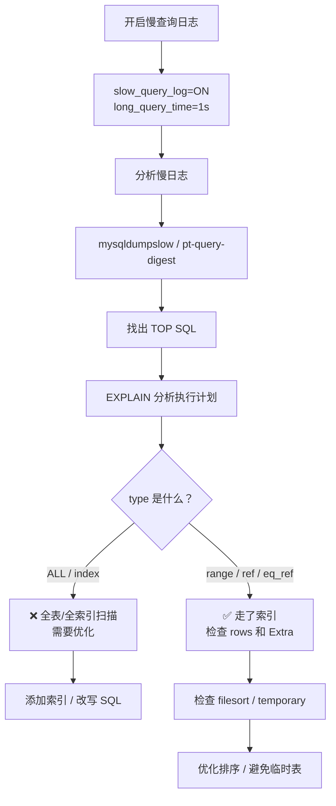

### 7.2 EXPLAIN 关键字段速查

| 字段 | 关注点 | 好的值 | 坏的值 |
| :--- | :--- | :--- | :--- |
| **type** | 访问类型 | const > eq_ref > ref > range | ALL（全表）、index（全索引） |
| **key** | 实际使用的索引 | 有值且符合预期 | NULL（没走索引） |
| **rows** | 预估扫描行数 | 越小越好 | 接近总行数 |
| **Extra** | 额外信息 | Using index（覆盖索引） | Using filesort / Using temporary |
| **filtered** | 过滤比例 | 接近 100% | 很低说明扫描了大量无效行 |

### 7.2.1 Extra 字段详解

Extra 是 EXPLAIN 中**信息量最大的字段**，直接反映 MySQL 的执行策略和优化程度。以下是按"从好到坏"排列的常见值：

#### ✅ 好的 Extra（无需优化）

| Extra 值 | 含义 | 示例场景 |
| :--- | :--- | :--- |
| **Using index** | **覆盖索引**：查询所需列全部在索引中，无需回表 | `SELECT name FROM t WHERE name='张三'`（name 有索引） |
| **Using index condition** | **ICP（索引条件下推）**：WHERE 条件部分下推到存储引擎层过滤，减少回表次数 | `SELECT * FROM t WHERE name LIKE '张%' AND age>20`（name 有索引，age 无索引） |
| **Using where** | Server 层对存储引擎返回的行做进一步过滤 | 正常情况，表示有部分条件在 Server 层处理 |
| **const** | 主键/唯一索引等值查询，最多返回一行 | `SELECT * FROM t WHERE id=1` |

#### ⚠️ 需要关注的 Extra（可能需要优化）

| Extra 值 | 含义 | 产生原因 | 优化方案 |
| :--- | :--- | :--- | :--- |
| **Using filesort** | **文件排序**：无法利用索引完成 ORDER BY，需要额外的排序操作 | ORDER BY 的列不在索引中，或排序方向与索引不一致 | 让 ORDER BY 的列包含在联合索引中，且顺序一致；或去掉不必要的排序 |
| **Using temporary** | **临时表**：GROUP BY / DISTINCT / UNION 等操作需要创建内部临时表 | GROUP BY 的列不在索引中；DISTINCT 去重；UNION 合并结果集 | 让 GROUP BY 的列包含在索引中；避免 SELECT * + DISTINCT；用 UNION ALL 替代 UNION |
| **Using join buffer (Block Nested Loop)** | **BNL 算法**：被驱动表没有索引，使用块嵌套循环连接 | JOIN 时被驱动表的关联列没有索引 | **给被驱动表的关联列加索引**，这是最重要的 JOIN 优化（什么叫做被驱动表？谁被"查"就是被驱动表。LEFT JOIN 中右表是被查的一方，所以给右表的关联列加索引。INNER JOIN 中优化器会自动选小表做驱动表，大表是被驱动表，给大表的关联列加索引。） |
| **Select tables optimized away** | 优化器直接从索引获取聚合结果，无需扫描表 | `SELECT MAX(id) FROM t`（id 是主键） | 无需优化，这是最优执行方式 |

#### ❌ 危险的 Extra（必须优化）

| Extra 值 | 含义 | 风险 |
| :--- | :--- | :--- |
| **Using filesort + Using temporary 同时出现** | 既需要排序又需要临时表 | 双重开销，大表时极慢 |
| **Using index + Using filesort** | 虽然走了覆盖索引，但排序仍需额外操作 | 比纯 Using index 差，考虑调整索引顺序 |

#### 实战对比：filesort vs 索引排序

```sql
-- ❌ 产生 Using filesort
-- 索引 idx_age_name(age, name)，但 ORDER BY 先 name 后 age，与索引顺序不一致
EXPLAIN SELECT * FROM users WHERE age > 20 ORDER BY name, age;
-- Extra: Using index condition; Using filesort

-- ✅ 利用索引排序，无 filesort
-- 调整 ORDER BY 顺序与索引一致
EXPLAIN SELECT * FROM users WHERE age > 20 ORDER BY age, name;
-- Extra: Using index condition（无 filesort！）
```

#### 实战对比：temporary 的产生与消除

```sql
-- ❌ 产生 Using temporary
-- GROUP BY 的列没有索引
EXPLAIN SELECT department, COUNT(*) FROM employees GROUP BY department;
-- Extra: Using temporary; Using filesort

-- ✅ 添加索引后消除 temporary
-- ALTER TABLE employees ADD INDEX idx_dept(department);
EXPLAIN SELECT department, COUNT(*) FROM employees GROUP BY department;
-- Extra: Using index（覆盖索引 + 索引分组，无临时表）
```

> 💡 **研发日常**：看到 **Using filesort** 先看数据量，小表（几千行）可以接受；大表（百万级）必须优化。看到 **Using temporary** 几乎都需要优化，因为临时表可能落盘。看到 **Using join buffer** 一定要检查被驱动表是否缺索引。

### 7.3 常见优化手段

| 问题 | 优化方案 |
| :--- | :--- |
| 全表扫描 | 添加合适索引 |
| 回表过多 | 覆盖索引（SELECT 只查索引列） |
| 深分页 `LIMIT 100000,10` | 延迟关联：`SELECT * FROM t INNER JOIN (SELECT id FROM t LIMIT 100000,10) tmp ON t.id=tmp.id` |
| 大 IN 列表 | 分批查询或临时表 JOIN |
| OR 导致索引失效 | 改写为 UNION ALL |
| 函数包裹索引列 | 把函数移到等号右边或改用范围查询 |
| ORDER BY 产生 filesort | 让排序列包含在索引中 |
| COUNT(*) 慢 | 估算用 `EXPLAIN` 的 rows；精确计数用缓存或汇总表 |

#### 深分页优化：延迟关联详解

**问题**：`LIMIT 100000, 10` 为什么慢？

```sql
-- ❌ 传统写法：跳过前 100000 行，取后 10 行
SELECT * FROM orders ORDER BY id LIMIT 100000, 10;
```

MySQL 执行这条 SQL 时，实际上需要：
1. 扫描索引找到前 100010 行
2. **回表 100010 次**取出完整行数据
3. 丢弃前 100000 行，只返回最后 10 行

**瓶颈在于回表**：即使你只需要 10 行，MySQL 也要回表 100010 次。offset 越大，回表次数越多，查询越慢。

**解决方案：延迟关联（Deferred Join）**

核心思想：**先用覆盖索引快速定位目标行的主键，再回表取完整数据**。把"大范围回表"拆成"小范围回表"。

```sql
-- ✅ 延迟关联写法
SELECT * FROM orders
INNER JOIN (
    SELECT id FROM orders ORDER BY id LIMIT 100000, 10
) tmp ON orders.id = tmp.id;
```

**为什么快？**

| 步骤 | 传统写法 | 延迟关联 |
| :--- | :--- | :--- |
| ① 扫描索引 | 扫描 100010 条索引记录 | 扫描 100010 条索引记录（相同） |
| ② 回表 | 回表 **100010 次**取完整行 | **不回表**（子查询只查 id，覆盖索引） |
| ③ 取最终数据 | 已在上一步完成 | 用 10 个 id 回表 **10 次** |
| **总回表次数** | **100010 次** | **10 次** |

子查询 `SELECT id FROM orders ORDER BY id LIMIT 100000, 10` 只查 id 列，id 是主键索引本身，所以是**覆盖索引**，完全不需要回表。外层再用这 10 个 id 去回表取完整数据，只需 10 次回表。

**前提条件**：
- 排序列必须有索引（通常是主键或有索引的列）
- 子查询中只查索引列（保证覆盖索引）

**其他深分页优化方案**：

| 方案 | 适用场景 | 示例 |
| :--- | :--- | :--- |
| **延迟关联** | 通用，排序列有索引 | 见上方示例 |
| **游标分页（Seek Method）** | 连续翻页，上一页最后一条的 id 已知 | `WHERE id > 上页最后id LIMIT 10` |
| **限制最大页码** | 业务允许 | 禁止翻到第 10000 页，改为搜索/筛选 |
| **搜索引擎** | 海量数据全文检索 | Elasticsearch / Solr |

> 💡 **游标分页 vs 延迟关联**：游标分页性能最好（直接 `WHERE id > last_id LIMIT 10`，无需跳过任何行），但要求客户端记住上一页的最后一条 id，且不支持跳页。延迟关联支持跳页，性能次之。**能游标就游标，不能游标再延迟关联**。

### 7.4 面试话术

> "慢 SQL 优化流程：开启慢查询日志 → pt-query-digest 分析 TOP SQL → EXPLAIN 看执行计划 → 重点关注 type、key、rows、Extra。常见优化：加索引避免全表扫描、覆盖索引减少回表、延迟关联优化深分页、UNION ALL 替代 OR、避免函数包裹索引列。优化后务必 EXPLAIN 验证效果。"

---

## 八、MySQL 8.0 常用新特性

> 💡 **背景**：MySQL 8.0 于 2018 年发布，是目前生产环境的主流版本。相比 5.7，引入了大量实用特性。以下仅介绍**面试常问、研发常用**的特性，不涉及偏门功能。

### 8.1 窗口函数（Window Functions）

#### 解决什么问题？

在 SQL 中做"**分组内的排名、累计求和、行间对比**"等需求。这些需求用 GROUP BY 做不了（GROUP BY 会合并行），5.7 时代只能靠自关联或变量 hack，又丑又慢。

#### 5.7 vs 8.0 对比

```sql
-- ❌ 5.7 写法：查每个部门薪资排名前 3 的员工（自关联，又丑又慢）
SELECT a.name, a.department, a.salary
FROM employees a
WHERE (
    SELECT COUNT(*) FROM employees b
    WHERE b.department = a.department AND b.salary > a.salary
) < 3;

-- ✅ 8.0 写法：一行搞定
SELECT name, department, salary
FROM (
    SELECT name, department, salary,
           ROW_NUMBER() OVER (PARTITION BY department ORDER BY salary DESC) AS rk
    FROM employees
) ranked
WHERE rk <= 3;
```

#### 核心语法

`函数名() OVER (PARTITION BY 分组列 ORDER BY 排序列)`

- **PARTITION BY** = 按什么分组（类似 GROUP BY，但**不合并行**，每行都保留）
- **ORDER BY** = 组内按什么排序
- **OVER()** = 定义"窗口"的范围

#### 常用窗口函数速览

| 函数 | 干什么 | 典型场景 |
| :--- | :--- | :--- |
| `ROW_NUMBER()` | 连续排名 1,2,3 | 取每组前 N 名 |
| `RANK()` | 跳跃排名 1,1,3 | 并列时跳过名次 |
| `DENSE_RANK()` | 密集排名 1,1,2 | 并列时不跳名次 |
| `LAG(col, n)` | 取前 n 行的值 | 环比计算（本月 vs 上月） |
| `LEAD(col, n)` | 取后 n 行的值 | 预测下一期 |
| `SUM() OVER(ORDER BY ...)` | 累计求和 | running total |
| `NTILE(n)` | 将结果集分成 n 桶 | 分位数分析 |

#### 什么时候该用窗口函数？

当你发现自己在写**自关联、用户变量、或应用层循环处理**来实现以下需求时，就是窗口函数的场景：

| 需求 | 5.7 做法 | 8.0 窗口函数 |
| :--- | :--- | :--- |
| 组内排名 | 自关联 COUNT | ROW_NUMBER / RANK |
| 累计求和 | 变量 @sum | SUM() OVER() |
| 环比/同比 | 自关联或应用层 | LAG / LEAD |
| 移动平均 | 自关联 | AVG() OVER(ROWS BETWEEN...) |

> ⚠️ **窗口函数不是替代 GROUP BY**。GROUP BY 用于聚合（多行变一行），窗口函数用于"在不合并行的前提下做组内计算"。两者解决的问题不同。

> 💡 **面试话术**："MySQL 8.0 原生支持窗口函数，解决了 5.7 时代排名、累计求和、行间对比等需求需要自关联或变量的痛点。核心语法是 函数() OVER(PARTITION BY ... ORDER BY ...)，PARTITION BY 定义分组但不合并行。ROW_NUMBER/RANK 处理排名，LAG/LEAD 处理行间对比，SUM OVER 处理累计聚合。"

### 8.2 CTE（公用表表达式 / WITH 子句）

#### 解决什么问题？

两个痛点：**复杂 SQL 的可读性**和**树形/层级数据的查询**。

#### 普通 CTE：替代嵌套子查询

```sql
-- ❌ 嵌套子查询，读起来像套娃
SELECT * FROM (
    SELECT department, AVG(salary) AS avg_sal
    FROM employees
    GROUP BY department
) dept_avg
WHERE avg_sal > 10000;

-- ✅ CTE：给中间结果起个名字，像变量一样清晰
WITH dept_avg AS (
    SELECT department, AVG(salary) AS avg_sal
    FROM employees
    GROUP BY department
)
SELECT * FROM dept_avg WHERE avg_sal > 10000;
```

CTE 还可以**复用**：同一个 WITH 定义的临时结果集可以在主查询中引用多次，避免重复写相同的子查询。

#### 递归 CTE：查树形结构（杀手级功能）

这是 5.7 完全做不到的事。比如查组织架构树：

```sql
WITH RECURSIVE org_tree AS (
    -- 锚点：从顶级节点开始
    SELECT id, name, parent_id, 0 AS depth
    FROM departments WHERE parent_id IS NULL
    
    UNION ALL
    
    -- 递归：每层找子节点
    SELECT d.id, d.name, d.parent_id, t.depth + 1
    FROM departments d
    INNER JOIN org_tree t ON d.parent_id = t.id
)
SELECT * FROM org_tree ORDER BY depth, name;
```

**执行逻辑**：先执行锚点查询拿到根节点，然后反复执行递归部分（每次用上一层的结果去查下一层），直到没有新行为止。

#### 什么时候该用 CTE？

| 场景 | 推荐 | 原因 |
| :--- | :--- | :--- |
| SQL 超过 3 层嵌套 | ✅ 普通 CTE | 提升可读性，给中间结果命名 |
| 同一子查询出现 2 次以上 | ✅ 普通 CTE | 复用，避免重复 |
| 组织架构/分类树/评论嵌套/BOM | ✅ 递归 CTE | 5.7 只能靠存储过程或应用层多次查询 |
| 简单单层子查询 | ❌ 不需要 | 直接写子查询即可，CTE 反而多余 |

> ⚠️ **注意事项**：
> - 普通 CTE 可能被优化器物化（8.0.20+ 会尝试合并优化）
> - 递归 CTE 有 `cte_max_recursion_depth` 限制（默认 1000），防止无限递归
> - 递归 CTE 中必须用 `UNION ALL`（不能用 `UNION`，否则去重可能导致递归提前终止）

> 💡 **面试话术**："CTE 用 WITH 子句给中间结果命名，提升复杂 SQL 可读性并支持复用。递归 CTE 是 8.0 的杀手级特性，原生支持树形/层级数据查询（组织架构、分类树、BOM 等），5.7 只能靠存储过程或应用层多次查询。使用时注意递归深度限制和 UNION ALL 的要求。"

### 8.3 JSON 增强

8.0 对 JSON 的支持从"能用"升级到"好用"：

| 特性 | 5.7 | 8.0 |
| :--- | :--- | :--- |
| JSON 字段索引 | ❌ 不支持 | ✅ **多值索引（Multi-Valued Index）** |
| JSON_TABLE | ❌ | ✅ 将 JSON 数组转为关系表 |
| ->> 操作符 | ❌ | ✅ 等价于 JSON_UNQUOTE(JSON_EXTRACT()) |
| JSON 聚合函数 | 基础 | 新增 JSON_ARRAYAGG、JSON_OBJECTAGG |

```sql
-- 多值索引：直接索引 JSON 数组中的元素
CREATE TABLE products (
    id INT PRIMARY KEY,
    tags JSON,
    INDEX idx_tags ((CAST(tags->>'$[*]' AS UNSIGNED ARRAY)))
);

-- 查询包含特定标签的产品（走索引！）
SELECT * FROM products WHERE 100 MEMBER OF(tags->>'$[*]');

-- JSON_TABLE：把 JSON 数组展开为行
SELECT p.name, t.tag_value
FROM products p,
     JSON_TABLE(p.tags, '$[*]' COLUMNS(tag_value VARCHAR(50) PATH '$')) AS t;
```

> 💡 **研发日常**：如果业务大量使用 JSON 且需要按 JSON 内容检索，8.0 的多值索引是杀手级特性。否则仍建议将频繁查询的字段提取为独立列。

### 8.4 不可见索引（Invisible Index）

```sql
-- 将索引设为不可见（优化器不使用，但索引仍维护）
ALTER TABLE users ALTER INDEX idx_age INVISIBLE;

-- 验证删除索引是否安全：观察一段时间，确认无性能退化后再真正删除
DROP INDEX idx_age ON users;

-- 恢复可见
ALTER TABLE users ALTER INDEX idx_age VISIBLE;
```

> 💡 **核心价值**：**安全地测试"删除索引"的影响**。以前删索引后发现问题只能重建，现在可以先隐藏观察，确认无误再删除。上线前验证索引有效性的利器。

### 8.5 其他常用特性速查

| 特性 | 说明 | 面试频率 |
| :--- | :--- | :--- |
| **默认字符集 utf8mb4** | 不再需要手动指定，原生支持 emoji | ⭐⭐⭐ |
| **降序索引** | `INDEX idx(a ASC, b DESC)`，混合排序可利用索引 | ⭐⭐ |
| **EXPLAIN ANALYZE** | 实际执行并显示每步耗时，比 EXPLAIN 更准确 | ⭐⭐⭐ |
| **原子 DDL** | CREATE/ALTER/DROP 表要么全成功要么全回滚，不会留下半成品 | ⭐⭐ |
| **直方图（Histogram）** | 统计信息更精确，优化器对数据分布理解更好 | ⭐⭐ |
| **角色（Role）** | 权限管理的角色抽象，类似 RBAC | ⭐ |
| **密码策略增强** | 密码过期、历史记录、复杂度校验内置 | ⭐ |

### 8.6 面试话术

> "MySQL 8.0 相比 5.7 的核心改进：① 窗口函数原生支持排名和累计聚合；② 递归 CTE 解决树形查询；③ JSON 多值索引让 JSON 字段可高效检索；④ 不可见索引支持安全测试索引删除；⑤ EXPLAIN ANALYZE 提供真实执行耗时；⑥ 默认 utf8mb4 和原子 DDL 提升了开箱即用体验和运维安全性。这些特性在实际开发中已经广泛使用，尤其是窗口函数和递归 CTE。"

---

## 九、面试高频问题速答

### Q1：为什么 InnoDB 用 B+树而不是 B树？

B+树内部节点不存数据，单页能放更多键，树更矮，磁盘 IO 更少；叶子节点通过链表串联，范围查询只需顺序扫描；全表扫描只遍历叶子层，性能稳定。B树每个节点都存数据，树更高，范围查询需要中序遍历整棵树。

### Q2：MVCC 的原理是什么？RC 和 RR 的区别？

MVCC 通过隐藏字段（DB_TRX_ID、DB_ROLL_PTR）+ Undo Log 版本链 + ReadView 实现。读取时沿版本链找到对当前 ReadView 可见的第一个版本。RC 每次 SELECT 创建新 ReadView，能看到其他事务已提交的修改；RR 只在首次 SELECT 创建 ReadView 并复用，整个事务期间快照一致。

### Q3：Redo Log 和 Binlog 的区别？为什么需要两阶段提交？

Redo Log 是 InnoDB 引擎层的物理日志，用于崩溃恢复；Binlog 是 Server 层的逻辑日志，用于主从复制和时间点恢复。两阶段提交保证两者一致性：先写 redo prepare，再写 binlog，最后写 redo commit。崩溃恢复时，redo=prepare+binlog完整则提交，否则回滚。

### Q4：SELECT FOR UPDATE 加的是什么锁？什么时候会退化为表锁？

FOR UPDATE 是当前读，加排他锁（X锁）。精确匹配索引时加 Record Lock，范围查询时加 Next-Key Lock（RR级别）。**如果 WHERE 条件没有走索引，会退化为表锁**，阻塞所有并发操作。使用前必须 EXPLAIN 确认走了索引。

### Q5：如何排查死锁？

四步法：① SHOW ENGINE INNODB STATUS 看最近死锁详情；② 开启 innodb_print_all_deadlocks 持久化日志；③ 查 performance_schema.data_locks 看当前锁等待；④ 分析根因（加锁顺序不一致、大事务、缺索引等）并修复。预防核心：统一加锁顺序、缩短事务、合理超时。

### Q6：乐观锁和悲观锁怎么选？

写多读少、冲突频繁选悲观锁（SELECT FOR UPDATE）；读多写少、冲突概率低选乐观锁（版本号/CAS）。乐观锁无锁开销，并发高，但冲突时需重试；悲观锁保证串行，但并发低。库存扣减等高冲突场景用悲观锁，配置更新等低冲突场景用乐观锁。

### Q7：UNION 和 JOIN 的区别？

UNION 是**纵向拼接**，把多个 SELECT 的结果集上下叠在一起，行数增加、列数不变，要求各 SELECT 的列数和数据类型一致。JOIN 是**横向关联**，把多张表的列按条件匹配后左右拼在一起，列数增加、行数取决于匹配情况。简单说：UNION 合并同类数据，JOIN 关联不同表的数据。另外 UNION 默认去重（等价于 UNION DISTINCT），UNION ALL 不去重且性能更好，确定无重复时应优先用 UNION ALL。

### Q8：INNER JOIN、LEFT JOIN、RIGHT JOIN 的区别？

| JOIN 类型 | 含义 | 结果行数 |
| :--- | :--- | :--- |
| **INNER JOIN** | 只返回两表中**匹配成功**的行 | ≤ 任一表的行数 |
| **LEFT JOIN** | 返回左表**所有行** + 右表匹配的行（不匹配的右表列填 NULL） | ≥ 左表行数 |
| **RIGHT JOIN** | 返回右表**所有行** + 左表匹配的行（不匹配的左表列填 NULL） | ≥ 右表行数 |
| **FULL OUTER JOIN** | 返回两表所有行（MySQL 不支持，可用 LEFT JOIN UNION RIGHT JOIN 模拟） | ≥ 两表行数之和 |

```sql
-- 示例：students(id, name) 和 scores(student_id, score)
-- students: (1,'张三'), (2,'李四'), (3,'王五')
-- scores:   (1,90), (2,80)

-- INNER JOIN：只返回有成绩的学生的成绩
SELECT s.name, sc.score FROM students s INNER JOIN scores sc ON s.id = sc.student_id;
-- 结果：张三-90, 李四-80（王五没有成绩，不出现）

-- LEFT JOIN：返回所有学生，没成绩的显示 NULL
SELECT s.name, sc.score FROM students s LEFT JOIN scores sc ON s.id = sc.student_id;
-- 结果：张三-90, 李四-80, 王五-NULL

-- RIGHT JOIN：返回所有成绩记录，即使学生不存在（实际少见）
SELECT s.name, sc.score FROM students s RIGHT JOIN scores sc ON s.id = sc.student_id;
-- 结果：张三-90, 李四-80
```

> 💡 **研发日常**：绝大多数场景用 **LEFT JOIN**（保留主表所有数据）。INNER JOIN 用于"只关心匹配数据"的场景。RIGHT JOIN 很少用，通常可以改写为 LEFT JOIN（交换表顺序即可）。面试中被问到 JOIN 区别，一定要用具体例子说明 NULL 的产生条件。

---

## 小结

- **B+树**：更矮、范围查询快、叶子链表串联，InnoDB 默认索引结构
- **MVCC**：ReadView + 版本链实现读不加锁，RC/RR 区别在于 ReadView 创建时机
- **日志三件套**：Redo Log 保崩溃恢复，Undo Log 保回滚+MVCC，Binlog 保复制+恢复，两阶段提交保一致性
- **锁机制**：行锁加在索引上，FOR UPDATE 必须走索引，RR 用 Next-Key Lock 防幻读
- **死锁排查**：SHOW STATUS + 持久化日志 + data_locks + 根因分析
- **慢SQL优化**：EXPLAIN 为核心工具，覆盖索引、延迟关联、避免函数包裹是常用手段
- **MySQL 8.0 特性**：窗口函数、递归 CTE、JSON 多值索引、不可见索引、EXPLAIN ANALYZE

> 💡 **记忆口诀**：**B加树矮链表连，MVCC快照读不锁；Redo恢复Undo滚，Binlog复制两阶段；行锁加在索引上，FOR UPDATE要走索引；死锁四步来排查，慢SQL看EXPLAIN；八零窗口CTE，JSON索引不可见**。
