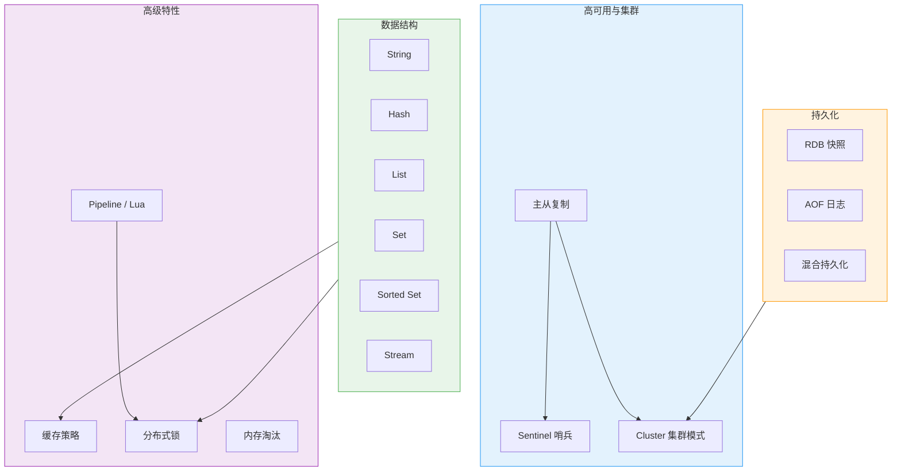
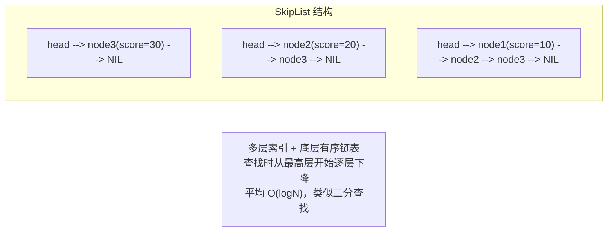
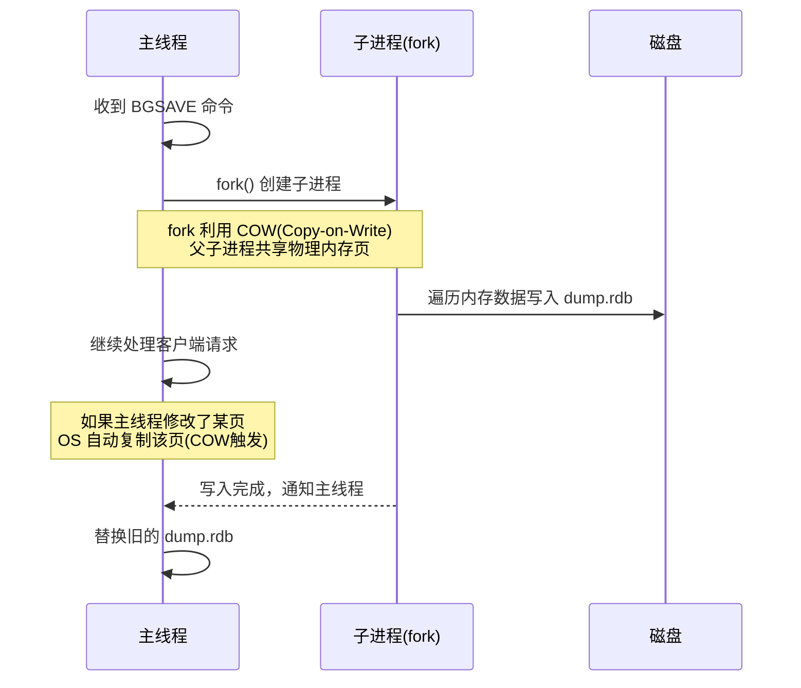
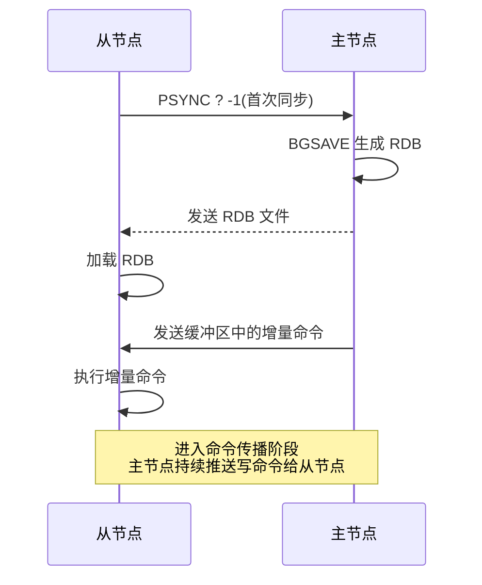
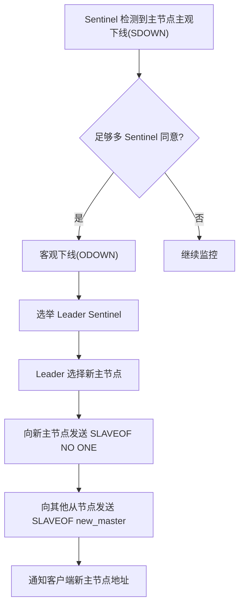
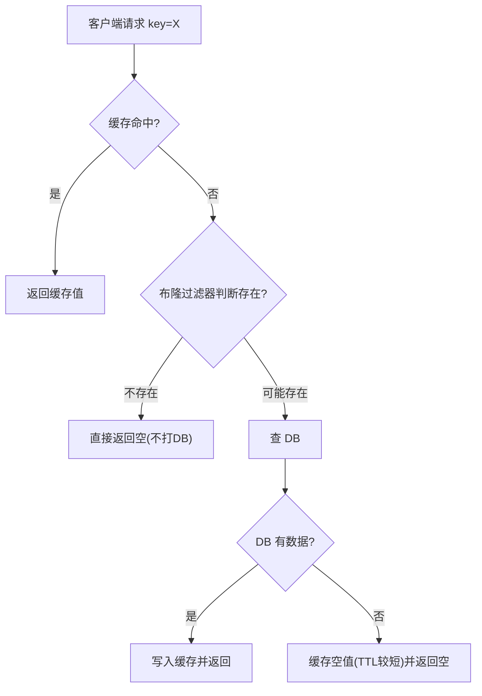

# Redis 面试常问知识点总结

## 核心知识全览



> 💡 **阅读指引**：本文按"**数据结构 → 持久化 → 主从复制 → 哨兵 → 集群 → 缓存策略 → 分布式锁 → 内存淘汰 → Pipeline/Lua**"的线性路径展开，每个章节独立成章。面试时可按需跳转。

---

## 一、数据结构：不只是 Key-Value

### 1.1 五种基础数据结构

| 数据结构 | 底层编码 | 典型用途 | 时间复杂度 |
| :--- | :--- | :--- | :--- |
| **String** | SDS（Simple Dynamic String） | 缓存、计数器、分布式锁 | GET/SET O(1) |
| **Hash** | ziplist / hashtable | 对象存储（用户信息、商品详情） | HGET/HSET O(1) |
| **List** | quicklist（ziplist + 链表） | 消息队列、最新列表 | LPUSH/RPOP O(1) |
| **Set** | intset / hashtable | 去重、交集/并集/差集 | SADD/SISMEMBER O(1) |
| **Sorted Set (ZSet)** | ziplist / skiplist + hashtable | 排行榜、延迟队列 | ZADD O(logN), ZRANGE O(logN+M) |

> 💡 **关键认知**：Redis 的数据结构有**两层抽象**。外层是你使用的 API（String/Hash/List/Set/ZSet），内层是实际的编码实现（SDS/ziplist/skiplist 等）。Redis 会根据数据量和元素大小自动选择最优编码，小数据用紧凑结构节省内存，大数据用高效结构保证性能。

### 1.2 SDS vs C 字符串

Redis 没有使用 C 语言原生字符串，而是自定义了 **SDS（Simple Dynamic String）**：

| 维度 | C 字符串 | SDS |
| :--- | :--- | :--- |
| **获取长度** | O(n) 遍历到 `\0` | O(1) 直接读 len 字段 |
| **二进制安全** | ❌ 以 `\0` 结尾，不能存二进制 | ✅ 用 len 记录长度，可存任意二进制 |
| **缓冲区溢出** | 需要手动检查 | 自动扩容，预留 free 空间 |
| **内存分配** | 每次修改都可能 realloc | 空间预分配 + 惰性释放，减少 realloc 次数 |

### 1.3 SkipList：ZSet 的核心

Sorted Set 需要同时支持 O(1) 查分值和 O(logN) 范围查询，Redis 用 **SkipList（跳跃表）** 实现：



| 特性 | 说明 |
| :--- | :--- |
| **为什么不用平衡树** | 平衡树实现复杂、范围查询效率低；SkipList 实现简单、范围查询只需找到起点后顺序遍历 |
| **为什么不用 B+树** | B+树适合磁盘 IO，SkipList 纯内存操作更轻量 |
| **层高怎么决定** | 随机化（概率 0.25 升一层），期望层高 logN |

### 1.4 Stream：Redis 5.0+ 的消息队列

Stream 是 Redis 原生的消息队列数据结构，解决了 List 做消息队列的痛点：

| 维度 | List 做消息队列 | Stream |
| :--- | :--- | :--- |
| **消费确认** | ❌ 弹出即删除，消费失败消息丢失 | ✅ ACK 机制，未确认的消息可重试 |
| **消费者组** | ❌ 不支持 | ✅ 多消费者组，每组独立消费进度 |
| **消息回溯** | ❌ 消费后不可重读 | ✅ 按 ID 回溯历史消息 |
| **持久化** | 依赖 RDB/AOF | 同左，但消息本身有 ID 可追踪 |

> 💡 **vs Kafka/RocketMQ**：Stream 适合轻量级消息队列场景（如应用内任务分发、事件通知）。如果需要高吞吐、跨服务、消息堆积能力，仍应使用专业 MQ。

### 1.5 面试话术

> "Redis 五种基础数据结构各有底层编码优化：String 用 SDS 实现 O(1) 长度获取和二进制安全；ZSet 用 SkipList 实现 O(logN) 范围查询；小数据自动用 ziplist/intset 节省内存。Stream 是 5.0+ 的原生消息队列，支持消费者组和 ACK 机制，弥补了 List 做消息队列的不足。"

---

## 二、持久化：RDB 与 AOF

### 2.1 RDB（Redis Database Snapshot）

RDB 是 Redis 的**快照持久化**：在某个时间点将内存中的所有数据序列化写入磁盘文件（dump.rdb）。

#### 触发方式

| 方式 | 命令/配置 | 说明 |
| :--- | :--- | :--- |
| **手动同步** | `SAVE` | 阻塞主线程，生产环境禁用 |
| **手动异步** | `BGSAVE` | fork 子进程执行，主线程不阻塞 |
| **自动触发** | `save 900 1` | 900 秒内至少 1 次写操作则触发 BGSAVE |

#### BGSAVE 的工作原理



> ⚠️ **fork 的代价**：fork 本身很快（只复制页表），但如果 fork 后主线程大量写入，COW 会导致内存翻倍。**生产环境建议预留 50% 以上空闲内存**给 fork 使用。

### 2.2 AOF（Append Only File）

AOF 是 Redis 的**日志持久化**：将每条写命令追加到日志文件末尾，重启时重放日志恢复数据。

#### fsync 策略

| 策略 | 行为 | 安全性 | 性能 |
| :--- | :--- | :--- | :--- |
| **always** | 每条命令都 fsync | ✅ 不丢数据 | ❌ 极慢 |
| **everysec** ⭐️ | 每秒 fsync 一次 | ⚠️ 最多丢 1 秒数据 | ✅ 推荐 |
| **no** | 由 OS 决定何时刷盘 | ❌ 可能丢较多数据 | ✅ 最快 |

#### AOF 重写（Rewrite）

AOF 文件会越来越大，Redis 定期执行**重写**：读取当前内存数据，生成一份等价的最小命令集替换旧文件。

```
重写前：SET a 1, SET a 2, SET a 3, DEL b, SET c 4
重写后：SET a 3, SET c 4
```

> 💡 **重写不是逐行压缩旧文件**，而是根据当前内存状态重新生成命令。所以重写后的文件一定是最小的。

### 2.3 混合持久化（Redis 4.0+）

结合 RDB 和 AOF 的优点：**AOF 文件的前半部分是 RDB 格式，后半部分是增量 AOF 命令**。

| 维度 | 纯 RDB | 纯 AOF | 混合持久化 |
| :--- | :--- | :--- | :--- |
| **恢复速度** | ✅ 快（直接加载二进制） | ❌ 慢（逐条重放命令） | ✅ 快（RDB 部分直接加载） |
| **数据安全** | ❌ 可能丢几分钟数据 | ✅ 最多丢 1 秒 | ✅ 最多丢 1 秒 |
| **文件大小** | ✅ 小 | ❌ 大 | ⚠️ 中等 |

> 💡 **生产推荐**：开启混合持久化（`aof-use-rdb-preamble yes`，Redis 5.0+ 默认开启）。兼顾恢复速度和数据安全。

### 2.4 面试话术

> "Redis 有两种持久化：RDB 是快照，BGSAVE fork 子进程利用 COW 写入，恢复快但可能丢数据；AOF 是日志追加，everysec 策略最多丢 1 秒数据，恢复慢。4.0+ 混合持久化结合两者优点：AOF 文件前半段是 RDB 格式加速恢复，后半段是增量 AOF 保证安全。生产环境推荐开启混合持久化。"

---

## 三、主从复制

### 3.1 复制流程



### 3.2 全量复制 vs 增量复制

| 类型 | 触发条件 | 过程 | 开销 |
| :--- | :--- | :--- | :--- |
| **全量复制** | 首次连接、从节点 replicationid 不匹配、复制偏移量超出缓冲区 | BGSAVE + 传输 RDB + 重放缓冲区 | 大，耗时耗带宽 |
| **增量复制** | 短暂断连后重连，偏移量仍在缓冲区内 | 主节点从缓冲区补发缺失的命令 | 小，几乎无感 |

> ⚠️ **repl-backlog-size**：复制缓冲区大小（默认 1MB）。如果从节点断连时间过长，积压的命令超出缓冲区，就会退化为全量复制。**生产环境应根据写入量和网络稳定性调大此值**。

### 3.3 主从复制的注意事项

| 注意点 | 说明 |
| :--- | :--- |
| **从节点只读** | 从节点默认不接受写操作，写入会报错 |
| **复制是异步的** | 主节点写完就返回成功，不等从节点确认 → 主从数据可能短暂不一致 |
| **过期键处理** | 从节点不会主动删除过期键，只在访问时惰性删除或由主节点传播 DEL 命令 |
| **级联复制** | 从节点也可以有自己的从节点，形成树状拓扑 |

### 3.4 面试话术

> "Redis 主从复制分全量和增量两种：首次连接或偏移量超出缓冲区时全量复制（BGSAVE + RDB 传输），短暂断连后增量复制（补发缓冲区命令）。复制是异步的，主节点不等从节点确认。生产环境应调大 repl-backlog-size 避免频繁全量复制。"

---

## 四、Sentinel 哨兵：自动故障转移

### 4.1 Sentinel 做什么？

Sentinel 是一个运行在特殊模式下的 Redis 实例，负责三件事：

| 职责 | 说明 |
| :--- | :--- |
| **监控** | 定期 PING 主从节点，检测是否存活 |
| **自动故障转移** | 主节点不可用时，选举新主节点并通知客户端 |
| **配置中心** | 客户端通过 Sentinel 获取当前主节点地址，无需硬编码 |

### 4.2 故障转移流程



#### 新主节点的选择标准（优先级从高到低）

1. 从节点优先级最小（`slave-priority`）
2. 复制偏移量最大（数据最新）
3. Run ID 最小（字典序）

> 💡 **主观下线 vs 客观下线**：单个 Sentinel 认为主节点挂了 = 主观下线（SDOWN）；quorum 个 Sentinel 都同意 = 客观下线（ODOWN），才触发故障转移。这避免了网络抖动导致的误判。

### 4.3 面试话术

> "Sentinel 负责监控主从节点、自动故障转移和配置发现。故障转移流程：主观下线 → quorum 同意后客观下线 → 选举 Leader → 选新主（优先级 > 偏移量 > RunID）→ 提升新主 → 其他从节点切换 → 通知客户端。主观下线是单节点判断，客观下线是多节点共识，避免误判。"

---

## 五、Cluster 集群模式

### 5.1 为什么需要集群？

单机 Redis 有两个瓶颈：**内存上限**（单机内存有限）和**写入吞吐**（单线程处理写命令）。Cluster 通过**数据分片**解决这两个问题。

### 5.2 哈希槽（Hash Slot）

Redis Cluster 将所有数据划分为 **16384 个哈希槽**，每个槽分配给一个主节点：

```
key -> CRC16(key) % 16384 -> slot_number -> master_node
```

| 特性 | 说明 |
| :--- | :--- |
| **槽数量固定** | 16384 个，不可更改 |
| **槽分配** | 每个主节点负责一部分槽，所有槽必须被覆盖集群才能上线 |
| **Key 定位** | 客户端计算 CRC16(key) % 16384 得到槽号，再找到对应节点 |
| **MOVED 重定向** | 如果 key 不在当前节点，返回 MOVED slot ip:port，客户端重定向 |
| **ASK 重定向** | 槽迁移过程中，返回 ASK slot ip:port，客户端先发 ASKING 再请求 |

### 5.3 集群通信：Gossip 协议

集群节点之间通过 **Gossip 协议**交换状态信息（PING/PONG/MEET/FAIL），无需中心化协调：

| 消息类型 | 作用 |
| :--- | :--- |
| **PING** | 检测节点是否存活 |
| **PONG** | 回复 PING，携带自身状态 |
| **MEET** | 请求加入集群 |
| **FAIL** | 标记某节点为失败状态 |

> 💡 **为什么选 Gossip 而不是 Raft？** Gossip 是去中心化的，适合大规模节点的状态传播；Raft 需要选举 Leader，在数千节点规模下选举开销大。Redis Cluster 用 Gossip 做节点发现和健康检查，用投票机制做故障检测和槽迁移确认。

### 5.4 集群的限制

| 限制 | 说明 | 解决方案 |
| :--- | :--- | :--- |
| **多 Key 操作** | 不同槽的 key 不能放在同一个事务/MGET 中 | 使用 `{hashtag}` 强制相关 key 落到同一槽 |
| **SELECT** | 不支持多数据库，只能用 db0 | 业务层面隔离 |
| **Lua 脚本** | 只能操作同一槽的 key | 同上 |

### 5.5 面试话术

> "Redis Cluster 通过 16384 个哈希槽实现数据分片，key 通过 CRC16 取模定位到槽和节点。节点间用 Gossip 协议交换状态，去中心化。客户端遇到 MOVED/ASK 重定向时自动跳转到正确节点。限制是多 key 操作必须在同一槽内，可用 {hashtag} 解决。"

---

## 六、缓存策略：穿透、击穿、雪崩

### 6.1 三大缓存问题对比

| 问题 | 定义 | 原因 | 解决方案 |
| :--- | :--- | :--- | :--- |
| **缓存穿透** | 查询**不存在的数据**，缓存永远 miss，请求全部打到 DB | 恶意攻击或业务 bug | 布隆过滤器、缓存空值 |
| **缓存击穿** | **热点 key 过期瞬间**，大量并发请求同时打到 DB | 热点数据 TTL 到期 | 互斥锁、逻辑过期 |
| **缓存雪崩** | **大量 key 同时过期**或 Redis 宕机，请求全部打到 DB | TTL 设置相同、Redis 故障 | TTL 加随机值、多级缓存、限流降级 |

### 6.2 缓存穿透详解



| 方案 | 原理 | 优缺点 |
| :--- | :--- | :--- |
| **布隆过滤器** | 用多个哈希函数将 key 映射到位图，查询时如果所有位都为 1 则"可能存在"，否则"一定不存在" | ✅ 内存占用极小；⚠️ 有误判率（可能把不存在的判断为存在），不支持删除 |
| **缓存空值** | DB 查不到也缓存一个空值，TTL 设短（如 5 分钟） | ✅ 实现简单；⚠️ 占用缓存空间，数据新增后需等 TTL 过期才能查到 |

### 6.3 缓存击穿详解

| 方案 | 原理 | 优缺点 |
| :--- | :--- | :--- |
| **互斥锁** | 缓存 miss 时先获取分布式锁，只有拿到锁的线程去查 DB 并回填缓存，其他线程等待重试 | ✅ 强一致性；⚠️ 性能受损（等待锁） |
| **逻辑过期** | 不设物理 TTL，在 value 中存逻辑过期时间。读到过期数据时异步更新缓存，当前请求返回旧值 | ✅ 高性能（不阻塞）；⚠️ 短暂不一致 |

### 6.4 缓存与数据库一致性

| 策略 | 做法 | 一致性 | 适用场景 |
| :--- | :--- | :--- | :--- |
| **Cache Aside（旁路缓存）** ⭐️ | 读：先缓存，miss 查 DB 回填；写：先更新 DB，再删缓存 | 最终一致 | 大多数业务 |
| **Read/Write Through** | 读写都经过缓存层，缓存层负责同步 DB | 强一致 | 对一致性要求高的场景 |
| **Write Behind** | 写只更新缓存，异步批量写 DB | 弱一致 | 写多读少、允许丢数据 |

> 💡 **为什么 Cache Aside 是"删缓存"而不是"更新缓存"？** 并发场景下，两个线程同时更新缓存可能导致旧值覆盖新值。删缓存让下次读取时自然回填最新值，更安全。

### 6.5 面试话术

> "缓存穿透是查不存在的数据，用布隆过滤器或缓存空值解决；缓存击穿是热点 key 过期瞬间并发打 DB，用互斥锁或逻辑过期解决；缓存雪崩是大量 key 同时过期，用 TTL 加随机值和多级缓存解决。缓存一致性推荐 Cache Aside 模式：读先缓存 miss 查 DB 回填，写先更新 DB 再删缓存。"

---

## 七、分布式锁

### 7.1 为什么需要分布式锁？

单机锁（synchronized/ReentrantLock）只在单个 JVM 内有效。微服务架构下多个实例并发访问共享资源时，需要跨进程的锁机制。

### 7.2 Redis 分布式锁的实现

#### 基本实现

```bash
# 加锁（原子操作）
SET lock_key unique_value NX EX 30

# NX = 不存在才设置（互斥）
# EX 30 = 30 秒过期（防死锁）
# unique_value = 唯一标识（防误删）
```

```bash
# 解锁（Lua 脚本保证原子性）
if redis.call("get", KEYS[1]) == ARGV[1] then
    return redis.call("del", KEYS[1])
else
    return 0
end
```

> ⚠️ **为什么解锁要用 Lua？** GET + DEL 不是原子操作。如果 GET 后发现是自己的锁，但在 DEL 之前锁过期被其他线程抢到，DEL 就会误删别人的锁。Lua 脚本在 Redis 中原子执行，避免这个问题。

### 7.3 分布式锁的问题与演进

| 问题 | 说明 | 解决方案 |
| :--- | :--- | :--- |
| **锁过期但业务未完成** | 持锁线程卡住，锁过期后被其他线程抢到 | 看门狗机制（Redisson）：自动续期 |
| **Redis 主从切换丢锁** | 加锁在主节点，主节点崩溃后从节点没有锁数据 | RedLock 算法（多 Redis 实例加锁） |
| **RedLock 争议** | Martin Kleppmann 指出 RedLock 在时钟跳变等场景下不安全 | 对强一致场景用 ZooKeeper/etcd 的临时有序节点 |

> 💡 **选型建议**：
> - **一般业务**（如防重复提交、接口限流）：Redisson 分布式锁足够
> - **金融级强一致**（如资金扣减）：用 ZooKeeper / etcd，不要用 Redis 锁
> - Redis 锁的本质是"尽力而为"，不是"绝对可靠"

### 7.4 面试话术

> "Redis 分布式锁用 SET NX EX 加锁，Lua 脚本原子解锁。问题是锁过期但业务未完成，Redisson 用看门狗自动续期解决。Redis 主从切换可能丢锁，RedLock 用多实例加锁缓解但有争议。一般业务用 Redisson 足够，金融级强一致场景用 ZooKeeper/etcd。"

---

## 八、内存淘汰策略

### 8.1 什么时候触发淘汰？

当 Redis 内存达到 `maxmemory` 上限时，根据配置的淘汰策略决定如何处理新的写入请求。

### 8.2 八种淘汰策略

| 策略 | 范围 | 算法 | 适用场景 |
| :--- | :--- | :--- | :--- |
| **noeviction** | — | 不淘汰，写入报错 | 不允许丢数据的场景 |
| **allkeys-lru** ⭐️ | 所有 key | LRU（最近最少使用） | 通用缓存（最常用） |
| **allkeys-lfu** | 所有 key | LFU（最不经常使用） | 热点数据缓存（4.0+） |
| **allkeys-random** | 所有 key | 随机淘汰 | 轮询式缓存 |
| **volatile-lru** | 设置了 TTL 的 key | LRU | 缓存 + 持久化混合 |
| **volatile-lfu** | 设置了 TTL 的 key | LFU | 同上（4.0+） |
| **volatile-ttl** | 设置了 TTL 的 key | TTL 最短的优先 | 希望尽快过期的先淘汰 |
| **volatile-random** | 设置了 TTL 的 key | 随机淘汰 | 同上 |

> 💡 **LRU vs LFU**：
> - **LRU**：淘汰最近最久没被访问的 key。问题是偶尔访问一次的 key 不会被淘汰
> - **LFU**：淘汰访问频率最低的 key。更准确地反映"热度"，Redis 4.0+ 引入
> - **生产推荐**：纯缓存用 `allkeys-lfu`，缓存+持久化混合用 `volatile-lru`

### 8.3 Redis 的近似 LRU/LFU

Redis 不做精确 LRU（维护全局链表开销太大），而是**随机采样 N 个 key（默认 5），从中淘汰最旧的**。采样数越大越接近精确 LRU，但 CPU 开销也越大。

> 💡 `maxmemory-samples`：采样数量，默认 5。生产环境可调到 10 以获得更好的淘汰精度。

### 8.4 面试话术

> "Redis 内存达到 maxmemory 时触发淘汰。8 种策略分两类：allkeys 对所有 key 生效，volatile 只对设置了 TTL 的 key 生效。算法有 LRU、LFU、random、ttl 四种。生产推荐 allkeys-lfu（纯缓存）或 volatile-lru（混合）。Redis 用随机采样近似 LRU/LFU，不做精确实现以降低开销。"

---

## 九、Pipeline 与 Lua 脚本

### 9.1 Pipeline：批量操作减少 RTT

普通模式下，每条命令都要经历"客户端发送 → 服务端处理 → 返回结果"一个完整的 RTT。Pipeline 将多条命令打包发送，服务端批量处理后一次性返回：

```
普通模式：CMD1 → RTT → CMD2 → RTT → CMD3 → RTT（3 次 RTT）
Pipeline：CMD1+CMD2+CMD3 → RTT（1 次 RTT）
```

| 维度 | 普通模式 | Pipeline |
| :--- | :--- | :--- |
| **RTT 次数** | N 次 | 1 次 |
| **吞吐量** | 受 RTT 限制 | 大幅提升 |
| **原子性** | ❌ 不保证 | ❌ 不保证（只是批量发送） |
| **内存占用** | 低 | ⚠️ 批量数据量大时注意内存 |

### 9.2 Lua 脚本：原子性保证

Lua 脚本在 Redis 中**原子执行**，执行期间不会被其他命令插入：

```lua
-- 原子扣减库存
local stock = tonumber(redis.call('GET', KEYS[1]))
if stock and stock > 0 then
    redis.call('DECR', KEYS[1])
    return 1
else
    return 0
end
```

| 维度 | Pipeline | Lua 脚本 |
| :--- | :--- | :--- |
| **原子性** | ❌ | ✅ |
| **减少 RTT** | ✅ | ✅ |
| **复杂度** | 简单 | 需要写 Lua |
| **适用场景** | 批量读写、不要求原子性 | 需要原子性的复合操作（如分布式锁、库存扣减） |

> ⚠️ **Lua 脚本不要写太久**：Redis 单线程执行 Lua，脚本执行期间阻塞所有其他命令。建议脚本执行时间控制在毫秒级。

### 9.3 面试话术

> "Pipeline 将多条命令打包发送减少 RTT，但不保证原子性；Lua 脚本在 Redis 中原子执行，适合需要原子性的复合操作。两者都能减少 RTT 提升吞吐，但 Lua 有阻塞风险，脚本应尽量简短。"

---

## 十、面试高频问题速答

### Q1：Redis 为什么这么快？

① 纯内存操作，避免磁盘 IO；② 单线程模型避免上下文切换和锁竞争（6.0+ IO 多线程，命令执行仍单线程）；③ 高效数据结构（SDS、SkipList、ziplist 等）；④ IO 多路复用（epoll）处理大量并发连接。

### Q2：Redis 单线程为什么还能处理高并发？

单线程指的是**命令执行**单线程，不是整个 Redis 单线程。6.0+ 引入 IO 多线程处理网络读写，命令执行仍然单线程保证原子性。瓶颈通常不在 CPU 而在网络带宽和内存，单线程足以跑满网卡。

### Q3：缓存穿透、击穿、雪崩怎么解决？

穿透：布隆过滤器或缓存空值；击穿：互斥锁或逻辑过期；雪崩：TTL 加随机值 + 多级缓存 + 限流降级。

### Q4：Redis 分布式锁怎么实现？有什么问题？

SET NX EX 加锁，Lua 脚本原子解锁。问题：锁过期业务未完成（Redisson 看门狗续期）、主从切换丢锁（RedLock 多实例缓解但有争议）。强一致场景用 ZooKeeper/etcd。

### Q5：如何保证缓存和数据库一致性？

推荐 Cache Aside：读先缓存 miss 查 DB 回填，写先更新 DB 再删缓存。删缓存而非更新缓存是为了避免并发下旧值覆盖新值。延迟双删可进一步降低不一致窗口。

### Q6：Redis 持久化怎么选？

生产推荐混合持久化（AOF 前半段 RDB + 后半段增量 AOF），兼顾恢复速度和数据安全。纯 RDB 恢复快但可能丢数据，纯 AOF 安全但恢复慢。

---

## 小结

- **数据结构**：五种基础结构各有底层编码优化，Stream 是原生消息队列
- **持久化**：RDB 快照恢复快，AOF 日志更安全，混合持久化兼顾两者
- **主从复制**：全量/增量两种模式，异步复制，注意缓冲区大小
- **Sentinel**：监控 + 自动故障转移 + 配置发现，主观下线 → 客观下线 → 选举新主
- **Cluster**：16384 哈希槽分片，Gossip 通信，MOVED/ASK 重定向
- **缓存策略**：穿透/击穿/雪崩各有解法，Cache Aside 是最常用的一致性方案
- **分布式锁**：SET NX EX + Lua 解锁，Redisson 看门狗续期，强一致用 ZK
- **内存淘汰**：8 种策略，生产推荐 allkeys-lfu 或 volatile-lru
- **Pipeline/Lua**：Pipeline 减 RTT 不保原子，Lua 保原子但阻塞单线程

> 💡 **记忆口诀**：**Redis快在内存单线程，SDS跳表ziplist；RDB快照AOF日志，混合持久两相宜；主从异步槽分片，哨兵故障自转移；穿透布隆击穿锁，雪崩随机加降级；Cache Aside删缓存，分布式锁NX EX；淘汰LFU采样近，Pipeline批Lua原**。
