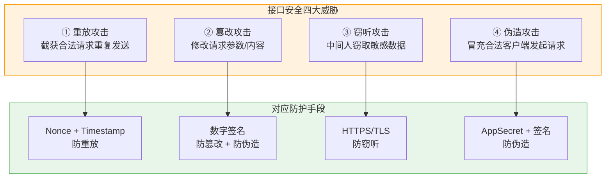
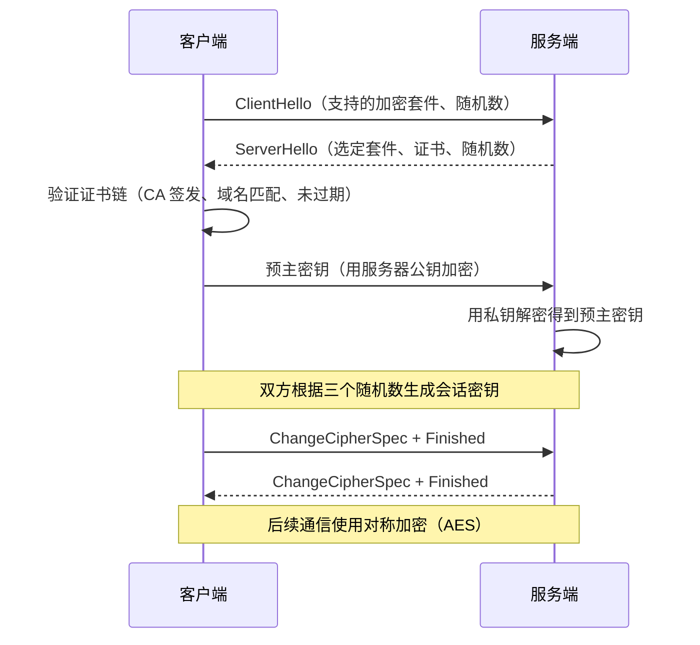
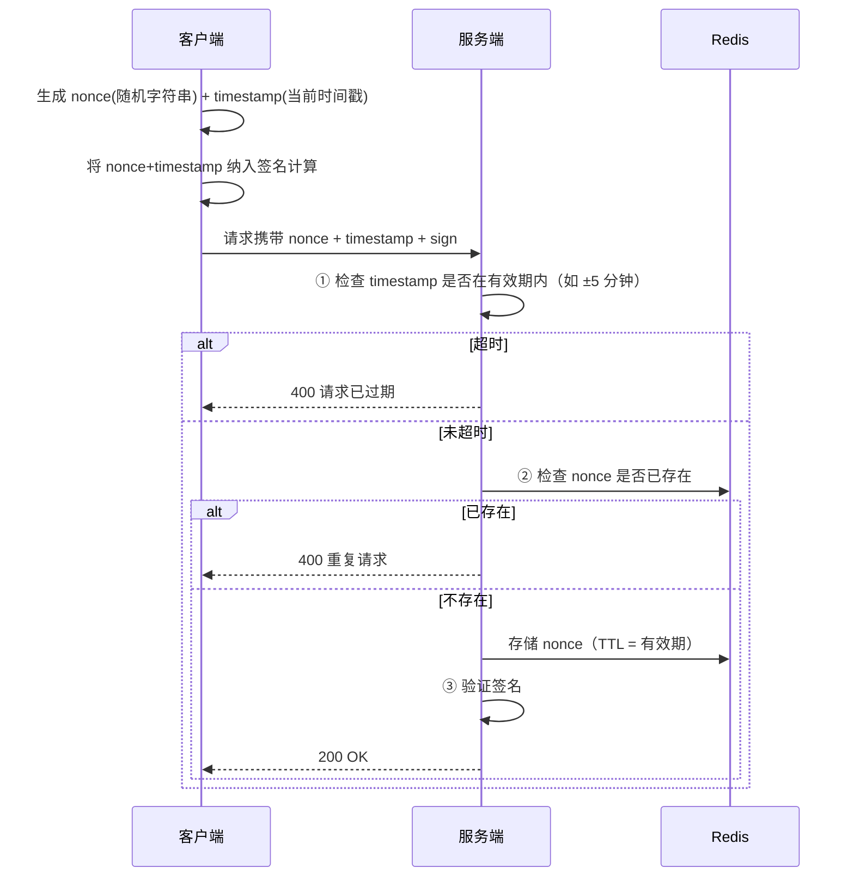
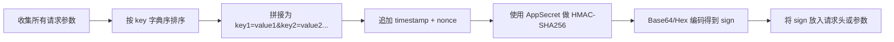
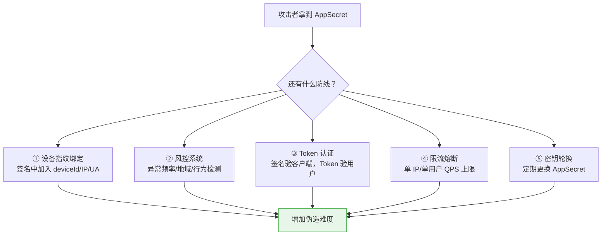
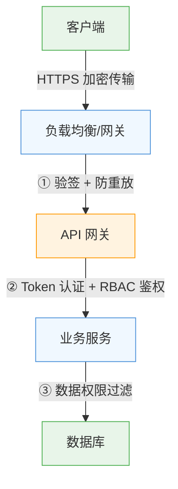

# 接口安全：防重放、签名验证与 HTTPS

## 核心威胁模型全览



> 💡 **阅读指引**：接口安全解决的是"**如何确保请求是合法的、未被篡改的、未被重复使用的、未被窃听的**"。本文按威胁→方案的逻辑线性展开。

---

## 一、HTTPS：传输层安全基石

### 是什么？

HTTPS = HTTP + TLS（Transport Layer Security）。在 TCP 之上建立加密隧道，所有 HTTP 数据在传输过程中都是密文。

### HTTPS 解决了什么？

| 威胁 | HTTPS 是否防护 | 说明 |
| :--- | :--- | :--- |
| **窃听** | ✅ 完全防护 | 中间节点只能看到密文，无法解密 |
| **篡改** | ✅ 完全防护 | TLS 有完整性校验，篡改后连接断开 |
| **冒充** | ✅ 部分防护 | 证书验证服务端身份，但客户端身份需应用层解决 |
| **重放** | ❌ 不防护 | TLS 会话内防重放，但应用层请求仍可被重放 |

### TLS 握手简化流程



### ⚠️ HTTPS 常见误区

| 误区 | 事实 |
| :--- | :--- |
| "用了 HTTPS 就绝对安全" | HTTPS 只保传输层，应用层仍需签名、防重放 |
| "自签证书和 CA 证书一样" | 自签证书无法验证身份，中间人可替换 |
| "HTTPS 性能很差" | TLS 1.3 + 会话复用 + HTTP/2，开销已很小 |
| "内网不需要 HTTPS" | 内网也有横向移动风险，零信任架构要求全程加密 |

> 💡 **核心认知**：HTTPS 是接口安全的**必要条件但不是充分条件**。它解决了传输层的窃听和篡改，但应用层的重放、伪造仍需额外机制。

---

## 二、防重放攻击

### 什么是重放攻击？

攻击者截获一个合法请求（如转账请求），原封不动地重新发送给服务端。由于请求本身是合法的（签名正确、Token 有效），服务端会再次执行操作。

```
正常用户：POST /transfer {to: "B", amount: 100, sign: "xxx"} → 成功
攻击者：  POST /transfer {to: "B", amount: 100, sign: "xxx"} → 又成功了！💰
```

### 防护方案：Nonce + Timestamp



### 核心参数说明

| 参数 | 作用 | 注意事项 |
| :--- | :--- | :--- |
| **nonce** | 一次性随机字符串，防止同一请求被重复提交 | 必须足够随机（UUID/加密随机数），长度 ≥ 16 字节 |
| **timestamp** | 请求时间戳，限制请求的有效窗口 | 通常允许 ±5 分钟偏差，兼顾安全和时钟不同步 |
| **sign** | 将 nonce + timestamp + 业务参数一起签名 | nonce/timestamp 必须参与签名，否则可被替换 |

### 服务端实现示例（Spring Boot）

```java
@Component
public class ReplayAttackFilter implements Filter {

    @Autowired
    private StringRedisTemplate redisTemplate;

    // 允许的时间偏差（秒）
    private static final long TIMESTAMP_TOLERANCE = 300;
    // nonce 缓存前缀
    private static final String NONCE_PREFIX = "api:nonce:";

    @Override
    public void doFilter(ServletRequest request, ServletResponse response, FilterChain chain)
            throws IOException, ServletException {
        HttpServletRequest httpRequest = (HttpServletRequest) request;

        String nonce = httpRequest.getHeader("X-Nonce");
        String timestamp = httpRequest.getHeader("X-Timestamp");

        // ① 检查参数是否存在
        if (nonce == null || timestamp == null) {
            reject(response, "Missing nonce or timestamp");
            return;
        }

        // ② 检查时间戳是否在有效期内
        long requestTime = Long.parseLong(timestamp);
        long currentTime = System.currentTimeMillis() / 1000;
        if (Math.abs(currentTime - requestTime) > TIMESTAMP_TOLERANCE) {
            reject(response, "Request expired");
            return;
        }

        // ③ 检查 nonce 是否已被使用
        String nonceKey = NONCE_PREFIX + nonce;
        Boolean isNew = redisTemplate.opsForValue().setIfAbsent(nonceKey, "1", 
                Duration.ofSeconds(TIMESTAMP_TOLERANCE * 2));
        if (Boolean.FALSE.equals(isNew)) {
            reject(response, "Duplicate request");
            return;
        }

        chain.doFilter(request, response);
    }

    private void reject(ServletResponse response, String message) throws IOException {
        HttpServletResponse httpResponse = (HttpServletResponse) response;
        httpResponse.setStatus(400);
        httpResponse.getWriter().write("{\"error\":\"" + message + "\"}");
    }
}
```

> 💡 **研发日常**：**Timestamp 限窗口，Nonce 防重复，两者缺一不可**。只用 Timestamp 的话，5 分钟内仍可重放；只用 Nonce 的话，没有过期机制，Redis 存储会无限增长。

---

## 三、接口签名验证

### 为什么需要签名？

即使有了 HTTPS，仍然需要签名，因为：

| 场景 | HTTPS 能否防护 | 签名能否防护 |
| :--- | :--- | :--- |
| 外部攻击者窃听 | ✅ | ✅ |
| 客户端被逆向，AppSecret 泄露后伪造请求 | ✅（传输层） | ❌（但可增加逆向难度） |
| 内部人员/网关层篡改请求参数 | ❌ | ✅ |
| 第三方回调验证来源真实性 | ❌ | ✅ |
| 微服务间调用验证调用方身份 | ❌ | ✅ |

### 签名算法设计

#### 推荐方案：HMAC-SHA256

```
sign = HMAC-SHA256(secret, sortedParams + timestamp + nonce)
```

#### 签名步骤



#### 客户端签名示例（JavaScript）

```javascript
import CryptoJS from 'crypto-js'

function generateSignature(params, appSecret) {
  // 1. 添加公共参数
  const allParams = {
    ...params,
    timestamp: Math.floor(Date.now() / 1000).toString(),
    nonce: crypto.randomUUID()
  }

  // 2. 按 key 字典序排序并拼接
  const sortedKeys = Object.keys(allParams).sort()
  const queryString = sortedKeys
    .map(key => `${key}=${allParams[key]}`)
    .join('&')

  // 3. HMAC-SHA256 签名
  const signature = CryptoJS.HmacSHA256(queryString, appSecret)
    .toString(CryptoJS.enc.Hex)

  return {
    ...allParams,
    sign: signature
  }
}
```

#### 服务端验签示例（Spring Boot）

```java
@Component
public class SignatureValidator {

    @Value("${api.app-secret}")
    private String appSecret;

    public boolean validate(Map<String, String> params, String receivedSign) {
        // 1. 移除 sign 字段本身
        Map<String, String> signParams = new TreeMap<>(params);
        signParams.remove("sign");

        // 2. 按字典序拼接
        String queryString = signParams.entrySet().stream()
            .map(entry -> entry.getKey() + "=" + entry.getValue())
            .collect(Collectors.joining("&"));

        // 3. 计算期望签名
        String expectedSign = HmacUtils.hmacSha256Hex(appSecret, queryString);

        // 4. 恒定时间比较，防止时序攻击
        return MessageDigest.isEqual(
            expectedSign.getBytes(StandardCharsets.UTF_8),
            receivedSign.getBytes(StandardCharsets.UTF_8)
        );
    }
}
```

### ⚠️ 签名设计踩坑清单

| 问题 | 原因 | 解决 |
| :--- | :--- | :--- |
| 签名验证总是失败 | 前后端参数排序/编码不一致 | 统一 UTF-8 编码 + 字典序排序 + 相同拼接规则 |
| 签名被绕过 | sign 未参与签名计算 | nonce/timestamp/sign 以外的所有参数都必须参与 |
| 时序攻击 | 用 `==` 比较签名 | 用 `MessageDigest.isEqual()` 恒定时间比较 |
| AppSecret 硬编码在前端 | 前端代码可被反编译 | 移动端用 NDK 存储；Web 端走后端代理签名 |
| 签名算法太弱 | 用 MD5/SHA1 | 至少 HMAC-SHA256，推荐 HMAC-SHA384 |

### ⚠️ 签名的局限性：AppSecret 泄露后怎么办？

> ⚠️ **核心事实**：客户端被逆向后 AppSecret 泄露，签名验证**无法防护伪造请求**。签名只能证明"这个请求是用正确的 Secret 签的"，不能证明"这个请求来自未被篡改的官方客户端"。

#### 为什么签名防不住？

签名的安全前提是 **AppSecret 只有合法客户端知道**。一旦攻击者通过反编译 APK/IPA、调试 JS、抓包分析等手段拿到了 Secret，他就能用相同的算法生成合法签名，服务端验签通过，无法区分"合法客户端"和"攻击者"。

#### 签名的真实定位

签名不是绝对防御，而是**提高攻击门槛的经济手段**：

| 防护层级 | 作用 | 能否被绕过 |
| :--- | :--- | :--- |
| **无签名** | 任何人用 Postman 就能调接口 | ✅ 零门槛 |
| **有签名** | 需要先逆向拿到 Secret + 实现签名算法 | ⚠️ 可绕过，但成本高 |
| **签名 + 设备指纹** | 还需模拟特定设备特征 | ⚠️ 更难，但仍可绕过 |
| **签名 + 风控系统** | 异常行为检测（频率/地域/设备聚类） | ⚠️ 持续对抗 |

#### 纵深防御策略

既然单一签名不够，就需要多层叠加：



| 补充措施 | 原理 | 效果 |
| :--- | :--- | :--- |
| **设备指纹** | 签名中加入 deviceId、IP、User-Agent，服务端校验一致性 | 换设备/IP 后签名失效 |
| **风控系统** | 基于行为模型检测异常（如短时间内大量不同账号操作） | 即使签名合法也能拦截 |
| **Token 分层** | 签名验客户端合法性，JWT/Session 验用户身份 | 拿到 Secret ≠ 拿到用户权限 |
| **限流** | 单 IP/单用户 QPS 上限 | 限制伪造请求的影响范围 |
| **密钥轮换** | 定期更换 AppSecret，支持多版本共存灰度 | 泄露的 Secret 自动过期 |
| **代码混淆/加固** | ProGuard/DexGuard/iOS Obfuscator | 增加逆向成本（但不能杜绝） |

> 💡 **核心认知**：签名解决的是"**请求完整性和来源真实性**"，但**不是绝对安全**。它让攻击从"零门槛"变成"需要逆向+实现算法+绕过指纹+躲过风控"，把大部分低水平攻击者挡在门外。对于高价值接口，必须叠加风控、限流、密钥轮换等多层防御。**没有任何单一技术能 100% 防住有决心的攻击者，安全是持续对抗的过程**。三者互补：**HTTPS 保传输、签名保完整、Token 保身份**。

---

## 四、综合防护架构

### 生产级接口安全分层



| 层级 | 防护内容 | 实现位置 |
| :--- | :--- | :--- |
| **传输层** | HTTPS/TLS 加密 | Nginx / ALB / CDN |
| **网关层** | 签名验证 + 防重放 + 限流 | API Gateway / Filter |
| **应用层** | Token 认证 + RBAC 鉴权 | Spring Security / SA-Token |
| **数据层** | 数据权限过滤（行级/列级） | MyBatis 拦截器 / SQL 拼接 |

### 不同场景的安全策略选型

| 场景 | HTTPS | 签名 | 防重放 | Token | 说明 |
| :--- | :--- | :--- | :--- | :--- | :--- |
| **后台管理系统** | ✅ | ❌ | ❌ | ✅ JWT/Session | 内网环境，Token 足够 |
| **对外开放 API** | ✅ | ✅ | ✅ | ✅ API Key + OAuth2 | 全副武装 |
| **移动端 App** | ✅ | ✅ | ✅ | ✅ JWT | App 可被逆向，签名增加难度 |
| **微服务内部调用** | ⚠️ 可选 | ✅ | ❌ | ✅ mTLS/Service Token | 内网可信，签名验证调用方 |
| **第三方支付回调** | ✅ | ✅ | ✅ | ❌ | 无用户态，纯签名验证来源 |

---

## 五、面试高频问题速答

### Q1：有了 HTTPS 为什么还需要接口签名？

HTTPS 保护的是传输过程，但无法防护以下场景：① 客户端被逆向后攻击者拿到 AppSecret 伪造请求；② 网关/代理层内部人员篡改请求参数；③ 第三方回调需要验证来源真实性；④ 微服务间调用需要验证调用方身份。接口签名的作用是防篡改 + 验身份。防篡改是指请求参数一旦被修改，签名校验就会失败；验身份是指只有持有 AppSecret 的合法客户端才能生成正确签名，防止第三方伪造请求。需要注意的是，HTTPS 已经保证了传输层的完整性，签名解决的是应用层的参数完整性和来源真实性，两者互补。另外签名不是银弹，AppSecret 泄露后仍需设备指纹、风控、密钥轮换等纵深防御措施配合。

### Q2：防重放攻击为什么要同时用 Nonce 和 Timestamp？

只用 Timestamp：在有效窗口内（如 5 分钟）攻击者仍可重放同一请求。只用 Nonce：没有过期机制，Redis 中的 nonce 记录会无限增长，且无法判断一个很旧的 nonce 是否是攻击者故意延迟发送的。**Timestamp 限窗口 + Nonce 防重复**，两者配合才能既安全又可运维。

### Q3：签名算法为什么推荐 HMAC-SHA256 而不是 MD5？

MD5 已被证明存在碰撞漏洞，且不支持密钥（纯哈希不等于签名）。HMAC-SHA256 结合了密钥和 SHA-256 的安全性：① 有密钥参与，不知道 Secret 就无法伪造签名；② SHA-256 目前无已知实用碰撞攻击；③ HMAC 结构天然抵抗长度扩展攻击。

### Q4：AppSecret 能放在前端代码里吗？

**绝对不能**。前端代码（JS/APK/IPA）都可以被反编译或调试提取。正确做法：① Web 端通过后端代理签名，前端永远不接触 Secret；② 移动端用 NDK/SO 库存储，增加逆向成本（但不能完全防止）；③ 服务端间调用用环境变量或密钥管理服务（如 Vault/KMS）。

---

## 小结

本篇覆盖了接口安全的完整知识体系：

- **HTTPS**：传输层安全基石，防窃听和篡改，但不防重放和伪造
- **防重放**：Nonce + Timestamp 双保险，限窗口 + 防重复
- **签名验证**：HMAC-SHA256 保证请求完整性和来源真实性
- **综合防护**：传输层→网关层→应用层→数据层四层纵深防御

> 💡 **记忆口诀**：**HTTPS 保传输，签名保完整；Nonce 防重放，Token 保身份；四层纵深防，选型看场景**。
