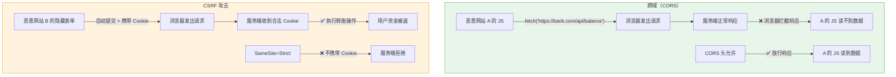
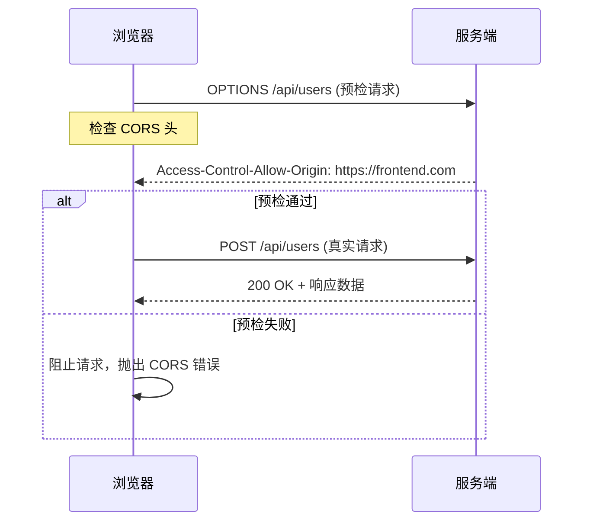

# 跨域问题分析与解决方案

## 核心澄清：跨域 ≠ 防 CSRF

> ⚠️ **跨域（CORS）和 CSRF 是两个完全不同的安全问题，解决的是不同的威胁模型。** 这是面试中最容易混淆的点。

| 维度 | 跨域（CORS） | CSRF |
| :--- | :--- | :--- |
| **防护目标** | 防止**恶意网站读取**你的 API 响应数据 | 防止**恶意网站借用你的身份**发起操作 |
| **攻击方向** | 攻击者网站 → 读你的数据 | 攻击者网站 → 用你的 Cookie 写你的数据 |
| **浏览器行为** | 默认**阻止**跨域请求的响应读取 | 默认**允许**跨域请求携带 Cookie |
| **解决机制** | CORS 响应头（服务端授权） | SameSite Cookie / CSRF Token / Referer 校验 |

**一句话总结**：
- **CORS 防的是"偷看"**：A 网站的 JS 能不能读到 B 网站 API 返回的数据
- **CSRF 防的是"冒用"**：A 网站能不能借用户浏览器的 Cookie 去调 B 网站的接口

---

## 一、什么是浏览器跨域？

### 同源策略（Same-Origin Policy）

同源策略是浏览器安全基石：**只有协议 + 域名 + 端口三者完全相同，才算同源**。不同源之间的资源访问会被浏览器限制。

| 当前页面 | 请求目标 | 是否同源 | 原因 |
| :--- | :--- | :--- | :--- |
| `https://app.com` | `https://app.com/api/users` | ✅ 同源 | 完全一致 |
| `https://app.com` | `http://app.com/api/users` | ❌ 跨域 | 协议不同 |
| `https://app.com` | `https://api.app.com/users` | ❌ 跨域 | 域名不同 |
| `https://app.com:8080` | `https://app.com:9090/api` | ❌ 跨域 | 端口不同 |
| `https://app.com` | `https://cdn.app.com/img.png` | ❌ 跨域 | 子域名也不同 |

### 跨域限制了什么？

| 资源类型 | 默认行为 | 说明 |
| :--- | :--- | :--- |
| **AJAX/Fetch 响应** | ❌ 阻止读取 | 请求能发出去，但浏览器拦截响应体 |
| **Cookie/LocalStorage** | ❌ 不共享 | 不同源的存储完全隔离 |
| **DOM 访问** | ❌ 阻止 | iframe 跨域无法操作对方 DOM |
| **图片/CSS/JS 加载** | ✅ 允许 | ``、`<link>`、`<script>` 标签不受限 |
| **表单提交** | ✅ 允许 | ⚠️ 这就是 CSRF 能利用的原因！ |

> 💡 **关键认知**：跨域限制的是**浏览器对响应的读取**，不是阻止请求发送。请求实际上已经到达服务端并执行了，只是浏览器不让 JS 拿到响应结果。这也是为什么 CSRF 能成功——请求发了、Cookie 带了、服务端执行了，只是攻击者读不到响应而已。

---

## 二、跨域 vs CSRF 关系图解



---

## 三、跨域问题解决方案

### 方案一：CORS 响应头（标准方案）⭐️

服务端在响应中添加 CORS 头，告诉浏览器"我允许这个源访问"：

```http
Access-Control-Allow-Origin: https://frontend.com
Access-Control-Allow-Methods: GET, POST, PUT, DELETE
Access-Control-Allow-Headers: Authorization, Content-Type
Access-Control-Allow-Credentials: true
```

#### Spring Boot 配置示例

```java
@Configuration
public class CorsConfig implements WebMvcConfigurer {
    @Override
    public void addCorsMappings(CorsRegistry registry) {
        registry.addMapping("/api/**")
            .allowedOrigins("https://frontend.com")  // 不要用 *，配合 Credentials 时必须指定具体源
            .allowedMethods("GET", "POST", "PUT", "DELETE")
            .allowedHeaders("*")
            // 当 allowCredentials(true) 时，allowedOrigins 不能用通配符 
            // allowCredentials(true) 表示我同意这个跨域请求带上 Cookie"。用 HttpOnly Cookie 存 Token 时必须开，用 Header 传 Token 时不需要开。
            .allowCredentials(true) ，
            // "预检结果缓存 1 小时，减少 OPTIONS 请求次数"。生产环境建议设为 3600-86400，兼顾性能和策略更新的及时性。
            .maxAge(3600);
    }
}
```

#### 预检请求（Preflight）

对于非简单请求（如带 `Authorization` 头的 POST、自定义 Header），浏览器会先发一个 `OPTIONS` 请求确认服务端是否允许，通过后才发真实请求。



#### ⚠️ CORS 常见踩坑

| 问题 | 原因 | 解决 |
| :--- | :--- | :--- |
| `Allow-Credentials: true` 时不能用 `*` | 规范要求 | 必须指定具体的 Origin |
| 预检请求缓存失效 | `max-age` 设置过短或未设置 | 合理设置 `maxAge`，减少 OPTIONS 请求 |
| 本地开发跨域 | 前后端端口不同 | 开发环境可用 Vite/Webpack proxy，生产用 Nginx |
| 通配符子域名不支持 | `*.example.com` 不被 CORS 支持 | 需服务端动态匹配 Origin 并回显 |

### 方案二：Nginx 反向代理（生产首选）⭐️⭐️

让前端和 API 在同一个域名下，从根本上消除跨域：

```nginx
server {
    listen 443 ssl;
    server_name app.com;
    
    # 前端静态资源
    location / {
        root /usr/share/nginx/html;
        try_files $uri $uri/ /index.html;
    }
    
    # API 代理到后端
    location /api/ {
        proxy_pass http://backend-server:8080/;
        proxy_set_header Host $host;
        proxy_set_header X-Real-IP $remote_addr;
        proxy_set_header X-Forwarded-For $proxy_add_x_forwarded_for;
    }
}
```

**工作原理**：前端请求 `/api/users` → Nginx 转发到后端 → 浏览器看到的是同域请求 → **无跨域问题**。

#### 优点

- ✅ 彻底消除跨域，无需改任何代码
- ✅ 同时解决部分 CSRF 问题（同域后 SameSite 自然生效）
- ✅ 可统一做限流、日志、SSL 终止
- ✅ 隐藏后端真实地址，增强安全性

### 方案三：JSONP（已过时，了解即可）

利用 `<script>` 标签不受跨域限制的特性，服务端返回函数调用而非 JSON：

```javascript
// 前端
function handleData(data) { console.log(data) }
const script = document.createElement('script')
script.src = 'https://api.example.com/data?callback=handleData'
document.body.appendChild(script)

// 服务端返回
handleData({"name": "张三", "age": 25})
```

**缺点**：仅支持 GET、安全风险高（XSS）、已被 CORS 取代。**仅用于维护历史遗留系统**。

### 方案对比

| 方案 | 适用场景 | 优点 | 缺点 |
| :--- | :--- | :--- | :--- |
| **CORS** | 前后端分离、多端接入、第三方 API | 标准协议，灵活可控 | 需服务端配合，预检请求有开销 |
| **Nginx 反向代理** | ⭐️ 生产环境首选 | 彻底消除跨域，无需改代码 | 增加一层代理，运维复杂度略增 |
| **JSONP** | 历史遗留系统 | 兼容老浏览器 | 仅 GET，安全风险高，已废弃 |
| **WebSocket** | 实时通信场景 | 不受同源策略限制 | 仅适用于长连接场景 |

---

## 四、开发环境跨域处理

### Vite 代理配置

```javascript
// vite.config.js
export default defineConfig({
  server: {
    // 开发服务器代理配置，将前端请求转发到后端，避免跨域问题
    proxy: {
      // 匹配所有以 /api 开头的请求
      '/api': {
        // 后端服务的实际地址，代理会将请求转发到这个目标
        target: 'http://localhost:8080',
        // 修改请求头中的 Host 为目标地址，避免后端因 Host 不匹配而拒绝请求
        changeOrigin: true,
        // 路径重写：去掉请求路径中的 /api 前缀
        // 例如前端请求 /api/users → 转发到后端变为 /users
        rewrite: (path) => path.replace(/^\/api/, '')
      }
    }
  }
})
```

### Webpack DevServer 代理配置

```javascript
// vue.config.js / webpack.config.js
module.exports = {
  devServer: {
    // 开发服务器代理配置，原理与 Vite 相同，语法略有差异
    proxy: {
      // 匹配所有以 /api 开头的请求
      '/api': {
        // 后端服务的实际地址
        target: 'http://localhost:8080',
        // 修改请求头中的 Host 为目标地址
        changeOrigin: true,
        // 路径重写规则（对象形式，key 为正则匹配，value 为替换值）
        // 例如前端请求 /api/users → 转发到后端变为 /users
        pathRewrite: { '^/api': '' }
      }
    }
  }
}
```

> 💡 **研发日常**：开发环境用构建工具代理，生产环境用 Nginx 反向代理。**不要在开发环境配置 CORS 然后带到生产**，两者架构完全不同。

---

## 五、安全检查清单

| 检查项 | 状态 | 说明 |
| :--- | :--- | :--- |
| 生产环境使用 Nginx 反向代理 | ☐ | 优先于 CORS |
| CORS 不使用通配符 `*` | ☐ | 配合 Credentials 时必须指定具体源 |
| CORS 白名单最小化 | ☐ | 只允许可信的前端域名 |
| 预检请求合理缓存 | ☐ | `max-age` 设置为 3600-86400 |
| 敏感接口不使用 JSONP | ☐ | JSONP 已废弃，存在 XSS 风险 |
| 开发/生产跨域方案分离 | ☐ | 开发用代理，生产用 Nginx |
| HTTPS 全站启用 | ☐ | 防止中间人篡改 CORS 头 |

---

## 六、面试话术

> "跨域和 CSRF 是两个独立的安全问题。跨域（CORS）解决的是'恶意网站能否读取你的 API 响应'，通过服务端返回 CORS 响应头或 Nginx 反向代理解决；CSRF 解决的是'恶意网站能否借用用户的 Cookie 发起操作'，通过 SameSite Cookie、CSRF Token 解决。两者防护目标和机制完全不同，不能混淆。生产中推荐 Nginx 反向代理同时解决跨域和部分 CSRF 问题（同域后 SameSite 自然生效）。"

---

## 小结

- **跨域本质**：浏览器同源策略限制跨域响应的读取，请求本身不会被阻止
- **跨域 ≠ CSRF**：CORS 防"偷看"，CSRF 防"冒用"，两者独立
- **生产首选 Nginx 反向代理**：彻底消除跨域，同时增强安全性和可运维性
- **CORS 作为补充**：适用于多端接入、第三方 API 等无法同域的场景
- **JSONP 已废弃**：仅用于维护历史遗留系统

> 💡 **记忆口诀**：**同源三要素，协议域名端口齐；跨域防偷看，CSRF 防冒用；生产 Nginx 代，开发代理替；CORS 作补充，JSONP 已弃**。
