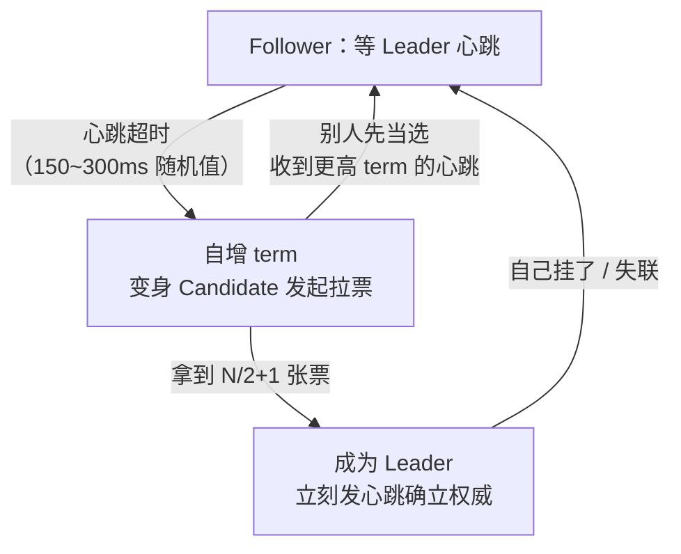

# 分布式理论基础：CAP、BASE 与共识算法（Raft/Paxos）

> 一句话：单机没这些破事——一旦数据存了多份（主从、集群、多副本），你就必须在"数据一致"和"服务可用"之间做取舍（CAP/BASE），并且让多台机器"对同一件事达成统一意见"（共识算法，Raft/Paxos）。所有分布式中间件（MySQL 主从、Redis 哨兵、etcd、Kafka）的骚操作，都是在这三套理论里打转。

## 零、什么时候会撞上这些理论

只要你干过后端，一定已经见过这些场景：

```
MySQL 挂了？加个从库              → 数据有两份了
Redis 单点？上哨兵/集群           → 数据有五份了
Kafka Broker 挂了丢消息？多副本   → 数据有三份了
```

数据一旦存多份，三个问题立刻出现：

1. **两份数据不一致了怎么办？**（CAP 一致性）
2. **网络断了，哪边继续服务？**（CAP 可用性）
3. **主节点挂了，谁说了算新选的主？大家会不会各选各的？**（共识算法）

## 一、CAP：分区发生时，二选一

### 1.1 用两家奶茶店记账理解三个字母

总店和分店各有一本账：

| 字母 | 含义 | 记账类比 |
| :--- | :--- | :--- |
| **C**（Consistency 一致性） | 所有节点同一时刻看到的数据一样 | **任何时刻两本账必须一模一样** |
| **A**（Availability 可用性） | 每个请求都能得到响应（不保证是最新数据） | **每家店随时都能记账、查账** |
| **P**（Partition tolerance 分区容错） | 网络断成几块时，系统整体还能继续工作 | **总店和分店之间电话断了，生意还得做** |

### 1.2 为什么说"P 没得选"

关键认知：**网络断（分区）不是会不会的问题，是什么时候的问题**——光纤被挖断、交换机重启、机房抖动，长年累月必然发生。所以 P 是必选项，CAP 实际上是 **C 和 A 之间二选一**。

拿奶茶店推演一遍网络断了（分区发生时）：

```
追求 C（两本账必须一致）：
  记一笔账必须两店同步完成才算成功
  → 电话断了，同步做不了
  → 两店都不敢记账，客户点不了单     → 牺牲了 A

追求 A（每家店都能开张）：
  电话断了，各记各的
  → 账本出现分歧                     → 牺牲了 C

P（电话一定会断）：
  这个躲不掉，只能接受
```

> 💡 "CAP 三选二"是流传最广的说法，但严格讲是"**二选一**"：P 是背景板。面试时说出这一点，直接和背题的拉开差距。

### 1.3 CP 和 AP 的代表

| 路线 | 分区时怎么做 | 代表系统 |
| :--- | :--- | :--- |
| **CP** | 宁可拒绝服务，也不给不一致的数据 | etcd、ZooKeeper、Redis 哨兵选主期间 |
| **AP** | 宁可给旧数据，也要继续服务 | Eureka、Redis 主从（异步复制） |

- etcd 放弃 A：它存的是 K8s 的调度元数据，**给错数据比给不出数据严重得多**
- Eureka 放弃 C：服务注册中心，**消费者拿个稍微过期的服务列表没事，整个注册中心瘫痪才是灾难**

### 1.4 三个进阶认知（面试加分项）

1. **CAP 只在"分区发生时"生效**。没有分区的太平岁月，C 和 A 可以同时享受——Raft 集群平时既一致又可用。分区才是"考验时刻"。
2. **粒度可以很细**。同一个系统里不同功能可以不同选型：Redis 写路径是 AP（主挂了从库顶上，可能丢几秒数据），哨兵选主却是 CP 阶段（凑不够 quorum 就不出新主）。
3. **"一致"有很多档位**。CAP 的 C 是最强档（线性一致性，读了就必须是最新的）；MySQL 主从那种"延迟一下但最终一样"是更弱的档——这就引出了 BASE。

> 💡 注意别把 CAP 的"一致性"和日常说的"双写一致性"（Redis 和 MySQL 的数据对不上）混为一谈——前者是分布式理论里的强一致，后者是业务层面的数据同步问题，八竿子打不着但常被一起问。

## 二、BASE：选了 AP，账怎么补

很多系统选了 AP（保可用、容忍暂时不一致），但"不一致"不能永远摆烂。**BASE 就是 AP 的售后方案**：

| 字母 | 含义 | 大白话 |
| :--- | :--- | :--- |
| **BA**（Basically Available 基本可用） | 允许降级 | 双十一下单慢点可以忍；推荐挂了给你看静态榜单也行 |
| **S**（Soft State 软状态） | 允许中间状态 | 订单可以停留在"支付中"半小时，不追求任何瞬间全局一致 |
| **E**（Eventually consistent 最终一致性） | 一段时间后数据终会一致 | 现在不一致先欠着，回头一定补齐 |

一句话：**BASE = "不一致先记账，回头补齐"的工程化落地**，本质是 CAP 里 A 路线的延伸。

"最终一致"不是祈祷，靠的是具体机制——都是你熟悉的东西：

```
MySQL 主从延迟        → slave 追上 binlog 后，读到的就是新数据了
本地消息表 + 定时补偿  → 事务提交后异步发消息，失败了定时重试
消息队列 + 幂等消费    → 对账任务兜底，多收的退回去
Redis 读写分离        → 主库写完，等复制延迟过了再读
```

> 💡 联系面试高频题："Redis 与 MySQL 双写一致性"的几种方案（延迟双删、订阅 binlog），本质上全是 BASE 里 E 的具体实现——先写主库，缓存晚点跟上，最终一致。

## 三、共识算法：一群人怎么统一意见

### 3.1 难在哪

共识（Consensus）= 多个节点就**一个值**（谁是主、日志追加到哪条）达成统一意见。听起来像小学选班长，难在三个叠加条件：

- 网络会断：消息可能丢、可能迟到几秒
- 机器会挂：有的挂了**还能回来**（重启），有的**永远回不来**（硬盘坏了）
- 没有裁判：没有任何一个绝对可靠的"第三方"替你宣布结果

最典型的场景：**主节点挂了，选新主**。如果选不出统一答案，就会出现"双主"（脑裂）：

```
脑裂现场：
  节点 A、B 认为主是 M1；节点 C、D、E 认为主是 M2
  → 两个主同时接受写入
  → 网络恢复后，两边的写互相冲突，数据错乱，无法收场
```

共识算法的使命：**无论断网、宕机、重启，全集群对"谁是主、日志是什么顺序"永远只有一个答案**。

### 3.2 Paxos：祖师爷，出了名的难懂

Paxos（1998，Lamport）是共识算法的理论鼻祖，核心思想两句话：

1. **两阶段**：先"准备"（Prepare，各位承诺不再接受旧提案）再"接受"（Accept，正式批准）
2. **多数派**（Quorum）：提案被**超过半数**节点批准才算通过

它证明了一件事：在以上恶劣条件下，共识是可达成的。但它的论文故意写成古希腊议会的故事，晦涩到 Lamport 自己后来又补了一篇《Paxos Made Simple》……效果依然.simple 有限。而且它只解决"单个值"的共识，工程上要拼成 Multi-Paxox（日志版），实现难度地狱级（Google Chubby、Spanner 的团队都叫过苦）。

**面试要求：知道它是理论基础、两阶段 + 多数派、工程难，就够了。** 真正要会讲的是 Raft。

### 3.3 Raft：为"可理解性"而生的 Paxos 平替

Raft（2014）的出发点写在论文标题里：*In Search of an Understandable Consensus Algorithm*（找一个能看懂的共识算法）。作者的理念：**和 Paxos 数学上等价，但拆成三件人话能描述的事**：

| 三件事 | 干什么 | 类比 |
| :--- | :--- | :--- |
| ① Leader 选举 | 挂了选新主 | 经理失联，员工投票选新经理 |
| ② 日志复制 | 写操作同步到多数派 | 决定要过半数员工签字才算"公司正式决定" |
| ③ 安全性 | 已提交的决定永不丢失 | 新经理必须完整知道前任所有决定 |

#### ① 选举：任期 term + 过半投票

每个节点三种身份：**Leader（经理）/ Follower（员工）/ Candidate（竞选者）**。



两个精妙设计：

- **term（任期）= 朝代号，单调递增**。任何节点收到比自己新的 term，立刻认怂变成 Follower——老主从宕机中恢复，发现自己 term 落后，自动退位，不会争权。
- **心跳超时是随机值**。避免所有节点同时心跳超时、同时竞选、选票瓜分谁都选不上；随机化让总有人先醒一步。

#### ② 日志复制：写请求的完整旅程

```
客户端写请求
   │
   ▼
Leader 追加一条日志 ──并行发给所有 Follower──> Follower 各自落盘
   │                                            │
   │<──── N/2+1 个确认（含自己）──── 提交 commit │
   ▼
应用到状态机，回复客户端"成功"
```

关键点：**只有过半数节点落盘，才算提交**。落后的 Follower 不用管它慢慢补——反正不挡提交。

#### ③ 多数派（Quorum）：整个算法的灵魂

为什么处处是"N/2+1"？拿 5 节点集群算一笔账：

```
5 个节点，提交需要 3 票（5/2+1）

任意两个"3 人组"必然至少有 1 个公共成员：
  {A,B,C} ∩ {A,D,E} = {A}
  {A,B,C} ∩ {C,D,E} = {C}
  {A,B,C} ∩ {B,D,E} = {B}

→ 任何一届能当选的 Leader，必然和"所有已提交日志的多数派"有交集
→ 交集里的人见过全部已提交日志
→ 新 Leader 手里一定不缺任何已提交的东西
→ 已提交的数据永远不会丢
```

容忍度公式：**N 个节点容忍 N/2−1 个故障**（3 容 1，5 容 2，7 容 3）。加节点买的是"容错"，不是性能。

#### 脑裂实战推演（面试高频）

5 节点集群断网，裂成 {A,B,C} 和 {D,E} 两块：

```
{A,B,C}：3/5，凑够多数派 → 选出新 Leader，继续读写 ✅
{D,E}  ：2/5，永远凑不够 3 票 → 选不出主；
         老主若在这边，写请求的确认数也到不了 3 → 无法提交任何新日志 ❌
```

**结论：分区期间，只有多数派那边能服务，少数派那边自动瘫痪——双主物理上不可能出现。** 网络恢复后，D、E 发现更高的 term，自动退位成 Follower，回滚自己未提交的日志，从新 Leader 补齐。这就是"分区容错"的完整含义：裂了也能恢复如初。

### 3.4 谁在用 Raft（你的技术栈点名）

| 系统 | 用 Raft 干什么 |
| :--- | :--- |
| **etcd** | K8s 全部元数据的存储与选主（最标准 Raft 实现） |
| **Kafka KRaft** | 3.x 起用 Raft（KRaft）管理元数据，**正式踢掉 ZooKeeper**（4.0 已完全移除） |
| **RocketMQ DLedger** | Commit Log 多副本，用 Raft 保证消息不丢 |
| **Consul / TiKV / nacos（Raft 模式）** | 配置与服务发现的元数据共识 |
| ZooKeeper | 用的 ZAB——Raft 的近亲，同为 Paxos 变种 |

> 💡 面试可聊的点："为什么 Kafka 要弃用 ZooKeeper？"——外挂一个 ZooKeeper 集群又重又要双份运维，KRaft 把 Raft 内嵌进 Broker 自己管元数据，架构一步到位。这个问题背后考的就是"你知道共识算法在 Kafaka 里的位置"。

### 3.5 Paxos vs Raft 一张表

| | Paxos | Raft |
| :--- | :--- | :--- |
| 定位 | 理论鼻祖 | 工程友好版 |
| 角色 | 节点平等，无 Leader | **强 Leader**（一切写请求过 Leader） |
| 理解难度 | 地狱 | 人话 |
| 核心机制 | 两阶段 + 多数派 | 选举 + 日志复制 + 多数派 |
| 工程实现 | 极难（Chubby、Spanner） | 相对容易（etcd、KRaft、DLedger） |

**本质上等价：都是"多数派拍板 + 日志顺序一致"。** 差别只在 Paxos 把简单的事说得复杂，Raft 把复杂的事说得简单。

## 四、把理论摔回你天天用的系统

学理论不做题等于白学。拿你手上的系统逐个体检：

| 系统 | C/A 取舍 | 共识/一致性机制在哪 |
| :--- | :--- | :--- |
| **MySQL 主从** | 滑动选择：异步复制 = AP；半同步 = 往 C 拧一点 | 无共识，靠 binlog 复制 + `after_sync/after_commit` 调节 |
| **Redis 哨兵** | 选主阶段 CP，日常读写 AP | quorum 投票 + epoch（Raft 的简化思想） |
| **etcd** | CP | 标准 Raft |
| **Eureka** | AP | 无共识，对等复制 + 自我保护 |
| **Kafka** | 数据层偏 AP（acks 可调），元数据层 CP | KRaft（Raft 变种）管元数据 |

面试被问"你们系统是 CP 还是 AP"时，照这个表的样子答："分功能说——XX 路径是 XX，因为业务上丢 XX 的代价大于/小于不可用"。**先给结论，再给取舍理由**，这就是标准答案的骨架。

## 五、面试速答卡

```
Q1：CAP 是什么？
A ：一致性、可用性、分区容错。P 是背景板（网络必断），
    实际是分区发生时 C 和 A 二选一。

Q2：举例 CP / AP 系统？
A ：CP：etcd、ZooKeeper——给错数据比不可用更致命；
    AP：Eureka、Redis 主从——不可用比数据旧更致命。

Q3：BASE 和 CAP 什么关系？
A ：BASE 是 AP 路线的工程落地：基本可用 + 软状态 + 最终一致。
    主从延迟、本地消息表、延迟双删都是 E 的实现。

Q4：Raft 选举流程？
A ：Follower 心跳超时 → 自增 term 变 Candidate 拉票 →
    拿到 N/2+1 票当选 → 发心跳。收到更高 term 立刻认怂退位。

Q5：怎么防脑裂？
A ：多数派机制。提交和当选都要 N/2+1，少数派那边凑不够票
    就瘫痪；两个多数派必有交集，所以不可能出现双主。

Q6：为什么 etcd 用 Raft 而不用 Paxos？
A ：数学等价，Raft 强 Leader + 明确分模块，工程实现和
    排错容易得多——选 Raft 是选"可理解性"。
```

## 六、总结

| 问题 | 理论 | 一句话 |
| :--- | :--- | :--- |
| 数据多份，不一致怎么办 | **CAP** | 分区时 C、A 二选一，P 必选 |
| 选了 A，账什么时候补 | **BASE** | 基本可用 + 软状态 + 最终一致，先欠后补 |
| 谁说了算，会不会脑裂 | **共识算法** | 多数派拍板（Raft），少数派自动瘫痪 |

一句话记住分布式理论：

> **数据存一份是"单机"，存多份是"分布式"——而多出来的每一份，都要用 CAP 付取舍、用 BASE 补窟窿、用共识算法定乾坤。**
