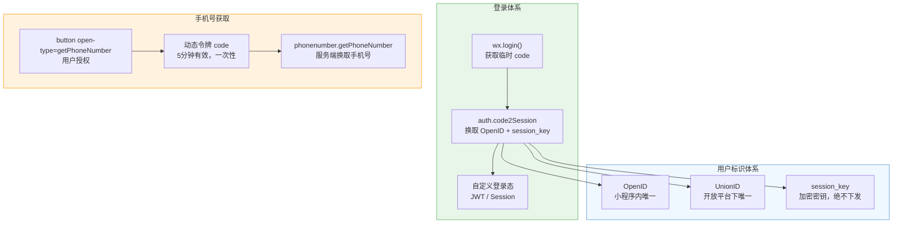
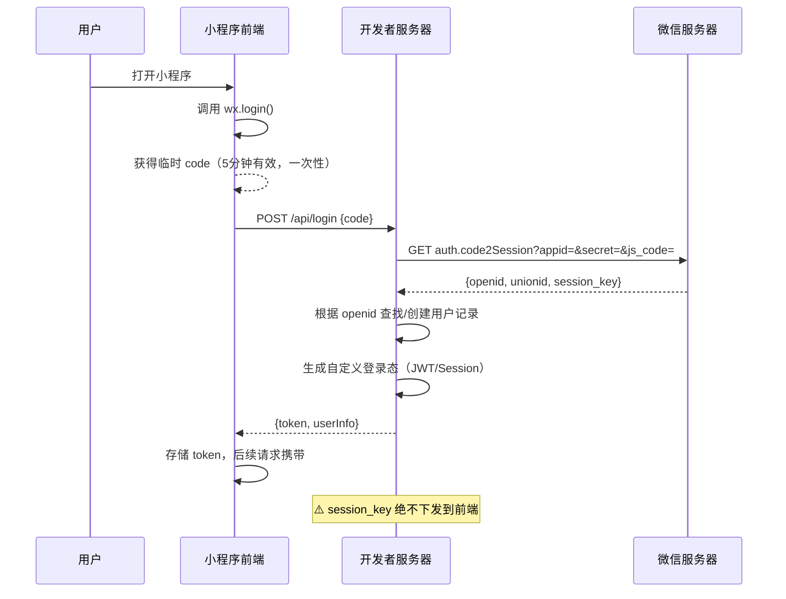
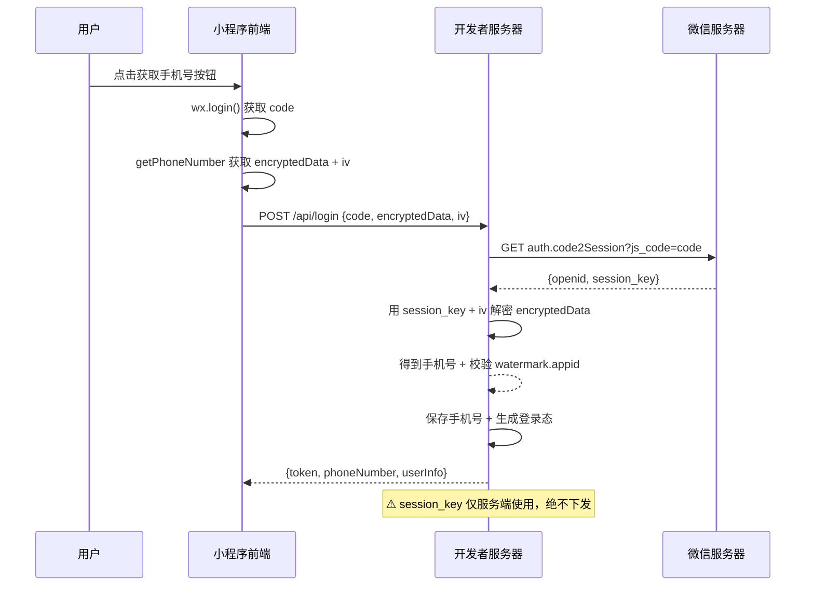
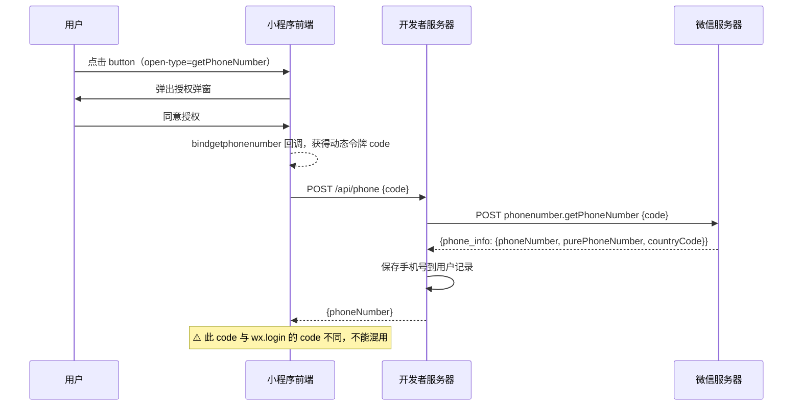

# 微信小程序登录流程与手机号获取

## 核心概念关系全览



> 💡 **阅读指引**：小程序登录解决"**你是谁**"，手机号获取解决"**怎么联系你**"。两者是独立的流程，`wx.login` 的 code 和 `getPhoneNumber` 的 code **不能混用**。

---

## 一、小程序登录流程

### 完整时序图



### 逐步解析

| 步骤 | 动作 | 细节说明 |
| :--- | :--- | :--- |
| ① | 前端调用 `wx.login()` | 获取临时登录凭证 `code`，**有效期 5 分钟，只能使用一次** |
| ② | 前端将 code 发送到开发者服务器 | 通过 HTTPS POST 请求，code 作为参数传递 |
| ③ | 服务器调用 `auth.code2Session` | 传入 `appid` + `appsecret` + `js_code`，向微信服务器换取用户标识 |
| ④ | 微信返回三个关键值 | **openid**（小程序内唯一）、**unionid**（需绑定开放平台）、**session_key**（加密密钥） |
| ⑤ | 服务器生成自定义登录态 | 根据 openid 关联业务用户，签发 JWT 或创建 Session，**不暴露 session_key** |
| ⑥ | 前端存储并使用登录态 | 后续 API 请求携带 token，服务器验证后识别用户身份 |

### ⚠️ 安全红线

| 规则 | 原因 | 违反后果 |
| :--- | :--- | :--- |
| **session_key 绝不下发到前端** | 它是用户数据加密签名的密钥，泄露可导致用户数据被解密 | 用户隐私泄露，小程序被封禁 |
| **appsecret 绝不放在前端代码里** | 前端代码可被反编译提取 | 攻击者可伪造 code2Session 请求 |
| **code 只能使用一次** | 微信服务端会校验，重复使用直接报错 | 登录失败 |
| **不要信任前端的 openid** | 前端可篡改，必须以 code2Session 返回的为准 | 身份伪造 |

### 服务端实现示例（Spring Boot）

```java
@RestController
@RequestMapping("/api/auth")
public class WxLoginController {

    @Value("${wx.miniprogram.appid}")
    private String appid;

    @Value("${wx.miniprogram.secret}")
    private String appSecret;

    @Autowired
    private UserService userService;

    @PostMapping("/login")
    public Result<?> login(@RequestBody Map<String, String> params) {
        String code = params.get("code");
        if (code == null || code.isEmpty()) {
            return Result.fail("code is required");
        }

        // 1. 调用微信 code2Session 接口
        String url = String.format(
            "https://api.weixin.qq.com/sns/jscode2session?appid=%s&secret=%s&js_code=%s&grant_type=authorization_code",
            appid, appSecret, code
        );
        String response = restTemplate.getForObject(url, String.class);
        JSONObject json = JSON.parseObject(response);

        // 2. 检查错误
        if (json.containsKey("errcode") && json.getIntValue("errcode") != 0) {
            return Result.fail("微信登录失败：" + json.getString("errmsg"));
        }

        String openid = json.getString("openid");
        String unionid = json.getString("unionid");
        String sessionKey = json.getString("session_key"); // ⚠️ 仅服务端使用，绝不下发

        // 3. 查找或创建用户
        User user = userService.findByOpenid(openid);
        if (user == null) {
            user = userService.createByOpenid(openid, unionid);
        }

        // 4. 生成自定义登录态（JWT）
        String token = jwtService.generateToken(user.getId(), openid);

        // 5. 缓存 session_key（用于后续解密手机号等敏感数据）
        redisTemplate.opsForValue().set("wx:session:" + openid, sessionKey, Duration.ofDays(7));

        Map<String, Object> data = new HashMap<>();
        data.put("token", token);
        data.put("userId", user.getId());
        return Result.success(data);
    }
}
```

---

## 二、获取用户手机号

### ⚠️ 重要前提

| 条件 | 说明 |
| :--- | :--- |
| **非个人主体** | 个人类型小程序不支持 |
| **已完成微信认证** | 未认证的小程序无法调用 |
| **付费使用** | 自 2023年8月28日起，每次成功调用收费 **0.03 元** |
| **体验额度** | 每个小程序账号有 **1000 次免费体验额度**（正式版/体验版/开发版共用） |
| **免费豁免** | 政府、非营利组织、事业单位政务民生、公立医疗机构、学历教育学校免收费 |

### 新旧方式对比

| 维度 | 旧版（session_key 解密） | 新版（动态令牌 code，推荐） |
| :--- | :--- | :--- |
| **触发方式** | `wx.login()` 获取 code + `getPhoneNumber` 获取 encryptedData + iv | `button open-type=getPhoneNumber` 获取动态令牌 code |
| **服务端接口** | `auth.code2Session` → AES 解密 encryptedData | `phonenumber.getPhoneNumber` 直接用 code 换手机号 |
| **是否需要 session_key** | ✅ 必须，用于解密 | ❌ 不需要 |
| **安全性** | ⚠️ 较低（session_key 参与解密，泄露风险高） | ⭐️ 更高（code 一次性，不依赖 session_key） |
| **微信推荐度** | 仍可继续使用，但建议迁移 | ✅ 官方推荐 |
| **基础库要求** | 所有版本 | ≥ 2.21.2 |
| **登录与获取手机号** | 可合并为一个接口 | 通常需要两个独立接口 |

### 旧版流程（session_key 解密方式）



#### 旧版服务端解密代码示例

```java
@PostMapping("/login")
public Result<?> login(@RequestBody Map<String, String> params) {
    String code = params.get("code");
    String encryptedData = params.get("encryptedData");
    String iv = params.get("iv");

    // 1. 用 code 换取 session_key
    String url = String.format(
        "https://api.weixin.qq.com/sns/jscode2session?appid=%s&secret=%s&js_code=%s&grant_type=authorization_code",
        appid, appSecret, code
    );
    JSONObject sessionJson = JSON.parseObject(restTemplate.getForObject(url, String.class));
    String sessionKey = sessionJson.getString("session_key");
    String openid = sessionJson.getString("openid");

    // 2. 用 session_key + iv 解密 encryptedData（AES-128-CBC）
    byte[] encData = Base64.decodeBase64(encryptedData);
    byte[] ivBytes = Base64.decodeBase64(iv);
    byte[] keyBytes = Base64.decodeBase64(sessionKey);

    Cipher cipher = Cipher.getInstance("AES/CBC/PKCS7Padding");
    SecretKeySpec keySpec = new SecretKeySpec(keyBytes, "AES");
    IvParameterSpec ivSpec = new IvParameterSpec(ivBytes);
    cipher.init(Cipher.DECRYPT_MODE, keySpec, ivSpec);
    byte[] decrypted = cipher.doFinal(encData);

    // 3. 解析 JSON 得到手机号
    JSONObject phoneData = JSON.parseObject(new String(decrypted, "UTF-8"));
    String phoneNumber = phoneData.getString("phoneNumber");
    String purePhoneNumber = phoneData.getString("purePhoneNumber");

    // 4. ⚠️ 校验 watermark.appid 是否匹配（防伪造，必须做！）
    JSONObject watermark = phoneData.getJSONObject("watermark");
    if (!appid.equals(watermark.getString("appid"))) {
        return Result.fail("数据校验失败，appid 不匹配");
    }

    // 5. 保存用户信息 + 生成登录态
    User user = userService.findOrCreateByOpenid(openid);
    userService.updatePhone(user.getId(), purePhoneNumber);
    String token = jwtService.generateToken(user.getId(), openid);

    Map<String, Object> data = new HashMap<>();
    data.put("token", token);
    data.put("phoneNumber", phoneNumber);
    return Result.success(data);
}
```

#### ⚠️ 旧版安全隐患

| 风险 | 说明 |
| :--- | :--- |
| **session_key 泄露** | 解密过程依赖 session_key，泄露后可解密所有用户数据 |
| **encryptedData 可被重放** | code 一次性，但 encryptedData 本身没有时效校验 |
| **watermark 校验易被忽略** | 很多开发者忘记校验 `watermark.appid`，导致接受伪造数据 |
| **前端传递加密数据** | encryptedData 和 iv 由前端传递，理论上可被篡改 |

### 新版流程（推荐，基础库 ≥ 2.21.2）



### 逐步解析

| 步骤 | 动作 | 细节说明 |
| :--- | :--- | :--- |
| ① | 前端渲染授权按钮 | `<button open-type="getPhoneNumber" bindgetphonenumber="onGetPhone">` |
| ② | 用户点击并同意 | 微信弹出授权弹窗，用户可选择绑定号码或手动添加 |
| ③ | 回调获得动态令牌 code | `e.detail.code`，**有效期 5 分钟，只能消费一次** |
| ④ | 前端将 code 发送到服务器 | 注意：此 code 与 `wx.login` 的 code **完全不同** |
| ⑤ | 服务器调用 `phonenumber.getPhoneNumber` | 传入 code，微信返回验证后的手机号 |
| ⑥ | 服务器保存并返回 | 手机号存入数据库，返回给前端展示 |

### 前端代码示例

```html
<!-- 授权按钮 -->
<button 
  open-type="getPhoneNumber" 
  bindgetphonenumber="onGetPhoneNumber"
  phone-number-no-quota-toast="{{true}}"
>
  获取手机号
</button>
```

```javascript
Page({
  onGetPhoneNumber(e) {
    if (e.detail.errMsg !== 'getPhoneNumber:ok') {
      console.log('用户拒绝授权', e.detail.errMsg)
      return
    }

    const code = e.detail.code  // 动态令牌，传给后端
    console.log('动态令牌:', code)

    // 发送到后端换取手机号
    wx.request({
      url: 'https://your-server.com/api/phone',
      method: 'POST',
      header: { Authorization: 'Bearer ' + this.data.token },
      data: { code },
      success(res) {
        if (res.data.code === 0) {
          console.log('手机号:', res.data.data.phoneNumber)
        }
      }
    })
  }
})
```

### 服务端实现示例（Spring Boot）

```java
@PostMapping("/phone")
public Result<?> getPhoneNumber(@RequestBody Map<String, String> params,
                                 @RequestHeader("Authorization") String token) {
    // 1. 验证登录态
    Long userId = jwtService.getUserIdFromToken(token);
    if (userId == null) {
        return Result.fail(401, "未登录");
    }

    String code = params.get("code");
    if (code == null || code.isEmpty()) {
        return Result.fail("code is required");
    }

    // 2. 获取 access_token（建议缓存，有效期 2 小时）
    String accessToken = wxTokenService.getAccessToken();

    // 3. 调用微信手机号获取接口
    String url = "https://api.weixin.qq.com/wxa/business/getuserphonenumber?access_token=" + accessToken;
    Map<String, String> body = Map.of("code", code);
    String response = restTemplate.postForObject(url, body, String.class);
    JSONObject json = JSON.parseObject(response);

    // 4. 检查错误
    if (json.getIntValue("errcode") != 0) {
        return Result.fail("获取手机号失败：" + json.getString("errmsg"));
    }

    // 5. 提取手机号
    JSONObject phoneInfo = json.getJSONObject("phone_info");
    String phoneNumber = phoneInfo.getString("phoneNumber");         // 带区号
    String purePhoneNumber = phoneInfo.getString("purePhoneNumber"); // 纯号码
    String countryCode = phoneInfo.getString("countryCode");         // 国家码

    // 6. 保存到用户记录
    userService.updatePhone(userId, purePhoneNumber);

    Map<String, Object> data = new HashMap<>();
    data.put("phoneNumber", phoneNumber);
    data.put("purePhoneNumber", purePhoneNumber);
    data.put("countryCode", countryCode);
    return Result.success(data);
}
```

### ⚠️ 常见踩坑

| 问题 | 原因 | 解决 |
| :--- | :--- | :--- |
| `getPhoneNumber` 返回的 code 无效 | 与 `wx.login` 的 code 混用 | 两个 code 作用完全不同，不能互换 |
| 扣费了但没拿到手机号 | 在 success 回调前就认为成功 | 必须在 `bindgetphonenumber` 的 success 回调中才扣费 |
| 额度不足报错 `1400001` | 体验额度和付费资源包都用完了 | 购买资源包或检查是否符合免费条件 |
| 旧方式解密手机号失败 | 基础库升级后推荐新方式 | 迁移到 `phonenumber.getPhoneNumber` 接口 |
| 用户拒绝授权 | 正常行为 | 做好降级方案，允许跳过或手动输入 |

---

## 三、面试高频问题速答

### Q1：小程序登录流程是怎样的？

前端调用 `wx.login()` 获取临时 code → 发送到开发者服务器 → 服务器用 code + appid + appsecret 调用微信 `auth.code2Session` 接口 → 获得 openid、unionid、session_key → 服务器根据 openid 关联业务用户并生成自定义登录态（JWT/Session）→ 返回给前端。**关键点**：session_key 绝不下发到前端，code 只能使用一次，appsecret 绝不放在前端代码里。

### Q2：怎么获取用户手机号？

使用 `<button open-type="getPhoneNumber">` 组件，用户点击同意后，回调中获得动态令牌 code → 发送到服务器 → 服务器调用微信 `phonenumber.getPhoneNumber` 接口换取手机号。**注意**：此 code 与 `wx.login` 的 code 不同，不能混用；该能力自 2023年8月起收费 0.03 元/次；仅限非个人主体且已认证的小程序使用。

### Q3：OpenID 和 UnionID 有什么区别？

**OpenID** 是用户在单个小程序/公众号内的唯一标识，同一个用户在不同小程序中有不同的 OpenID。**UnionID** 是用户在微信开放平台账号下的唯一标识，同一开放平台下的多个小程序/公众号/App 共享同一个 UnionID。需要跨应用识别同一用户时，必须使用 UnionID（前提是小程序已绑定到微信开放平台）。

### Q4：session_key 为什么不能下发到前端？

session_key 是微信用于加密用户敏感数据（如手机号、用户信息）的密钥。如果下发到前端，攻击者可以通过反编译或抓包获取，进而解密所有用户的敏感数据。正确做法是：session_key 仅存储在服务器端（如 Redis），需要解密数据时在服务器端完成。

---

## 小结

- **登录流程**：`wx.login()` → code → `code2Session` → openid + session_key → 自定义登录态
- **手机号获取**：`button getPhoneNumber` → 动态令牌 code → `phonenumber.getPhoneNumber` → 手机号
- **安全红线**：session_key 不下发、appsecret 不放前端、两个 code 不混用
- **费用注意**：手机号获取 0.03 元/次，1000 次免费体验额度

> 💡 **记忆口诀**：**login 换 openid，phone 换手机号；两个 code 别混用，session_key 留服务端；认证才能取号码，三毛一次记心间**。
