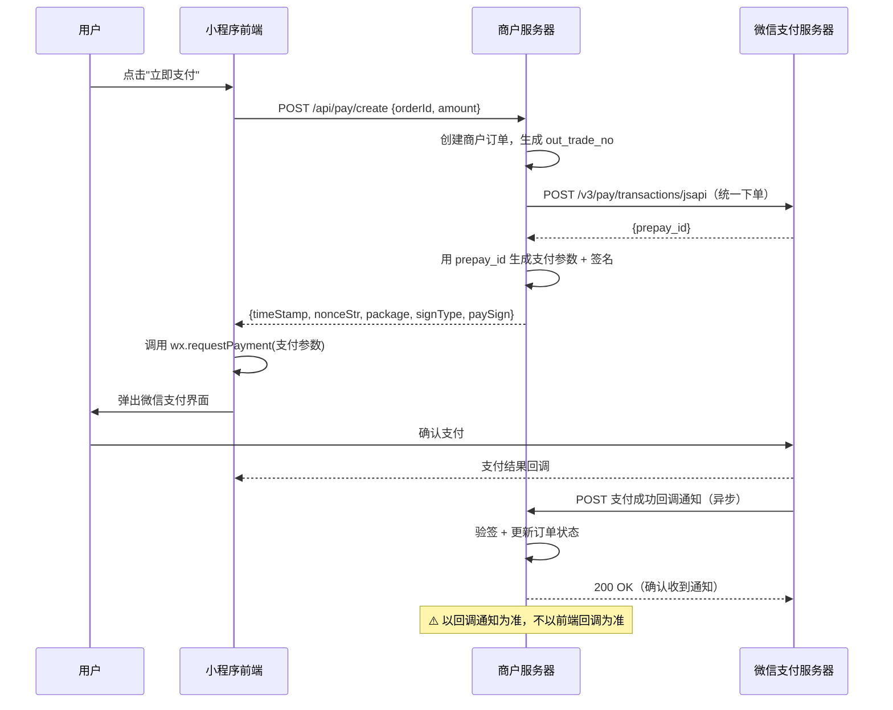
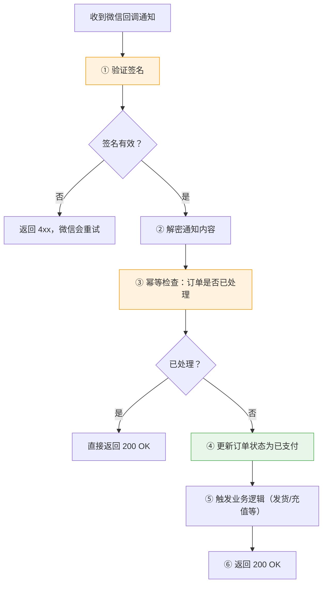
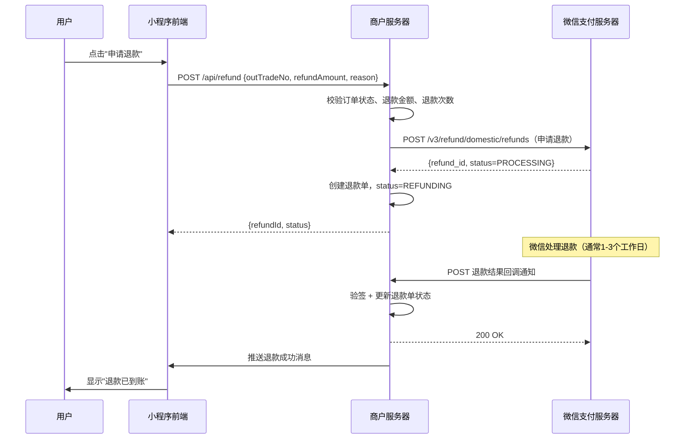
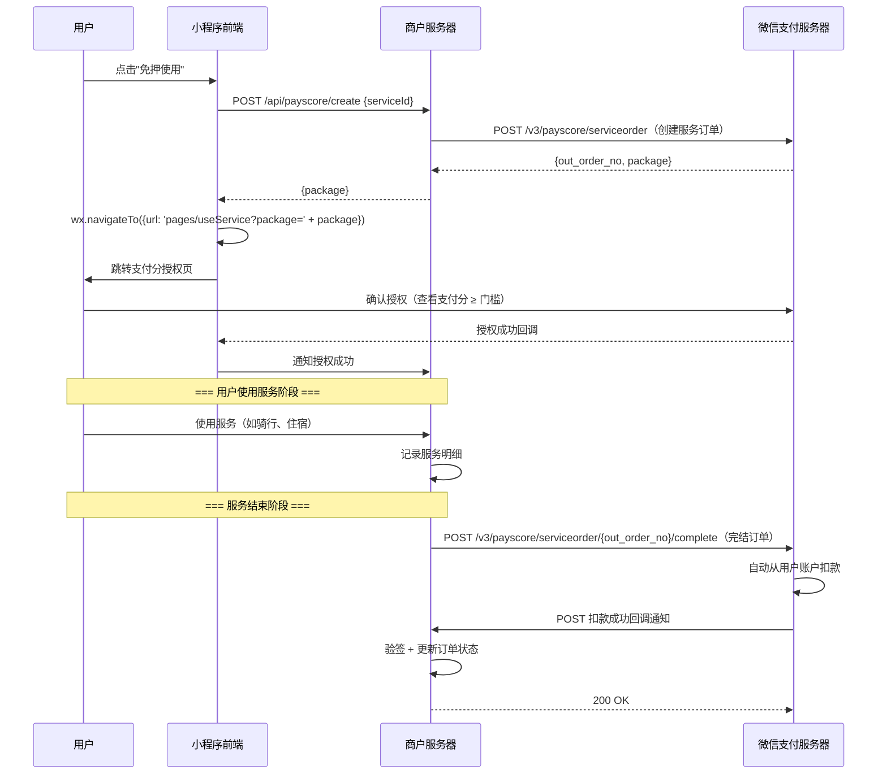
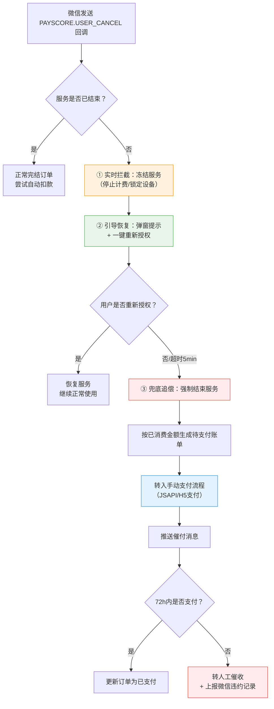
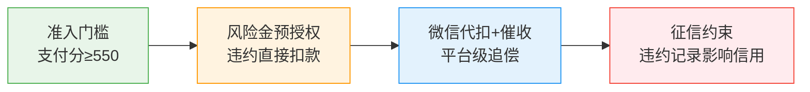

# 微信支付 JSAPI 支付流程详解

## 核心流程全览



> 💡 **核心原则**：**前端回调仅用于 UI 提示，订单状态必须以微信服务器的异步回调通知为准**。前端回调可以被伪造，回调通知有签名验证。

---

## 一、JSAPI 支付完整流程

### 第一步：统一下单（服务端）

商户服务器调用微信支付 V3 接口创建预支付订单：

```
POST https://api.mch.weixin.qq.com/v3/pay/transactions/jsapi
```

#### 请求参数

| 参数 | 必填 | 说明 |
| :--- | :--- | :--- |
| `appid` | ✅ | 小程序 appid |
| `mchid` | ✅ | 商户号 |
| `description` | ✅ | 商品描述 |
| `out_trade_no` | ✅ | 商户订单号（唯一，32字符内） |
| `notify_url` | ✅ | 支付结果回调地址（HTTPS） |
| `amount.total` | ✅ | 订单总金额（单位：分） |
| `payer.openid` | ✅ | 用户 openid（通过小程序登录获取） |

#### 响应

```json
{
  "prepay_id": "wx201410272009395522657a690389285100"
}
```

>  prepay_id 一般是不需要存储到数据库的，具体原因如下：    
> 生命周期短：prepay_id 有效期只有 2 小时，过期后即使存着也没用  
> 不是业务实体：它是微信侧的"预支付会话标识"，类似于 JWT 的 jti，不应该作为持久化业务数据  
> 可重新生成：如果用户超时未支付，重新调用统一下单就能拿到新的 prepay_id，旧的自动失效  
> 查询靠商户订单号：微信的所有查询接口（查订单、关单、退款）都用 out_trade_no，不用 prepay_id  

### 第二步：生成支付参数（服务端）

用 `prepay_id` 组装前端调起支付所需的参数，并用商户私钥签名：

```java
// 生成支付参数
Map<String, String> payParams = new TreeMap<>();
payParams.put("appId", appid);
payParams.put("timeStamp", String.valueOf(System.currentTimeMillis() / 1000));
payParams.put("nonceStr", UUID.randomUUID().toString().replace("-", ""));
payParams.put("package", "prepay_id=" + prepayId);
payParams.put("signType", "RSA");

// 按字典序拼接并用商户私钥签名
String message = String.join("\n",
    payParams.get("appId"),
    payParams.get("timeStamp"),
    payParams.get("nonceStr"),
    payParams.get("package"),
    ""
);
String paySign = signWithPrivateKey(message); // RSA-SHA256 签名

payParams.put("paySign", paySign);
return payParams;
```

### 第三步：调起支付（前端）

```javascript
wx.requestPayment({
  timeStamp: res.data.timeStamp,
  nonceStr: res.data.nonceStr,
  package: res.data.package,
  signType: res.data.signType,
  paySign: res.data.paySign,
  success(res) {
    console.log('支付成功（仅UI提示，不代表订单已完成）')
    // 跳转到支付成功页，但订单状态以回调为准
  },
  fail(err) {
    console.log('支付取消或失败', err)
  }
})
```

### 第四步：支付结果回调通知（服务端）⭐️

微信支付成功后，会向 `notify_url` 发送 POST 请求通知商户。**这是订单状态变更的唯一可信来源**。

#### 回调处理要点



#### 服务端回调处理示例

```java
@PostMapping("/api/pay/notify")
public ResponseEntity<?> payNotify(HttpServletRequest request) {
    try {
        // 1. 读取请求头和请求体
        String serialNo = request.getHeader("Wechatpay-Serial");
        String timestamp = request.getHeader("Wechatpay-Timestamp");
        String nonce = request.getHeader("Wechatpay-Nonce");
        String signature = request.getHeader("Wechatpay-Signature");
        String body = StreamUtils.copyToString(request.getInputStream(), StandardCharsets.UTF_8);

        // 2. 验证签名（使用微信支付公钥）
        boolean valid = wxPayService.verifyNotifySignature(serialNo, timestamp, nonce, body, signature);
        if (!valid) {
            return ResponseEntity.status(400).body(Map.of("code", "FAIL", "message", "签名验证失败"));
        }

        // 3. 解密通知内容（AES-256-GCM）
        JSONObject notifyData = wxPayService.decryptNotifyBody(body);
        String outTradeNo = notifyData.getString("out_trade_no");
        String tradeState = notifyData.getString("trade_state");

        // 4. 幂等检查
        Order order = orderService.findByOutTradeNo(outTradeNo);
        if (order == null) {
            return ResponseEntity.status(400).body(Map.of("code", "FAIL", "message", "订单不存在"));
        }
        if ("PAID".equals(order.getStatus())) {
            // 已处理过，直接返回成功
            return ResponseEntity.ok(Map.of("code", "SUCCESS", "message", "OK"));
        }

        // 5. 更新订单状态
        if ("SUCCESS".equals(tradeState)) {
            orderService.markAsPaid(outTradeNo, notifyData.getString("transaction_id"));
            // 触发业务逻辑：发货、充值、发短信等
            businessService.afterPaySuccess(order);
        }

        // 6. 返回成功应答
        return ResponseEntity.ok(Map.of("code", "SUCCESS", "message", "OK"));

    } catch (Exception e) {
        log.error("支付回调处理异常", e);
        return ResponseEntity.status(500).body(Map.of("code", "FAIL", "message", "系统异常"));
    }
}
```

### 第五步：退款流程（服务端）⭐️

支付成功后，若用户申请退款或商户主动退款，需调用微信退款接口。**退款是异步操作**，提交后不会立即到账，需通过回调通知或主动查询确认结果。

#### 退款完整时序图



#### 申请退款接口

```
POST https://api.mch.weixin.qq.com/v3/refund/domestic/refunds
```

| 参数 | 必填 | 说明 |
| :--- | :--- | :--- |
| `out_trade_no` | ✅ | 原支付商户订单号 |
| `out_refund_no` | ✅ | 商户退款单号（唯一，用于幂等） |
| `reason` | ❌ | 退款原因（展示给用户） |
| `notify_url` | ❌ | 退款结果回调地址（不传则用下单时的 notify_url） |
| `amount.refund` | ✅ | 退款金额（单位：分） |
| `amount.total` | ✅ | 原订单总金额（单位：分） |
| `amount.currency` | ✅ | 货币类型，固定 `CNY` |

#### 响应

```json
{
  "refund_id": "50000000382019052709732678859",
  "out_refund_no": "1217752501201407033233368018",
  "status": "PROCESSING",
  "amount": {
    "refund": 100,
    "total": 100,
    "currency": "CNY"
  }
}
```

> ⚠️ **`status=PROCESSING` 不代表退款成功**，仅表示微信已受理。必须等待回调通知或主动查询确认最终状态。

#### 退款结果回调通知

退款完成后，微信会向 `notify_url` 发送回调通知，事件类型为 `REFUND.SUCCESS` 或 `REFUND.ABNORMAL`。

```java
@PostMapping("/api/refund/notify")
public ResponseEntity<?> refundNotify(HttpServletRequest request) {
    // 1. 验签（同支付回调）
    // 2. 解密通知内容
    JSONObject notifyData = wxPayService.decryptNotifyBody(body);
    String outRefundNo = notifyData.getString("out_refund_no");
    String refundStatus = notifyData.getString("refund_status");
    
    RefundOrder refundOrder = refundOrderService.findByOutRefundNo(outRefundNo);
    if (refundOrder == null) {
        return ResponseEntity.status(400).body(Map.of("code", "FAIL", "message", "退款单不存在"));
    }
    
    // 3. 幂等检查
    if (!"REFUNDING".equals(refundOrder.getStatus())) {
        return ResponseEntity.ok(Map.of("code", "SUCCESS", "message", "OK"));
    }
    
    // 4. 更新退款单状态
    if ("SUCCESS".equals(refundStatus)) {
        refundOrder.setStatus("REFUNDED");
        refundOrder.setSuccessTime(notifyData.getString("success_time"));
        refundOrderService.update(refundOrder);
        
        // 5. 更新原订单状态
        orderService.markAsRefunded(refundOrder.getOutTradeNo());
        
        // 6. 触发业务逻辑：恢复库存、退还优惠券等
        businessService.afterRefundSuccess(refundOrder);
    } else if ("ABNORMAL".equals(refundStatus)) {
        refundOrder.setStatus("REFUND_FAILED");
        refundOrder.setFailReason(notifyData.getString("fail_reason"));
        refundOrderService.update(refundOrder);
        // 告警通知运营人员
        alertService.sendRefundFailAlert(refundOrder);
    }
    
    return ResponseEntity.ok(Map.of("code", "SUCCESS", "message", "OK"));
}
```

#### ⚠️ 退款关键注意事项

| 要点 | 说明 |
| :--- | :--- |
| **退款金额 ≤ 原订单金额** | 支持部分退款，但累计退款不能超过原订单总额 |
| **退款单号必须唯一** | `out_refund_no` 用于幂等，重复提交同一退款单号不会重复退款 |
| **退款是异步的** | 提交后 status=PROCESSING，需等回调或主动查询确认结果 |
| **退款有效期** | 支付成功后 **1 年内** 可申请退款，超期无法退款 |
| **退款到账时间** | 零钱实时到账，银行卡 1-3 个工作日，信用卡 1-7 个工作日 |
| **回调可能丢失** | 必须有定时任务轮询 REFUNDING 状态的退款单，主动查询退款结果 |
| **部分退款** | 支持多次部分退款，每次需生成不同的 `out_refund_no` |
| **退款后发票** | 若已开票，需先红冲发票再退款，避免税务风险 |

#### 退款定时补偿任务

```java
@Scheduled(fixedRate = 900000) // 15分钟
public void checkRefundStatus() {
    // 扫描超过5分钟仍为 REFUNDING 状态的退款单
    List<RefundOrder> pendingRefunds = refundOrderService.selectPendingRefunds(
        LocalDateTime.now().minusMinutes(5)
    );
    
    for (RefundOrder refundOrder : pendingRefunds) {
        try {
            // 主动查询退款结果
            String status = wxPayService.queryRefund(refundOrder.getOutRefundNo());
            
            if ("SUCCESS".equals(status)) {
                refundOrder.setStatus("REFUNDED");
                refundOrderService.update(refundOrder);
                orderService.markAsRefunded(refundOrder.getOutTradeNo());
                businessService.afterRefundSuccess(refundOrder);
            } else if ("CLOSED".equals(status) || "ABNORMAL".equals(status)) {
                refundOrder.setStatus("REFUND_FAILED");
                refundOrderService.update(refundOrder);
                alertService.sendRefundFailAlert(refundOrder);
            }
            // PROCESSING 则继续等待下次轮询
        } catch (Exception e) {
            log.error("查询退款 {} 失败", refundOrder.getOutRefundNo(), e);
        }
    }
}
```

---

## 二、V3 接口安全机制

### 签名认证

微信支付 V3 接口使用 **RSA-SHA256** 签名，不再使用 V2 的 MD5/HMAC-SHA256。

| 要素 | 说明 |
| :--- | :--- |
| **商户私钥** | 用于请求签名，存放在服务器，绝不外泄 |
| **微信支付公钥** | 用于验证回调通知签名，从微信商户平台下载 |
| **证书序列号** | 标识使用的证书版本，放在请求头 `Wechatpay-Serial` |
| **签名算法** | `WECHATPAY2-SHA256-RSA2048` |

### 回调通知解密

回调通知的请求体是加密的，需要用 **APIv3 密钥** 进行 AES-256-GCM 解密：

```
明文 = AES-256-GCM(APIv3密钥, nonce, associated_data, ciphertext)
```

| 参数 | 来源 |
| :--- | :--- |
| `APIv3密钥` | 商户平台设置，32字节字符串 |
| `nonce` | 通知请求体中的 `resource.nonce` |
| `associated_data` | 通知请求体中的 `resource.associated_data` |
| `ciphertext` | 通知请求体中的 `resource.ciphertext`（Base64编码） |

---

## 三、⚠️ 常见踩坑与安全要点

| 问题 | 原因 | 解决 |
| :--- | :--- | :--- |
| 以前端回调为准导致掉单 | 前端回调可被伪造/丢失 | **必须以异步回调通知为准** |
| 重复发货/充值 | 回调通知可能多次发送 | **必须做幂等处理**（检查订单状态） |
| 签名验证失败 | 用了 V2 的 MD5 签名方式 | V3 必须用 RSA-SHA256 |
| 回调地址不通 | 使用了 HTTP 或内网地址 | `notify_url` 必须是公网 HTTPS |
| 金额不一致 | 前端传的金额被篡改 | 服务端从订单表读取金额，不信任前端传参 |
| 回调超时未响应 | 处理逻辑太慢或抛异常 | 先返回 200，再异步处理业务逻辑 |
| 预支付订单过期 | prepay_id 有效期 2 小时 | 超时需重新统一下单 |

### 安全清单

| 检查项 | 状态 | 说明 |
| :--- | :--- | :--- |
| 商户私钥仅存服务器 | ☐ | 绝不放到前端或代码仓库 |
| APIv3 密钥妥善保管 | ☐ | 32字节，定期轮换 |
| 回调通知验签 | ☐ | 每次回调都必须验证 |
| 回调通知幂等 | ☐ | 防止重复处理 |
| 金额服务端校验 | ☐ | 不信任前端传入的金额 |
| notify_url 为 HTTPS | ☐ | 微信要求必须 HTTPS |
| 订单号全局唯一 | ☐ | 避免重复下单 |
| 超时主动查询 | ☐ | 回调丢失时通过查询接口兜底 |

---

## 四、微信支付分（先享后付）模式

### 什么是支付分？

微信支付分是基于用户信用评估的"**先享后付**"能力。用户无需预付，先享受服务（如租借充电宝、入住酒店、打车），服务结束后系统自动扣款。**本质是用信用替代押金/预付款**。

### 与 JSAPI 支付的核心区别

| 维度 | JSAPI 支付 | 支付分（先享后付） |
| :--- | :--- | :--- |
| **付款时机** | 下单时立即支付 | 服务结束后自动扣款 |
| **用户操作** | 主动确认支付 | 授权后无感扣款 |
| **适用场景** | 电商购物、充值 | 租赁、出行、住宿、共享服务 |
| **订单类型** | 支付订单 | 服务订单（非支付订单） |
| **核心接口** | `/v3/pay/transactions/jsapi` | `/v3/payscore/serviceorder` |
| **风控依据** | 余额/银行卡 | 微信支付分 + 履约记录 |

### 完整流程时序图



### 四步核心流程

#### 第一步：创建服务订单（服务端）

```
POST https://api.mch.weixin.qq.com/v3/payscore/serviceorder
```

| 参数 | 必填 | 说明 |
| :--- | :--- | :--- |
| `service_id` | ✅ | 服务ID（商户平台申请） |
| `appid` | ✅ | 小程序 appid |
| `out_order_no` | ✅ | 商户服务订单号（唯一） |
| `service_introduction` | ✅ | 服务描述 |
| `post_payments` | ✅ | 后付费项目列表（金额单位：分） |
| `risk_fund` | ✅ | 风险金（押金/预估金额） |
| `notify_url` | ✅ | 回调地址（HTTPS） |
| `openid` | ✅ | 用户 openid |

响应返回 `package` 字段，用于前端跳转授权页。

#### 第二步：用户授权（前端）

```javascript
// 跳转到支付分授权页
wx.navigateTo({
  url: 'pages/useService?package=' + encodeURIComponent(res.data.package)
})

// 在 useService 页面中，用户确认授权后回调
Page({
  onLoad(options) {
    // package 参数由微信传入，无需手动处理
  },
  onAuthSuccess() {
    // 授权成功，通知后端开始服务
    wx.request({
      url: '/api/payscore/auth-success',
      method: 'POST',
      data: { outOrderNo: this.data.outOrderNo }
    })
  }
})
```

#### 第三步：完结服务订单（服务端）⭐️

服务结束后，商户调用完结接口触发自动扣款：

```
POST https://api.mch.weixin.qq.com/v3/payscore/serviceorder/{out_order_no}/complete
```

| 参数 | 必填 | 说明 |
| :--- | :--- | :--- |
| `post_payments` | ✅ | 实际消费金额（可与创建时不同） |
| `total_amount` | ✅ | 订单总金额（单位：分） |
| `time_range` | ✅ | 服务时间范围 |

> ⚠️ **关键点**：完结时的金额可以不同于创建时的预估金额，以实际消费为准。

#### 第四步：扣款回调通知（服务端）

与 JSAPI 支付回调类似，但事件类型为 `PAYSCORE.USER_PAID`：

```java
@PostMapping("/api/payscore/notify")
public ResponseEntity<?> payscoreNotify(HttpServletRequest request) {
    // 1. 验签（同 JSAPI 回调）
    // 2. 解密通知内容
    JSONObject notifyData = wxPayService.decryptNotifyBody(body);
    String eventType = notifyData.getString("event_type");
    
    if ("PAYSCORE.USER_PAID".equals(eventType)) {
        // 3. 扣款成功，更新订单状态
        String outOrderNo = notifyData.getString("out_order_no");
        payscoreOrderService.markAsPaid(outOrderNo);
    } else if ("PAYSCORE.USER_CANCEL".equals(eventType)) {
        // 用户取消授权
        payscoreOrderService.markAsCancelled(outOrderNo);
    }
    
    return ResponseEntity.ok(Map.of("code", "SUCCESS", "message", "OK"));
}
```

### ⚠️ 支付分专属注意事项

| 要点 | 说明 |
| :--- | :--- |
| **支付分门槛** | 商户可设置最低支付分要求（如 ≥ 550），低于门槛的用户无法授权 |
| **风险金** | 创建订单时需指定风险金，用于覆盖用户违约风险 |
| **扣款失败** | 用户账户余额不足时，微信会重试扣款，商户需监听 `PAYSCORE.USER_REPAID` 事件 |
| **订单超时** | 服务订单有有效期，超时未完结会自动关闭 |
| **不能直接支付** | 支付分是服务订单，不是支付订单，不能用 JSAPI 支付接口 |
| **用户可随时取消** | 用户在服务结束前可取消授权，商户需处理取消逻辑 |

### 适用场景对比

| 场景 | 推荐支付方式 | 原因 |
| :--- | :--- | :--- |
| 电商购物 | JSAPI 支付 | 即时交易，需立即收款 |
| 充电宝租赁 | 支付分 | 先使用后付费，降低使用门槛 |
| 酒店住宿 | 支付分 | 免押金入住，离店自动扣款 |
| 网约车 | 支付分 | 下车自动扣款，体验流畅 |
| 会员充值 | JSAPI 支付 | 预付费模式，需立即到账 |
| 共享单车 | 支付分 | 骑行结束自动结算 |

> 💡 **选择原则**：**即时交易用 JSAPI，先享后服用支付分**。支付分的核心价值是"**用信用替代押金，降低用户决策门槛**"。

---

## 五、面试高频问题速答

### Q1：微信支付 JSAPI 的流程是怎样的？

四步走：① 服务端调用统一下单接口获得 `prepay_id`；② 服务端用 `prepay_id` 组装支付参数并用商户私钥签名；③ 前端调用 `wx.requestPayment` 拉起微信支付；④ 支付成功后微信向商户 `notify_url` 发送异步回调通知，商户验签、解密、幂等处理后更新订单状态。**核心原则：订单状态以回调通知为准，不以前端回调为准**。

### Q2：为什么不能以前端支付回调为准？

前端回调发生在用户设备上，可以被伪造（修改 JS）、被拦截（网络问题）、被跳过（用户杀进程）。而微信服务器的异步回调通知有 RSA 签名验证，只有微信能发出合法通知，且会重试直到商户返回 200。所以**前端回调只用于 UI 提示，订单状态变更必须以回调通知为准**。

### Q3：回调通知为什么要做幂等？

微信为了保证通知送达，会在商户未返回 200 OK 时按 15s/30s/3m/10m/20m/1h/2h/6h/15h 的频率重试。如果商户处理成功但响应超时，微信会再次发送相同通知。不做幂等就会导致重复发货、重复充值。正确做法是：先检查订单状态，已处理则直接返回 200，未处理才执行业务逻辑。

### Q4：V2 和 V3 接口有什么区别？

| 维度 | V2 | V3 |
| :--- | :--- | :--- |
| 签名算法 | MD5 / HMAC-SHA256 | RSA-SHA256 |
| 通信格式 | XML | JSON |
| 回调加密 | 无 | AES-256-GCM |
| 证书管理 | 双向证书 | 公钥/私钥对 |
| 安全性 | 较低 | ⭐️ 推荐 |
| 状态 | 逐步废弃 | 当前标准 |

> 💡 **新项目必须用 V3**，V2 已逐步下线。

### Q5：用户下单后一直不付钱怎么办？

这是支付系统最经典的超时问题。微信不会主动通知"用户没付钱"，商户必须自己设计兜底机制。我们采用**三层防护**：

**① 微信侧自动过期**：prepay_id 有效期仅 2 小时，过期后自动失效，但微信**不会通知商户**，业务订单仍为 WAIT_PAY。

**② 商户侧定时关单**：定时任务每 5 分钟扫描超过 30 分钟未支付的 WAIT_PAY 订单，调用微信关单接口 `/v3/pay/transactions/out-trade-no/{no}/close`，更新订单状态为 CLOSED，并释放库存、优惠券等资源。**这是商户的责任，微信不会帮你关业务订单**。

**③ 前端重试兜底**：用户再次点击支付时，服务端提供 retry 接口，检查订单状态和 prepay_id 有效性。若订单已关闭则提示重新下单；若 prepay_id 过期则自动重新统一下单获取新的 prepay_id，避免用户拿着过期凭证拉起支付失败。

**关键设计细节**：
- **prepay_id 不落库**：它是临时凭证（2h TTL），放 Redis 缓存即可；持久化的是商户订单号和业务状态
- **关单幂等**：用乐观锁或分布式锁防止定时任务重复关单
- **关单瞬间支付**：回调处理中检查订单状态，若已关闭则忽略或触发退款，避免资损
- **资源释放**：关单时必须同步释放库存、优惠券，否则会造成超卖或券浪费

> 💡 **核心原则**：**微信只管支付通道，业务状态管理和资源清理是商户的责任**。

### Q6：你在设计支付系统时，一般设计了哪些定时任务？主要作用是什么？

支付系统的定时任务是**保障数据最终一致性和资源及时回收**的关键基础设施。我们设计了以下 4 类定时任务：

| 定时任务 | 执行频率 | 作用 | 关键细节 |
| :--- | :--- | :--- | :--- |
| **超时关单** | 每 5 分钟 | 扫描超过 30 分钟未支付的 WAIT_PAY 订单，调用微信关单接口并释放库存/优惠券 | 必须幂等（乐观锁/分布式锁）；关单时需同步释放资源 |
| **回调补偿查询** | 每 10 分钟 | 扫描处于 PAYING 状态超过 5 分钟的订单，主动调用微信查单接口确认支付结果 | 防止回调丢失导致掉单；查到 SUCCESS 则补发业务逻辑 |
| **退款状态轮询** | 每 15 分钟 | 扫描 REFUNDING 状态的退款单，调用微信退款查询接口更新退款结果 | 退款回调可能延迟或丢失；需记录最大重试次数，超限转人工 |
| **对账文件下载** | 每日凌晨 2 点 | 下载前一天的微信支付对账单，与本地订单逐笔核对 | 发现差异自动生成差错单；T+1 对账是资金安全的最后防线 |

**设计原则**：
- **幂等性**：所有定时任务必须支持重复执行而不产生副作用（用订单状态机 + 乐观锁）
- **分片执行**：大数据量时按时间/ID 分片，避免单次任务超时
- **告警机制**：任务失败或处理异常时触发钉钉/短信告警
- **灰度开关**：新上线的定时任务先小范围验证，确认无误再全量开启
- **日志审计**：每次执行记录处理数量、耗时、异常详情，便于排查问题

> 💡 **核心认知**：定时任务是支付系统的"**安全网**"。回调通知是主路径，定时任务是兜底路径。两者配合才能保证"**不漏单、不错单、不丢钱**"。

### Q7：微信支付分和 JSAPI 支付有什么区别？

JSAPI 支付是"**先付后用**"，用户下单时立即完成支付；支付分是"**先用后付**"，用户授权后先享受服务，服务结束后系统自动扣款。JSAPI 适用于电商、充值等即时交易场景；支付分适用于租赁、出行、住宿等需要信用担保的场景。两者的接口完全不同：JSAPI 用 `/v3/pay/transactions/jsapi`，支付分用 `/v3/payscore/serviceorder`。

### Q8：支付分的扣款失败了怎么办？

微信会在用户账户余额充足时自动重试扣款，商户需监听 `PAYSCORE.USER_REPAID` 事件处理补扣成功的情况。如果长期扣款失败，商户可通过催收接口提醒用户，或根据业务规则限制用户后续使用。同时，支付分会记录用户的履约行为，恶意拖欠会影响用户的支付分评分。

### Q9：用户在服务过程中关闭了支付分授权，怎么处理？

这是支付分特有的风控场景，本质是**信用担保中途失效**。我们采用**三层防护**：



**① 实时拦截**：收到微信 `PAYSCORE.USER_CANCEL` 回调后，立即冻结服务（停止计费、锁定设备），防止损失扩大。从收到回调到冻结应 < 1s。

**② 引导恢复**：前端弹窗提示"授权已关闭，请重新授权以继续使用"，提供一键重新授权入口。大部分用户是误操作，引导后可恢复正常服务。同时启动定时任务，5 分钟后检查是否重新授权。

**③ 兜底追偿**：若用户拒绝重新授权或超时未恢复 → 强制结束服务 → 按已消费金额生成待支付账单 → **转入手动支付流程（JSAPI/H5支付）** → 推送催付消息 → 72 小时内未支付则转人工催收 + 上报微信支付分违约记录。

> 💡 **关于"生成账单转手动支付"**：这里的账单不是独立的财务凭证，而是一个**普通支付订单**。系统会调用 JSAPI 统一下单接口（或 H5 支付接口）创建一笔新的支付订单，金额等于已消费但未扣款的部分。用户通过短信/小程序消息收到支付链接后，像普通购物一样完成支付。这笔订单与原来的支付分服务订单关联，支付成功后原服务订单状态同步更新为已支付。

**关键细节**：
- **不要直接关单**：取消授权 ≠ 放弃服务，先冻结再引导，避免误伤正常用户
- **保留证据**：记录取消时间、已消费金额、冻结时间点，用于纠纷处理
- **合规催收**：催付频率不能过高，避免被投诉；超时后走正规催收流程
- **天然风控**：恶意拖欠会被微信记录违约，影响用户后续使用支付分，这是平台级的信用约束

> 💡 **核心原则**：**冻结止损 → 引导恢复 → 兜底追偿（转手动支付）**，三步递进，既保障商户权益，又给用户纠错机会。

### Q10：先用后付天然存在资金风险，用户永远不支付怎么办？是不是白送了？

先用后付确实天然存在资金风险，但**不是白送**。我们通过**四层风险对冲机制**将坏账率控制在 0.5% 以内：



| 层级 | 机制 | 作用 | 关键点 |
| :--- | :--- | :--- | :--- |
| **① 准入门槛** | 支付分 ≥ 550（商户可设更高） | 从源头筛掉低信用用户 | 门槛越高，违约率越低 |
| **② 风险金预授权** ⭐️ | 创建订单时冻结预估金额 | **用户违约时直接从风险金扣款，无需等用户主动支付** | 这是最核心的防线，用户无感知 |
| **③ 微信代扣+催收** | 自动重试扣款 + 推送催付 + 限制微信支付功能 | 平台级催收能力，比商户自己催有效得多 | 微信会持续尝试直到成功或超限 |
| **④ 征信约束** | 恶意拖欠上报违约记录 | 影响用户后续所有支付分服务 | 长期信用惩罚，用户不敢轻易赖账 |

**关于风险金的关键认知**：
- **风险金 ≠ 押金**：用户感知不到被冻结（不像押金需显式支付），但微信后台已预留
- **扣款优先级**：用户账户余额 > 风险金 > 催收
- **退还规则**：服务正常完结且扣款成功后，剩余风险金自动解冻退还
- **代码示例**：创建订单时设置 `risk_fund.name=ESTIMATE_ORDER_COST`、`risk_fund.amount=5000`（50元）

**实际违约率参考**：
- 支付分 ≥ 600：违约率 < 0.1%
- 支付分 550-600：违约率约 1-3%
- 有风控策略的商户：综合坏账率通常 < 0.5%

**额外风控措施**（可选）：
- 提高支付分门槛至 600/650
- 设置服务时长上限（如共享单车限 4 小时）
- 实时计费阈值预警（达风险金 80% 弹窗提醒，100% 暂停服务）
- 历史违约用户黑名单
- 购买信用保险转嫁风险

> 💡 **面试话术**："先用后付的资金风险通过四层对冲机制控制：准入门槛筛用户、风险金预授权兜底（核心）、微信代扣催收追偿、征信约束威慑。风险金是最关键的防线，用户违约时直接扣除，无需等待主动支付。实际坏账率控制在 0.5% 以内，已计入定价模型，类似信用卡业务，是可接受的经营成本。"

---

## 小结

- **JSAPI 支付四步**：统一下单 → 生成支付参数 → 前端调起支付 → 异步回调通知
- **核心原则**：订单状态以回调通知为准，前端回调仅作 UI 提示
- **安全三要素**：回调验签 + 幂等处理 + 金额服务端校验
- **V3 接口**：RSA-SHA256 签名 + AES-256-GCM 加密，是当前标准
- **支付分**：先享后付，用信用替代押金，适用于租赁/出行/住宿场景
- **定时任务**：超时关单 + 回调补偿 + 退款轮询 + 对账下载，是支付系统的安全网

> 💡 **记忆口诀**：**下单拿 prepay，签名拉支付；回调验签名，幂等防重复；前端仅提示，通知才作数；V3 是标准，V2 已退场；信用替押金，先享再后付；定时兜底查，对账保安全**。
