# 计算机网络常用名词扫盲

## 核心概念全览

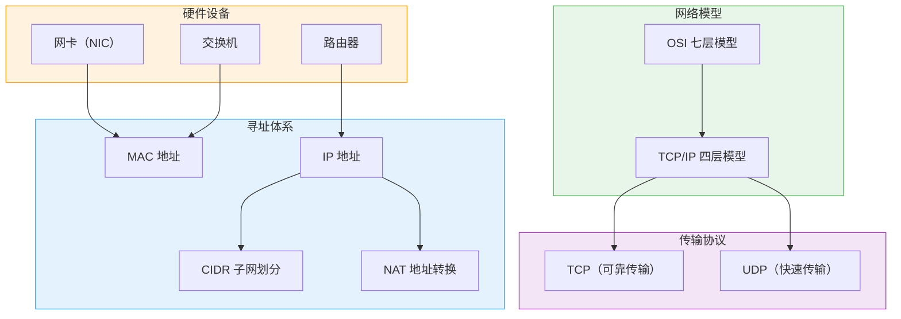

> 💡 **阅读指引**：本文是计算机网络**基础名词扫盲**，聚焦"是什么、干什么、怎么配合"。TCP/UDP 协议的深入细节（三次握手、拥塞控制等）将在单独笔记中展开，本文仅做定位性介绍。

---

## 一、OSI 七层模型与 TCP/IP 四层模型

### 1.1 为什么需要分层？

网络通信极其复杂，涉及电信号、编码、路由、加密、应用逻辑等无数细节。**分层的核心思想是：每一层只关心自己的职责，通过标准接口与上下层交互**。就像寄快递：你只管写地址和内容（应用层），快递公司负责分拣运输（网络层/链路层），你不需要知道飞机怎么飞。

### 1.2 OSI 七层 vs TCP/IP 四层

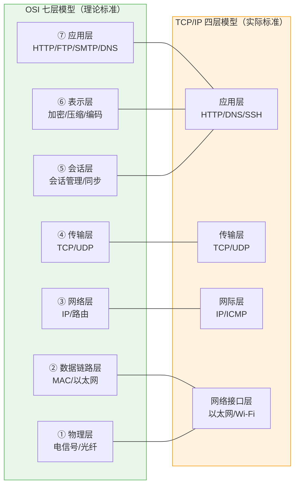

| 层级 | OSI 名称 | TCP/IP 对应 | 核心职责 | 关键协议/技术 | 数据单元 |
| :--- | :--- | :--- | :--- | :--- | :--- |
| 7 | 应用层 | 应用层 | 为用户提供网络服务 | HTTP、DNS、SMTP、SSH | 报文（Message） |
| 6 | 表示层 | 应用层 | 数据格式转换、加密、压缩 | SSL/TLS、JPEG、ASCII | 报文 |
| 5 | 会话层 | 应用层 | 建立/维护/终止会话 | RPC、NetBIOS | 报文 |
| 4 | 传输层 | 传输层 | 端到端可靠/不可靠传输 | TCP、UDP | 段（Segment） |
| 3 | 网络层 | 网际层 | 跨网络路由、逻辑寻址 | IP、ICMP、ARP | 包（Packet） |
| 2 | 数据链路层 | 网络接口层 | 同一网络内帧传输、MAC 寻址 | Ethernet、Wi-Fi、PPP | 帧（Frame） |
| 1 | 物理层 | 网络接口层 | 比特流的物理传输 | 光纤、双绞线、无线电波 | 比特（Bit） |

> 💡 **研发日常**：实际开发中我们几乎只接触**应用层和传输层**。面试时重点掌握这两层 + 网络层的 IP/路由概念即可。OSI 七层是理论框架，TCP/IP 四层是工程实践，两者映射关系要清楚。

### 1.3 数据封装与解封装

发送方从上到下逐层加头部，接收方从下到上逐层拆头部：

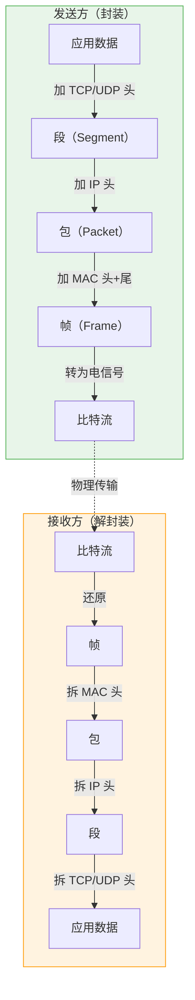

> 💡 **记忆口诀**：**应传网链物，数段包帧比**（应用层→传输层→网络层→链路层→物理层，数据→段→包→帧→比特）。

---

## 二、硬件设备：网卡、交换机、路由器

### 2.1 三者定位对比

| 设备 | 工作层级 | 核心职责 | 寻址依据 | 类比 |
| :--- | :--- | :--- | :--- | :--- |
| **网卡（NIC）** | 物理层 + 数据链路层 | 收发电信号/光信号，组装/拆解帧 | MAC 地址 | 嘴巴和耳朵 |
| **交换机** | 数据链路层（L2） | 同一网络内的帧转发 | MAC 地址表 | 楼层导引台 |
| **路由器** | 网络层（L3） | 不同网络之间的包转发 | 路由表 + IP 地址 | 城市间交通枢纽 |

### 2.2 网卡（Network Interface Card）

网卡是计算机与网络的**物理接口**，每块网卡都有一个全球唯一的 **MAC 地址**。

| 特性 | 说明 |
| :--- | :--- |
| **MAC 地址** | 48 位（6 字节），出厂烧录，全球唯一（理论上） |
| **功能** | 将上层数据包封装成帧、发送到物理介质；接收帧并校验后交给上层 |
| **类型** | 有线网卡（RJ45）、无线网卡（Wi-Fi）、虚拟网卡（Docker/vSwitch） |
| **速率** | 百兆 / 千兆 / 万兆 / 25G / 100G |

> 💡 **研发感知**：你在代码里几乎不会直接操作网卡，但容器化环境中经常遇到 `eth0`、`veth`、`bridge` 等虚拟网卡概念，理解网卡有助于排查容器网络问题。

### 2.3 交换机（Switch）

交换机工作在**数据链路层（L2）**，负责**同一网络内**的帧转发。

#### 工作原理：MAC 地址表学习

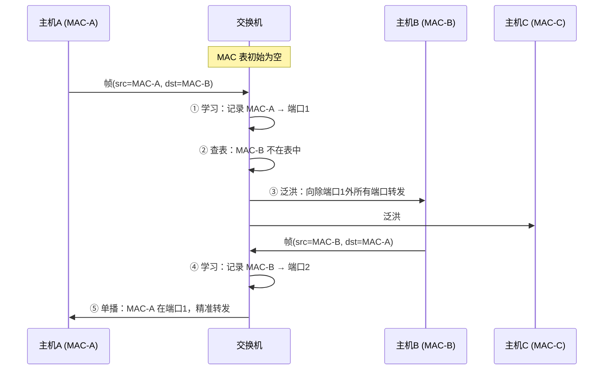

| 特性 | 说明 |
| :--- | :--- |
| **MAC 地址表** | 动态学习，记录"哪个 MAC 在哪个端口"，老化时间通常 300s |
| **未知目标** | 目标 MAC 不在表中 → **泛洪**（Flooding），向所有端口广播 |
| **已知目标** | 目标 MAC 在表中 → **单播**，只发到对应端口 |
| **VLAN** | 逻辑隔离广播域，不同 VLAN 之间需要路由器/L3 交换机 |
| **vs Hub** | Hub 是物理层设备，无条件广播；交换机智能转发，效率高得多 |

> ⚠️ **关键认知**：交换机**不认识 IP 地址**，只看 MAC 地址。同一个 VLAN/子网内的通信由交换机完成，跨子网才需要路由器。

### 2.4 路由器（Router）

路由器工作在**网络层（L3）**，负责**不同网络之间**的包转发。

| 特性 | 说明 |
| :--- | :--- |
| **路由表** | 记录"目标网段 → 下一跳 IP / 出接口" |
| **核心动作** | 收到包 → 查路由表 → 确定下一跳 → 修改 MAC 头（源/目标 MAC 换成当前链路的）→ 转发 |
| **TTL** | 每经过一个路由器 TTL-1，到 0 丢弃，防止环路 |
| **NAT** | 家用路由器通常内置 NAT，将私网 IP 转换为公网 IP |
| **vs 交换机** | 交换机看 MAC 转帧（同网络）；路由器看 IP 转包（跨网络） |

#### 路由器转发过程

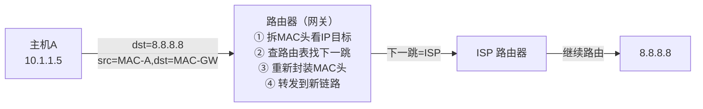

> 💡 **简单记忆**：**交换机管"屋内传话"（同网络 MAC 转发），路由器管"跨城寄信"（跨网络 IP 路由）**。

### 2.5 L3 交换机：交换机的进化体

现代数据中心常用的 **L3 交换机** = 二层交换 + 三层路由，既能按 MAC 转发帧，也能按 IP 路由包，性能远高于传统路由器。

| 维度 | 二层交换机 | 路由器 | L3 交换机 |
| :--- | :--- | :--- | :--- |
| 工作层级 | L2 | L3 | L2 + L3 |
| 转发依据 | MAC 表 | 路由表 | MAC 表 + 路由表 |
| 性能 | 高（ASIC 硬件转发） | 较低（CPU 软件转发） | 高（ASIC 硬件转发 L3） |
| 适用场景 | 接入层 | 边界/出口 | 汇聚层/核心层 |

---

## 三、寻址体系：MAC、IP、CIDR、NAT

### 3.1 MAC 地址 vs IP 地址

这是网络中最容易混淆的一对概念：

| 维度 | MAC 地址 | IP 地址 |
| :--- | :--- | :--- |
| **层级** | 数据链路层（L2） | 网络层（L3） |
| **长度** | 48 位（6 字节） | IPv4: 32 位 / IPv6: 128 位 |
| **格式** | `AA:BB:CC:DD:EE:FF` | `192.168.1.1` / `2001:db8::1` |
| **分配方式** | 出厂烧录（全球唯一） | 动态分配（DHCP）或静态配置 |
| **作用范围** | 同一局域网内有效 | 跨网络全局有效 |
| **可变性** | 一般不变（可软件修改） | 随网络位置变化 |
| **类比** | 身份证号（跟人不跟地） | 邮寄地址（跟地不跟人） |

> 💡 **核心认知**：**MAC 解决"同一网络内谁是谁"，IP 解决"跨网络去哪里"**。数据包在每一跳都会更换 MAC 头（源/目标 MAC 变成当前链路的），但 IP 头中的源/目标 IP **全程不变**（NAT 除外）。

### 3.2 IP 地址分类与私有地址

#### IPv4 地址结构

```
IP 地址 = 网络号 + 主机号

192.168.1.100
├── 网络号：192.168.1    ← 标识"哪个网络"
└── 主机号：100          ← 标识"网络内哪台机器"
```

#### 私有地址（RFC 1918）

以下地址段**不能在公网上路由**，仅用于内部网络：

| 地址段 | 范围 | 可用地址数 | 常见用途 |
| :--- | :--- | :--- | :--- |
| `10.0.0.0/8` | 10.0.0.0 ~ 10.255.255.255 | ~1677 万 | 大型企业/VPC |
| `172.16.0.0/12` | 172.16.0.0 ~ 172.31.255.255 | ~104 万 | 中型企业 |
| `192.168.0.0/16` | 192.168.0.0 ~ 192.168.255.255 | ~6.5 万 | 家庭/小型办公 |

> 💡 **为什么需要私有地址？** IPv4 只有约 43 亿个地址，远远不够。私有地址允许无数内部网络复用相同的地址段，通过 NAT 共享少量公网 IP 访问互联网。

### 3.3 CIDR：无类别域间路由

#### 为什么需要 CIDR？

早期 IP 地址按 A/B/C 类固定划分，浪费严重（一个 C 类只能容纳 254 台主机，不够就得上 B 类 6.5 万台）。CIDR 用**前缀长度**取代固定分类，实现灵活的子网划分。

#### CIDR 表示法

```
IP地址/前缀长度

192.168.1.0/24
├── 前 24 位 = 网络号：192.168.1
└── 后 8 位 = 主机号：0~255（256 个地址，去掉网络号和广播地址 = 254 可用）
```

#### 网络号与广播地址

每个子网中有两个**被保留、不能分配给主机**的特殊地址：

| 特殊地址 | 定义 | 示例（/24） | 作用 |
| :--- | :--- | :--- | :--- |
| **网络号** | 主机号全为 **0** | `192.168.1.0` | 代表整个子网本身，路由器用它做路由匹配 |
| **广播地址** | 主机号全为 **1** | `192.168.1.255` | 向该子网内所有主机发送数据（如 ARP 请求、DHCP Discover） |

```
192.168.1.0/24 的 256 个地址：

192.168.1.0     ← 网络号（代表整个子网，不可分配）
192.168.1.1     ← ✅ 可分配（通常是网关）
192.168.1.2     ← ✅ 可分配
...
192.168.1.253   ← ✅ 可分配
192.168.1.254   ← ✅ 可分配
192.168.1.255   ← 广播地址（发给所有人，不可分配）

可用主机数 = 2^主机位数 - 2 = 2^8 - 2 = 254
```

> 💡 **简单记忆**：**头是网络号（全0），尾是广播地址（全1），中间才能分给人**。广播地址不是你"拥有"的地址，而是你"喊话"的目标——当你想给子网内所有人发消息时，把目标 IP 设为广播地址，交换机就会向所有端口转发。

| CIDR | 子网掩码 | 可用主机数 | 示例 |
| :--- | :--- | :--- | :--- |
| `/8` | 255.0.0.0 | ~1677 万 | 10.0.0.0/8 |
| `/16` | 255.255.0.0 | ~6.5 万 | 172.16.0.0/16 |
| `/24` | 255.255.255.0 | 254 | 192.168.1.0/24 |
| `/25` | 255.255.255.128 | 126 | 拆分为两个子网 |
| `/30` | 255.255.255.252 | 2 | 点对点链路 |
| `/32` | 255.255.255.255 | 1 | 单个主机（精确匹配） |

#### 子网掩码的作用

子网掩码用于**区分 IP 地址中的网络号和主机号**：

```
IP:       192.168.1.100  → 11000000.10101000.00000001.01100100
掩码:     255.255.255.0  → 11111111.11111111.11111111.00000000
AND运算:  192.168.1.0    → 网络号 = 192.168.1.0
```

> 💡 **研发日常**：VPC/vSwitch 规划、K8s Pod CIDR、安全组规则都离不开 CIDR。记住 `/24 = 254 台`、`/16 = 6.5 万台`、`/8 = 1677 万台` 这三个常用值就够了。

### 3.4 NAT：网络地址转换

#### 为什么需要 NAT？

IPv4 地址枯竭，不可能每台设备都有公网 IP。NAT 让**多台私网设备共享少量公网 IP** 访问互联网。

#### SNAT vs DNAT

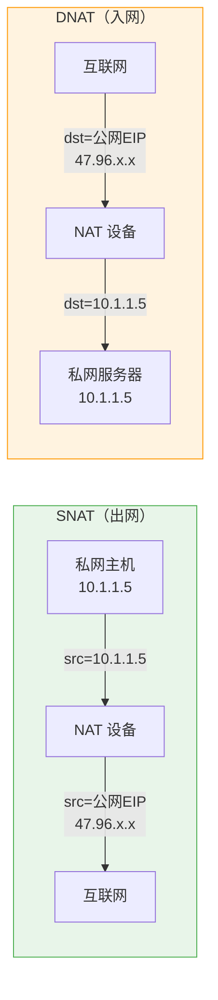

| 类型 | 全称 | 方向 | 转换内容 | 典型场景 |
| :--- | :--- | :--- | :--- | :--- |
| **SNAT** | Source NAT | 私网 → 公网 | 源 IP：私网 → 公网 | Pod/ECS 访问外部 API、拉镜像 |
| **DNAT** | Destination NAT | 公网 → 私网 | 目标 IP：公网 → 私网 | 外部回调内部服务、端口映射 |

#### NAT 的工作过程（以 SNAT 为例）

| 步骤 | 动作 | 说明 |
| :--- | :--- | :--- |
| ① | 私网主机发包 | src=10.1.1.5, dst=8.8.8.8 |
| ② | NAT 设备拦截 | 匹配 SNAT 规则 |
| ③ | 替换源 IP | src → 公网 EIP，记录映射关系（NAT 表） |
| ④ | 转发到公网 | src=EIP, dst=8.8.8.8 |
| ⑤ | 外部回包 | src=8.8.8.8, dst=EIP |
| ⑥ | NAT 设备反向转换 | 查 NAT 表，dst → 10.1.1.5 |
| ⑦ | 转发给私网主机 | src=8.8.8.8, dst=10.1.1.5 |

> 💡 **简单记忆**：**S**NAT = **S**ource = **出网**（改源 IP）；**D**NAT = **D**estination = **入网**（改目标 IP）。日常部署中 90% 只需要配 SNAT。

### 3.5 ARP：IP 到 MAC 的桥梁

既然交换机只看 MAC、路由器只看 IP，那**知道目标 IP 后怎么拿到目标 MAC**？答案是 **ARP（Address Resolution Protocol）**。

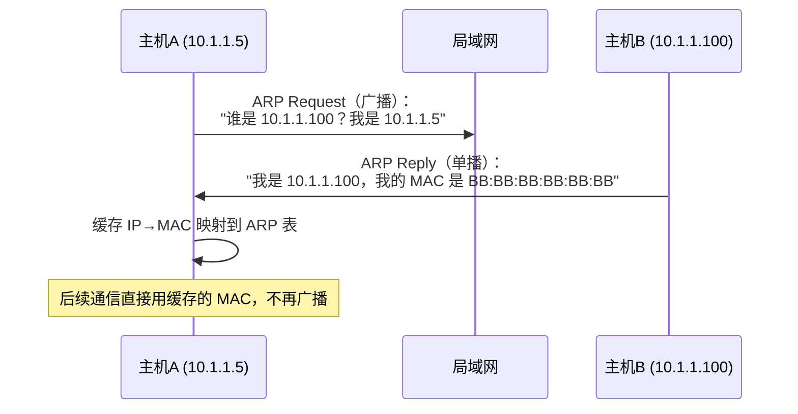

| 特性 | 说明 |
| :--- | :--- |
| **工作层级** | L2 和 L3 之间（不属于任何一层） |
| **请求方式** | 广播（所有设备都收到） |
| **响应方式** | 单播（只有目标设备回复） |
| **缓存** | ARP 表有老化时间（通常 20 分钟） |
| **安全风险** | ARP 欺骗/投毒是局域网攻击的常见手段 |

> 💡 **研发感知**：`arp -a` 查看本机 ARP 表；容器网络中 ARP 行为可能不同于物理网络（如 Flannel overlay 模式下不走真实 ARP）。

### 3.6 DNS：域名系统

DNS（Domain Name System）是互联网的"电话簿"，将人类可读的域名（如 `www.example.com`）转换为机器可用的 IP 地址。

#### 域名体系结构：从右往左读

域名是**层级结构**，从右往左级别越来越高：

```
www.example.com.
│   │       │   └── 根域（通常省略不写，实际是 "."）
│   │       └────── 顶级域（TLD, Top-Level Domain）
│   └────────────── 二级域（注册的主域名）
└────────────────── 三级域 / 子域名（主机名）
```

| 层级 | 示例 | 说明 |
| :--- | :--- | :--- |
| **根域** | `.` | 全球 13 组根域名服务器（a.root-servers.net ~ m.root-servers.net），DNS 查询的起点 |
| **顶级域（TLD）** | `.com` `.cn` `.org` `.net` | 分两类：**通用顶级域**（gTLD，如 .com/.org/.net）和**国家代码顶级域**（ccTLD，如 .cn/.us/.jp） |
| **二级域** | `example.com` | 用户向注册商购买的主域名，由对应的 TLD 服务器管理 |
| **子域名** | `www.example.com` `api.example.com` | 域名持有者自行划分，可无限嵌套 |

> 💡 **TLD 服务器是什么？** TLD 服务器就是管理某个顶级域（如 `.com`）下所有二级域信息的服务器。当你查询 `www.example.com` 时，根服务器告诉你".com 的 TLD 服务器在哪"，TLD 服务器再告诉你"example.com 的权威服务器在哪"。**TLD = Top-Level Domain 的缩写，不是某种特殊技术，就是"管顶级域的服务器"**。

#### DNS 记录类型详解

DNS 不只是"域名→IP"的映射，它支持多种记录类型，每种解决不同的问题：

| 记录类型 | 全称 | 作用 | 示例 | 使用场景 |
| :--- | :--- | :--- | :--- | :--- |
| **A** | Address | 域名 → IPv4 地址 | `example.com → 93.184.216.34` | 最基础的解析，网站/服务器绑定 IP |
| **AAAA** | Address (IPv6) | 域名 → IPv6 地址 | `example.com → 2606:2800:220:1:248:1893:25c8:1946` | IPv6 环境下的等价物 |
| **CNAME** | Canonical Name | 域名 → 另一个域名（别名） | `cdn.example.com → cdn.provider.net` | CDN 接入、域名跳转、多域名指向同一服务 |
| **MX** | Mail Exchange | 指定该域名的邮件服务器 | `example.com → mail.example.com (优先级10)` | 邮箱收发信必须配置 |
| **TXT** | Text | 存储任意文本信息 | `example.com → "v=spf1 include:_spf.google.com"` | SPF/DKIM 邮件防伪、SSL 证书验证、域名所有权验证 |
| **NS** | Name Server | 指定该域的权威 DNS 服务器 | `example.com → ns1.dnsprovider.com` | 将子域委托给其他 DNS 服务商管理 |
| **SRV** | Service | 指定某服务的地址和端口 | `_sip._tcp.example.com → sipserver:5060` | SIP/VoIP、LDAP 等服务发现 |

##### A 记录 vs CNAME 的关键区别

```
A 记录：    域名 ──直接──→ IP 地址
            www.example.com → 93.184.216.34

CNAME 记录：域名 ──别名──→ 另一个域名 ──A记录──→ IP 地址
            cdn.example.com → cdn.provider.net → 1.2.3.4
```
>  **CNAME 的使用场景是"别名指向"**：典型场景是，你的服务部署在第三方平台上（比如 CDN），平台给你一个域名 abc123.cdn.com，你把 sub.example.com CNAME 到 abc123.cdn.com。这样用户访问sub.example.com 时，DNS 会递归解析到 CDN 的边缘节点 IP，而且 CDN 那边换 IP 你不需要改配置。


| 维度 | A 记录 | CNAME 记录 |
| :--- | :--- | :--- |
| **解析次数** | 1 次 | 至少 2 次（先查 CNAME 再查目标域名的 A 记录） |
| **能否与 MX/TXT 共存** | ✅ 可以 | ❌ **不能**（RFC 规定 CNAME 所在节点不能有其他记录） |
| **适用场景** | 根域名（`example.com`）、邮件域 | 子域名、CDN 接入、多环境切换 |
| **变更灵活性** | 改 IP 需逐个修改 | 改目标域名即可批量生效 |

> ⚠️ **常见坑**：根域名（`example.com`）不能用 CNAME，只能用 A/AAAA 记录。因为根域名还需要 MX、TXT 等记录，而 CNAME 不允许与其他记录共存。这就是为什么很多网站根域名用 A 记录直接指向 IP，而 `www.example.com` 用 CNAME 指向 CDN 提供的域名（如 `abc.cdn.com`）。

#### DNS 解析流程

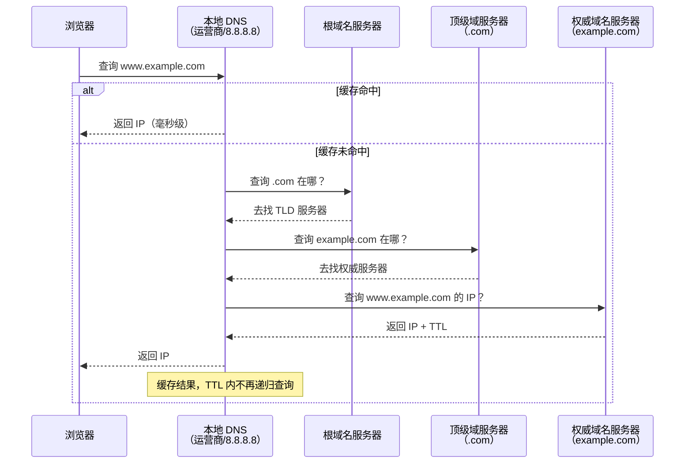

| 概念 | 说明 |
| :--- | :--- |
| **递归查询** | 客户端只问一次本地 DNS，本地 DNS 负责层层追问直到拿到结果 |
| **迭代查询** | 本地 DNS 依次问根→顶级域→权威，每次得到"下一步去哪问"的指引 |
| **TTL** | DNS 缓存有效期（Time To Live），过期后重新查询。改域名解析后要等 TTL 过期才生效 |

> 💡 **研发日常**：排查"域名访问不了"第一步就是 `nslookup` 或 `dig` 看 DNS 解析是否正常。CDN 切换、域名迁移时注意 TTL 导致的解析延迟。K8s 内部有 CoreDNS 做服务发现，原理相同。查看某个域名的所有记录：`dig example.com ANY`。

### 3.7 DHCP：动态主机配置协议

DHCP（Dynamic Host Configuration Protocol）解决"**IP 地址从哪来**"的问题。设备接入网络后，通过 DHCP 自动获取 IP 地址、子网掩码、网关、DNS 服务器等配置。

#### DHCP 四步交互（DORA）

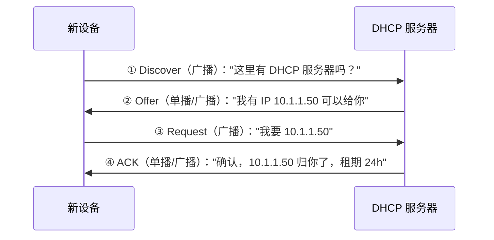

| 特性 | 说明 |
| :--- | :--- |
| **租期** | IP 不是永久分配，到期需续租。通常租期过半时自动续租 |
| **释放** | 设备断开时发送 Release，归还 IP |
| **静态绑定** | 按 MAC 地址固定分配特定 IP（服务器/NAS 常用） |
| **VPC 中的 DHCP** | 云环境中由云平台提供，用户无需自建 DHCP 服务器 |

> 💡 **研发感知**：ECS/Pod 启动时自动获取 IP 就是 DHCP 在工作。容器网络中 Docker 自带 DHCP-like 机制分配容器 IP；K8s 中由 CNI 插件（Terway/Calico）负责 IP 分配，原理类似但实现不同。

### 3.8 ICMP / ping / traceroute：网络排查三板斧

ICMP（Internet Control Message Protocol）是网络层的"信使协议"，用于传递控制消息和错误报告。**ping 和 traceroute 都基于 ICMP**。

| 工具 | 原理 | 用途 |
| :--- | :--- | :--- |
| **ping** | 发送 ICMP Echo Request，等待 Echo Reply | 测试目标是否可达、测量 RTT（往返时延） |
| **traceroute** | 逐步递增 TTL，利用 ICMP Time Exceeded 获取每一跳的路由器 IP | 追踪数据包经过的路径，定位网络瓶颈/故障点 |
| **telnet / nc** | TCP 连接测试（非 ICMP） | 测试目标端口是否开放 |

#### traceroute 工作原理

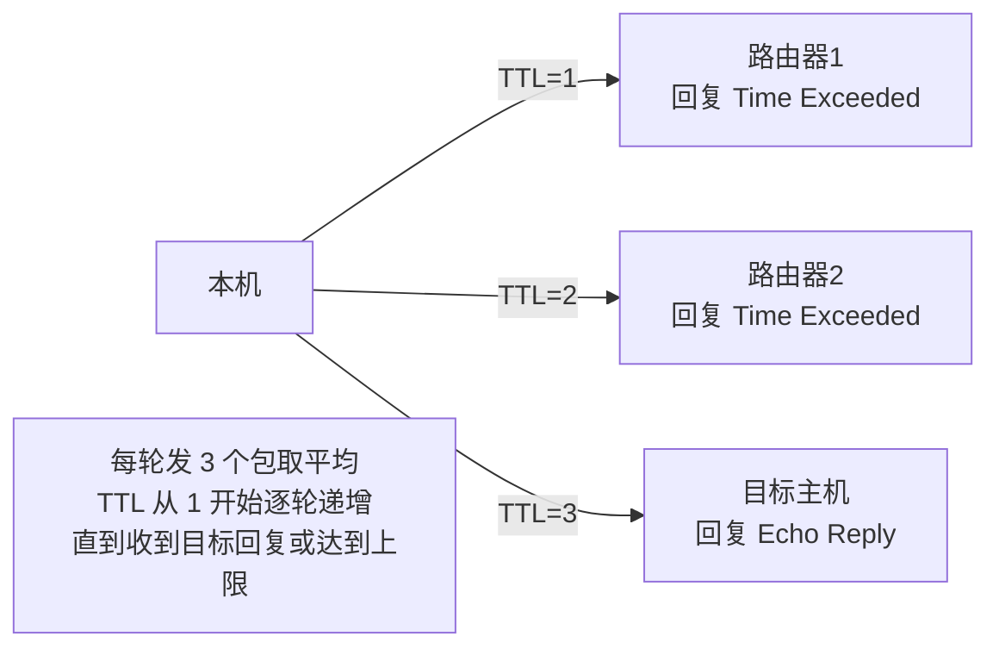

> 💡 **研发日常命令速查**：
> ```bash
> ping -c 4 www.example.com          # 发 4 个包测试连通性
> traceroute www.example.com          # Linux/macOS 追踪路由
> tracert www.example.com             # Windows 追踪路由
> telnet host port                    # 测试端口是否开放
> nc -zv host port                    # 更现代的端口测试
> curl -v https://example.com         # 查看完整 HTTP 握手过程
> dig www.example.com                 # 查看 DNS 解析详情
> nslookup www.example.com            # DNS 解析（跨平台）
> ```

---

## 四、传输协议：TCP、UDP 与端口

> ⚠️ **说明**：TCP/UDP 的详细机制（三次握手、四次挥手、拥塞控制、滑动窗口等）将在单独笔记中展开。本节仅做定位性介绍。

### 4.1 TCP vs UDP 核心对比

| 维度 | TCP | UDP |
| :--- | :--- | :--- |
| **连接** | 面向连接（三次握手） | 无连接 |
| **可靠性** | ✅ 可靠（确认、重传、排序） | ❌ 不可靠（发完不管） |
| **顺序** | ✅ 保证有序 | ❌ 不保证 |
| **流量控制** | ✅ 滑动窗口 | ❌ 无 |
| **拥塞控制** | ✅ 慢启动/拥塞避免 | ❌ 无 |
| **开销** | 较大（20 字节头 + 握手） | 极小（8 字节头） |
| **速度** | 较慢 | 快 |
| **适用场景** | Web、文件传输、邮件、数据库 | 视频直播、DNS、游戏、语音通话 |

### 4.2 什么时候选 TCP / UDP？

```
你的应用需要什么？
├── 数据不能丢、必须有序 → TCP
│   ├── HTTP/HTTPS（Web）
│   ├── FTP/SFTP（文件传输）
│   ├── SMTP/IMAP（邮件）
│   └── MySQL/Redis（数据库）
└── 速度快比完整性重要 → UDP
    ├── 视频直播/实时音视频
    ├── DNS 查询（短请求，丢了重试就行）
    ├── 在线游戏（状态同步）
    └── IoT 传感器上报（容忍丢失）
```

> 💡 **面试话术**："TCP 提供可靠、有序的字节流传输，适合对数据完整性要求高的场景；UDP 提供尽最大努力交付，适合对延迟敏感、容忍丢失的场景。选择取决于业务需求：数据不能丢选 TCP，速度优先选 UDP。"

### 4.3 端口（Port）详解

端口是传输层的概念，16 位数字（0-65535），用于标识主机上的**具体服务进程**。IP 定位到机器，端口定位到机器上的哪个程序。

#### 端口分类

| 范围 | 名称 | 说明 | 示例 |
| :--- | :--- | :--- | :--- |
| 0-1023 | **知名端口** | 系统保留，需 root 权限绑定 | 22(SSH)、80(HTTP)、443(HTTPS)、3306(MySQL) |
| 1024-49151 | **注册端口** | 用户/应用程序常用 | 8080(Tomcat)、6379(Redis)、27017(MongoDB) |
| 49152-65535 | **临时端口** | 客户端发起连接时由 OS 自动分配 | 浏览器访问网站时的源端口 |

#### 常见知名端口速记

| 端口 | 协议 | 服务 |
| :--- | :--- | :--- |
| 22 | TCP | SSH 远程登录 |
| 53 | UDP/TCP | DNS |
| 80 | TCP | HTTP |
| 443 | TCP | HTTPS |
| 3306 | TCP | MySQL |
| 5432 | TCP | PostgreSQL |
| 6379 | TCP | Redis |
| 8080 | TCP | Tomcat / Spring Boot 默认 |
| 9090 | TCP | Prometheus |
| 27017 | TCP | MongoDB |

#### 端口复用与 TIME_WAIT

服务端重启后报 `Address already in use`？这是 TCP 的 **TIME_WAIT** 状态导致的：

```
主动关闭方发送最后一个 ACK 后进入 TIME_WAIT（持续 2MSL ≈ 60s）
目的：① 确保最后一个 ACK 能到达对方 ② 让网络中残留的旧包自然消亡
副作用：该端口在 TIME_WAIT 期间不能被重新绑定
解决：设置 SO_REUSEADDR / SO_REUSEPORT 选项
```

> 💡 **研发日常**：高并发服务端必须开启 `SO_REUSEADDR`；Nginx/Tomcat 配置中的 `reuseport` 能让多个 worker 绑定同一端口，提升性能。`netstat -tlnp` 或 `ss -tlnp` 查看当前监听端口。

---

## 五、代理：正向代理与反向代理

代理（Proxy）是网络请求的"中间人"，分为正向代理和反向代理，两者方向相反、用途完全不同。

### 5.1 正向代理 vs 反向代理

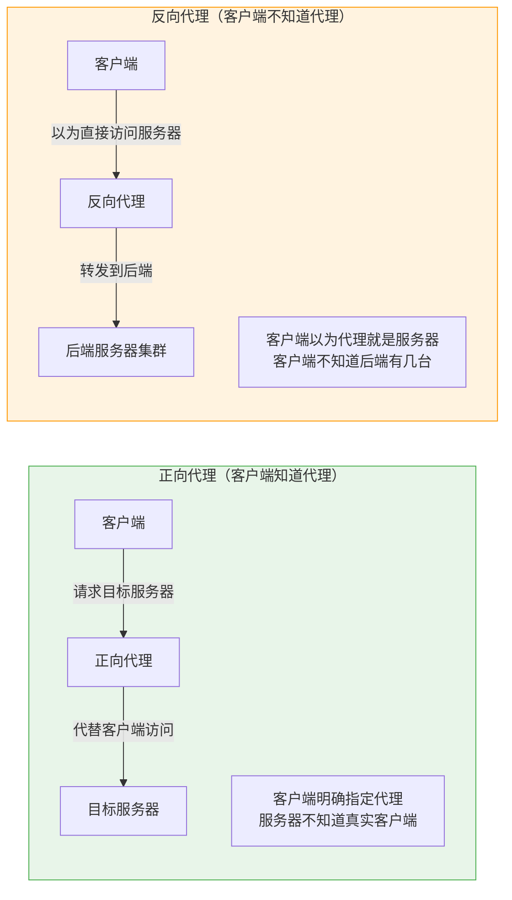

| 维度 | 正向代理 | 反向代理 |
| :--- | :--- | :--- |
| **谁配置** | 客户端配置 | 服务端部署 |
| **谁知道代理存在** | 客户端知道，服务器不知道 | 客户端不知道，服务器知道 |
| **核心用途** | 突破访问限制、隐私保护、缓存加速 | 负载均衡、安全防护、SSL 卸载、静态资源缓存 |
| **典型工具** | VPN、Shadowsocks、Charles/Fiddler | Nginx、HAProxy、Envoy、ALB/MSE |
| **类比** | 你托朋友帮你买东西（卖家不知道是你买的） | 餐厅前台接待员（你以为前台就是餐厅，其实后面有厨房） |

### 5.2 反向代理的核心能力

| 能力 | 说明 |
| :--- | :--- |
| **负载均衡** | 将请求分发到多台后端服务器（轮询/权重/IP Hash/最少连接） |
| **SSL 卸载** | 在代理层终结 HTTPS，后端走 HTTP，减轻后端加解密负担 |
| **静态资源缓存** | 图片/CSS/JS 直接在代理层返回，不打到后端 |
| **安全防护** | WAF、限流、IP 黑白名单、隐藏后端真实 IP |
| **灰度发布** | 按 Header/Cookie/IP 将部分流量导向新版本 |

> 💡 **研发日常**：Nginx 是最常用的反向代理，几乎每个 Web 项目都会用到。云环境中 ALB/MSE 网关本质也是反向代理。理解正向/反向代理的区别，有助于排查"请求到底经过了哪些节点"。

---

## 六、CDN：内容分发网络

CDN（Content Delivery Network）是部署在全球各地的**缓存服务器集群**，将静态资源（图片、CSS、JS、视频等）缓存到离用户最近的节点，让用户就近获取，大幅降低延迟和源站压力。

### 6.1 CDN 工作原理

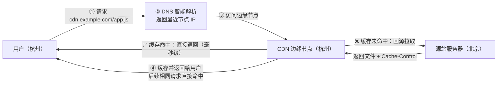

| 步骤 | 说明 |
| :--- | :--- |
| ① DNS 智能解析 | 用户请求 CDN 域名时，DNS 根据用户 IP/地理位置返回**最近的边缘节点 IP**（而非源站 IP） |
| ② 边缘节点检查缓存 | 命中 → 直接返回；未命中 → 回源拉取 |
| ③ 回源 & 缓存 | 从源站拉取文件，按 `Cache-Control` / `ETag` 等头部决定缓存策略 |
| ④ 后续请求 | 相同资源直接从边缘节点返回，不再回源 |

### 6.2 CDN 与 DNS CNAME 的关系

CDN 接入的核心就是 **CNAME 记录**：

```
你的域名配置：
cdn.example.com  →  CNAME  →  cdn.provider.net

用户访问 cdn.example.com 时：
① DNS 解析 cdn.example.com → 得到 CNAME → cdn.provider.net
② DNS 继续解析 cdn.provider.net → CDN 服务商的智能 DNS 返回最近边缘节点 IP
③ 用户直接向该边缘节点请求资源
```

> 💡 **为什么用 CNAME 而不是 A 记录？** CDN 服务商的边缘节点 IP 会动态变化（扩缩容、故障切换），你不可能手动维护 A 记录。CNAME 把解析权交给 CDN 服务商的智能 DNS，由它决定返回哪个节点 IP。

### 6.3 前端发布与 CDN

前端组件/静态资源发布到 CDN 是日常高频操作，核心关注点：

| 关注点 | 说明 |
| :--- | :--- |
| **文件名哈希** | `app.a1b2c3d4.js`，内容变化 → 哈希变化 → 文件名变化 → CDN 视为新资源自动刷新 |
| **Cache-Control** | 带哈希的文件设 `max-age=31536000`（1 年强缓存）；入口 HTML 设 `no-cache`（每次验证） |
| **版本回滚** | 旧版本文件仍在 CDN 上（文件名不同），只需将 HTML 中的引用改回旧哈希即可秒级回滚 |
| **预热** | 大版本发布前主动推送资源到边缘节点，避免上线瞬间大量回源打垮源站 |
| **刷新/ purge** | 紧急修复时强制清除 CDN 缓存，让边缘节点重新回源拉取最新文件 |
| **多环境** | dev/staging/prod 使用不同的 CDN 域名或路径前缀，避免互相污染 |

#### 典型发布流程

```
构建产物（带内容哈希）
    ↓
上传到 OSS / CDN 源站
    ↓
CDN 预热（可选，大版本建议做）
    ↓
更新 HTML / 配置中的资源引用
    ↓
部署 HTML 到服务器（HTML 本身不走长缓存）
    ↓
用户访问 → 拿到新 HTML → 加载新版 JS/CSS（CDN 命中或回源）
```

### 6.4 CDN 核心概念速查

| 概念 | 说明 |
| :--- | :--- |
| **边缘节点（Edge）** | 部署在各地机房/运营商的缓存服务器，离用户近 |
| **回源（Origin Pull）** | 边缘节点缓存未命中时，向源站拉取资源 |
| **命中率** | 边缘节点直接响应的比例，越高越好（通常 >90%） |
| **TTL / max-age** | 资源在边缘节点的缓存时长，由源站响应头控制 |
| **预热（Prefetch）** | 主动将资源推送到边缘节点，避免首次访问回源 |
| **刷新（Purge）** | 强制清除指定资源的边缘缓存 |
| **智能 DNS** | CDN 服务商的 DNS 系统，根据用户位置/运营商返回最优节点 IP |
| **HTTPS 加速** | CDN 节点终结 SSL，回源走 HTTP，减轻源站加解密负担 |

> 💡 **研发日常**：阿里云 CDN / CloudFront / Cloudflare 是主流选择。前端发布时记住"**文件带哈希 + HTML 不缓存**"这个黄金组合，就能兼顾性能和实时更新。排查 CDN 问题用 `curl -I https://cdn.example.com/app.js` 看响应头中的 `X-Cache`、`Age`、`Cache-Control` 字段。

---

## 七、常见名词速查表

| 名词 | 一句话解释 | 所属层级 |
| :--- | :--- | :--- |
| **OSI** | 国际标准化组织提出的七层网络参考模型（理论标准） | — |
| **TCP/IP** | 互联网实际使用的四层协议栈（工程标准） | — |
| **NIC / 网卡** | 计算机与网络的物理接口，拥有唯一 MAC 地址 | L1 + L2 |
| **MAC 地址** | 48 位硬件地址，标识同一网络内的设备 | L2 |
| **IP 地址** | 逻辑地址，标识设备在网络中的位置，支持跨网络路由 | L3 |
| **CIDR** | 用 `/前缀长度` 表示子网，取代 A/B/C 类固定划分 | L3 |
| **子网掩码** | 与 IP 做 AND 运算，区分网络号和主机号 | L3 |
| **NAT** | 将私网 IP 转换为公网 IP，解决 IPv4 地址不足 | L3 |
| **SNAT** | 出网时替换源 IP（私网→公网） | L3 |
| **DNAT** | 入网时替换目标 IP（公网→私网） | L3 |
| **ARP** | 根据 IP 地址查询对应的 MAC 地址 | L2 ↔ L3 |
| **交换机** | L2 设备，按 MAC 地址在同一网络内转发帧 | L2 |
| **路由器** | L3 设备，按 IP 地址在不同网络间转发包 | L3 |
| **L3 交换机** | 兼具 L2 交换和 L3 路由能力的高性能设备 | L2 + L3 |
| **VLAN** | 虚拟局域网，在交换机上逻辑隔离广播域 | L2 |
| **TCP** | 面向连接的可靠传输协议 | L4 |
| **UDP** | 无连接的不可靠传输协议 | L4 |
| **端口** | 16 位数字（0-65535），标识主机上的具体服务进程 | L4 |
| **DNS** | 域名系统，将域名解析为 IP 地址 | 应用层 |
| **DHCP** | 动态主机配置协议，自动分配 IP/网关/DNS | 应用层 |
| **ICMP** | 互联网控制报文协议，ping/traceroute 的基础 | L3 |
| **正向代理** | 客户端配置的中间人，代替客户端访问目标服务器 | 应用层 |
| **反向代理** | 服务端部署的中间人，接收请求并转发到后端集群 | 应用层 |
| **CDN** | 内容分发网络，将静态资源缓存到全球边缘节点，用户就近获取 | 应用层 |
| **回源** | CDN 边缘节点缓存未命中时向源站拉取资源 | 应用层 |
| **预热 / Purge** | 主动推送资源到边缘节点 / 强制清除边缘缓存 | 应用层 |
| **MTU** | 最大传输单元，以太网默认 1500 字节 | L2 |
| **TTL** | 生存时间，每经过一个路由器减 1，防环路 | L3 |
| **TIME_WAIT** | TCP 主动关闭方的等待状态，持续 2MSL，防止旧包干扰 | L4 |

---

## 六、面试高频问题速答

### Q1：OSI 七层和 TCP/IP 四层的区别？

OSI 是 ISO 提出的理论参考模型，分七层，学术意义大于工程意义；TCP/IP 是互联网实际使用的协议栈，分四层（应用层、传输层、网际层、网络接口层），是工程实践标准。OSI 的表示层和会话层在 TCP/IP 中合并到了应用层。面试时说清楚映射关系即可。

### Q2：交换机和路由器的区别？

交换机工作在 L2，按 MAC 地址在同一网络内转发帧，不认识 IP；路由器工作在 L3，按 IP 地址在不同网络间转发包，需要维护路由表。简单说：交换机管"屋内传话"，路由器管"跨城寄信"。现代 L3 交换机兼具两者能力。

### Q3：MAC 地址和 IP 地址的区别？

MAC 是 L2 硬件地址，48 位，出厂烧录，同一网络内有效，类比身份证号；IP 是 L3 逻辑地址，32/128 位，动态分配，跨网络有效，类比邮寄地址。数据包每一跳都换 MAC 头，但 IP 头全程不变（NAT 除外）。

### Q4：什么是 CIDR？为什么需要它？

CIDR（无类别域间路由）用 `/前缀长度` 表示子网（如 192.168.1.0/24），取代了早期 A/B/C 类的固定划分。好处是灵活划分子网、减少 IP 浪费、简化路由表聚合。VPC/vSwitch/K8s Pod CIDR 规划都基于 CIDR。

### Q5：NAT 是什么？SNAT 和 DNAT 的区别？

NAT（网络地址转换）让多台私网设备共享少量公网 IP 访问互联网。SNAT 是出网时替换源 IP（私网→公网），日常部署 90% 只需配 SNAT；DNAT 是入网时替换目标 IP（公网→私网），仅在外部主动回调内部服务时使用。

### Q6：DNS 解析的流程是什么？

浏览器先查本地缓存 → 未命中则向本地 DNS 服务器发起递归查询 → 本地 DNS 依次迭代查询根域名服务器、顶级域服务器、权威域名服务器 → 拿到 IP 后缓存（TTL 内有效）并返回给客户端。排查 DNS 问题用 `dig` 或 `nslookup`。

### Q7：正向代理和反向代理的区别？

正向代理是客户端配置的中间人，代替客户端访问目标服务器，服务器不知道真实客户端（如 VPN、科学上网）；反向代理是服务端部署的中间人，接收客户端请求并转发到后端集群，客户端不知道后端有几台（如 Nginx、ALB）。简单记：**正向代理隐藏客户端，反向代理隐藏服务端**。

### Q8：什么是 TIME_WAIT？为什么服务端重启报 Address already in use？

TCP 主动关闭方发送最后一个 ACK 后进入 TIME_WAIT 状态，持续 2MSL（约 60s），目的是确保最后一个 ACK 到达对方并让网络中残留的旧包自然消亡。副作用是该端口在此期间不能被重新绑定。解决方案是设置 `SO_REUSEADDR` 或 `SO_REUSEPORT` 选项。

---

## 小结

- **分层模型**：OSI 七层是理论，TCP/IP 四层是实践，研发重点关注应用层和传输层
- **硬件设备**：网卡收发信号、交换机按 MAC 转帧（同网络）、路由器按 IP 转包（跨网络）
- **寻址体系**：MAC 管同网络身份、IP 管跨网络定位、CIDR 管子网划分、NAT 管公私网转换
- **基础协议**：DNS 解析域名、DHCP 分配 IP、ARP 桥接 IP 和 MAC、ICMP 支撑 ping/traceroute
- **传输协议**：TCP 可靠有序、UDP 快速轻量，端口定位具体服务，TIME_WAIT 需注意复用
- **代理**：正向代理隐藏客户端，反向代理隐藏服务端，Nginx 是最常用的反向代理

> 💡 **记忆口诀**：**七层四栈分清楚，网卡交换路由器；MAC 同网 IP 跨网，CIDR 划网 NAT 转；DNS 解析 DHCP 配，ARP 桥接 ICMP 探；端口定位 TIME_WAIT，正代隐客反代隐服；TCP 可靠 UDP 快，网络基础全掌握**。
