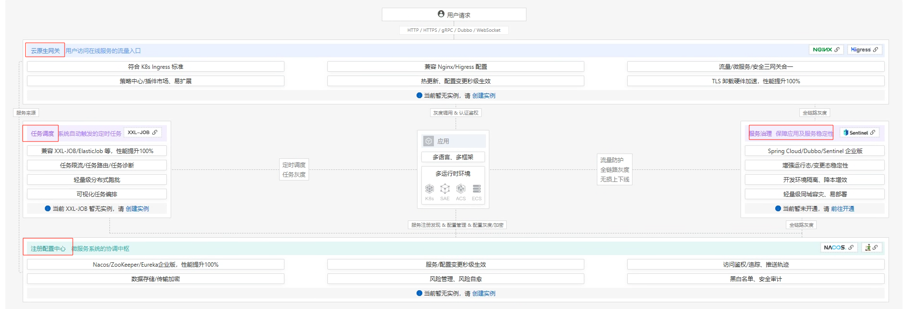

# 阿里云部署架构实战：从零搭建一套生产级微服务架构

## 为什么需要全览视角？

很多开发者对 VPC、ALB、ACK、SAE、MSE 这些概念都不陌生，但真正要从零搭建一套生产环境时，却不知道它们**如何组织在一起**。本篇以一个典型的微服务电商系统为例，从网络规划到应用部署，完整走一遍阿里云上的架构搭建流程，帮你建立**全览视角**。

> ⚠️ **说明**：阿里云产品迭代较快，本文基于当前主流架构整理。关键配置建议到 [阿里云控制台](https://console.aliyun.com/) 和 [官方文档](https://help.aliyun.com/) 验证最新版本。

---

## 一、整体架构全景图

先看全貌，再逐层拆解：

```
                          互联网用户
                              │
                              ▼
                    ┌─────────────────┐
                    │   DNS / CDN     │  ← 域名解析 + 静态资源加速
                    └────────┬────────┘
                             │
                             ▼
                    ┌─────────────────┐
                    │      ALB        │  ← 应用型负载均衡（七层入口）
                    │  (公网/私网)     │     SSL 卸载、健康检查、灰度发布
                    └────────┬────────┘
                             │
              ┌──────────────┼──────────────┐
              ▼              ▼              ▼
     ┌──────────────┐ ┌──────────────┐ ┌──────────────┐
     │  MSE 网关     │ │  MSE 网关     │ │  MSE 网关     │  ← 微服务网关
     │ (API Gateway)│ │              │ │              │     路由、限流、鉴权
     └──────┬───────┘ └──────┬───────┘ └──────┬───────┘
            │                │                │
    ════════╪════════════════╪════════════════╪═══════════  VPC 边界
            │                │                │
     ┌──────▼───────┐ ┌──────▼───────┐ ┌──────▼───────┐
     │  ACK / SAE   │ │  ACK / SAE   │ │  ACK / SAE   │  ← 应用运行环境
     │  (订单服务)   │ │  (商品服务)   │ │  (用户服务)   │     K8s 或 Serverless
     └──────┬───────┘ └──────┬───────┘ └──────┬───────┘
            │                │                │
     ┌──────▼────────────────▼────────────────▼───────┐
     │           云原生中间件 & 数据库                    │
     │  RDS(MySQL) · Redis · RocketMQ · Nacos · OSS   │
     └────────────────────────────────────────────────┘
            │
     ┌──────▼───────┐
     │  NAT 网关     │  ← 出网统一出口（访问外部 API、拉取镜像）
     └──────────────┘
```

### 小项目轻量部署方案

上面的全景图是中大规模微服务架构。如果你的项目只有 1-3 个服务、日活几千、预算有限，不需要这么重的架构：

```
                          互联网用户
                              │
                              ▼
                    ┌─────────────────┐
                    │   ECS + Nginx   │  ← 一台 ECS 搞定入口 + 反向代理
                    │  (公网 IP)      │     SSL 终结、静态资源、API 转发
                    └────────┬────────┘
                             │
              ┌──────────────┼──────────────┐
              ▼              ▼              ▼
        ┌──────────┐  ┌──────────┐  ┌──────────┐
        │ Spring   │  │ Spring   │  │ 其他     │  ← 应用直接跑在 ECS 上
        │ Boot App │  │ Boot App │  │ 服务     │     Docker Compose 编排
        └────┬─────┘  └────┬─────┘  └────┬─────┘
             │              │              │
        ┌────▼──────────────▼──────────────▼────┐
        │         RDS + Redis（云托管）           │  ← 数据库和缓存用云服务
        └───────────────────────────────────────┘
```

### 中等规模部署方案（SAE 为核心）

当项目从"几个服务"发展到"十几个微服务、日活几万、需要弹性伸缩"，但团队又没有专职 K8s 运维时，**SAE 是最优解**：

```
                          互联网用户
                              │
                              ▼
                    ┌─────────────────┐
                    │      ALB        │  ← 七层入口，SSL 卸载
                    │   (公网实例)     │
                    └────────┬────────┘
                             │
                    ┌────────▼────────┐
                    │   MSE 网关       │  ← 路由、限流、鉴权（可选）
                    │  (按需开启)      │
                    └────────┬────────┘
                             │
              ┌──────────────┼──────────────┐
              ▼              ▼              ▼
        ┌──────────┐  ┌──────────┐  ┌──────────┐
        │  SAE     │  │  SAE     │  │  SAE     │  ← 每个微服务一个 SAE 应用
        │ 订单服务  │  │ 商品服务  │  │ 用户服务  │     自动伸缩、秒级启动
        └────┬─────┘  └────┬─────┘  └────┬─────┘
             │              │              │
        ┌────▼──────────────▼──────────────▼────┐
        │     MSE Nacos（注册中心 + 配置中心）     │  ← SAE 内置集成
        ├───────────────────────────────────────┤
        │  RDS(高可用) · Tair · RocketMQ · OSS  │
        └───────────────────────────────────────┘
             │
        ┌────▼─────┐
        │ NAT 网关  │  ← 出网（拉镜像、调外部 API）
        └──────────┘
```

### 三种规模方案全景对比

| 维度 | 小项目 | 中等规模 | 大规模 |
| :--- | :--- | :--- | :--- |
| **计算** | 单台 ECS + Docker Compose | SAE（Serverless） | ACK Pro 集群 |
| **入口** | ECS 公网 IP + Nginx | ALB + MSE 网关（可选） | ALB + MSE 网关 |
| **服务数量** | 1-3 个 | 5-20 个 | 20-100+ |
| **弹性伸缩** | 手动扩缩容 | 自动（按 QPS/CPU/内存） | HPA/VPA/KEDA |
| **注册中心** | 不需要 | MSE Nacos（SAE 内置） | MSE Nacos / 自建 |
| **数据库** | RDS 基础版 | RDS 高可用版 | PolarDB / RDS 集群版 |
| **缓存** | Tair 标准版 | Tair 标准版/集群版 | Tair 集群版 |
| **消息队列** | 不需要 | RocketMQ Serverless | RocketMQ / Kafka 实例 |
| **运维负担** | 极低 | 低（无需管 Node/Pod） | 中高（需 K8s 知识） |
| **月成本估算** | ¥200-500 | ¥1000-3000 | ¥3000-10000+ |
| **适用阶段** | MVP、个人项目 | 成长期产品、中小团队 | 大规模微服务、平台型业务 |

> 💡 **演进路径**：
> ```
> ECS + Docker Compose → SAE → ACK Pro
>      (MVP)          (成长期)   (规模化)
> ```
> - **ECS → SAE**：只需把应用打成镜像推到 ACR，在 SAE 控制台创建应用即可，代码零改动
> - **SAE → ACK**：SAE 底层也是 K8s，YAML 配置可复用，但需要团队具备 K8s 运维能力
> - **核心原则**：**不要一开始就上 K8s**，运维成本远超小团队的承受能力。SAE 能覆盖绝大多数中等规模场景

### 核心组件一句话定位

| 组件 | 一句话定位 | 类比 |
| :--- | :--- | :--- |
| **VPC** | 云上私有网络，所有资源的"围墙" | 公司办公大楼 |
| **vSwitch** | VPC 内的子网，按可用区划分 | 楼层 |
| **ALB** | 七层负载均衡，流量入口 | 大楼前台/门禁 |
| **MSE 云原生网关** | 微服务网关，路由+治理 | 楼层导引台 |
| **ACK** | 托管 K8s，自己管 Pod/Service | 自己装修的办公室 |
| **SAE** | Serverless 应用引擎，只管代码 | 拎包入住的共享办公 |
| **NAT 网关** | 私网资源访问公网的统一出口 | 大楼对外快递收发室 |
| **EIP** | 弹性公网 IP，绑定到资源上 | 独立门牌号 |

### 两个基础概念：AZ 与 IDC

#### AZ（Availability Zone）— 可用区

AZ = 一个独立的物理数据中心机房。同一个地域（Region）下有多个 AZ，例如"华东1（杭州）"下有 `cn-hangzhou-a`、`cn-hangzhou-b`、`cn-hangzhou-c` 等。

- 每个 AZ 有**独立的电力、网络、冷却系统**，一个 AZ 故障不影响其他 AZ
- AZ 之间通过低延迟专线互联（通常 < 2ms）
- 把服务部署在 ≥ 2 个 AZ，就能做到"机房级容灾"

```
Region: 华东1（杭州）
├── AZ-A (cn-hangzhou-a)  ← 独立机房 A
├── AZ-B (cn-hangzhou-b)  ← 独立机房 B
└── AZ-C (cn-hangzhou-c)  ← 独立机房 C
```

#### IDC（Internet Data Center）— 互联网数据中心

IDC = 企业自建或租用的传统线下机房，就是自己买服务器、放在机房里的老模式。

- 和云上 VPC 是**完全隔离的网络**，默认不互通
- 如果需要云上的服务和线下 IDC 通信，需要通过 VPN 网关、高速通道（Express Connect）、智能接入网关（SAG）或云企业网（CEN）打通

> 💡 **简单记忆**：AZ 是阿里云自己的机房分区，IDC 是你自己的线下机房。同 VPC 内不同 AZ 天然互通；VPC 与 IDC 之间需要专门的"桥"才能连通。

---

## 二、第一层：网络规划（VPC + vSwitch）

> 💡 **核心原则**：网络是地基，一旦创建很难修改，务必提前规划好。

### VPC 设计要点

| 决策点 | 建议 | 原因 |
| :--- | :--- | :--- |
| **CIDR 网段** | `10.0.0.0/8` 或 `172.16.0.0/12` | 避免与本地 IDC 冲突，预留足够地址空间 |
| **vSwitch 数量** | 每个可用区至少 2 个（公私分离） | 高可用 + 安全隔离 |
| **可用区选择** | ≥ 2 个可用区 | 跨 AZ 容灾 |
| **安全组** | 按业务分组，最小权限原则 | 默认拒绝所有入站，按需开放 |

### 典型 vSwitch 规划示例

```
VPC: 10.0.0.0/8
├── AZ-A
│   ├── vSwitch-public:  10.1.0.0/24   ← ALB、NAT 等面向公网的资源
│   └── vSwitch-private: 10.1.1.0/24   ← ACK/SAE、RDS、Redis 等业务资源
├── AZ-B
│   ├── vSwitch-public:  10.2.0.0/24
│   └── vSwitch-private: 10.2.1.0/24
└── AZ-C（可选，三 AZ 容灾）
    ├── vSwitch-public:  10.3.0.0/24
    └── vSwitch-private: 10.3.1.0/24
```

> ⚠️ **常见踩坑**：vSwitch CIDR 太小（如 /28），后续扩容 Pod 时 IP 不够用。建议私网 vSwitch 至少 /24，大规模集群用 /20 或更大。

### IP 分配机制：规划靠人，分配靠云

很多初学者担心"这么多资源都要分配 IP，是不是要手动一个个配？"——**不需要，绝大多数 IP 分配都是自动的**。

| 资源 | IP 类型 | 分配方式 | 你需要做什么 |
| :--- | :--- | :--- | :--- |
| **VPC** | CIDR 网段 | 创建时手动选择 | 只需选一次（如 `10.0.0.0/8`） |
| **vSwitch** | 子网 CIDR | 创建时手动指定 | 在 VPC 范围内选一个子网段 |
| **ECS** | 私网 IP | ✅ 自动分配 | 创建实例时选 vSwitch，系统自动分配可用 IP |
| **ACK Pod** | Pod IP | ✅ 自动分配 | Terway 从 VPC ENI 自动分配；Flannel 从 Pod CIDR 自动分配 |
| **ACK Service** | ClusterIP | ✅ 自动分配 | 从 Service CIDR 自动分配，无需关心 |
| **ALB** | 私网/公网 IP | ✅ 自动分配 | 创建 ALB 时选 vSwitch，系统自动分配 |
| **NAT 网关** | 私网 IP | ✅ 自动分配 | 创建时选 vSwitch，系统自动分配 |
| **EIP** | 公网 IP | ✅ 自动分配 | 购买 EIP 时系统自动分配一个公网 IP |
| **RDS/Tair** | 私网 IP | ✅ 自动分配 | 创建实例时选 vSwitch，系统自动分配 |

> 💡 **简单记忆**：**规划网段靠人，分配 IP 靠云**。你只管"画格子"（VPC + vSwitch CIDR），格子里的门牌号系统自动发。唯一需要手动指定 IP 的极少数场景是做主备切换时需要固定 ECS 私网 IP，一般不需要。

---

## 三、第二层：流量入口（ALB + MSE 网关）

### ALB：七层流量入口

ALB（Application Load Balancer）是阿里云新一代七层负载均衡，替代了传统的 CLB/SLB 七层模式。

| 特性 | 说明 |
| :--- | :--- |
| **协议支持** | HTTP/HTTPS/gRPC/WebSocket |
| **SSL 卸载** | 在 ALB 层终结 HTTPS，后端走 HTTP，减少应用负担 |
| **灰度发布** | 基于 Header/Cookie/权重的流量分发 |
| **健康检查** | 支持 HTTP/TCP/gRPC 多种探针 |
| **与 ACK 集成** | 通过 Ingress Controller 自动关联 Service |
| **与 SAE 集成** | 直接绑定 SAE 应用作为后端 |

```yaml
# ACK Ingress 示例（ALB Ingress Controller）
apiVersion: networking.k8s.io/v1
kind: Ingress
metadata:
  name: order-ingress
  annotations:
    alb.ingress.kubernetes.io/address-type: internet       # 公网 ALB
    alb.ingress.kubernetes.io/listen-ports: '[{"HTTPS":443}]'
    alb.ingress.kubernetes.io/certificate-id: cert-xxx     # SSL 证书 ID
spec:
  ingressClassName: alb
  rules:
    - host: api.example.com
      http:
        paths:
          - path: /order
            pathType: Prefix
            backend:
              service:
                name: order-service
                port:
                  number: 8080
```

#### 什么是 Ingress？

**Ingress = K8s 版的 nginx.conf，是云原生网关的基础版。**

| 维度 | Nginx（传统） | Ingress（K8s） |
| :--- | :--- | :--- |
| **本质** | 反向代理 + 路由规则 | K8s 的路由规则**声明**（YAML） |
| **配置方式** | 手写 `nginx.conf` | 写 Ingress YAML，Controller 自动生成代理配置 |
| **后端目标** | upstream IP/端口 | K8s Service 名称 |
| **SSL 终结** | 手动配证书路径 | 在 YAML 里引用 Secret |
| **动态更新** | 改配置 + reload | 改 YAML → Controller 自动生效，零停机 |

> ⚠️ **关键区分**：**Ingress 只是"规则声明"，不是"程序"**。真正干活的是 **Ingress Controller**（Nginx / ALB / Traefik 等），它监听 Ingress 资源变化，自动更新自己的路由配置。

| Ingress Controller | 适用场景 | 特点 |
| :--- | :--- | :--- |
| **ALB Ingress Controller** | ✅ 阿里云生产首选 | 直接用阿里云 ALB，云原生集成，免运维 |
| **Nginx Ingress Controller** | 自建集群、多云兼容 | 经典方案，社区生态最丰富 |
| **MSE Ingress Controller** | 需要微服务治理 | 集成 MSE 网关能力（限流、鉴权、灰度） |

> 💡 **Ingress vs 增强网关**：Ingress 只提供基础路由和 SSL 终结；MSE/Kong/APISIX 等增强网关是 Ingress 的超集，额外提供限流熔断、鉴权、灰度、协议转换等治理能力。小项目用 Ingress 就够，中大规模需要治理能力时升级到 MSE 网关，两者兼容可平滑升级。

### MSE 云原生网关：微服务治理入口

ALB 解决的是"流量怎么进来"，MSE 网关解决的是"流量怎么分发到具体微服务"。

mse 在阿里云里面是个功能比较丰富的组件 下图标注红色框线的都属于 MSE 的功能：


| 能力 | 说明 |
| :--- | :--- |
| **路由** | 基于 Path/Header/参数将请求路由到不同服务 |
| **限流熔断** | 集成 Sentinel，按 QPS/线程数/响应时间限流 |
| **鉴权** | JWT 校验、OAuth2、自定义鉴权插件 |
| **灰度** | 标签路由、金丝雀发布 |
| **可观测** | 请求日志、链路追踪、指标监控 |
| **协议** | HTTP/gRPC/Dubbo/Spring Cloud 多协议支持 |

> 💡 **ALB vs MSE 网关的关系**：
> ```
> 用户 → ALB（SSL卸载+负载均衡）→ MSE网关（路由+治理）→ 微服务
> ```
> ALB 是 L7 LB，MSE 是 API Gateway。小规模可以只用 ALB + Ingress 规则做简单路由；中大规模建议 ALB + MSE 分层，职责更清晰。

---

## 四、第三层：应用运行环境（ACK vs SAE）

这是你最关心的部分——K8s 太底层了，阿里云提供了什么更友好的选择？

### ACK vs SAE 全景对比

| 维度 | ACK（容器服务 Kubernetes） | SAE（Serverless 应用引擎） |
| :--- | :--- | :--- |
| **本质** | 托管 K8s 集群 | Serverless PaaS |
| **你需要管的** | Node、Pod、Service、Ingress、HPA... | 只管教代码和配置 |
| **不需要管的** | Master 节点（ACK 托管版） | 一切基础设施 |
| **弹性伸缩** | HPA/VPA/KEDA，需自己配 | 自动伸缩，按请求量/CPU/内存 |
| **启动速度** | Pod 冷启动 ~10-30s | 秒级启动 |
| **计费** | Node 实例费 + 管理费 | 按实际使用的 CPU/内存秒级计费 |
| **适用场景** | 大规模集群、复杂编排、自研平台 | 中小规模、快速上线、不想碰 K8s |
| **学习成本** | 高（需掌握 K8s 全套概念） | 低（类似传统应用部署） |
| **迁移成本** | 标准 K8s YAML，可迁移到其他云 | 绑定阿里云，迁移需改造 |

### 怎么选？

```
你的团队有专职运维/SRE 吗？
├── 有 → 应用规模 > 50 个微服务？
│   ├── 是 → ACK Pro（托管版 K8s）
│   └── 否 → SAE 或 ACK Serverless
└── 没有 → SAE（首选）
         或 ACK Serverless（需要 K8s API 但不想管 Node）
```

> 💡 **ACK Serverless（ASK）**：介于 ACK 和 SAE 之间。你仍然写 K8s YAML，但不需要购买和管理 Node 节点，Pod 运行在阿里云的 ECI（弹性容器实例）上。适合"想用 K8s 生态但不想运维机器"的团队。

### ACK 部署关键配置

如果选择 ACK，以下是创建集群时的关键决策：

| 配置项 | 选项 | 建议 |
| :--- | :--- | :--- |
| **集群类型** | ACK Pro / ACK Standard / ACK Serverless | 生产用 ACK Pro（增强调度+安全） |
| **网络插件** | Terway / Flannel | ✅ **Terway**（Pod 直接使用 VPC ENI，性能更好，支持 NetworkPolicy） |
| **Service CIDR** | 172.21.0.0/20 | 不与 VPC/vSwitch 冲突即可 |
| **Pod CIDR** | Terway 模式下无需配置 | Pod 直接使用 VPC IP |
| **Worker 节点** | ECS / 弹性裸金属 / ECI | 通用业务用 ECS，高性能用裸金属 |
| **存储** | CSI + 云盘/NAS/OSS | 有状态服务用云盘，共享文件用 NAS |

### SAE 部署关键配置

如果选择 SAE，部署流程极其简化：

```
1. 创建 SAE 命名空间（对应环境：dev/staging/prod）
2. 上传镜像到 ACR（阿里云容器镜像服务）
3. 创建应用 → 选镜像 → 配规格（CPU/内存）→ 配环境变量
4. 绑定 SLB/ALB → 配置公网/私网访问
5. 完成 ✅
```

| 配置项 | 说明 |
| :--- | :--- |
| **规格** | 0.5C1G ~ 8C32G，按需选择 |
| **实例数** | 固定 or 自动伸缩（按 QPS/CPU/内存） |
| **健康检查** | HTTP/TCP 探针，失败自动重启 |
| **优雅上下线** | 发布时自动摘流 → 等待处理完 → 停机 |
| **配置管理** | 内置 ConfigMap，支持动态刷新 |
| **微服务注册** | 内置 Nacos/ZooKeeper/Eureka 注册中心 |

---

## 五、第四层：出入网配置

这是很多人容易忽略但极其重要的一环。

### 入网：外部流量如何到达你的服务

```
互联网 → DNS → ALB(公网) → MSE网关 → ACK/SAE(Pod)
```

| 步骤 | 操作 | 注意事项 |
| :--- | :--- | :--- |
| 1. 域名备案 | ICP 备案（国内必须） | 未备案域名无法绑定 ALB |
| 2. DNS 解析 | CNAME 到 ALB 的公网地址 | 推荐用阿里云 DNS |
| 3. SSL 证书 | 申请免费/付费证书，绑定到 ALB | ALB 支持自动续签 |
| 4. ALB 监听 | 配置 HTTPS:443 → 后端 HTTP:8080 | SSL 在 ALB 终结 |
| 5. 安全组 | ALB 所在 vSwitch 开放 443 入站 | 最小权限，只开必要端口 |

### 出网：你的服务如何访问外部

ACK/SAE 中的 Pod 默认**没有公网访问能力**，需要通过以下方式出网：

| 方案 | 适用场景 | 原理 |
| :--- | :--- | :--- |
| **NAT 网关 + SNAT** | ✅ 大多数场景（拉镜像、调外部 API） | Pod → vSwitch → NAT 网关 → 公网，共享一个 EIP |
| **EIP 绑定 Pod** | 需要独立公网 IP（如 webhook 回调） | 每个 Pod 绑定独立 EIP，成本高 |
| **代理服务器** | 需要审计/管控出站流量 | Squid/Nginx 正向代理 |

#### SNAT 与 DNAT：NAT 网关的两条核心规则

**SNAT（Source NAT，源地址转换）**：私网资源出网时，NAT 网关把数据包的**源 IP 从私网 IP 替换成公网 EIP**，使外部能回包。这是日常部署中 **90% 只需要配的规则**。

```
Pod (10.1.1.5)                    NAT 网关                     外部 API
      │                               │                            │
      │  src=10.1.1.5, dst=api.xxx    │                            │
      ├──────────────────────────────►│                            │
      │                               │  SNAT: src → EIP(47.96.x.x)│
      │                               ├───────────────────────────►│
      │                               │◄───────────────────────────┤
      │  src=api.xxx, dst=10.1.1.5   │  反向转换: dst → 10.1.1.5 │
      │◄──────────────────────────────┤                            │
```

**DNAT（Destination NAT，目标地址转换）**：外部主动访问内部服务时，NAT 网关把数据包的**目标 IP 从公网 EIP 替换成私网 IP**。仅在需要外部回调内部服务（如 webhook）时才用，日常很少配。

| 类型 | 方向 | 作用 | 典型场景 |
| :--- | :--- | :--- | :--- |
| **SNAT** | 私网 → 公网 | 把私网源 IP 换成公网 EIP | Pod 访问外部 API、拉镜像 |
| **DNAT** | 公网 → 私网 | 把公网目标 IP 换成私网 IP | 外部主动回调内部服务（少见）一般回调还是设计的走 ALB 的入口，只有部分场景（比如 SSH 登录走非 HTTP 协议的场景）才需要配置 DNAT |

> 💡 **简单记忆**：**S**NAT = **S**ource = **出网**；**D**NAT = **D**estination = **入网**。

#### NAT 网关配置要点

```
VPC
├── vSwitch-private (Pod 所在子网)
│   └── Pod → 默认路由 → NAT 网关
├── vSwitch-public
│   └── NAT 网关 → EIP → 公网
```

| 配置项 | 建议 |
| :--- | :--- |
| **SNAT 条目** | 将整个私网 vSwitch CIDR 加入 SNAT 规则 |
| **EIP 带宽** | 根据出网流量预估，突发型业务选按流量计费 |
| **DNAT 条目** | 仅在需要外部主动访问内部服务时配置（少见） |
| **多 EIP** | 出网流量大时配多个 EIP 做负载，避免单 EIP 瓶颈 |

> ⚠️ **常见踩坑**：
> 1. Pod 无法拉取镜像 → 检查 NAT 网关 SNAT 是否覆盖了 Pod 所在 vSwitch
> 2. 调用外部 API 超时 → 检查安全组出站规则是否放行
> 3. 多个 Pod 共用一个 EIP，并发连接数打满 → 增加 EIP 或改用按端口级别 SNAT

---

## 六、第五层：中间件与数据存储

应用跑起来后，还需要配套的中间件。以下是阿里云上的典型选型：

| 需求 | 阿里云产品 | 备注 |
| :--- | :--- | :--- |
| **关系数据库** | RDS MySQL / PolarDB | PolarDB 适合读写分离、弹性扩展 |
| **缓存** | Tair（Redis 兼容版） | 支持持久化、集群、全球多活 |
| **消息队列** | RocketMQ / Kafka | 业务消息选 RocketMQ，日志/大数据选 Kafka |
| **注册中心/配置中心** | MSE Nacos | SAE 内置，ACK 需自行部署或购买 MSE |
| **对象存储** | OSS | 图片、文件、备份 |
| **日志** | SLS（日志服务） | 采集、查询、告警一体化 |
| **链路追踪** | ARMS / MSE 可观测 | 分布式调用链追踪 |
| **容器镜像** | ACR（容器镜像服务） | 企业版支持镜像扫描、签名、同步 |

> 💡 **SAE 的优势**：Nacos、SLS、ARMS 等中间件可以直接在 SAE 控制台一键绑定，无需自行部署。ACK 则需要通过 Helm Chart 或 Operator 自行安装。

---

## 七、完整搭建 Checklist

从零搭建一套生产级微服务架构的步骤清单：

### Phase 1: 网络基础
- [ ] 创建 VPC，规划 CIDR 网段
- [ ] 每个可用区创建 public + private vSwitch
- [ ] 创建安全组，配置最小权限规则
- [ ] 创建 NAT 网关 + EIP，配置 SNAT 规则

### Phase 2: 流量入口
- [ ] 域名备案 + DNS 解析
- [ ] 申请 SSL 证书
- [ ] 创建 ALB（公网），配置 HTTPS 监听
- [ ] （可选）部署 MSE 云原生网关，配置路由规则

### Phase 3: 应用运行环境
- [ ] 选择 ACK / SAE / ACK Serverless
- [ ] 创建 ACR 镜像仓库，推送应用镜像
- [ ] 部署应用，配置健康检查、弹性伸缩
- [ ] 绑定 ALB/MSE 网关，验证端到端连通性

### Phase 4: 中间件与数据
- [ ] 创建 RDS/PolarDB，配置白名单
- [ ] 创建 Tair/Redis，配置白名单
- [ ] 创建 RocketMQ/Kafka 实例
- [ ] 部署/绑定 Nacos 注册中心
- [ ] 配置 SLS 日志采集

### Phase 5: 可观测与安全
- [ ] 接入 ARMS 链路追踪
- [ ] 配置告警规则（CPU/内存/错误率/延迟）
- [ ] 配置 WAF（Web 应用防火墙）
- [ ] 定期安全扫描 + 镜像漏洞检测

---

## 八、常见架构误区

| 误区 | 正确做法 |
| :--- | :--- |
| 把 RDS/Redis 放在公网 vSwitch | ❌ 数据库必须在私网 vSwitch，通过白名单访问 |
| 所有服务共用一个安全组 | ❌ 按业务分组，最小权限 |
| ACK 集群只用一个可用区 | ❌ 至少 2 AZ，Node 分散部署 |
| 不做 NAT 就想让 Pod 访问公网 | ❌ Pod 默认无公网，必须配 NAT 或 EIP |
| SAE 和 ACK 混用同一套注册中心 | ⚠️ 可以，但要确保网络互通（同 VPC 或通过 PrivateLink） |
| ALB 后端直接挂 ECS | ⚠️ 可以但不推荐，建议走 ACK/SAE 统一管理 |
| 忽略出网带宽限制 | ❌ 单 EIP 默认带宽有限，大流量需扩容或多 EIP |

---

## 小结

本篇从全览视角梳理了阿里云上搭建微服务架构的完整链路：

- **网络层**：VPC + vSwitch 是地基，规划要先行
- **入口层**：ALB 做 SSL 卸载和负载均衡，MSE 网关做路由和治理
- **运行层**：ACK（自主可控）vs SAE（省心省力）vs ACK Serverless（折中方案）
- **出网层**：NAT 网关 + SNAT 是标配，别忘了配
- **中间件层**：RDS + Tair + RocketMQ + Nacos + SLS 五件套

> 💡 **记忆口诀**：**VPC 划好网，ALB 守大门；MSE 做路由，ACK/SAE 跑应用；NAT 管出网，中间件配套齐；安全组最小权，多 AZ 保高可用**。

> 📎 **延伸阅读**：
> - [阿里云 ACK 官方文档](https://help.aliyun.com/product/85222.html)
> - [阿里云 SAE 官方文档](https://help.aliyun.com/product/118999.html)
> - [阿里云 MSE 云原生网关](https://help.aliyun.com/product/170614.html)
> - [阿里云 VPC 网络规划最佳实践](https://help.aliyun.com/document_detail/100477.html)
