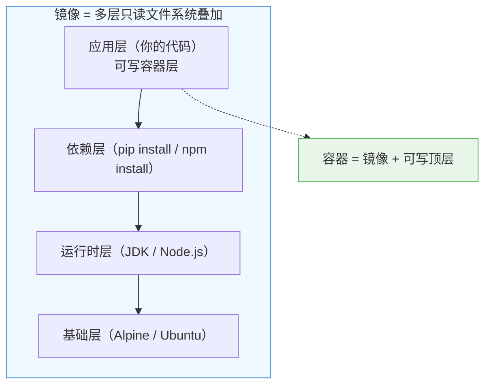
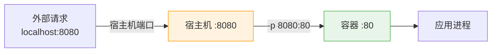

# Docker 核心原理与常用命令：研发视角速查手册


> 💡 **核心认知**：Docker 不是虚拟机，它复用宿主机内核，通过 **Namespace（隔离）** 和 **Cgroups（限制）** 实现轻量级沙箱。启动一个容器 ≈ 启动一个进程，毫秒级完成。

---

## 一、核心原理

### 镜像分层模型



| 概念 | 说明 |
| :--- | :--- |
| **镜像（Image）** | 只读模板，由多层文件系统叠加而成。每层对应 Dockerfile 中的一条指令 |
| **容器（Container）** | 镜像的运行实例 = 镜像 + 顶部可写层。容器删除后可写层消失，镜像不变 |

> 💡 **分层的本质就是复用**。以 Spring Boot 应用为例：100 个服务共享同一个 `eclipse-temurin:17-jre-alpine` 基础层，存储只存一份、拉取只下载一次。Dockerfile 中**变化少的指令放前面（`COPY pom.xml` → `RUN mvn install`）**，依赖不变时直接用缓存，构建镜像的时候不用去反复的拉取`eclipse-temurin:17-jre-alpine` 基础层，构建从 5 分钟降到 10 秒。应用代码改了只有最顶层需要重建推送，CI/CD 推送从 500MB 降到 20MB。

### Namespace 与 Cgroups

| 技术 | 作用 | 隔离了什么 |
| :--- | :--- | :--- |
| **Namespace** | 隔离视图 | PID、网络、文件系统、用户、IPC、UTS（主机名） |
| **Cgroups** | 限制资源 | CPU、内存、磁盘 IO、网络带宽 |

> 💡 **关键理解**：容器内的进程看到的 PID 1 是自己，但宿主机上它的真实 PID 可能是 12345。容器以为自己独占一台机器，实际上只是被"关"在了一个受限的沙箱里。

### Docker vs 虚拟机

| 维度 | Docker 容器 | 虚拟机 |
| :--- | :--- | :--- |
| **启动速度** | 秒级 | 分钟级 |
| **资源开销** | MB 级 | GB 级 |
| **隔离级别** | 进程级（共享内核） | 硬件级（独立内核） |
| **适用场景** | 微服务、CI/CD、开发环境 | 强隔离、异构 OS、安全敏感 |
| **密度** | 单机数十到数百容器 | 单机数个到数十 VM |

---

## 二、常用命令速查

### 镜像操作

| 命令 | 用途 | 研发高频用法 |
| :--- | :--- | :--- |
| `docker build -t name:tag .` | 构建镜像 | ⭐️ 本地构建验证 |
| `docker images` | 列出本地镜像 | 查看已构建的镜像 |
| `docker pull image:tag` | 拉取镜像 | 获取基础镜像 |
| `docker push image:tag` | 推送镜像 | 发布到 Registry |
| `docker rmi image:tag` | 删除镜像 | 清理无用镜像 |
| `docker image prune -a` | 清理所有未使用的镜像 | ⭐️ 释放磁盘空间 |

### 容器操作

| 命令 | 用途 | 研发高频用法 |
| :--- | :--- | :--- |
| `docker run -d -p 8080:80 --name app image` | 后台运行容器 | ⭐️ 启动服务 |
| `docker ps -a` | 列出所有容器（含已停止） | 查看容器状态 |
| `docker logs -f --tail 200 container` | 实时追踪日志 | ⭐️ 排查问题 |
| `docker exec -it container /bin/sh` | 进入容器内部 | ⭐️ 调试、检查文件 |
| `docker stop / start / restart container` | 停止/启动/重启 | 服务管理 |
| `docker rm -f container` | 强制删除容器 | 清理 |
| `docker cp container:/path /local/path` | 从容器拷贝文件 | 导出日志/配置 |

### 端口映射详解

容器有独立的 Network Namespace，外部无法直接访问容器内端口。**端口映射**就是把宿主机的端口"转发"到容器内的端口。



#### `-p` 参数格式

| 格式 | 示例 | 说明 |
| :--- | :--- | :--- |
| `宿主机端口:容器端口` | `-p 8080:80` | ⭐️ 最常用，指定宿主机端口 |
| `容器端口` | `-p 80` | 宿主机随机分配端口（`docker port` 查看） |
| `IP:宿主机端口:容器端口` | `-p 127.0.0.1:8080:80` | 仅绑定 localhost，外部不可访问 |
| `宿主机端口:容器端口/协议` | `-p 8080:80/tcp` | 指定协议（默认 tcp） |
| 多个端口 | `-p 8080:80 -p 8443:443` | 同时映射多个端口 |

#### Dockerfile 中的 EXPOSE vs docker run 的 -p

| 指令 | 作用 | 是否真正映射 |
| :--- | :--- | :--- |
| `EXPOSE 8080` | **文档声明**：告诉使用者"这个镜像监听 8080" | ❌ 不做任何实际映射 |
| `docker run -p 8080:8080` | **实际映射**：把宿主机 8080 转发到容器 8080 | ✅ 真正生效 |

> ⚠️ **常见误解**：`EXPOSE` 只是注释/文档，**不写 EXPOSE 也能用 `-p` 映射**。写了 EXPOSE 但不加 `-p`，外部仍然访问不到。

#### ⚠️ 端口映射踩坑

| 现象 | 原因 | 解决 |
| :--- | :--- | :--- |
| `port already allocated` | 宿主机端口被占用 | `lsof -i :8080` 排查，换端口或停掉占用进程 |
| 容器内服务正常但外部访问不通 | 没加 `-p` 或防火墙拦截 | 确认 `-p` 参数 + 检查 iptables/安全组 |
| 只有本机可访问 | 用了 `127.0.0.1:8080:80` | 去掉 IP 前缀改为 `8080:80` |
| 容器重启后端口变了 | 用了 `-p 80`（随机端口） | 显式指定宿主机端口 `-p 8080:80` |

### 调试排查

```bash
# 查看容器详细信息（IP、挂载、环境变量）
docker inspect container

# 查看容器资源使用
docker stats container

# 查看容器进程
docker top container

# 查看容器事件
docker events --filter container=app

# 清理所有停止的容器 + 未使用的镜像 + 悬空卷
docker system prune -a --volumes
```

---

## 三、Dockerfile 最佳实践

### 标准模板（Spring Boot 应用）

```dockerfile
# ===== 阶段1：构建 =====
FROM maven:3.9-eclipse-temurin-17 AS builder
WORKDIR /build
COPY pom.xml .
RUN mvn dependency:go-offline       # ⭐️ 利用缓存层，依赖不变时跳过下载
COPY src ./src
RUN mvn package -DskipTests

# ===== 阶段2：运行 =====
FROM eclipse-temurin:17-jre-alpine  # ⭐️ JRE 而非 JDK，Alpine 减小体积
WORKDIR /app
COPY --from=builder /build/target/*.jar app.jar

# ⭐️ 非 root 用户运行
RUN addgroup -S appgroup && adduser -S appuser -G appgroup
USER appuser

EXPOSE 8080
ENTRYPOINT ["java", "-jar", "app.jar"]
```

### 关键原则

| 原则 | 说明 | 反面教材 |
| :--- | :--- | :--- |
| **多阶段构建** | 构建工具和依赖不进最终镜像 | 单阶段导致镜像 1GB+ |
| **利用缓存层** | 变化少的指令放前面 | COPY src 在 COPY pom.xml 之前 |
| **最小基础镜像** | Alpine / distroless / slim | 用完整 Ubuntu 做运行时 |
| **非 root 运行** | 安全加固，避免容器逃逸风险 | 默认 root 运行 |
| **固定版本标签** | `node:18.17-alpine` 而非 `node:latest` | latest 导致不可复现 |
| **ENTRYPOINT 用数组格式** | `["java", "-jar"]` 而非字符串 | 字符串格式信号处理异常 |

### ⚠️ 常见踩坑

| 现象 | 原因 | 解决 |
| :--- | :--- | :--- |
| 镜像太大 | 单阶段构建 / 用了完整 OS | 多阶段 + Alpine |
| 构建慢 | 每次重新下载依赖 | `dependency:go-offline` + 合理排序 COPY |
| 容器内时区不对 | Alpine 默认 UTC | `apk add tzdata` + `ENV TZ=Asia/Shanghai` |
| 信号无法传递 | ENTRYPOINT 用字符串格式 | 改用数组格式 `["java", "-jar"]` |
| 权限问题 | 以 root 构建，非 root 运行 | 构建阶段 chown 或 RUN chmod |

---

## 四、Docker Compose：本地多服务编排

### 是什么？

Docker Compose = **用一个 YAML 文件定义和运行多个容器**。解决"本地开发要起 MySQL + Redis + 应用，手动 docker run 三次太麻烦"的问题。

> 💡 **定位**：Compose 是**本地开发和测试工具**，不是生产编排工具。生产环境用 K8s。

### 核心概念

| 概念 | 说明 |
| :--- | :--- |
| **Service** | 一个容器的定义（镜像、端口、环境变量、依赖） |
| **Network** | 服务间的网络隔离，同一 network 内可用服务名互访 |
| **Volume** | 持久化存储，容器删除后数据保留 |
| **depends_on** | 启动顺序依赖（注意：不保证服务就绪） |

### 完整配置样例（Spring Boot + MySQL + Redis）

```yaml
version: "3.9"

services:
  # ===== 应用服务 =====
  order-service:
    build:
      context: .
      dockerfile: Dockerfile
    ports:
      - "8080:8080"
    environment:
      - SPRING_DATASOURCE_URL=jdbc:mysql://mysql:3306/order_db?useSSL=false
      - SPRING_DATASOURCE_USERNAME=root
      - SPRING_DATASOURCE_PASSWORD=root123
      - SPRING_REDIS_HOST=redis
      - SPRING_REDIS_PORT=6379
    depends_on:
      mysql:
        condition: service_healthy    # ⭐️ 等 MySQL 健康检查通过再启动
      redis:
        condition: service_started
    networks:
      - app-network
    restart: unless-stopped

  # ===== MySQL =====
  mysql:
    image: mysql:8.0
    ports:
      - "3306:3306"
    environment:
      MYSQL_ROOT_PASSWORD: root123
      MYSQL_DATABASE: order_db
    volumes:
      - mysql-data:/var/lib/mysql     # ⭐️ 数据持久化
      - ./init.sql:/docker-entrypoint-initdb.d/init.sql  # 初始化脚本
    healthcheck:                      # ⭐️ 健康检查
      test: ["CMD", "mysqladmin", "ping", "-h", "localhost"]
      interval: 10s
      timeout: 5s
      retries: 5
    networks:
      - app-network

  # ===== Redis =====
  redis:
    image: redis:7-alpine
    ports:
      - "6379:6379"
    volumes:
      - redis-data:/data
    command: redis-server --appendonly yes
    networks:
      - app-network

# ===== 持久化卷 =====
volumes:
  mysql-data:
  redis-data:

# ===== 自定义网络 =====
networks:
  app-network:
    driver: bridge
```

### 常用命令

```bash
# 启动所有服务（后台运行）
docker compose up -d

# 查看服务状态
docker compose ps

# 查看某个服务日志
docker compose logs -f order-service

# 重新构建并启动
docker compose up -d --build

# 停止并删除容器（保留数据卷）
docker compose down

# 停止并删除容器 + 数据卷（⚠️ 清除所有数据）
docker compose down -v

# 进入某个服务容器
docker compose exec order-service /bin/sh
```

### ⚠️ 常见踩坑

| 现象 | 原因 | 解决 |
| :--- | :--- | :--- |
| 应用启动报 DB 连不上 | `depends_on` 不等服务就绪 | 加 `healthcheck` + `condition: service_healthy` |
| 服务间访问不通 | 不在同一 network | 确保所有服务在同一 `networks` 下 |
| 数据丢失 | 没用 volume 持久化 | 声明 `volumes` 映射 |
| 端口冲突 | 宿主机端口被占用 | 改 `ports` 映射或 `docker ps` 排查 |
| 环境变量不生效 | 写了 `env_file` 但格式不对 | 每行 `KEY=VALUE`，无引号无空格 |

> 💡 **服务发现**：同一 network 内，服务名就是 DNS 域名。`order-service` 可以直接用 `mysql:3306` 和 `redis:6379` 访问其他服务，不需要 localhost 或 IP。

---

## 五、面试高频问题速答

### Q1：Docker 镜像为什么是分层的？

分层实现了**复用和增量更新**。多个镜像共享底层（如 Alpine），拉取时只需下载缺失的层。构建时只有变化的层需要重建，未变化的层直接使用缓存。这大幅减少了存储空间和网络传输量。

### Q2：容器和虚拟机的本质区别是什么？

容器共享宿主机内核，通过 Namespace 隔离视图、Cgroups 限制资源，本质是一个受限的进程。虚拟机有独立的 Guest OS 和内核，通过 Hypervisor 模拟硬件。容器启动秒级、开销 MB 级；虚拟机启动分钟级、开销 GB 级。

### Q3：Dockerfile 中 COPY 和 ADD 的区别？

COPY 只做文件复制，语义明确。ADD 额外支持 URL 下载和 tar 自动解压。**99% 的场景用 COPY**，只在需要从 URL 下载或自动解压 tar 时才用 ADD。

### Q4：为什么容器内不能用 localhost 访问其他服务？

每个容器有独立的 Network Namespace，localhost 指向容器自身。同一 Docker network 内的容器应该用**服务名**作为主机名互相访问（如 `mysql:3306`），Docker 内置 DNS 会自动解析。

### Q5：一台 ECS 能同时运行多少个容器？上限受什么制约？

> 💡 **面试话术**："容器本身非常轻量，额外开销只有几 MB。一台 ECS 能跑多少容器，**不取决于 Docker，而取决于三个因素**：① ECS 的物理资源（硬上限）；② 每个容器内应用的资源消耗（真正的变量）；③ 内核参数限制（高并发时容易触顶）。生产中我们通过 K8s 的 resources.requests/limits 做资源规划，配合 HPA 自动伸缩，让集群资源利用率保持在 60-70% 的安全水位。"

---

## 小结

本篇从研发视角覆盖了 Docker 核心知识：

- **核心原理**：镜像分层、Namespace/Cgroups、与 VM 的区别
- **常用命令**：镜像操作、容器操作、调试排查
- **Dockerfile**：多阶段构建模板 + 最佳实践 + 踩坑
- **Docker Compose**：本地多服务编排的概念、完整样例、常用命令
- **面试速答**：分层、容器 vs VM、COPY vs ADD、服务发现

> 💡 **记忆口诀**：**镜像是模板，容器是实例；分层省空间，Namespace 做隔离；Compose 管本地，K8s 管生产；Dockerfile 多阶段，非 root 保安全**。
