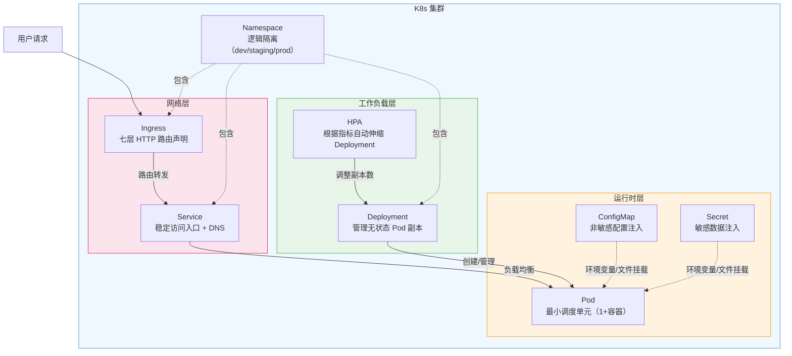
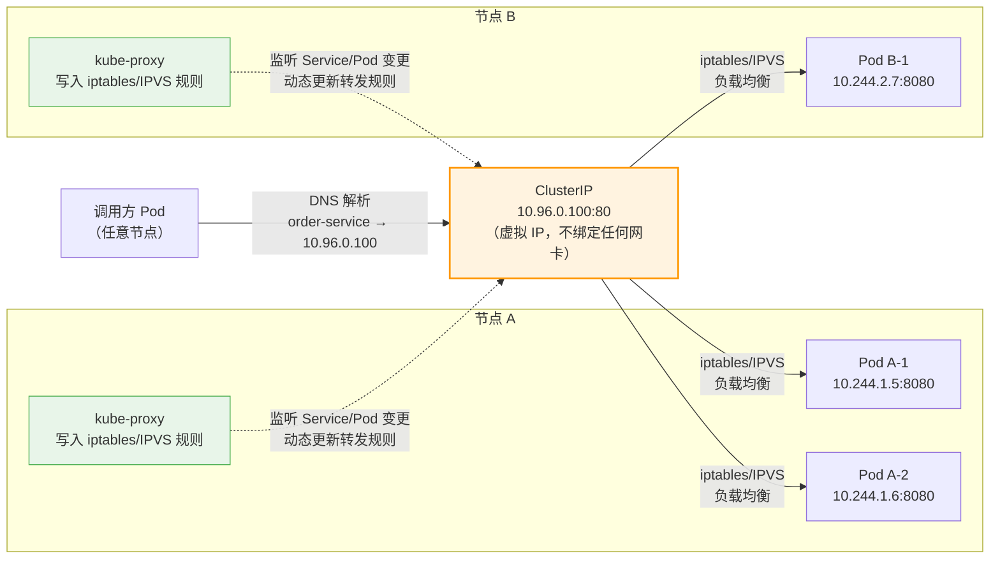

# K8s 核心概念：研发视角速查手册

## 核心概念关系全览



> 💡 **阅读指引**：从上到下是**流量路径**（用户 → Ingress → Service → Pod），从左到右是**管理关系**（Deployment 管 Pod，HPA 管 Deployment，ConfigMap/Secret 注入 Pod）。Namespace 是所有资源的逻辑容器。

---

## 写给谁看？

这篇笔记**不教你搭集群**，那是运维/SRE 的事。作为研发，你只需要知道：

1. **这个组件是什么、解决什么问题**
2. **YAML 怎么写、关键字段是什么**
3. **日常开发中怎么用、怎么排查问题**

> 💡 **核心认知**：K8s 的一切都是**声明式**的。你写 YAML 描述"我想要什么状态"，K8s 自动帮你达成并维持这个状态。你不需要手动启停容器、配负载均衡、做滚动更新——写好 YAML，`kubectl apply` 就行。

### 配置是怎么生效的？

```
本地 YAML 文件 → kubectl apply → API Server 写入 etcd → Controller 监听到变更 → 创建/更新 Pod
```

- **etcd 是集群的唯一真相来源**：K8s 的所有组件（API Server、Controller Manager、Scheduler）都不直接操作容器，它们只读写 etcd。kubelet 监听 etcd 变更来启停容器，kube-proxy 监听 etcd 变更来更新转发规则。**etcd 变了，整个集群才变**
- **YAML 是配置的"源码"**：所有资源定义都以 YAML 文件形式存储在 Git 中，通过 CI/CD 流水线或 GitOps 工具（ArgoCD/FluxCD）自动应用到集群
- **控制台只是 GUI 工具**：云厂商控制台（ACK/SAE）本质上是生成 YAML 并提交到 API Server 的图形界面，底层走的还是同一套声明式 API
- **研发日常**：本地写好 YAML → `kubectl apply -f xxx.yaml` 验证 → 提交 Git → 流水线自动部署。**生产配置必须版本化，禁止在控制台手动修改**

---

## 一、Pod：最小运行单元

### 是什么？

Pod = **一个或多个容器的组合**，是 K8s 调度的最小单位。你不会直接创建 Pod，而是通过 Deployment/StatefulSet 等控制器来管理它。

| 要点 | 说明 |
| :--- | :--- |
| **为什么不是容器？** | 有些场景需要多个容器紧密协作（如 sidecar 日志采集），它们共享网络和存储 |
| **生命周期** | Pod 是临时的，随时可能被重建。**永远不要依赖单个 Pod 的 IP** |
| **IP 分配** | 每个 Pod 有独立 IP，同集群内可直接通信 |

### 研发必知的 Pod 配置

```yaml
apiVersion: v1
kind: Pod
metadata:
  name: order-service
  labels:
    app: order          # ⭐️ 标签是 Service 选择器的匹配依据
spec:
  containers:
    - name: order-app
      image: registry.cn-hangzhou.aliyuncs.com/myapp/order:v1.2.0
      ports:
        - containerPort: 8080
      env:               # 环境变量注入
        - name: DB_HOST
          valueFrom:
            configMapKeyRef:
              name: order-config
              key: db.host
      resources:         # ⭐️ 必须设置资源限制，否则会被驱逐或抢占
        requests:
          cpu: "250m"    # 调度依据：至少需要这么多才调度到此节点
          memory: "512Mi"
        limits:
          cpu: "500m"    # 上限：超过会被限流（CPU）或 OOM Kill（内存）
          memory: "1Gi"
      livenessProbe:     # ⭐️ 存活探针：失败则重启容器
        httpGet:
          path: /actuator/health/liveness
          port: 8080
        initialDelaySeconds: 30
        periodSeconds: 10
      readinessProbe:    # ⭐️ 就绪探针：失败则从 Service 摘除流量
        httpGet:
          path: /actuator/health/readiness
          port: 8080
        initialDelaySeconds: 10
        periodSeconds: 5
```

### 两种探针的区别（⚠️ 高频考点）

| 探针 | 作用 | 失败后果 | 典型场景 |
| :--- | :--- | :--- | :--- |
| **livenessProbe** | 检测容器是否"活着" | 重启容器 | 进程死锁、内存泄漏导致假死 |
| **readinessProbe** | 检测容器是否"准备好接流量" | 从 Service 端点摘除 | 应用启动加载缓存、数据库连接池初始化 |

> ⚠️ **常见踩坑**：
> - 不设 `resources.limits` → Pod 可能吃光节点资源，影响其他服务
> - liveness 和 readiness 用同一个接口 → 启动慢时 liveness 超时触发重启，陷入死循环
> - `initialDelaySeconds` 设太短 → 应用还没启动完就被判定失败
> - 生产环境一般不单独写 pod 配置，pod 一般交给 Deployment 进行管理

---

## 二、Deployment：无状态应用的标配控制器

### 是什么？

Deployment = **管理一组相同 Pod 的控制器**，提供滚动更新、回滚、扩缩容能力。90% 的微服务都用 Deployment。

| 能力 | 说明 |
| :--- | :--- |
| **副本管理** | 保证始终有 N 个 Pod 在运行，挂了自动拉起 |
| **滚动更新** | 新版本 Pod 逐个替换旧版本，零停机 |
| **回滚** | `kubectl rollout undo` 一键回到上一版本 |
| **扩缩容** | `kubectl scale --replicas=5` 或 HPA 自动伸缩 |

### 研发必知的 Deployment 配置

```yaml
apiVersion: apps/v1
kind: Deployment
metadata:
  name: order-service
spec:
  replicas: 3                    # 副本数
  selector:
    matchLabels:
      app: order                 # ⭐️ 必须与 Pod template 的 labels 匹配
  strategy:
    type: RollingUpdate
    rollingUpdate:
      maxSurge: 1                # 更新时最多多出 1 个 Pod
      maxUnavailable: 0          # ⭐️ 更新时不允许减少可用 Pod（零停机）
  template:                      # Pod 模板
    metadata:
      labels:
        app: order
    spec:
      containers:
        - name: order-app
          image: registry.cn-hangzhou.aliyuncs.com/myapp/order:v1.2.0
          ports:
            - containerPort: 8080
          resources:
            requests:
              cpu: "250m"
              memory: "512Mi"
            limits:
              cpu: "500m"
              memory: "1Gi"
```

### 滚动更新策略解读

```
replicas=3, maxSurge=1, maxUnavailable=0 的更新过程：

时间线:  [旧v1] [旧v1] [旧v1]
         ↓ 创建1个新Pod
        [旧v1] [旧v1] [旧v1] [新v2]    ← 4个Pod（maxSurge=1）
         ↓ 新Pod就绪后，删1个旧Pod
        [旧v1] [旧v1] [新v2]           ← 3个Pod
         ↓ 继续...
        [旧v1] [新v2] [新v2]
         ↓
        [新v2] [新v2] [新v2]           ← 更新完成
```

> 💡 **生产建议**：`maxUnavailable: 0` 保证更新期间可用副本数不减少，适合对可用性要求高的服务。如果追求更新速度，可设为 `maxUnavailable: 1`。

### 常用运维命令

```bash
# 查看部署状态
kubectl get deployment order-service
kubectl rollout status deployment/order-service

# 扩缩容
kubectl scale deployment order-service --replicas=5

# 滚动更新镜像
kubectl set image deployment/order-service order-app=registry.../order:v1.3.0

# 回滚
kubectl rollout undo deployment/order-service
kubectl rollout history deployment/order-service   # 查看历史版本
```

### ⚠️ 重要提醒：不要手写 Pod YAML

> ✅ **写了 Deployment，就不要再单独写 Pod**。Deployment 的 `template` 就是 Pod 的定义，K8s 会自动根据模板创建和管理 Pod。

**为什么？**

| 方式 | 后果 |
| :--- | :--- |
| 只写 Deployment | K8s 自动创建 N 个 Pod，挂了自动拉起，支持滚动更新、回滚、扩缩容 |
| 同时写 Deployment + 独立 Pod | 独立 Pod 是"孤儿"：挂了不重启、不被 Service 选中、不被 HPA 伸缩，造成混乱 |
| 只写独立 Pod | 没有生命周期管理，生产环境严禁使用 |

**研发日常正确姿势**：
- 生产环境永远通过控制器（Deployment/StatefulSet/DaemonSet）创建 Pod
- `spec.template.spec` 就是完整的 PodSpec，和单独写 Pod 的结构一模一样

> 💡 **记忆口诀**：**Deployment = Pod 模板 + 副本管理策略**。你只需要关心"Pod 长什么样"和"要几个"，剩下的交给 K8s。

### 三种控制器选型指南：Deployment vs StatefulSet vs DaemonSet

它们不仅仅是扩缩容工具，更是三种不同场景下的 **Pod 生命周期管理器**。核心区别在于如何创建、命名、存储和更新 Pod。

| 维度 | Deployment | StatefulSet | DaemonSet |
| :--- | :--- | :--- | :--- |
| **适用场景** | 无状态服务（Web/API/微服务） | 有状态服务（DB/MQ/缓存集群） | 节点级守护进程（日志/监控/网络插件） |
| **Pod 命名** | 随机后缀 `order-5f8b7c-abc12` | 有序编号 `mysql-0`, `mysql-1` | 与节点绑定 `fluentd-node01` |
| **存储** | 共享 PV 或临时存储 | 每个 Pod 绑定独立 PVC（持久化） | 通常不需要持久存储 |
| **扩缩容** | 无序，任意增减 | 有序（0→1→2），缩容逆序 | 跟随节点数量，不能手动指定副本数 |
| **更新策略** | RollingUpdate / Recreate | RollingUpdate / Partition / OnDelete | RollingUpdate / OnDelete |
| **Pod 与节点关系** | 调度器随机分配 | 可指定节点亲和性 | **每个节点恰好一个 Pod** |
| **研发使用频率** | ⭐⭐⭐ 90% 的微服务 | ⭐⭐ 数据库/MQ 集群 | ⭐ 运维/SRE 配置，研发极少手写 |

#### 各自解决什么问题？

- **Deployment**：N 个相同的 Pod，挂了就拉起，更新时零停机。Pod 之间完全对等，任何一个都可以被替换。典型应用：Spring Boot 微服务、Nginx、前端静态资源服务。
- **StatefulSet**：Pod 有固定身份（名称+存储），重启后数据不丢、身份不变。Pod 名称有序且稳定（`mysql-0` 永远是主节点），每个 Pod 绑定独立 PVC，删除 Pod 后 PVC 保留，扩缩容严格按顺序执行。典型应用：MySQL 主从、Redis Cluster、Kafka、ZooKeeper、Elasticsearch。
- **DaemonSet**：每个节点（或特定节点）运行且仅运行一个 Pod。新节点加入集群时自动创建 Pod，节点移除时自动清理 Pod，**不能手动设置 replicas**。典型应用：日志采集（Fluentd/Filebeat）、监控 Agent（Prometheus Node Exporter）、网络插件（Calico/Flannel）。

#### 选型决策树

```
你的应用需要持久化数据吗？
├── 否 → Deployment
└── 是 → 每个实例需要独立存储和固定身份吗？
    ├── 是 → StatefulSet
    └── 否 → Deployment + 外部存储（如 RDS/OSS/NAS）

你的应用需要在每个节点都运行吗？
├── 是 → DaemonSet
└── 否 → 看上面的判断
```

> 💡 **研发日常**：**90% 的情况用 Deployment**。只有当你明确知道应用是有状态的（如自建 MySQL/Redis/Kafka）才用 StatefulSet；DaemonSet 通常是运维/SRE 配置的集群基础设施，研发几乎不需要手写。

---

## 三、Service：稳定的服务发现与负载均衡

### 是什么？

Service = **一组 Pod 的稳定访问入口**。Pod IP 会变，Service 提供不变的 ClusterIP/DNS 名称 + 自动负载均衡。

| Service 类型 | 用途 | 研发使用频率 |
| :--- | :--- | :--- |
| **ClusterIP** | 集群内部访问（默认） | ⭐⭐⭐ 最常用 |
| **NodePort** | 通过节点端口暴露（测试用） | ⭐ 少用 |
| **LoadBalancer** | 云厂商 LB（阿里云 ACK 自动创建 SLB/ALB） | ⭐⭐ 对外暴露时用 |
| **ExternalName** | CNAME 到外部域名 | ⭐ 极少 |

### 研发必知的 Service 配置

```yaml
apiVersion: v1
kind: Service
metadata:
  name: order-service
spec:
  type: ClusterIP              # 集群内部访问
  selector:
    app: order                 # ⭐️ 匹配 Pod 的 labels
  ports:
    - port: 80                 # Service 端口（其他服务访问时用这个）
      targetPort: 8080         # Pod 实际端口
      protocol: TCP
```

### 服务发现：DNS 解析规则

创建 Service 后，K8s 自动注册 DNS：

```
# 同命名空间内直接用服务名
http://order-service:80/api/orders

# 跨命名空间
http://order-service.production.svc.cluster.local:80/api/orders

# 完整格式
<service-name>.<namespace>.svc.cluster.local
```

> 💡 **研发日常**：微服务之间调用直接用 `http://服务名:端口`，不需要硬编码 IP。Nacos/Eureka 注册中心在 K8s 中可以用 K8s 原生 DNS 替代。

---

## 四、ConfigMap 与 Secret：配置与敏感数据管理

ConfigMap 存储非敏感配置，Secret 存储敏感数据（密码、证书、API Key）。两者结构相似，区别仅在于 Secret 的值需要 Base64 编码且 K8s 会做额外的安全处理。

### 完整配置示例（ConfigMap + Secret + 注入方式）

```yaml
# ===== 1. ConfigMap：非敏感配置 =====
apiVersion: v1
kind: ConfigMap
metadata:
  name: order-config
data:
  db.host: "rm-xxx.mysql.rds.aliyuncs.com"
  db.port: "3306"
  log.level: "INFO"
  application.yml: |           # ⭐️ 也可以挂载整个配置文件
    server:
      port: 8080
    spring:
      datasource:
        url: jdbc:mysql://${DB_HOST}:${DB_PORT}/order_db
---
# ===== 2. Secret：敏感数据 =====
apiVersion: v1
kind: Secret
metadata:
  name: order-secret
type: Opaque
data:                            # ⭐️ 值必须是 Base64 编码
  db.password: cGFzc3dvcmQxMjM=  # echo -n 'password123' | base64
  api.key: c2VjcmV0LWtleQ==
---
# ===== 3. Deployment 中注入 ConfigMap 和 Secret =====
apiVersion: apps/v1
kind: Deployment
metadata:
  name: order-service
spec:
  replicas: 3
  selector:
    matchLabels:
      app: order
  template:
    metadata:
      labels:
        app: order
    spec:
      containers:
        - name: order-app
          image: registry.../order:v1.2.0
          # 方式1：环境变量注入（简单键值对）
          env:
            - name: DB_HOST
              valueFrom:
                configMapKeyRef:
                  name: order-config
                  key: db.host
            - name: DB_PASSWORD
              valueFrom:
                secretKeyRef:
                  name: order-secret
                  key: db.password
          # 方式2：文件挂载（配置文件、证书）
          volumeMounts:
            - name: config-volume
              mountPath: /app/config    # ConfigMap 变成目录下的多个文件
              readOnly: true
            - name: secret-volume
              mountPath: /app/certs     # Secret 变成目录下的证书文件
              readOnly: true
      volumes:
        - name: config-volume
          configMap:
            name: order-config
        - name: secret-volume
          secret:
            secretName: order-secret
```

### 两种注入方式对比

| 方式 | 适用场景 | 动态更新 | 本质 |
| :--- | :--- | :--- | :--- |
| **环境变量** | 简单键值对（数据库地址、开关） | ❌ 需重启 Pod | 把键值对设为容器的 `ENV` |
| **文件挂载** | 配置文件、证书、密钥文件 | ✅ 自动更新（1-2分钟延迟） | K8s 把数据写入容器内指定路径 |

> 💡 **核心认知**：ConfigMap/Secret 是**配置数据的存储**，环境变量和文件挂载是**两种注入通道**。Pod 启动时，K8s 会把数据"快递"到容器内的指定位置——环境变量直接写入进程环境，文件挂载则动态生成容器内的文件副本。

> ⚠️ **常见踩坑**：
> - Secret 的 data 字段必须是 **Base64 编码**，明文会报错（或用 `stringData` 字段写明文，K8s 自动编码）
> - 环境变量方式修改 ConfigMap 后，**已有 Pod 不会自动更新**，需要重启或重新部署
> - 文件挂载方式更新有 **1-2 分钟延迟**（kubelet sync period），不是实时的

### 实战示例：TLS 证书挂载

以下展示如何将 TLS 证书通过 Secret 挂载到容器内，供 Spring Boot / Nginx 等应用使用。

```yaml
# ===== 1. 创建 TLS Secret =====
# 方式一：命令行创建（推荐，自动 Base64 编码）
# kubectl create secret tls order-tls \
#   --cert=tls.crt --key=tls.key \
#   -n production

# 方式二：YAML 定义
apiVersion: v1
kind: Secret
metadata:
  name: order-tls
  namespace: production
type: kubernetes.io/tls          # ⭐️ TLS 专用类型，比 Opaque 更规范
data:
  tls.crt: LS0tLS1CRUdJTi...     # Base64 编码的证书内容
  tls.key: LS0tLS1CRUdJTi...     # Base64 编码的私钥内容
---
# ===== 2. Deployment 中挂载证书 =====
apiVersion: apps/v1
kind: Deployment
metadata:
  name: order-service
spec:
  template:
    spec:
      containers:
        - name: order-app
          image: registry.../order:v1.2.0
          volumeMounts:
            - name: tls-certs
              mountPath: /app/certs       # ⭐️ 证书文件会出现在这个目录下
              readOnly: true
      volumes:
        - name: tls-certs
          secret:
            secretName: order-tls
            items:                        # ⭐️ 可选：重命名挂载后的文件名
              - key: tls.crt
                path: server.crt          # 容器内文件名为 /app/certs/server.crt
              - key: tls.key
                path: server.key          # 容器内文件名为 /app/certs/server.key
```

**挂载后容器内的文件结构**：
```
/app/certs/
├── server.crt    ← tls.crt 的内容（如果不指定 items，则文件名为 tls.crt）
└── server.key    ← tls.key 的内容
```

**Spring Boot 配置引用**：
```yaml
server:
  ssl:
    certificate: /app/certs/server.crt
    certificate-private-key: /app/certs/server.key
```

> 💡 **关键点**：
> - 证书数据存在 **etcd 中**，不在宿主机磁盘上。Pod 启动时 kubelet 动态生成文件并挂载进容器
> - 更新 Secret 后，容器内证书文件会在 **1-2 分钟内自动刷新**，无需重启 Pod
> - 使用 `kubernetes.io/tls` 类型而非 `Opaque`，K8s 会校验证书格式，且 Ingress Controller 可直接引用

---

## 五、Ingress：七层流量入口

### 是什么？

Ingress = **K8s 版的 nginx.conf**，声明 HTTP/HTTPS 路由规则。详见 [阿里云部署架构笔记](Aliyun-Deployment-Architecture-Notes.md) 中的 Ingress 章节。

```yaml
apiVersion: networking.k8s.io/v1
kind: Ingress
metadata:
  name: order-ingress
  annotations:
    alb.ingress.kubernetes.io/address-type: internet
    alb.ingress.kubernetes.io/listen-ports: '[{"HTTPS":443}]'
    alb.ingress.kubernetes.io/certificate-id: cert-xxx
spec:
  ingressClassName: alb
  rules:
    - host: api.example.com
      http:
        paths:
          - path: /order
            pathType: Prefix
            backend:
              service:
                name: order-service
                port:
                  number: 80
```

> 💡 **研发视角**：你只需要写 Ingress YAML 声明路由规则，Ingress Controller（ALB/Nginx）自动生效。不需要手动改 nginx.conf、reload、配证书路径。

---

## 六、HPA：自动弹性伸缩

### 是什么？

HPA（Horizontal Pod Autoscaler）= **根据指标自动调整 Deployment 副本数**。

```yaml
apiVersion: autoscaling/v2
kind: HorizontalPodAutoscaler
metadata:
  name: order-hpa
spec:
  scaleTargetRef:
    apiVersion: apps/v1
    kind: Deployment
    name: order-service
  minReplicas: 2
  maxReplicas: 10
  metrics:
    - type: Resource
      resource:
        name: cpu
        target:
          type: Utilization
          averageUtilization: 70    # CPU 平均使用率 > 70% 时扩容
    - type: Resource
      resource:
        name: memory
        target:
          type: Utilization
          averageUtilization: 80    # 内存平均使用率 > 80% 时扩容
```

### HPA 工作原理

```
当前副本=3, CPU平均利用率=85%, 目标=70%

期望副本 = ceil(当前副本 × 当前利用率 / 目标利用率)
         = ceil(3 × 85 / 70)
         = ceil(3.64)
         = 4

→ HPA 将副本数从 3 扩到 4
```

> ⚠️ **前提条件**：Pod 必须设置 `resources.requests`，否则 HPA 无法计算利用率。没设 requests = HPA 不工作。

---

## 七、Namespace：逻辑隔离

### 是什么？

Namespace = **K8s 内的虚拟集群**，用于环境隔离（dev/staging/prod）或团队隔离。

```bash
# 创建命名空间
kubectl create namespace production

# 指定命名空间操作
kubectl get pods -n production
kubectl apply -f deployment.yaml -n production

# 设置默认命名空间（避免每次加 -n）
kubectl config set-context --current --namespace=production
```

> 💡 **研发日常**：不同环境的配置（ConfigMap/Secret）放在不同 Namespace 中，同名不冲突。SAE 的"命名空间"概念与此对应。

---

## 八、研发日常排查速查

### Pod 起不来？

```bash
# 1. 看 Pod 状态
kubectl get pods -l app=order -o wide

# 2. 看事件（最常见的问题都在这里）
kubectl describe pod <pod-name>

# 3. 看日志
kubectl logs <pod-name> --tail=200
kubectl logs <pod-name> --previous    # 上一个崩溃容器的日志

# 4. 进容器调试
kubectl exec -it <pod-name> -- /bin/sh
```

### 常见问题速查表

| 现象 | 可能原因 | 排查命令 |
| :--- | :--- | :--- |
| **Pending** | 资源不足 / 节点污点 / PVC 未绑定 | `kubectl describe pod` 看 Events |
| **CrashLoopBackOff** | 应用启动失败 / 探针配置错误 | `kubectl logs --previous` |
| **ImagePullBackOff** | 镜像不存在 / 拉取凭证错误 | `kubectl describe pod` 看 Events |
| **OOMKilled** | 内存超 limits | 调大 limits 或优化应用内存 |
| **Evicted** | 节点资源压力过大 | `kubectl describe node` 看 Conditions |
| **Service 不通** | selector 不匹配 / Pod 未就绪 | `kubectl get endpoints <svc>` |

> 💡 **黄金法则**：**`kubectl describe` 是第一排查手段**。90% 的问题都能在 Events 里找到答案。

---

## 九、面试高频问题速答

### Q1：Pod 和容器的区别是什么？

Pod 是一个或多个容器的组合，是 K8s 调度的最小单位。同一 Pod 内的容器共享网络命名空间（localhost 互通）和存储卷。单独一个容器不能直接被 K8s 调度。

### Q2：Deployment 和 StatefulSet 怎么选？

详见正文「三种控制器选型指南」章节。核心结论：**90% 的微服务用 Deployment**，只有自建 MySQL/Redis/Kafka 等有状态组件才用 StatefulSet。选型决策树：需要持久化数据且每个实例需独立存储和固定身份 → StatefulSet，否则 → Deployment。

### Q3：Service 的 ClusterIP 是怎么实现的？

K8s 通过 **iptables/IPVS** 规则实现。每个 Service 分配一个虚拟 IP（ClusterIP），kube-proxy 在每个节点上写入转发规则，将访问 ClusterIP 的流量负载均衡到后端 Pod。应用无需感知，直接用 DNS 名称访问即可。



> 💡 **关键理解**：ClusterIP 是一个**纯虚拟 IP**，不绑定任何物理网卡。流量到达节点内核时，被 iptables/IPVS 规则拦截并重定向到真实 Pod IP。整个过程对应用完全透明，应用只需要知道 `order-service:80` 这个 DNS 名称。

### Q4：ConfigMap 更新后 Pod 会自动生效吗？

详见正文「两种注入方式对比」和「常见踩坑」章节。核心结论：环境变量方式 ❌ 需重启，文件挂载方式 ✅ 自动更新（1-2 分钟延迟）。Spring Boot 推荐文件挂载 + Spring Cloud Kubernetes Config Reload 实现热更新。

---

## 附录：完整配置文件参考（逐行注释）

以下是一份生产级微服务的完整 YAML，涵盖 ConfigMap、Secret、Deployment、Service、Ingress、HPA 六种资源，每一行都有注释，可作为日常开发的模板参考。

```yaml
# ==========================================
# 1. ConfigMap：非敏感配置
# ==========================================
apiVersion: v1                    # K8s API 版本，ConfigMap 用 v1
kind: ConfigMap                   # 资源类型：配置映射
metadata:
  name: order-config              # ConfigMap 名称，被 Deployment 引用时用这个名字
  namespace: production           # 所属命名空间，不同环境用不同 Namespace
data:                             # 键值对配置，值为字符串
  db.host: "rm-xxx.mysql.rds.aliyuncs.com"   # 数据库地址
  db.port: "3306"                 # 数据库端口
  log.level: "INFO"               # 日志级别
  application.yml: |              # ⭐️ 多行字符串，挂载后变成容器内的 application.yml 文件
    server:
      port: 8080
    spring:
      datasource:
        url: jdbc:mysql://${DB_HOST}:${DB_PORT}/order_db
---
# ==========================================
# 2. Secret：敏感数据
# ==========================================
apiVersion: v1
kind: Secret                      # 资源类型：敏感数据
metadata:
  name: order-secret              # Secret 名称
  namespace: production
type: Opaque                      # 通用类型，还有 kubernetes.io/tls（证书）、kubernetes.io/dockerconfigjson（镜像拉取）等
data:                             # ⭐️ 值必须是 Base64 编码（echo -n 'xxx' | base64）
  db.password: cGFzc3dvcmQxMjM=   # 数据库密码
  api.key: c2VjcmV0LWtleQ==       # API 密钥
---
# ==========================================
# 3. Deployment：无状态应用控制器
# ==========================================
apiVersion: apps/v1               # Deployment 属于 apps/v1 组
kind: Deployment
metadata:
  name: order-service             # Deployment 名称
  namespace: production
  labels:
    app: order                    # 标签，用于组织和筛选资源
spec:
  replicas: 3                     # ⭐️ 期望副本数，K8s 会自动维持这个数量
  selector:
    matchLabels:
      app: order                  # ⭐️ 必须与 template.metadata.labels 完全匹配，否则报错
  strategy:                       # 更新策略
    type: RollingUpdate           # 滚动更新（另一种是 Recreate：先删旧再建新，有停机时间）
    rollingUpdate:
      maxSurge: 1                 # 更新时最多比 replicas 多出 1 个 Pod
      maxUnavailable: 0           # ⭐️ 更新时不允许减少可用 Pod，保证零停机
  template:                       # ⭐️ Pod 模板，Deployment 根据这个模板创建 Pod
    metadata:
      labels:
        app: order                # ⭐️ 必须与 selector.matchLabels 匹配
    spec:                         # PodSpec：定义 Pod 的内容
      containers:
        - name: order-app         # 容器名称，Pod 内唯一
          image: registry.cn-hangzhou.aliyuncs.com/myapp/order:v1.2.0  # ⭐️ 镜像地址+标签，不要用 latest
          ports:
            - containerPort: 8080 # 容器暴露的端口（仅声明作用，实际访问靠 Service）
          env:                    # 环境变量注入
            - name: DB_HOST       # 环境变量名
              valueFrom:
                configMapKeyRef:  # 从 ConfigMap 取值
                  name: order-config
                  key: db.host
            - name: DB_PASSWORD
              valueFrom:
                secretKeyRef:     # 从 Secret 取值
                  name: order-secret
                  key: db.password
          resources:              # ⭐️ 必须设置，否则 HPA 不工作、节点可能被挤爆
            requests:             # 调度依据：节点至少要有这么多资源才会把 Pod 调度上去
              cpu: "250m"         # 250 毫核 = 0.25 核
              memory: "512Mi"     # 512 MiB
            limits:               # 上限：超过会被限流（CPU）或 OOM Kill（内存）
              cpu: "500m"
              memory: "1Gi"
          livenessProbe:          # ⭐️ 存活探针：失败则重启容器
            httpGet:
              path: /actuator/health/liveness
              port: 8080
            initialDelaySeconds: 30  # 容器启动后等 30 秒再开始探测，避免启动慢误杀
            periodSeconds: 10        # 每 10 秒探测一次
            failureThreshold: 3      # 连续失败 3 次才判定为不健康
          readinessProbe:         # ⭐️ 就绪探针：失败则从 Service 摘除流量
            httpGet:
              path: /actuator/health/readiness
              port: 8080
            initialDelaySeconds: 10
            periodSeconds: 5
          volumeMounts:           # 文件挂载
            - name: config-volume
              mountPath: /app/config   # ConfigMap 的数据会变成这个目录下的文件
              readOnly: true           # 只读，防止应用意外修改
            - name: secret-volume
              mountPath: /app/certs    # Secret 的数据会变成这个目录下的证书文件
              readOnly: true
      volumes:                    # 定义卷
        - name: config-volume
          configMap:
            name: order-config    # 引用上面定义的 ConfigMap
        - name: secret-volume
          secret:
            secretName: order-secret  # 引用上面定义的 Secret
---
# ==========================================
# 4. Service：稳定访问入口
# ==========================================
apiVersion: v1
kind: Service
metadata:
  name: order-service             # ⭐️ 这个名称就是 DNS 域名：order-service.production.svc.cluster.local
  namespace: production
spec:
  type: ClusterIP                 # 集群内部访问（默认），对外暴露用 LoadBalancer
  selector:
    app: order                    # ⭐️ 匹配 Pod 的 labels，决定哪些 Pod 是后端
  ports:
    - port: 80                    # Service 端口，其他服务访问时用这个
      targetPort: 8080            # ⭐️ 转发到 Pod 的实际端口
      protocol: TCP
---
# ==========================================
# 5. Ingress：七层 HTTP 路由
# ==========================================
apiVersion: networking.k8s.io/v1
kind: Ingress
metadata:
  name: order-ingress
  namespace: production
  annotations:                    # ⭐️ Ingress Controller 特定的配置（这里是阿里云 ALB）
    alb.ingress.kubernetes.io/address-type: internet      # 公网访问
    alb.ingress.kubernetes.io/listen-ports: '[{"HTTPS":443}]'  # 监听 HTTPS 443
    alb.ingress.kubernetes.io/certificate-id: cert-xxx    # SSL 证书 ID
spec:
  ingressClassName: alb           # ⭐️ 指定使用哪个 Ingress Controller
  rules:
    - host: api.example.com       # 域名匹配
      http:
        paths:
          - path: /order          # 路径前缀匹配
            pathType: Prefix      # Prefix（前缀）/ Exact（精确）/ ImplementationSpecific
            backend:
              service:
                name: order-service  # ⭐️ 转发到哪个 Service
                port:
                  number: 80         # Service 的端口
---
# ==========================================
# 6. HPA：自动弹性伸缩
# ==========================================
apiVersion: autoscaling/v2        # HPA v2 支持多指标
kind: HorizontalPodAutoscaler
metadata:
  name: order-hpa
  namespace: production
spec:
  scaleTargetRef:                 # ⭐️ 要伸缩的目标资源
    apiVersion: apps/v1
    kind: Deployment
    name: order-service
  minReplicas: 2                  # 最小副本数，缩容不低于此值
  maxReplicas: 10                 # 最大副本数，扩容不超过此值
  metrics:                        # ⭐️ 伸缩指标，可配多个
    - type: Resource
      resource:
        name: cpu
        target:
          type: Utilization
          averageUtilization: 70  # CPU 平均使用率 > 70% 时扩容
    - type: Resource
      resource:
        name: memory
        target:
          type: Utilization
          averageUtilization: 80  # 内存平均使用率 > 80% 时扩容
```

> 💡 **使用建议**：复制这份模板，替换 `name`、`image`、`ports`、`resources` 等字段即可快速创建新服务。所有 `⭐️` 标记的行是研发必须关注和理解的字段。

---

## 小结

本篇从研发视角覆盖了 K8s 核心组件：

- **Pod**：最小运行单元，关注探针和资源限制
- **Deployment**：无状态应用标配，关注滚动更新策略
- **Service**：稳定访问入口 + DNS 服务发现
- **ConfigMap/Secret**：配置与敏感数据管理，关注注入方式和动态更新
- **Ingress**：七层路由声明，配合 ALB/Nginx Controller
- **HPA**：自动弹性伸缩，前提是设好 resources.requests
- **Namespace**：环境/团队逻辑隔离

> 💡 **记忆口诀**：**Pod 是砖块，Deployment 砌墙；Service 当门牌，ConfigMap 贴墙上；Ingress 管大门，HPA 自动扩；Namespace 隔房间，describe 查病因**。
