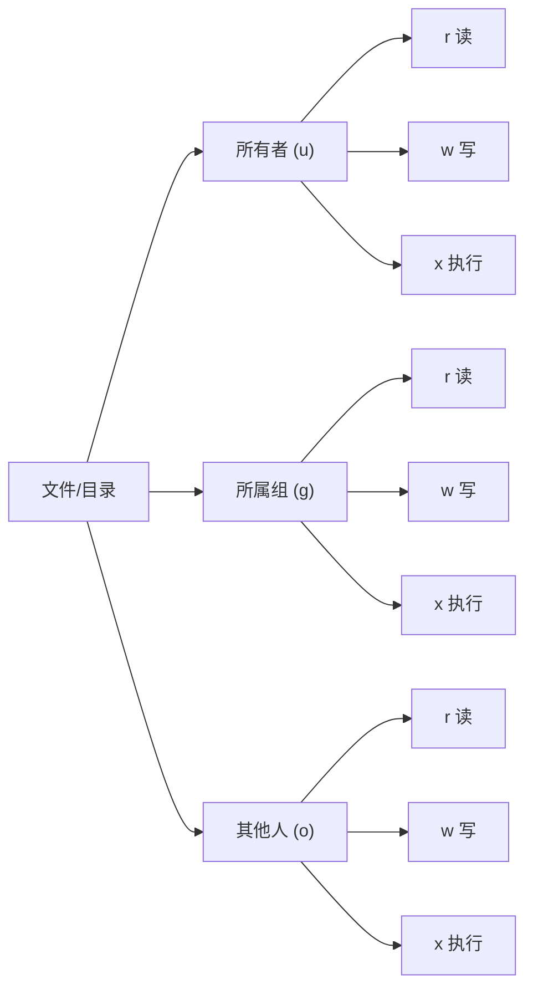
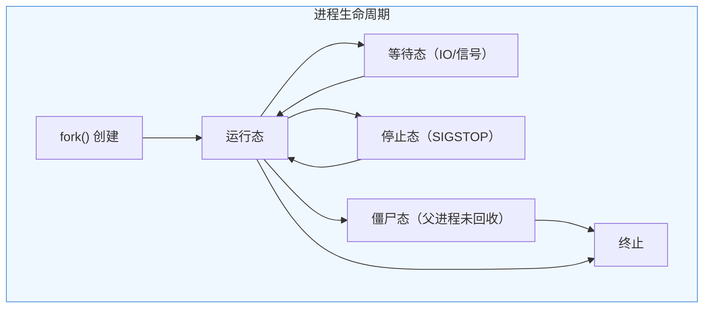

# Linux 基础：研发日常速查手册


> 💡 **核心认知**：Linux 一切皆文件。进程、设备、Socket、管道都是文件描述符。理解了这个抽象，大部分命令的逻辑就通了。

---

## 一、常用命令速查

### 文件与目录操作

| 命令 | 用途 | 研发高频用法 |
| :--- | :--- | :--- |
| `ls -lah` | 列出文件详情（含隐藏文件、人类可读大小） | 查看目录结构和文件大小 |
| `find /path -name "*.log" -mtime -1` | 查找最近 1 天修改的日志文件 | 定位最新日志 |
| `du -sh /path/*` | 查看各子目录占用空间 | 排查磁盘占满 |
| `df -h` | 查看磁盘分区使用情况 | 确认哪个分区满了 |
| `ln -s target link` | 创建软链接 | 配置切换、快捷方式 |
| `tar -czf archive.tar.gz dir/` | 压缩打包 | 备份、传输文件 |
| `scp file user@host:/path` | 远程复制文件 | 服务器间传文件 |

### 文本搜索与处理

| 命令 | 用途 | 研发高频用法 |
| :--- | :--- | :--- |
| `grep -rn "keyword" /path` | 递归搜索 + 显示行号 | ⭐️ 代码/日志关键词搜索 |
| `grep -rn "keyword" /path -C 5` | 匹配行前后各 5 行上下文 | ⭐️ 日志排查看调用链/堆栈 |
| `grep -v "exclude" file` | 反向匹配（排除） | 过滤无关日志行 |
| `awk '{print $1, $5}' file` | 按列提取 | 分析日志字段 |
| `sort \| uniq -c \| sort -rn` | 统计词频 Top N | 分析错误日志分布 |
| `sed 's/old/new/g' file` | 批量替换 | 配置文件修改 |
| `wc -l file` | 统计行数 | 确认日志量级 |
| `head -n 100 / tail -n 100` | 查看文件头/尾 | 快速预览大文件 |

> 💡 **awk 速记**：awk（Aho-Weinberger-Kernighan）是 Unix 下最强的按列处理器。字段序号从 `$1` 开始，`$0` 表示整行，`$NF` 表示最后一列。默认以空白符分列，`-F','` 可改为逗号分隔。研发高频用法：`awk '{print $1}'` 提取 IP、`awk '$9>=400'` 过滤错误请求、`awk '{count[$1]++} END {for(k in count) print count[k],k}'` 分组计数。比 `cut` 灵活，比 `sed` 直观，日志分析首选。

### 网络诊断

| 命令 | 用途 | 研发高频用法 |
| :--- | :--- | :--- |
| `curl -v http://host:port/path` | HTTP 请求调试 | ⭐️ 验证接口连通性 |
| `netstat -tlnp` / `ss -tlnp` | 查看监听端口和进程 | 确认服务是否启动 |
| `ping host` | 测试网络连通性 | 基础连通检查 |
| `telnet host port` | 测试 TCP 端口连通性 | 防火墙/安全组排查 |
| `dig domain` / `nslookup domain` | DNS 解析 | 域名解析问题排查 |

---

## 二、权限管理

### 权限模型图解



### 权限数字表示法

| 权限 | 二进制 | 数字 | 含义 |
| :--- | :--- | :--- | :--- |
| `rwx` | 111 | 7 | 读+写+执行 |
| `rw-` | 110 | 6 | 读+写 |
| `r-x` | 101 | 5 | 读+执行 |
| `r--` | 100 | 4 | 只读 |

```bash
# 常见权限设置
chmod 755 script.sh      # 所有者 rwx，其他人 r-x（可执行脚本）
chmod 644 config.yml     # 所有者 rw-，其他人 r--（配置文件）
chmod 600 id_rsa         # 仅所有者 rw-（私钥文件）
chown user:group file    # 修改所有者和所属组
```

### ⚠️ 常见踩坑

| 现象 | 原因 | 解决 |
| :--- | :--- | :--- |
| `Permission denied` | 当前用户无写/执行权限 | `ls -la` 检查权限，`chmod` 或 `sudo` |
| SSH 私钥登录失败 | 私钥权限过宽（非 600） | `chmod 600 ~/.ssh/id_rsa` |
| 容器内写入失败 | 挂载目录属主不匹配 | `chown` 或 Dockerfile 中 `USER` 指令 |
| `sudo` 仍需密码 | 未配置 NOPASSWD | `/etc/sudoers` 添加 `user ALL=(ALL) NOPASSWD: ALL` |

---

## 三、进程管理

### 核心概念



### 进程查看与定位

| 命令 | 用途 | 研发高频用法 |
| :--- | :--- | :--- |
| `ps aux \| grep java` | 查看所有 Java 进程 | ⭐️ 确认服务是否在运行 |
| `top -c` | 实时查看 CPU/内存 Top 进程 | 定位资源瓶颈 |
| `htop` | top 增强版（交互式） | 更直观的进程监控 |
| `lsof -i :8080` | 查看占用端口的进程 | ⭐️ 端口冲突排查 |
| `lsof -p <pid>` | 查看进程打开的文件 | 排查文件句柄泄漏 |
| `strace -p <pid>` | 跟踪进程系统调用 | 排查 IO/网络阻塞 |

### CPU 100% 排查流程

```bash
# 1. 找到 CPU 最高的进程
top -c                    # 记下 PID

# 2. 找到该进程中 CPU 最高的线程
top -Hp <pid>             # 记下 TID

# 3. 将 TID 转为十六进制
printf "%x\n" <tid>       # 例如 12345 → 3039

# 4. 导出线程堆栈并搜索
jstack <pid> > thread_dump.txt
grep -A 30 "nid=0x3039" thread_dump.txt   # Java 应用
```

### top 命令执行后各个列的参数含义

`top` 输出分为上下两部分：**汇总区（前 5 行）**和**进程列表区**。

#### 示例输出

```
top - 15:14:11 up 273 days, 22:26,  1 user,  load average: 0.13, 0.11, 0.14
Tasks: 127 total,   1 running, 126 sleeping,   0 stopped,   0 zombie
%Cpu(s):  1.0 us,  0.8 sy,  0.0 ni, 98.1 id,  0.1 wa,  0.0 hi,  0.0 si,  0.0 st
KiB Mem :  8008568 total,   600384 free,  2672856 used,  4735328 buff/cache
KiB Swap:        0 total,        0 free,        0 used.  5029060 avail Mem

  PID USER      PR  NI    VIRT    RES    SHR S  %CPU %MEM     TIME+ COMMAND
  910 root      20   0  184900  45572  15676 S   2.3  0.6   3055:35 /usr/local/aegis/...
 4765 admin     20   0 6341952   1.3g  24052 S   2.3 17.3   5:18.36 /usr/java/...
```

---

#### 第一行：系统概览

```
top - 15:14:11 up 273 days, 22:26,  1 user,  load average: 0.13, 0.11, 0.14
```

| 字段 | 含义 | 说明 |
| :--- | :--- | :--- |
| `15:14:11` | 当前系统时间 | — |
| `up 273 days, 22:26` | 系统已运行时长 | 273 天 22 小时 26 分，说明机器很稳定 |
| `1 user` | 当前登录用户数 | — |
| **`load average: 0.13, 0.11, 0.14`** | 系统负载（⭐ 最重要） | 1 分钟、5 分钟、15 分钟的平均负载 |

> ⚠️ **load average 怎么解读？** 这个值表示**可运行 + 不可中断睡眠（D 状态）的进程数**的平均值。不是 CPU 使用率！

| 负载值 vs CPU 核数 | 含义 |
| :--- | :--- |
| 负载 < CPU 核数 | ✅ 正常，有空闲 |
| 负载 = CPU 核数 | ⚠️ 刚好打满 |
| 负载 > CPU 核数 | ❌ 过载，进程在排队等 CPU |

上例中负载 0.13，如果机器是 4 核，说明非常空闲（只用了 3% 左右的算力）。**口诀：负载值跟 CPU 核数比，不是跟 1 比**。

---

#### 第二行：任务统计

```
Tasks: 127 total,   1 running, 126 sleeping,   0 stopped,   0 zombie
```

| 字段 | 含义 |
| :--- | :--- |
| `total` | 进程/线程总数 |
| `running` | 正在运行（或就绪等待 CPU）的进程数 |
| `sleeping` | 睡眠（等待 IO / 事件）的进程数，**大部分进程都是这个状态** |
| `stopped` | 被暂停的进程（收到 `SIGSTOP` 信号） |
| **`zombie`** | **⚠️ 僵尸进程**：已结束但父进程未调用 `wait()` 回收，不为 0 就要排查 |

> ⚠️ **zombie > 0 时排查**：`ps aux | grep Z` 找僵尸进程，再 `ps -o ppid= -p <僵尸PID>` 找到父进程，检查父进程为什么不回收子进程。

---

#### 第三行：CPU 使用率（⭐ 最重要的一行）

```
%Cpu(s):  1.0 us,  0.8 sy,  0.0 ni, 98.1 id,  0.1 wa,  0.0 hi,  0.0 si,  0.0 st
```

| 字段 | 全称 | 含义 | 上例解读 |
| :--- | :--- | :--- | :--- |
| **`us`** | user | 用户态 CPU 时间（应用代码） | 1.0% — 很正常 |
| **`sy`** | system | 内核态 CPU 时间（系统调用） | 0.8% — 正常 |
| `ni` | nice | 低优先级进程（被 nice 的）用户态 CPU | 0.0% — 无低优先级任务 |
| **`id`** | idle | 空闲 CPU | **98.1% — 机器很闲** |
| **`wa`** | iowait | 等待 IO 完成的时间 | 0.1% — 磁盘 IO 无瓶颈 |
| `hi` | hardware irq | 硬件中断处理 | 接近 0 正常 |
| `si` | software irq | 软件中断处理 | 接近 0 正常 |
| `st` | steal | 被虚拟机管理程序偷走的时间 | **0.0% — 非虚拟化环境/未被超卖** |

> 💡 **快速判断口诀**：
> - `id` 低 + `us` 高 → CPU 密集型任务，代码在拼命计算
> - `id` 低 + `wa` 高 → IO 密集型任务，CPU 在等磁盘/网络
> - `sy` 高 → 系统调用过多，可能是频繁上下文切换
> - `st` > 0 → **你在云主机上，宿主机超卖了！CPU 被隔壁虚拟机抢了**

---

#### 第四行：物理内存

```
KiB Mem :  8008568 total,   600384 free,  2672856 used,  4735328 buff/cache
```

| 字段 | 含义 | 上例解读 |
| :--- | :--- | :--- |
| `total` | 物理内存总量 | ≈ 8 GB |
| `free` | 完全未使用的内存 | ≈ 600 MB |
| `used` | 已使用的内存 | ≈ 2.7 GB |
| `buff/cache` | 缓冲区 + 页缓存 | ≈ 4.7 GB（**这是"可回收的内存"**） |

> ⚠️ **关键认知**：`free` 低不代表内存不够！Linux 会尽量用空闲内存做 **Page Cache**（缓存文件读写），这部分在需要时可以**立即释放**给应用使用。真正看内存是否够用的指标是下一行的 `avail Mem`。

---

#### 第五行：交换空间 + 可用内存

```
KiB Swap:        0 total,        0 free,        0 used.  5029060 avail Mem
```

| 字段 | 含义 | 上例解读 |
| :--- | :--- | :--- |
| `Swap total/free/used` | 交换分区总量/空闲/已用 | 全 0 — 未配置 swap |
| **`avail Mem`** | **⭐ 真正可用的内存** | ≈ 5 GB — `free` + 可回收的 `buff/cache` |

> 💡 **判断内存是否够用**：看 `avail Mem`，不是 `free`。公式粗略等于 `free + buff/cache`（可回收部分）。上例中 `free=600MB` 看起来很少，但 `avail=5GB`，实际还很充裕。

---

#### 进程列表区：各列含义

```
  PID USER      PR  NI    VIRT    RES    SHR S  %CPU %MEM     TIME+ COMMAND
  910 root      20   0  184900  45572  15676 S   2.3  0.6   3055:35 /usr/local/aegis/...
 4765 admin     20   0 6341952   1.3g  24052 S   2.3 17.3   5:18.36 /usr/java/...
```

| 列 | 含义 | 说明 |
| :--- | :--- | :--- |
| **`PID`** | 进程 ID | — |
| `USER` | 进程所属用户 | `root` 启动的进程需留意权限风险 |
| **`PR`** | 优先级（Priority） | 内核实际调度优先级，值越小优先级越高。实时进程显示 `rt` |
| **`NI`** | nice 值 （这个在进程管理笔记里有详细介绍） | -20（最高优先级）~ 19（最低），默认 0。`PR = 20 + NI`（普通进程） |
| **`VIRT`** | 虚拟内存（Virtual） | 进程申请的**全部**虚拟地址空间，包括代码、数据、共享库、已映射但未分配物理页的。**这个值通常很大，不要慌** |
| **`RES`** | 常驻内存（Resident） | 进程**实际占用的物理内存**（不包含 swap 出去的）。⭐ **看内存占用就认准 RES** |
| `SHR` | 共享内存（Shared） | 与其他进程共享的内存（如动态链接库 `.so`） |
| **`S`** | 进程状态 | 见下方状态码表 |
| **`%CPU`** | CPU 使用率 | 表示占**单核**的百分比。多核机器可能超过 100%（如 4 核最高 400%） |
| **`%MEM`** | 物理内存占比 | `RES / 物理内存总量` |
| `TIME+` | 累计 CPU 时间 | 进程自启动以来消耗的总 CPU 时间，不是持续运行时间。如 `3055:35` 表示累计跑了约 127 天 |
| `COMMAND` | 命令行 | — |

**进程状态码 `S`**：

| 状态 | 含义 | 说明 |
| :--- | :--- | :--- |
| **`R`** | Running | 正在运行或就绪（在运行队列中等待 CPU） |
| **`S`** | Sleeping（可中断） | 等待事件（IO、信号等），可被信号唤醒，**最常见** |
| **`D`** | Disk Sleep（不可中断） | 等待 IO 完成，**不可被信号中断**。`D` 状态多 → 磁盘 IO 是瓶颈 |
| **`Z`** | Zombie | 僵尸进程，已结束但父进程未回收 |
| **`T`** | Stopped | 被暂停（`SIGSTOP` 信号或 `Ctrl+Z`） |

> 💡 **RES 和 VIRT 的区别**：`VIRT` 是进程"声称需要的"虚拟内存，包含了代码段、堆、栈、mmap 映射文件、共享库等，可能远大于实际物理内存占用。`RES` 才是真实占用的物理内存。Java 进程 `VIRT` 动辄 6GB+ 非常正常（堆 + 栈 + mmap 文件 + jar 包映射等），**看内存占用只看 RES**。

---

#### 常用交互快捷键

| 按键 | 功能 |
| :--- | :--- |
| `1` | 展开/折叠每个 CPU 核心的使用率 |
| `c` | 显示完整的命令行 |
| `M` | 按内存使用率排序 |
| `P` | 按 CPU 使用率排序 |
| `E` | 切换内存单位显示（KB → MB → GB） |
| `k` | 杀死进程（输入 PID + 信号） |
| `q` | 退出 |


### 进程控制信号

| 信号 | 编号 | 作用 | 使用场景 |
| :--- | :--- | :--- | :--- |
| `SIGTERM` | 15 | 优雅终止（默认 kill） | 正常停止服务 |
| `SIGKILL` | 9 | 强制杀死（不可捕获） | 进程卡死无法响应 |
| `SIGHUP` | 1 | 重载配置 | Nginx reload |
| `SIGSTOP` | 19 | 暂停进程 | 调试时冻结进程 |
| `SIGCONT` | 18 | 恢复进程 | 配合 SIGSTOP |

```bash
kill -15 <pid>            # 优雅停止（推荐）
kill -9 <pid>             # 强制杀死（最后手段）
kill -HUP <pid>           # 重载配置
```

> ⚠️ **生产纪律**：**永远先 `kill -15`，等 30 秒无响应再 `kill -9`**。`kill -9` 不会触发应用的 shutdown hook，可能导致数据丢失、连接未释放。

---

## 四、日志排查三板斧

### 第一板斧：tail + grep 实时追踪

```bash
# 实时追踪日志 + 关键词过滤
tail -f /var/log/app/application.log | grep -i "error\|exception"

# 追踪最近 500 行 + 持续输出
tail -n 500 -f /var/log/app/application.log

# 多文件同时追踪
tail -f /var/log/app/*.log | grep "order-service"
```

### 第二板斧：grep + awk 统计分析

```bash
# 统计错误类型 Top 10
grep "ERROR" app.log | awk '{print $5}' | sort | uniq -c | sort -rn | head -10

# 统计每小时请求量
awk '{print substr($1,1,13)}' access.log | sort | uniq -c

# 提取特定字段（如 IP、状态码）
awk '{print $1, $9}' access.log | sort | uniq -c | sort -rn | head -20

# 查找时间范围内的日志
sed -n '/2026-08-19 10:00/,/2026-08-19 10:30/p' app.log
```

### 第三板斧：journalctl 系统日志

```bash
# 查看某个服务的日志
journalctl -u order-service --since "1 hour ago"

# 实时追踪
journalctl -u order-service -f

# 查看启动失败原因
journalctl -u order-service -b          # 上次启动的日志
systemctl status order-service          # 查看服务状态和最近日志
```

### 日志排查决策树

```
线上出问题
├── 知道关键词？ → grep -rn "keyword" /var/log/
├── 不知道关键词？
│   ├── 看最近日志 → tail -n 500 app.log
│   ├── 看错误统计 → grep ERROR | sort | uniq -c
│   └── 看系统日志 → journalctl -u service
├── 怀疑性能问题？ → top + jstack / perf
└── 怀疑网络问题？ → curl + netstat + dig
```

> 💡 **黄金法则**：**先看日志，再看监控，最后看代码**。90% 的线上问题能在日志里找到直接线索。

---

## 五、面试高频问题速答

### Q1：Linux 权限 755 和 644 有什么区别？

755 = `rwxr-xr-x`：所有者可读写执行，其他人可读和执行。适用于**可执行文件和目录**（目录需要 x 权限才能进入）。
644 = `rw-r--r--`：所有者可读写，其他人只读。适用于**普通文件和配置文件**。

### Q2：如何排查 CPU 100% 的问题？

四步法：`top` 找进程 → `top -Hp` 找线程 → TID 转十六进制 → `jstack` 导出堆栈搜索对应线程。如果是死循环会在堆栈中看到重复的调用栈；如果是锁竞争会看到 BLOCKED 状态。

### Q3：SIGTERM 和 SIGKILL 的区别？

SIGTERM（15）是优雅终止信号，应用可以捕获并执行清理逻辑（关闭连接、刷盘、释放锁）。SIGKILL（9）由内核直接杀死进程，应用无法捕获，不会执行任何清理。**生产环境永远先 SIGTERM，超时后再 SIGKILL**。

### Q4：如何快速定位磁盘空间不足的原因？

```bash
df -h                              # 确认哪个分区满了
du -sh /* 2>/dev/null | sort -rn   # 找到最大的顶层目录
du -sh /var/log/* | sort -rn       # 逐层深入定位
lsof +L1                           # 查找已删除但未释放的文件（最常见陷阱）
```

> 💡 **记忆口诀**：**权限看 ls -la，进程看 top + ps，日志看 tail + grep，磁盘看 df + du，网络看 curl + ss**。

---

## 小结

本篇从研发视角覆盖了 Linux 日常必备技能：

- **常用命令**：文件操作、文本搜索、网络诊断三类高频命令
- **权限管理**：数字表示法 + 常见踩坑场景
- **进程管理**：查看定位、CPU 排查流程、信号控制
- **日志排查**：三板斧 + 决策树
- **面试速答**：权限、CPU、信号、磁盘四个高频问题

> 💡 **研发日常**：不需要成为 Linux 专家，但必须能独立完成"服务起不来→看日志→定位原因→修复"这个闭环。以上命令覆盖了这个闭环的 90% 场景。
