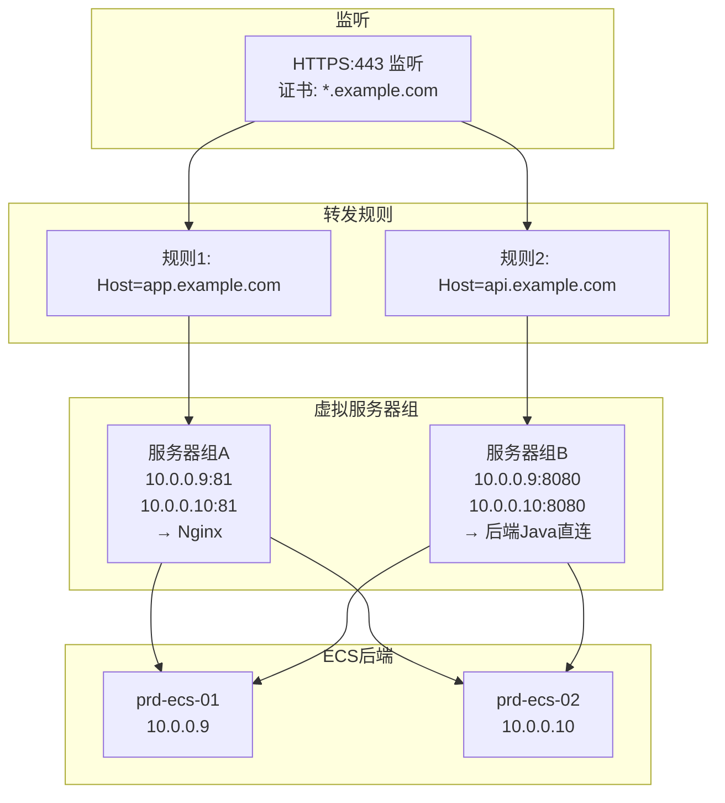
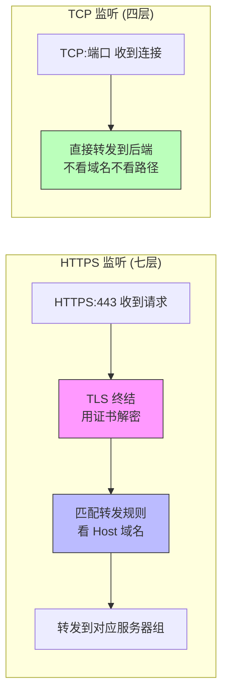
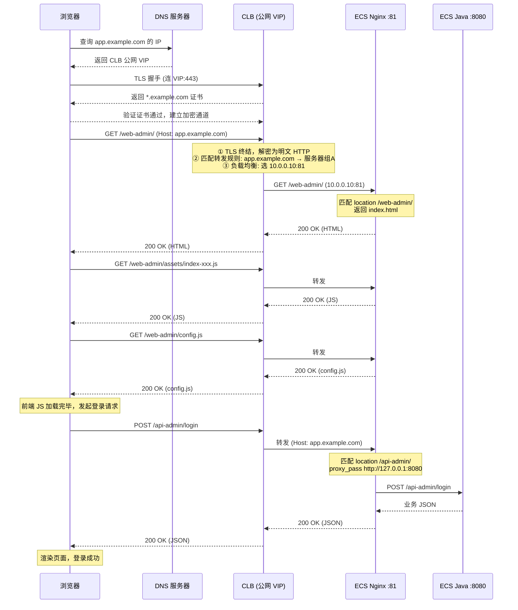
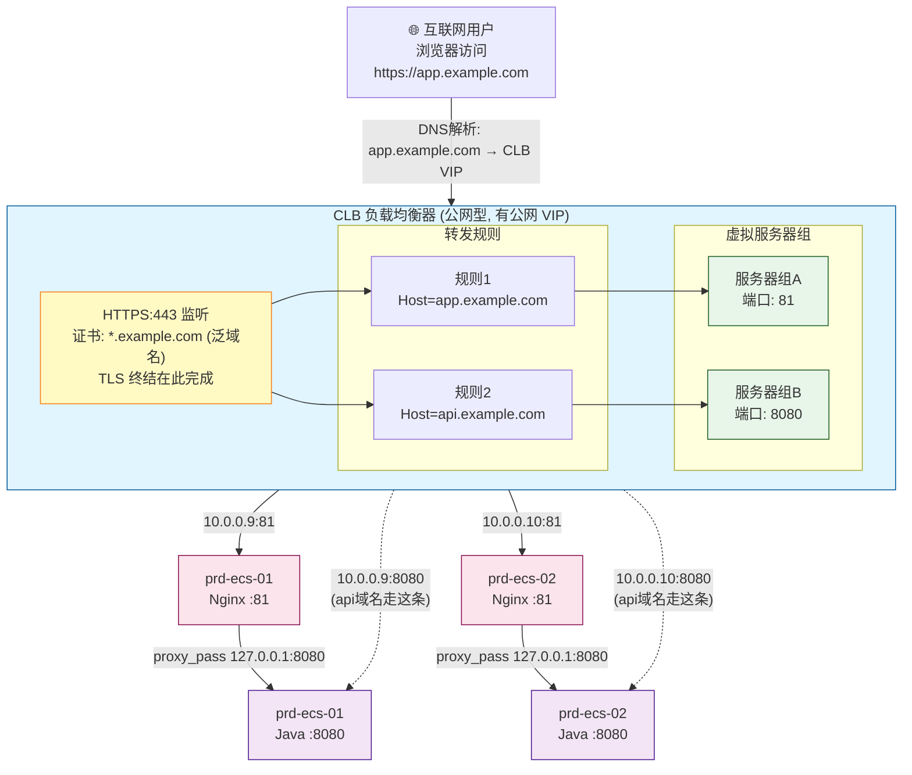

# 阿里云 CLB 负载均衡 知识笔记

> 整理自生产环境部署过程中的交流，结合实际项目 `app.example.com` 为例。

---

## 一、域名层级关系

```
.com                        ← 顶级域名 (TLD)
example.com                 ← 二级域名
*.example.com               ← 泛域名（覆盖所有三级域名）
app.example.com             ← 三级域名（生产环境）
app-qa.example.com          ← 三级域名（QA 环境）
```

- `*.example.com` 泛域名证书可覆盖所有三级域名，**一个证书搞定全部子域名**
- 证书配在**监听**上，不是配在转发规则上

---

## 二、CLB 是什么

CLB（传统型负载均衡）是阿里云的**独立组件**，不是装在 ECS 上的软件。

### 2.1 CLB 的公网 IP

公网型 CLB 自带一个独立的公网 IP（VIP），DNS 的 A 记录（一般情况下你可以在云解析 DNS 控制台找到一条 A 记录）指向它：

```
DNS: app.example.com  →  A记录  →  CLB 公网 IP (VIP)
```

- CLB 是独立资源，有自己的公网 IP
- 后端 ECS **不需要公网 IP**，只有内网 IP（如 `10.0.0.9`）
- 公网 IP 可以是创建 CLB 时自动分配的，也可以后绑 EIP（弹性公网 IP）
- CLB 分**公网型**（接互联网流量）和**私网型**（VPC 内部负载均衡）两种

### 2.2 CLB 的定位

```
              ┌─────────────┐
  互联网 ───→ │     CLB      │  ← 独立组件，有公网 IP，做 TLS 终结 + 负载均衡
              └──────┬──────┘
                     │ 内网转发
              ┌──────┴──────┐
              ↓              ↓
        ┌─────────┐   ┌─────────┐
        │  ECS-1  │   │  ECS-2  │   ← 只有内网 IP，无公网 IP
        └─────────┘   └─────────┘
```

---

## 三、CLB 四大核心概念

以生产环境 `app.example.com` 为例，从上到下四层：

### 3.1 概念总览

```
监听 (Listener)          —— 定义 CLB 怎么收流量（协议+端口+证书）
  └── 证书 (Certificate)  —— HTTPS 监听必须配，做 TLS 握手
  └── 转发规则 (Rules)     —— 根据域名/路径决定转发到哪个后端组
        └── 虚拟服务器组 (VSG) —— 一组后端 ECS，CLB 在组内负载均衡
```

### 3.2 监听 (Listener)

**定义 CLB 在什么协议、什么端口接收流量。**

| 配置项 | 生产环境值 |
| --- | --- |
| 前端协议 | HTTPS |
| 前端端口 | 443 |
| 后端协议 | HTTP |
| 后端端口 | 81 |
| SSL 证书 | `*.example.com` 泛域名证书 |

监听就是 CLB 在 443 端口"听"着，收到 HTTPS 请求后用证书做 TLS 终结（解密），然后把明文 HTTP 转发到后端的 81 端口。

### 3.3 证书 (Certificate)

**HTTPS 监听必须配证书，用于 TLS 握手时向浏览器证明身份。**

- 一个 CLB 可以关联**多个证书**
- 可以配一个 `*.example.com` 泛域名证书覆盖所有三级域名
- 也可以为不同域名配不同证书（通过 SNI 机制，CLB 根据浏览器请求的域名动态返回对应证书）
- 生产场景：一个 `*.example.com` 证书就够了

### 3.4 转发规则 (Forwarding Rules)

**根据请求的域名或路径，决定转发到哪个后端服务器组。**

一个 HTTPS 监听可以配**多条转发规则**，按域名区分流量：

```
HTTPS:443 监听
  │
  ├── 规则1: Host = app.example.com  →  虚拟服务器组 A (端口 81)
  │
  └── 规则2: Host = api.example.com  →  虚拟服务器组 B (端口 8080)
```

### 3.5 虚拟服务器组 (Virtual Server Group)

**一组后端 ECS 实例的集合，CLB 在组内做负载均衡。**

生产环境的两个服务器组（同样机器、不同端口）：

```
虚拟服务器组 A（app.example.com）:
  ├── 10.0.0.9:81    (prd-ecs-01, Nginx)
  └── 10.0.0.10:81   (prd-ecs-02, Nginx)

虚拟服务器组 B（api.example.com）:
  ├── 10.0.0.9:8080   (prd-ecs-01, 后端 Java 直连)
  └── 10.0.0.10:8080  (prd-ecs-02, 后端 Java 直连)
```

### 3.6 四大概念关系图



---

## 四、HTTPS 监听 vs TCP 监听

| 对比项 | HTTPS 监听（七层） | TCP 监听（四层） |
| --- | --- | --- |
| 工作层级 | L7（应用层） | L4（传输层） |
| TLS 终结 | CLB 上做（需要证书） | 不做（透传原始 TCP 流） |
| 能看 HTTP 头 | 能（Host、Path） | 不能 |
| 转发规则 | ✅ 有（按域名/路径分发） | ❌ 没有 |
| 证书管理 | ✅ 有 | ❌ 没有 |
| 可用菜单 | 修改监听配置、配置转发策略、管理证书 | 只有修改监听配置 |

TCP 监听是"傻瓜转发"：收到某个端口的 TCP 连接，直接丢给后端 ECS 的指定端口，不关心域名和路径。所以它不需要转发规则（无法区分域名），也不需要证书（不做 TLS 解密）。



---

## 五、完整请求链路

以 `https://app.example.com/web-admin/` 为例，从用户打开浏览器到后端响应的全过程：



### 文字版步骤

```
 1. 浏览器输入 https://app.example.com/web-admin/

 2. DNS 解析
    app.example.com → A 记录 → CLB 公网 VIP
    （在 DNS 控制台配置的域名解析记录）

 3. TLS 握手
    浏览器 → CLB VIP:443
    CLB 返回 *.example.com 证书
    浏览器验证域名匹配 → 建立加密连接

 4. 发送 HTTP 请求
    GET /web-admin/ HTTP/1.1
    Host: app.example.com

 5. CLB 匹配转发规则
    Host: app.example.com → 命中规则1 → 服务器组A (81端口)

 6. CLB 负载均衡到后端
    在 10.0.0.9:81 和 10.0.0.10:81 之间选一台
    假设选中 10.0.0.10:81

 7. Nginx 收到请求
    匹配 location /web-admin/ → 返回 index.html

 8. 浏览器渲染页面
    加载 /web-admin/assets/index-xxx.js
    加载 /web-admin/config.js

 9. 前端发起接口请求
    POST /api-admin/login
    → CLB → 转发规则 → 服务器组A → Nginx
    → location /api-admin/ → proxy_pass http://127.0.0.1:8080
    → 后端 Java 处理 → 返回 JSON
```

---

## 六、生产环境 CLB 配置全貌



### 两条路径对比

| | `app.example.com`（前端 + Nginx 反代） | `api.example.com`（直连后端） |
| --- | --- | --- |
| CLB 转发到 | 服务器组 A（81 端口） | 服务器组 B（8080 端口） |
| 到达 | Nginx | Java 后端直连 |
| Nginx 再转发 | `proxy_pass http://127.0.0.1:8080` | 无（直接到后端） |
| 用途 | 前端页面 + 接口反代 | 后端接口直连（不走 Nginx） |

---

## 七、关键问答速查

**Q: 域名是怎么到 CLB 的？**
DNS 控制台配了 A 记录，把域名指向 CLB 的公网 VIP。浏览器先查 DNS 拿到 VIP，再连 CLB。

**Q: CLB 需要单独的公网 IP 吗？**
需要。公网型 CLB 自带一个公网 VIP，DNS 指向它。后端 ECS 不需要公网 IP。

**Q: 一个 443 监听能配多条转发规则吗？**
能。一个 HTTPS:443 监听可以配多条域名/路径转发规则，每条转发到不同的虚拟服务器组。

**Q: 证书配在哪？**
配在**监听**上（HTTPS 监听必须关联证书），不是配在转发规则上。转发规则只管"根据域名选哪个服务器组"，证书管"TLS 解密"。

**Q: 一个 CLB 能配多少证书？**
可以关联多个。配一个 `*.example.com` 泛域名证书就能覆盖所有三级域名，也可以通过 SNI 为不同域名配不同证书。

**Q: TCP 监听为什么没有转发规则和证书菜单？**
TCP 是四层监听，只做端口到端口的透传，不看 HTTP 头（无法区分域名），不做 TLS 终结（不需要证书）。只有 HTTPS（七层）监听才有这些功能。

**Q: proxy_pass 为什么必须用 127.0.0.1？**
后端 Java 启动参数 `pandora.accept.foreign.ip=false`，只接受本机请求。用 `127.0.0.1` 是本机回环地址，用内网 IP 会被拒绝。

---

## 八、涉及的阿里云控制台操作位置

| 操作 | 路径 |
| --- | --- |
| 查看 CLB 列表 / VIP | 负载均衡 CLB → 实例管理 |
| 配置监听 | CLB 实例 → 监听 → 修改监听配置 |
| 配置转发规则 | CLB 实例 → 监听 → 配置转发策略 |
| 管理证书 | CLB 实例 → 监听 → 管理证书 |
| 配置虚拟服务器组 | CLB 实例 → 后端服务器 → 虚拟服务器组 |
| 配置 DNS 解析 | 云解析 DNS → 域名解析 → 添加记录 |

---

## 九、CLB / ALB / NLB 区别速览

阿里云负载均衡有三种类型，另有 GWLB 面向网络设备，与应用部署无关。

| | **CLB**（传统型） | **NLB**（网络型） | **ALB**（应用型） |
| --- | --- | --- | --- |
| 工作层级 | L4 + L7 | L4（传输层） | L7（应用层） |
| 架构 | 基于物理机 | NFV 虚拟化 | NFV 虚拟化 |
| 弹性伸缩 | 需手动调规格 | 自动伸缩 | 自动伸缩 |
| 转发能力 | 按域名/URL 转发 | 端口到端口透传 | 按 Header/Cookie/路径/方法路由 |
| 证书 | HTTPS 终结 | TCPSSL 终结 | HTTPS 终结 |
| 后端类型 | ECS、ENI、ECI | ECS、ENI、ECI、IP | ECS、ENI、ECI、IP、函数计算 |
| 性能 | 100 万并发 / 5 万 QPS | 1 亿并发 | 100 万 QPS |
| 云原生 | 弱 | 弱 | 强（Ingress 网关、灰度发布、蓝绿） |
| 特殊协议 | 基础 TCP/UDP/HTTP | TCPSSL | QUIC、gRPC |

**一句话选型：**

- 普通 Web 网站，按域名/URL 分发 → **CLB**（够用，本项目用的就是）
- 亿级并发连接（物联网、车联网）→ **NLB**
- 精细化七层路由（灰度发布、Header 路由、Serverless）→ **ALB**

> GWLB（网关型）工作在 L3，面向防火墙/入侵检测等网络设备，不做应用层负载均衡，和应用部署无关。
